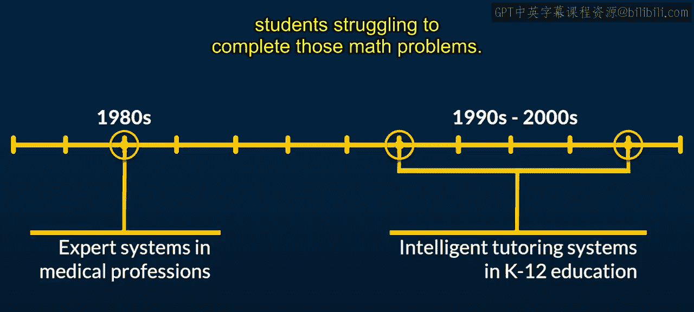
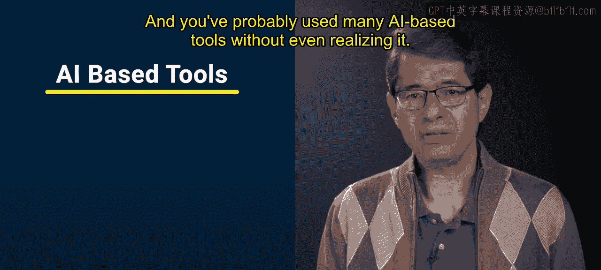
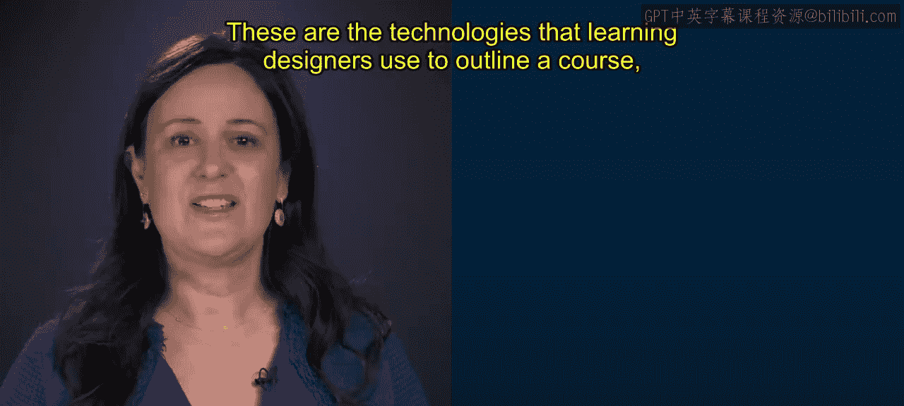
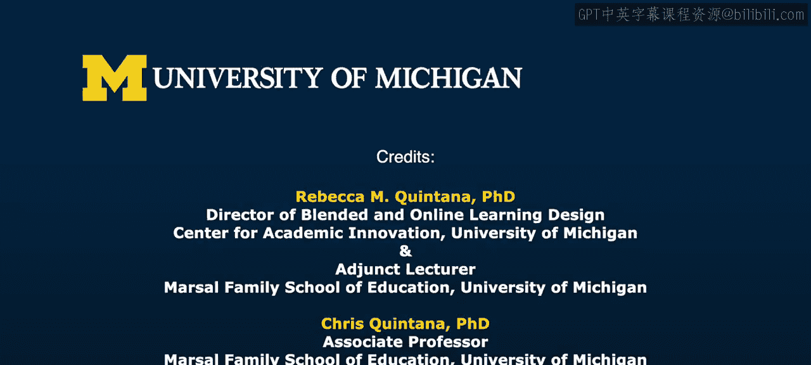

# 密歇根大学《生成式AI作为学习设计伙伴（3课全）｜Generative AI as a Learning Design Partner》中英字 - P4：3_面向学习专业人士的生成式人工智能.zh_en - GPT中英字幕课程资源 - BV147xgeaEGJ

Before we move forward with the specifics of generative AI for learning design。

 we will take a brief moment here to say what we mean by Gen AI。

We've been hearing so much about generative AI that it might seem like artificial intelligence is a new topic。

 or that the current wave of AI tools are the first generation of AI tools that are available。

But AI is most definitely not a new topic。Artificial intelligence research has been continuing for 60 years or so。

 and it has resulted in different tools that people can use for work and education。

We've seen tools like expert systems that try to encompass knowledge about a given discipline so practitioners could query the system for help。

For example， in the 1980s we saw expert systems in the medical profession that could be used to augment the diagnostic work of doctors in the 1990s and 2000s we saw intelligent tutoring systems used in K12 education that could gauge the work students are doing in algebra。

 for example， and then provide hints and guidance when they observe students struggling to complete those math problems。

And you've probably used many AI based tools without even realizing it。

Grammar checkers and word processors， parking assist in our cars， smart thermostats in our homes。

 These all have a measure of AI。Now， as we talk about generative AI。

 what kinds of tools do we mean and what will we be using throughout this series？

When we say generative AI， we mean an artificial intelligence tool that is capable of generating some artifact；

 it can generate text， images， videos， or other types of data。

It will generate those artifacts in response to prompts given by a user。

GAI tools can also learn patterns and structure as information is provided to it。

As it gains access to more information and continues to learn about that information。

It will improve the output it provides。There are many types of GenAI tools。

 but two that we are gaining more access to include large language models or LLMs and large action models or LAAMs。

ChatGPT is an example of a large language model。LLMs are statistical models that learn patterns about language。

When we prompt the LLM， it will generate text from its current model to try and answer our prompt。

As we give an LOM more information， it will use that information to recognize patterns and develop more statistical relationships to refine its model。

Large action models are similar， but they are more focused on taking some sort of action and interacting with the world。

A large action model can analyze data and then make a decision。

Or they can control smart devices like your home thermostat based on information about your home。

Or it can automate tasks for you。For our purposes， we will focus on LLMs and tools like chatGPT。Now。

 while we might focus on ChaGPT here， there are many other available tools that we encourage you to experiment with as you explore generative AI for learning design。

And。As usually happens when we discuss technology， things can change fast。

 so there may be a number of new LLMs available by the time you view this。

It is important to note that there are tools similar to LLMs that can generate other media types。

 like images。Sometimes you'll see these tools referred to as using diffusion models。For instance。

 Open AI incorporated Dli to generate images in response to your text prompts。

Some LLMs are also starting to generate images along with text。

Even though these types of tools are all technically different。

 we can refer to them under the generative AI umbrella。

As we use a library of tools that can generate text， images， audio， video， and even computer code。

So why are we thinking about generative AI in the context of learning design？

While we can think about two ways that learning designers use technology as part of their practice。

 the first way is to identify and integrate technologies for learners to use as part of a larger learning experience。

These are the technologies that learners themselves use to interact with content。

 other learners and their instructor， as well as to show what they know。

The second way is for learning designers to design and develop learning experiences。

 using technology as part of professional practice。

These are the technologies that learning designers use to outline a course， create digital materials。

 manage a project， and so on。

In this course， we are focusing on the use of generative AI within the second category。

 allowing learning designers to augment their practice。

When we think about the role of large language models。

 we should recall that they excel at understanding and generating human language。

 they can hold natural conversations， generate content。

 and summarize large quantities of textual information。Since LLMs can hold natural conversations。

 it might be helpful to think of them as chatbots， using them to answer questions， give feedback。

 and propose ideas and suggestions for a course design。Since LLMs Excelel at generating content。

 learning designers can use them to prepare drafts。And since they are able to process human language。

 learning designers can provide textual input in various forms to help shape desired output。

Since LLMs are adept at sifting through large amounts of text。

 learning designers can use them to review content， provide a summary。

 and condense material as needed。So we hope this gives you some historical context related to AI tools in general and a high level explanation of what large language models are and what they can do。

We also hope we've shown you a glimmer of how learning designers can use LLMs as a tool for professional practice to prepare for our subsequent discussions。

