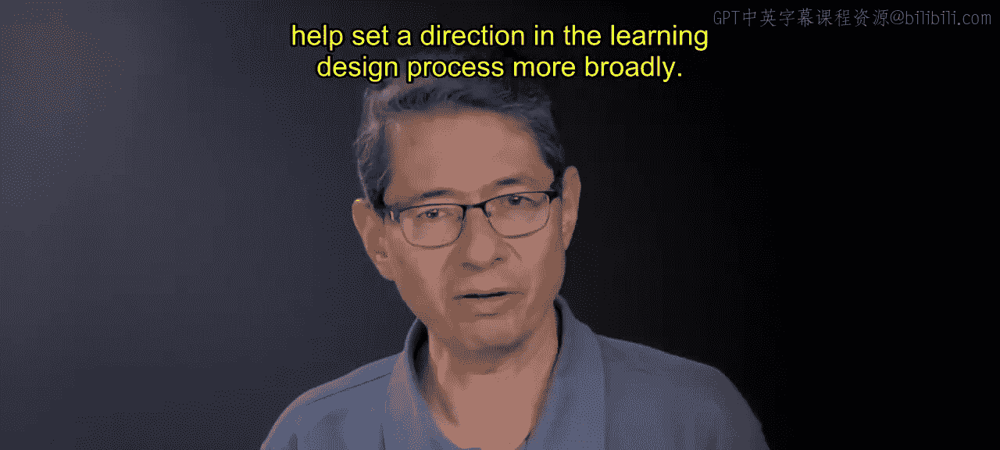
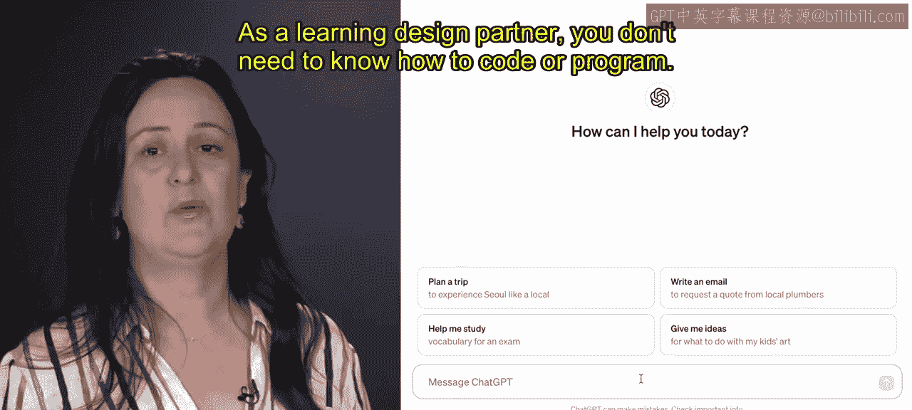
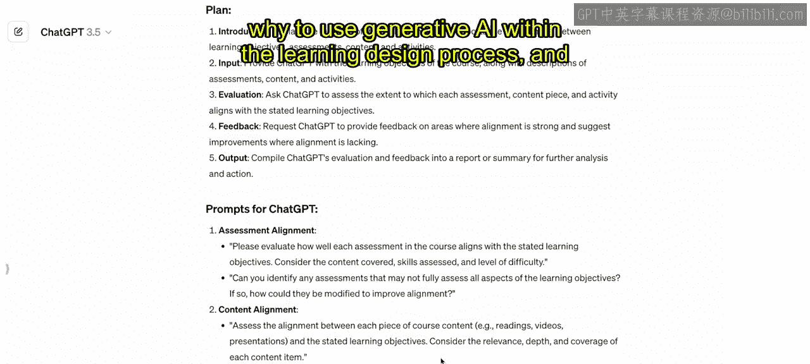
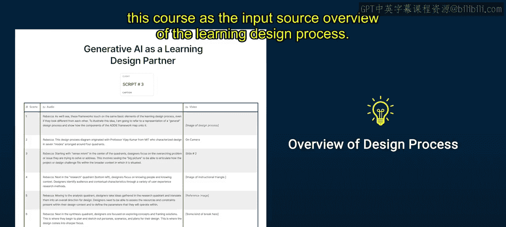
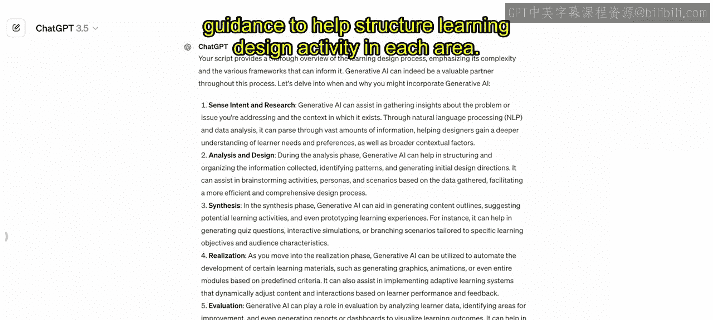
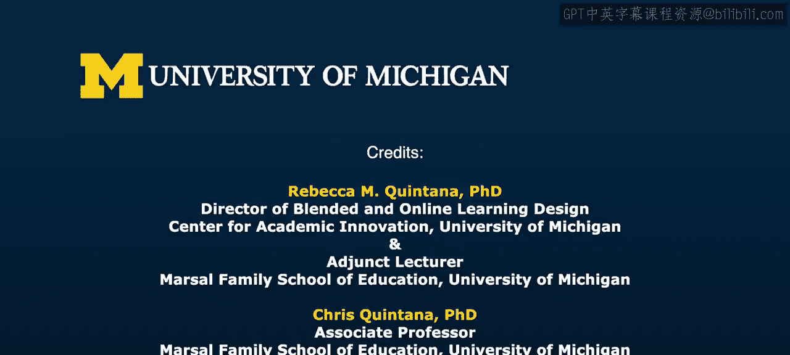

# 密歇根大学《生成式AI作为学习设计伙伴（3课全）｜Generative AI as a Learning Design Partner》中英字 - P7：6_设计过程中的机遇.zh_en - GPT中英字幕课程资源 - BV147xgeaEGJ

We have already spent some time examining where generative AI could be used within our learning design processes。

 we have identified several early phase design tasks along with tasks in later phases where generative AI could be a useful partner in the design process。

As you consider how you might engage Jeninner to AI as a learning design partner。

It will be important to be strategic in your approach。

 Your objective should not be to use generative AI to replace your role in responsibility as the learning designer。

But rather， you should consider ways to use it to get started， get unstuck and improve your practice。

 One way to think about the when and why to use Gen AI could be to use it to give you a boost for tasks that you find challenging or tedious。

You want to be able to focus on parts of your work that give you the most joy and satisfaction。

And you also want to be able to explain the rationale behind your work。

 including everything that you do with generative AI， to project stakeholders。

 so it is important to be measured in your approach before jumping right in。At this point。

 we wanted to provide a demonstration of how generative AI could be used as a learning design partner。

And rather than demonstrating a specific learning design task here。

We thought we would show how generative AI can provide inspiration or help set a direction in the learning design process more broadly Let's start with a scenario and then a question You can provide some information about your role and your interest in the topic of generative AI as a learning design partner。

You don't need to know how to code or program， think of it as having a conversation。

Hello Cha GPT I am a seasoned learning experienced designer， but I am new to using generative AI。

 I am interested in the idea that chat GPT could serve as a partner for my learning design practice Can you help me think about some potential use cases。

Even with that pretty basic prompt， Chat GPT provided a robust list of options。

 but some are more useful than others。Some of the generated ideas relate to how learners could interact with generative AI。

 and others relate to tasks specific to a learning designer。When this happens。

 you can try stating the question again or asking for more detail。

Something like this Can you please provide some additional ideas for how I as a learning designer could use chat GT to design and plan a course These options look a little closer to what we are looking for。

If any of the provided options are particularly intriguing。

 you could follow up and ask chat GPT to expand further on that idea。

 something like I am particularly interested in alignment with learning objectives Could you help me create a plan or set of prompts for chat GPT to evaluate the alignment of course learning objectives with course assessments。

 content and activities？Chat GPT provided a concrete set of steps and prompts for a learning designer to use to ensure alignment with objectives Now。

 let's see if we can return to our original question about the when and why to use generative AI within the learning design process。

And here it might be helpful to provide the tool with more information about how we conceptualize the learning design process。

For the purposes of this example， we are going to input one of our scripts from this course as the input source overview of the learning design process。

For this， let's start a new chat。We can save the one that we just finished。

Can you help me think about when and why to use generative AI in the learning design process？

I am going to share some of my thoughts about design generally and how I see one learning design model mapping onto that process in the form of a script that I wrote。

After entering the prompt and pasting in the script， we see some useful results here。

 along with some general guidance about the benefits and potential cautions about using generative AI in the learning design process。

You can use some or all of the results according to Kumar's general design process to help guide your thinking around research。

 analysis and design， synthesis， realization， and evaluation。From there。

 you could drill down into each category and ask for additional ideas and guidance to help structure learning design activity in each area。

It's important to remember that you can rephrase questions， ask for more detail， ask for less detail。

 drill down， reorganize results， and so on you can save chats and start new ones。

Generative AI can generate a lot of content， which can be overwhelming at times。

 so you might also want to copy particularly promising ideas into your own digital note taking space so that those important ideas are not lost。

We hope this brief demonstration has given you some ideas for how to get started with considering generative AI as a learning design partner。

We encourage you to give the activity we just demonstrated a try with your own questions and phrasing。

You'll see that you may get similar or different results from ours。

 and we will be interested to hear your thoughts on what you plan to start， stop。

 and continue doing with these tools later on in the course。

