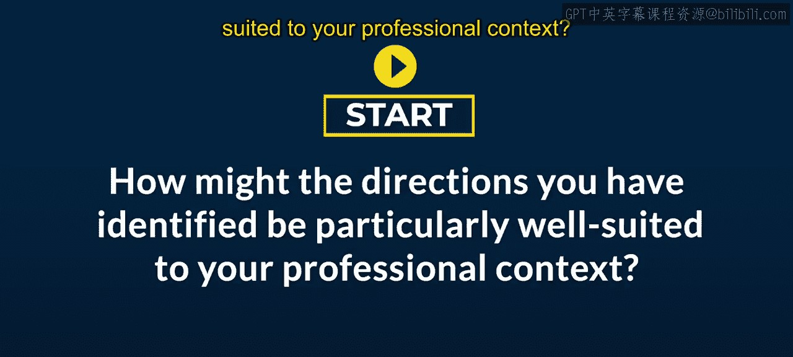
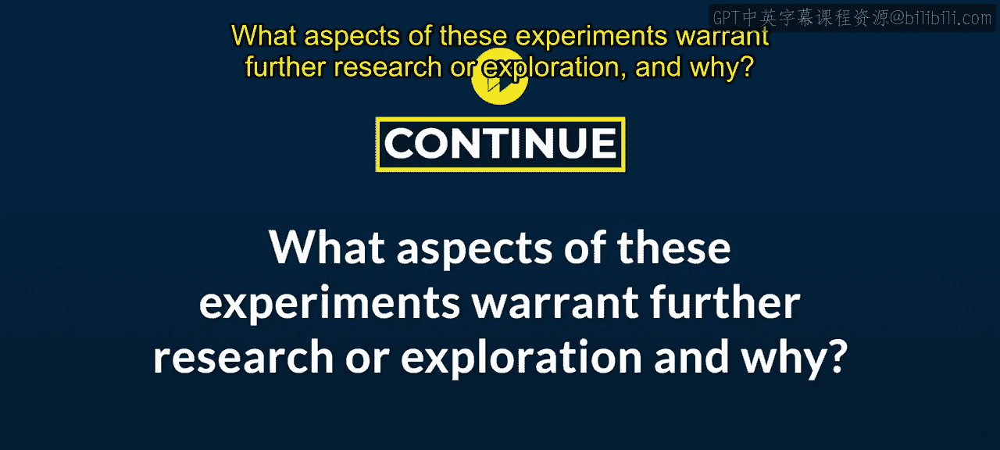
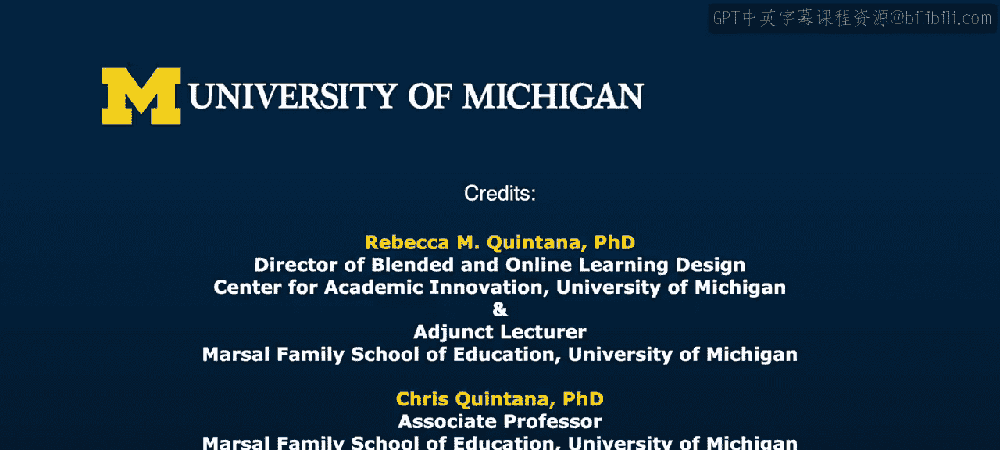

# 密歇根大学《生成式AI作为学习设计伙伴（3课全）｜Generative AI as a Learning Design Partner》中英字 - P8：7_深入思考.zh_en - GPT中英字幕课程资源 - BV147xgeaEGJ

Throughout this course， we have considered how generative AI can be leveraged as a learning design partner。

Recognizing that you operate within unique professional contexts。

 we wanted to give you an opportunity to reflect on what you have learned and to consider where you might apply these ideas in your own work。

To guide your reflection， we would like to provide a basic structure to organize your thinking。

As learning professionals， you may have heard of the start， stop， continue model。

Instructors often use this method to organize student feedback about what is working and what is not working in a learning situation。

We'd like to use these categories slightly differently as a way to spark your thinking about how you might leverage generative AI as a learning design partner。

Let's begin with start。 We have thought about ways that generative AI could be used in the early phases of design。

 such as to draft learner personas， course outlines， learning objectives and more。😊。

Any task that learning designers would typically provide drafting support for could be considered in this category。

We have also thought about ways that generative AI could be used in the later phases of design。

 such as to polish or revise drafts or to review course content from a particular perspective。

 such as through an equitable and inclusive design lens。For this start section。

 ask yourself the following questions。 What promising ideas have you heard that you' like to try。

Which of these would you prioritize and why？How might the directions you have identified be particularly well suited to your professional context？

Now， let's consider stop。We have considered what learning design tasks might be particularly well suited for generative AI to support。

 but there might be learning design tasks that are best handled by a learning professional directly。

We have also discussed the hype cycle that tools like generative AI could fall into。

 including initial enthusiasm that wanes and turns to disillusionment。

Learning designers may have to navigate differing views from stakeholders on the use of these tools for course and program development。

The word stop can also be thought of as caution。Ask yourself the following questions to guide your reflection in this section。

What concerns do you have about leveraging generative AI as a learning design partner？

What parts of your professional practice give you pause in terms of the use of generative AI。

 what motivates your concern or caution？Finally， let's examine and continue。

If you're taking this course， you may have already begun experimenting with generative AI to support your professional practice。

Or you may be working alongside colleagues who have begun to experiment with these tools。

You maybe have even heard from peers in this course about experimentation they are doing in the discussion forums。

Ask yourself the following questions。What aspect of your experimentation or that of your colleagues do you find most promising and why？

What aspects of these experiments weren't further research or exploration and why？

We are looking forward to hearing from you and seeing how you are currently thinking about generative AI as a learning design partner。

