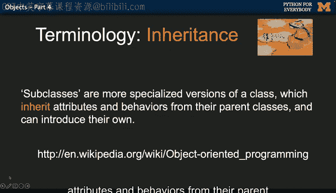
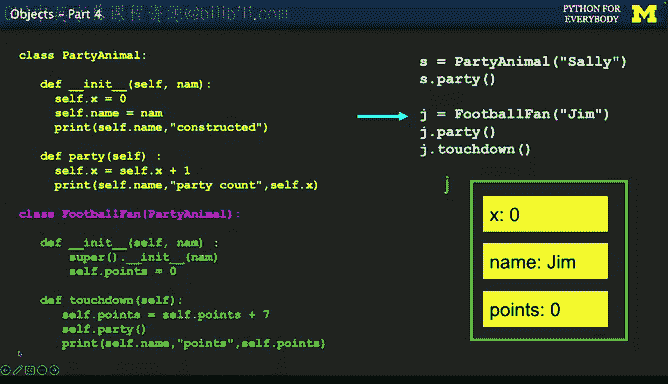
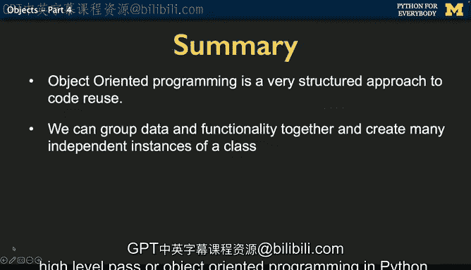

# 密歇根大学《给所有人的Python课》课程4：《使用数据库进行Python编程》｜python-databases｜ - P10：10_01_04_对象继承.zh_en - GPT中英字幕课程资源 - BV1PP411W7H1

Now we're going to talk about inheritance。I'm going to guess that among all the things I've talked about。

Inheritance is going to be the part where you go like， hm， I don't get it。 that's fair。

 Just don't get it。It turns out that when it's all said and done。

 this is one of the most powerful capabilities， and it has to do with。Store and reuse。

 and don't repeat yourself。 we as programmers hate risk saying the same thing over and over again。嗯。

Like in ajango model， which is a future class， every a whole bunch of different objects need a date and a time of create date and an update date。

 Do I want to type create date and update in 40 places or just extend a base class called the date stuff。

And so emitates a balance， and it's a bit art form， but it is a form of store and reuse and avoiding。

Just pasting over and over。 So every time you're coding and you're pasting over and over。

 you're like， man， what if I want to change all this stuff and I got 40 places I just pasted this code in。

 and what if I mistype the word create， right and created at like a date or something。

So we like to not repeat ourselves， so back to inheritance。

We can make a new class by reusing an existing class and inheriting all the capabilities of that class and then extending it。

So there's inherent an extent and we're going to say， you know what， I like that。

 but I want to add a couple things， I want to replace a couple things， et cetera。

 And so it's we call them the parent class or base class and then the child class。

 which is or the derived class。So subclass is another form for the word for this。

 There are kind of more specialized improved versions of classes。

 which inherit attributes and behaviors from their parent classes and can introduce their own。

 So let's get right to it。

So party animal， class party animal， we've done that before。

 right that's our stuff where we took I took the deor out because remember we don't care much about the deor。

 so we got an a knit method and a party method and we got an X and a name。

Been doing this for a while now。The interesting part is the bottom part。

Where I say class football fan。 And the way I read this is class football fan extends party animal。

 So now we put a parenthesesis in the class statement， but that's not an instance。

That's another class。 So what we're saying is， and literally， if I didn't have anything below that。

A football fan would be another class that's identical to party animal。

 because we've extended a class which means we inherited all of its capabilities。

 and we haven't changed anything， and we haven't replaced anything。 And we hadn't added anything。 So。

 but now。After class football fan， party animal， we're indented， and then we start doing some deaths。

 and we de the double underscore and knit。 double underscore。And。We're in effect。

 adding on a knit for the football fan class。But it turns out the first thing we've got to do。

Is called the ait in the party animal class。So that little gesture， super open friend， dot。

 underscore， underscore， and knit， underscore， underscore open friendend namem， which is， of course。

 that parameter that were passed in。That saying， before I do the stuff I'm going to do in football fan。

 let's make sure all the stuff that is necessary for a functioning party animal。Let's get that done。

So we're constructing a football fan and initializing a football fan。

 But the first thing we do is initialize the party animal super。That is the superclass。

 we're in a subclass， superclass is the party animals。

 the superclass football fan is the subclass and that superpre that's just hardcoded。

 that's a thing you say and you know I don't love this syntax。

 other object earned approaches and different languages use different syntax for this this just is what it is。

 it's a gesture。And then what we， what we're doing now is when that super is done。

 there is going to be an X， and there's going to be a name in football fan。

 And then we're going to add another attribute。 This is the extending part。 Self points equals 0。

 So at the end of the creation of a football fan。It will have a name， an X， and a points。

And it will have a party method， but then we're going to add a touchdown method。

 and the touchdown method adds seven to the points and calls the party method。

 So party is not in football fan。 partys in party animal， but because football fan isn't inherited。

 everything that is party animal， but a boba a Bing， we have got a party method。And we print it out。

And so now if we look at the code。S equals party animalim Sally。

 we can make one of those things and we can call SO party in that。J equals football fan of Jim。

 That's going to construct a football fan， which is then going to call the a knit method for football fan。

 which is that ait method is then going to call the inni method for party animal。

 Come back and then add points。 So we've got a party out We got a。

 even though it's not explicit in football fan。 We inherited the party method from party animal。

 But then we can say J dot toucheddown because Jim is a football fan。 not just a party animal。 Okay。

So实。What I'm really gaining here is I'm not repeating myself。

 that I wanted that party method now and you know， real code。

The party method will be something useful like uppercase or lower case or reverse or something like that。

 And you're like， oh， I don't want to rewrite the reverse function in this new thing。 You know。

 we might have a thing called uppercase string or something。So if we look through the code。

 we see that at the moment we construct the party animal， it's set x to zero。

And the name to Sally because it calls the inni method of party animal。

 because it's not a football fan It's just a party animal。 So party animal is， in effect。

 unaware that football fan exists。 And we can just use it like a class。

 And then we call the party method。And then that sets adds1 to x。

Then we go to the next line and we make a football fan。So as the initializer for football fan runs。

 which then calls the initializer party animal then comes back and finishes the initialization of football fan。

We're going to end up with an instance variable of x of 0， a name of gem and a points of0。

 so that means it's fully constructed and fully initialized， and then we call the party method。

 and it adds1 to x。

And then we call the touchdown method。 and adds 7 to the points。 It's kind of intuitive。

 It's not too bad。 So away we go。 So we now we have two instances。

 but we have dims of a different class， but one of the classes。 football fan。

 in a sense includes inside of it。 everything that's in the party animal class because party animal is the base class。

 Foot fan is the sub class。 party animal is the parent class。 Foot fan is the child class。

Party animal is a class。 football fan is a derived class。

 all that terminology that you might hear in a book or whatever。 It's for all intents and purposes。

 the same thing。So now we're going to kind of summarize the definitions of all this stuff， a class。

Is a template。 It's not a thing。It's the definition of a shape of a thing。It is the cookie cutter。

It has all the details of what that thing's going to be when it's done。

Including what attributes it's going to have， what methods it's going to have。

 But then when we make one， we make a cookie。That's an object。But when we make a cookie。

 it's going to call the constructor。Seets the cookie up with default values generally。

And then inheritance is the ability to say， you know what， I like this class。

 and I want to change it just a little bit and do my own thing。

Sometimes people will build classes in various situations， and Django is a good example of this。

 where they'll build classes that your job is to extend it。

 and then you'll put a little tiny bit of stuff in it。

 and then of a sudden you get like tens of hundreds if not thousands of lines of code。

That you get for basically for free。And so these sets of definitions。

I what I wanted you to learn in this class， and I don't expect you to be like a ninja warrior of object orion programming at this point。

I just want you to get used to me saying over and over and over again， object， constructor。

 destructor method， attribute。 I'm going to just say those words for all the classes I teach from now on。

 I'm just going to say those words。 And I just want you to understand them。

 So I hope you have enjoyed and gained something from this。😊，Quick。Quick。

 high level pass over object learning programming in Python。

