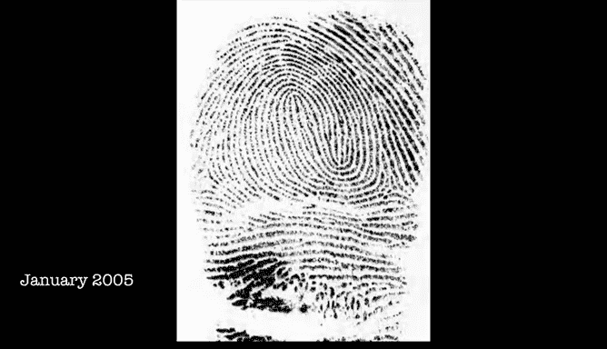
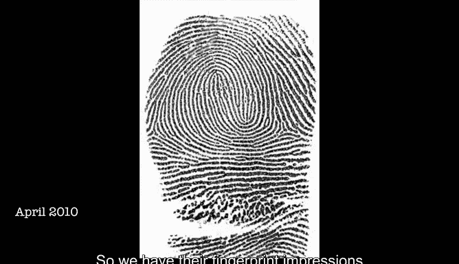
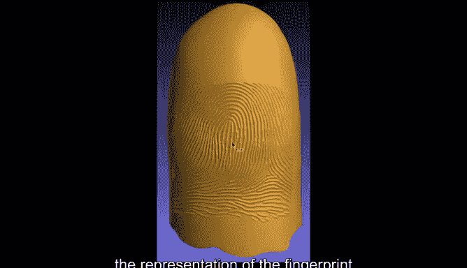

# 密歇根大学《给所有人的Python课》课程5：《毕业项目：使用Python检索、处理和可视化数据》｜python-data-visualization｜ - P10：10_02_02_访谈-Anil Jain（图像处理）.zh_en - GPT中英字幕课程资源 - BV1Eh4y1U7aE

🎼いし。🎼宝宝。You know， I've been working in the general area of pattern recognition。

 image processing computer vision for the last 40 years。And you know。

 it just sort of happened the serendipidity that in 1990， somebody called me from Washington。

 DC and said， you know， you do good image processing work and the NSA has designed or funded the development of FPGA。

Processor and we can give you this FPGA processing board which is attached to a Sun at that time 350 workstation and we can give you some money。

 can you find some civilian application of this？Okay so we thought about as you know FPGA is field programmable gateator a it can do can we configure reconfigure to do both low level operations and highle operations so in the thinking in terms of the image processing domain we said what is it that we can do so low level operation is easy convolution you look at a pixel look at its neighboring pixels and you can do either smoothing or edge detection and that's some kind of a local filtering operation for the high level。

😊，What could we do well， point matching is a generic computer vision operation。

 if you do stereo correspondence， you have left image。

 right image and you take some landmarks in the two images and align them and then estimate the depth。

So we said well what would be the application of it and this is where we just thought of say well fingerprint because fingerprint matching is essentially a point matching operation if you watch any crime show on the TV these days CSI or anything they will show you you know computer extracting the minutia points from a fingerprint and doing the matching so it's really fingerprint matching is essentially a point matching and then the local operation filtering operation means images fingerprint images when they are captured are generally of low quality a little bit blurred and so on we need to do some enhancement image enhancement of that so that's how we really got started 25 years ago in fingerprint recognition and I think now we have developed several technologies in fingerprint which has you made some impact and I think one of the best things which we have done is。

😊，cal texture based fingerprint matching traditionally fingerprint matching is based on points but what happens if the fingerprint image does not have sufficient number of points or the image quality is poor that we cannot extract sufficient number of points thats when you need to look at that the texture image texture formed by the ridges and valleys。

Wwhich characterize a fingerprint so one of my PhD students， Ail Prabaer around 1999 2000。

Came up with a bank of filters， which will captured the texture characteristics of a fingerprint。

And that can be used for。finingerprint matching and surprisingly， not necessarily surprisingly。

 but to our delight， this is texture matching is what is used in these small sensors embedded。

 fingerprint sensors embedded in mobile phones。😊，In order to have a small footprint of the fingerprint sensor which are embedded in mobile phone and to reduce the cost。

 these sensors of fingerprint readers are about 80 pixels by 80 pixels。

Traditionally fingerprint sensors are 512 by 512 images of that size。

 so an 80 by 80 image captures only a small part of the fingerprint， not the whole fingerprint。

And so if you capture only a small part of the fingerprint。

 the number of minutia points in it is only maybe four or five and that's not enough to establish a correspondence between two different fingerprint impressions so this is where the texture information is used so I think you know some of the work we did 25 years ago 15 years ago or so in terms of texture matching is now seeing some renewed interest。

😊。

Look forward。What's got you curious now？Well， so the number of interesting things we are doing。 So。

 for example， the traditional model of authentication or。😊。

Security for mobile space or any login which you do is log in once and then use it forever。

but that that was sort of revolved around the desktop computers， you know。

 now if you have a mobile phone。It's easily accessible by other people。

So this notion of authenticate wants and use forever is really not appropriate for higher levels of security。

So that's why we have this nuisance。built into the system where you unlock the phone and after five minutes of not using it。

 you have to keep unlocking again and again and a typical person may unlock a phone 40 or 50 times a day。

Now you are spending more time with the phone these days than with any other device。

 so why doesn't the device learn who you are based on your behavioral patterns based on how you swipe the screen based on how you hold it。

 GPS。😊，And even the camera can turn on once in a while to capture your partial face image and it knows yeah。

 this is the owner of the phone so this method is this mode of operation is called continuous authentication so in the morning you can present your frontal face image。

😊，To the camera， get a strong authentication， or you can use a fingerprint and the rest of the day。

Unless the system is really unsure that it's not the owner。

You know the system can just sort of keep it unlocked for you as long as it is it has a sufficient confidence that it the owner of the phone。

 so that is one area which is quite attractive。The other area which is very interesting。😊。

And this applies to any biometric modality， whether it's fingerprint， face or iris。

 these are the three most widely used。😊，呃。Body characteristics which are used for identification。

Is what is the persistence of these biometric traits and what is the uniqueness of the biometric trade so if I have a if I have a 10 digit key or 10 digit。

😊，呃变。I know how many distinct identities I can have tend to the power 10。

But can we say the same thing about what can we say about fingerprint。

 how many unique identities can it discriminate in principle， every finger。😊，Has a different。

Batter monitor。So， there are 7 billion people approximately 7 billion people living on the earth right now。

 so there are 70 assuming each one has 10 fingers， there are 70 billion fingers so in principle we should be able to discriminate。

😊，You know，70 billion individuals using this， but it doesn't work quite this way because。😊。

What is on the finger is maybe quite different from the impression of the finger which you use or the image which you obtain to do the recognition and this question of what is the individuality or what is the uniqueness of fingerprint or any other modality is not known。

😊，And this is something which we would like to。Which we are working on， how do we establish？

The probability。With which we can say that these two fingerprints are distinct。

Or the probability that your fingerprint will match one of my fingerprints is referred to as probability of false correspondence。

😊，And this notion is very important in the legal proceedings。😊。

Especially when a person is convicted based on partial fingerprint found at the crime scene。

And there have been a lot of innocent individuals who have been incarcerated。

Because of the wrong testimony or wrong conclusions。

 so basically we need to have some scientific basis for understanding。

What is the probability of false correspondence the second thing。

 the second fundamental premise of any biometric trait is the persistence。😊。

That is though does the fingerprint pattern change over time， does the irIS pattern change over time。

 we know that the people age so the face characteristics changes over time and it is indeed true that state of the art phase recognition systems。

star falling apart when the aid separation between two images of the same person exceeds about 10 years or so。

 but in the case of fingerprint and iris， you know we have been let to believe。

That they last forever， but there is there is no scientific。

proof for that and so just recently we last year we conducted a study of about 20。

000 individuals and the data came from Michigan State police because you know。

 they are the ones who often encounter the same person again and again。And over a 15 year period。

 these 20，000 or so individuals had been arrested multiple times。

 so we had their fingerprint impressions。😊。

On multiple encounters with the police and we showed scientifically using a multi level statistical models。

😊，That fingerprint accuracy。Over this time period does not degrade。You know。

 so those are the two important questions， the third important question is a biometrics is going to replace。

😊，Passwords and ID cards。Or used in conjunction with it。

 what if happens if somebody steals your biometric traits that means that the template or the representation of the fingerprint which is stored。

😊，In the databases， whether it is in your mobile phone or whether it's in your local bank。

How do we secure it so that that even if it is stolen， it cannot be used or you can reissue。

He a presentation that is its like like a type of a credit card number which can be revoked and then you shoot a new credit card number that is you I collect your fingerprint but I never used the original version of it I use some transformed version of it。

😊。