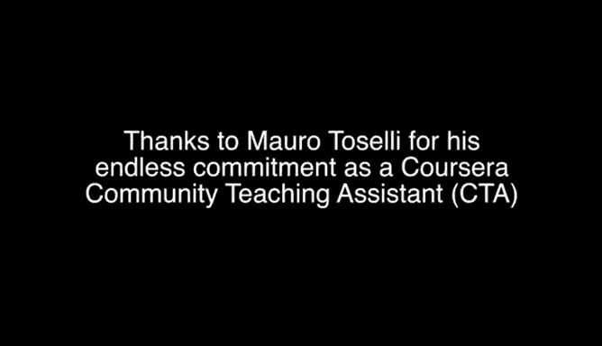
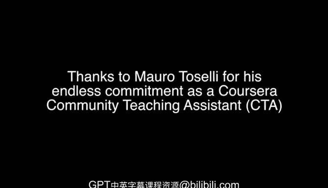

# 密歇根大学《给所有人的Python课》课程1：《编程入门指南（使用Python进行开发）》｜python｜ - P10：10_03_02_面对面办公时间-意大利米兰.zh_en - GPT中英字幕课程资源 - BV1214y117Mk

🎼，🎼When I'm writing a。An operating system， I'm saying， oh。

 here's this problem I've got to solve and here's these specifications in performance。

 and I'm thinking like a computer scientist， but when I'm writing a Python program。

 that's like looking through a mailing list for certain kind of mail messages and then matching those mailing messages up with something else or seeing who the most prolific poster in your form is。

What you're really doing is you're slowly but surely putting yourself into that program we're in Milan。

 Italy with one of the largest office hours ever， and I'd like to do our standard introduction so that you can see everybody。

So so give us your name and say hi or say something about the mark I just really like the course don't have anything to say。

 okay， I am'm Lucca。And I mean， I mean for。Lever上班。Okay， I'm Ivan。

 I like the teacher and I really love the course。 great thank you。 Hi。

 I'm Sebastian and I attended the Internet history course， right。😊，Hi。

 this is Antita learning Python and getting excited about the course Sha and Barbara and I like your course。

 Thank you Thank you， Barbara。😊，Hi，m Alberta。 just want to learn programming。 Okay， hi， I'm Andrea。

 I took interest history。 And when I read that Doctor Chuck was coming， I started screaming。

 Doctor Chuck in the office no one understood about anyway。 Hi， I'm David。

 It's my first course on Cosera。 And I wish everybody good luck。 And stay focused on your goals。

 And now we meet the famous。😊，Community teaching assistantant tomorrowrow yay。ね。

So so tomorrow say hi whatever you want to say Oh yes， we finally succeed in bringing Dr。

 Squikin here in Italy and we have a very big perfect time starting on so after that brief in。

Interruption by the construction crew， we'll go back to talking tomorrow。

 our intrepid community teaching assistant。Hi Maorohira Finally we succeed in bringing Dr。

 Shaque in Italy， very successful office hour here。

 a lot of people both from programming for everybody and Internet takes I'm very happy。

 very happy about our our people。 Thank you。 Okay， so we missed one person。 you want to say hi。😊。

I am my name isz and she's my wife Oh she didn't you couldn take courses Okay but you will of course you will。

 you have to Okay， so so let's see， let me get a nice group picture and and let's give Mara a nice round of applause thanking him for how awesome he is for doing what he does。

