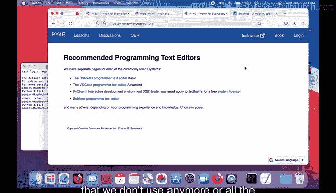
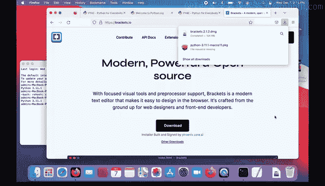
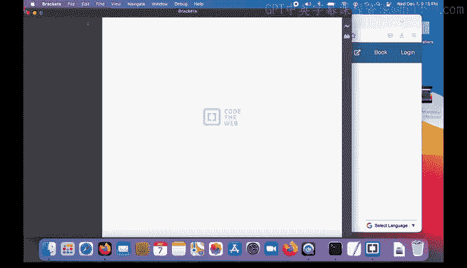
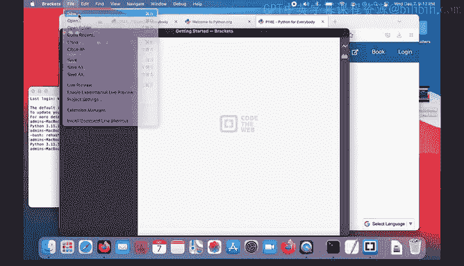
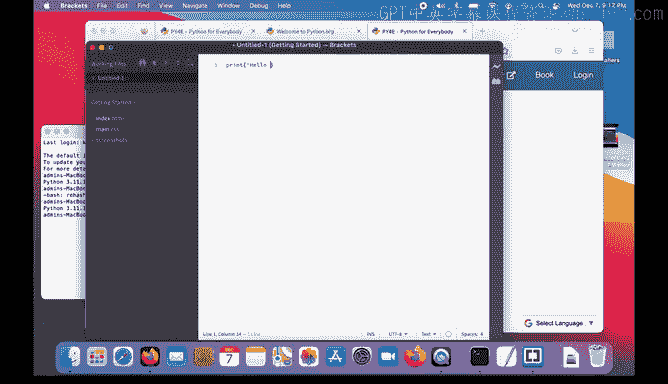
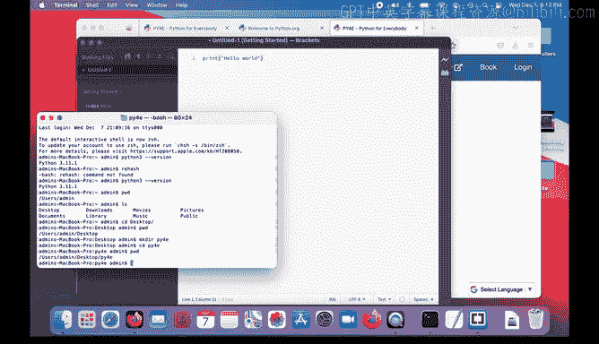
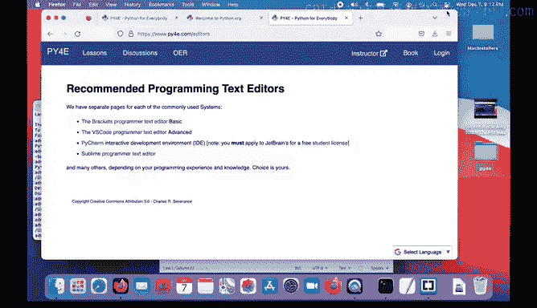
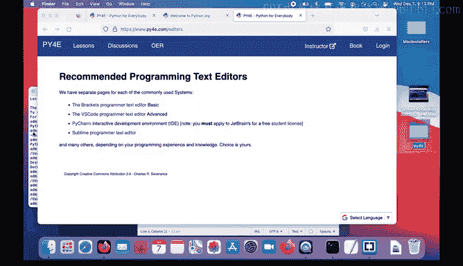
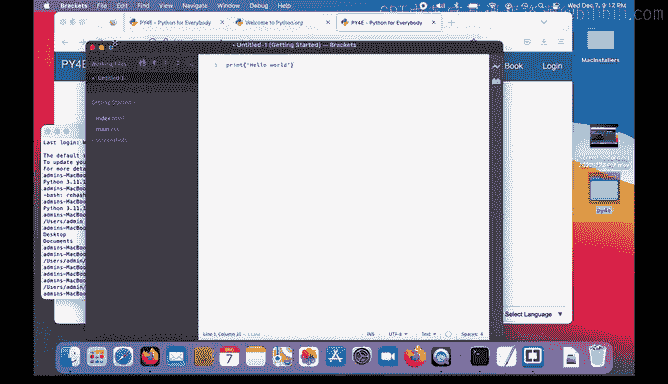

# 密歇根大学《给所有人的Python课》课程2：《Python数据结构课程（密歇根大学）》｜python-data｜ - P11：11_02_01_Macintosh使用Python并编写程序.zh_en - GPT中英字幕课程资源 - BV1yP411a7TZ

B and I type terminal and this terminal came up。So PwD is a printworking directory。

 this is effectively the same user interface as Linux and most servers are done with Linux so our goal is to install a Python Now the first thing to do is to check to see if you've already got installed because you can type the command Python dash dash version。

And see that we have Python 2。7。 Now if you actually just say Python。

You'll go into the shell and you'll get some really bad warnings because Python 2。

 as of the recording this moment， is actually out of support if you ever get in this triple Cheevron prompt you just say quit。

Close printn， and that it will get you out of it。So because Mac OS used Python。

 let me do a clear here。Because Python is used inside Mac OS and they use Python too。

 we tend to have to install our own copy of Python and it will show up as Python 3。Now。

 if you just type Python 3 minus minus version。And you already have a Python。

Then don't bother installing it。 And I'm not， I wouldn't。

 I don't want to install the developer tools。 So I'm just going to say cancel right here。

 it might be part of that， but I just rather install the official。Python distribution。

 so we're going to go to Python。org。And click on downloads and it knows it's already figured out that I'm on Mac。

 so I'm going to download Python。呃。3。11， you just download the latest one， you'll be fine。

So that download is now completed。Going to open it up。And click on it。And we're going to go continue。

Continue， continue。I agree。So now it's installing。Andon is showing me a folder with Python in it。

I'm going to click to close my downloads and so it seems to be。Installed。

 we'll go ahead and move the installer to the trash。And then I'm going to come over here。

 and I'm going to say Python3 minus minus version。Oops。Let's close this。And open terminal again。

Python 3 minus minus version。There we go， so you notice I had to close my terminal and open it again because this shell needed to see the the new software so you can do that。

 you won't have to do that again。There's a command you can type that might fix that by just say re hassh that says。

 look those no it doesn't even have it。 So I'm wrong there。 but eventually you wanted to see Python。

3 minus minus version。And away we go。So you have Python installed。

The next problem you need is you need a programmer editor， you don't want to use text editit。So。

Mt comes with this thing called textext editit。Don't use this。

Because it saves in a weird format called RTF， so don't use text editit， just don't use it。

 so you got to find a programmer application， a programmer editor。

And so if we take a look at Python for everybody， we have this page called editors。

 Now the best editor depends you may already have an editor if you have an editor， keep it。

We have a couple of recommendations， brackets， which is a super simple one， VS code。

 which is really nice， but the installation can be a little tricky， so I'm just not going to。

For beginners， I'm just going to recommend brackets， but if you have one， you like one。

 you like sublime over the years that we've been teaching this course。

 there's just been so many editors that have come and gone and so I probably should put a little thing on here that says all the editors that we don't use anymore or all the recommended editors that we don't use brackets IO is for now I like it。

 it's open source。

It's free， it looks to me like it's going to stay free and open source and it works on Windows。

 Mac and Linux， and so I like that， so I'm going to download that。

And so we're going to open it。Just click on here open it。There's the bracket Gitthub。Which is nice。

So I'm just copying it from the brackets code into my application folder。

And the applications is where on the Mac。Put things that are going to be run。

So now I'm going to just close this。And I've got a couple things on my desktop here。That's the。

It's not brackets， that's the brackets mount point。So now to run brackets。

 I'm going to go up to my search and type brackets。And click brackets。

I'll go ahead and hide this page。And yes， it's wanteding to make sure I didn't I'm not installing some bad stuff。

 So here we have brackets。 It's a nice， simple editor。

And it starts up。So I'm going to close this window。And I am going to create a new file。

And let must say print。Hello world。

嗯。And then I'm going to save this file。one thing that you're going to have to keep track of is where you're at。

So users admin this desktop。Is。In users' admin desktop， I'm going to change directory into desktop。

PWD print Working directory CC CMMM Use admin desktop。 I'm going to make a directory MK D IR， PY 4 E。

Now I'm going to change into that directory。Like I said。

 it's a good thing for you to learn all these things。 So now I'm in the folder P Py for。

 And if I look on my desktop， I've got this folder Py for that currently has nothing in it。

 So this terminal and this folder are the same thing。 So now I'm going to file。

Save as。And I'm going to。Go into my desktop。And go into Py for E， and I'm going to call this file。

Hello， dot P，I'm going to save it。Now at this point it it knows the Python file and graphicic brackets knows what Python you know syntax fileing is so that's quite nice。

 so if I look in PY3 I see there is a file。And if I look in it in terminal and I say Ls minus L。

 I see that file as well。To run that file， I say Python3。Hello， dot P。And with that。I have created。

My first Python program， I've installed a text editor or I've installed Python and created my first program。

So I hope that you found this useful， see you in the rest of the course。

