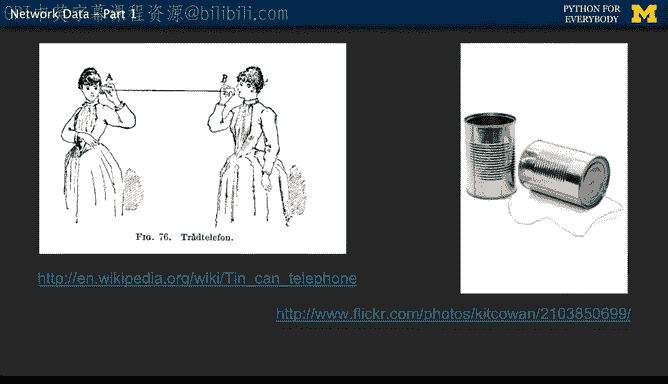
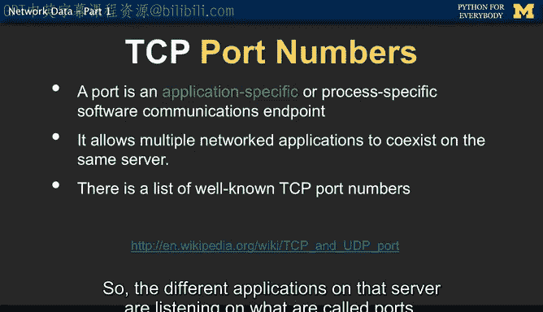
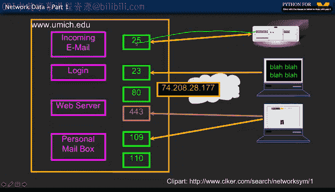
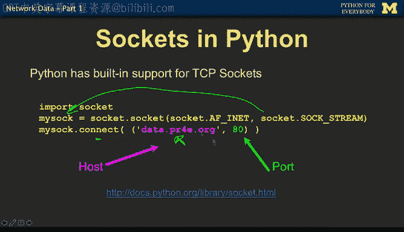
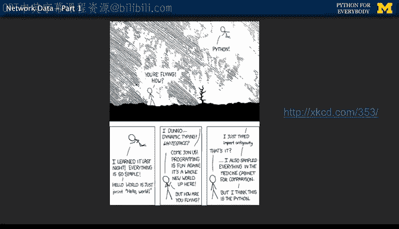

# 密歇根大学《给所有人的Python课》课程3：《使用Python访问Web数据》｜python-network-data｜ - P11：11_03_01_网络技术.zh_en - GPT中英字幕课程资源 - BV1Hu4y1e7WS

Welcome to chapter 12 Now what we're going to do is we're going to take and write programs instead of just talking to a disk drive。

 we're going to go right outside the computer and talk across the internet to talk on the web。

And the Internet of course is an exciting thing and there's a lot to it and we'll talk a little bit about internet architecture just enough to motivate what we're going to do in Python programs。

 but if you really get excited about this and find this interesting I wrote a whole book。

 it's a free book， you can also buy it on Amazon if you like。

 but just go there there's actually lectures and quizzes and everything for this free book on network architecture that I wrote called Introuction to networking so this is really short summary of something I go into in much more detail there。

So one of the things we talk about in that book is this thing called the network architecture。

 there is this layered architecture that basically represents the connection over the internet and it's representing two computers。

And you know there's a application talks to a transport layer which talks to an internet layer which talks to a link layer and that talks to like the Wi-fi or ethernet connection and it goes through a bunch of hops on the network。

 maybe 10， 1215 and it comes of into the destination computer。

 maybe this is a web server or something and it goes up through these layers and then runs the web application。

 and then the data is then sent back you know， out the same path back up 15。15 hops， hop， hop。

 hop and then back into your application and then sort of to your screen so you can see something。

 and we can talk a lot about this and in the book and in my other courseursera class I I talk a lot about these layers and give you all this stuff。

 but we're going to sort of simplify。And skip past all of that stuff。 It's fun。

 but we're not going take too much time on it。 But instead。

 we're going to start at the first layer that is what's called an end to end layer in the network architecture called the transport layer。

 And the idea is as you can write a piece of code。 you will write a Python program that will talk out the transport layer over to an application on another server。

 This is the network over here。 another server and get data back。

 and that's what we're going to show you how to do。 So the internet layer in the link layer。

 implement the transport layer。 But for now we're really going to just pretend that there is a nice pipe from end to end。

 that when your program says something down the pipe， the program on the other end hears it。

 And when that program sends something back， you can hear it on your end。 It's a very simple thing。

So we call these。

Communications between two applications because it really is two applications。

 your Python program on Onein and a network server。

 it might be written in PhP or Java or even Python， but when you hook these two things together。

 there are two pieces of software running on two independent computers that are actually chatting that's like they made a phone call。

 you make a phone call， chat on the phone call， H the phone call up。 The differences is that。

Computers do this hundreds of times a second， if not thousands of times a second。

 and we call this connection。A socket， right， It's。

 it's this sort of like little thing that's that's built in the Internet just long enough to have this conversation happen。

 And then it's thrown away。 And so we call this thing a socket。

And the way sockets work is if you want to establish a socket。

 you say I would like to talk to this particular web server and all the web servers have names and numbers。

 end points。 And then there's also which application So the different applications on that server are listening on what are called ports。

 you can think of them almost as telephone number extension。

 So you call a large company they've got one phone number and it says enter the extension。

 if you know it。 Well， that means you've called the company， but you really want to talk to a person。

 So these ports， these TCPI ports。

These little ports are different applications associate themselves with these ports when they start up。

 So the incoming email server might be on port 25， and it wakes up and it sits there waiting for something to happen。

 And so our applications。Say， you know what， I want to send some mail。

 And so I'm going to connect to this server， but on port 25 in that way。

 I hope to talk to the email server。 So we use these ports。 Now。

 the port that we're going to play with in this class， the most is port 80。

 So port 80 is the web port because that's the port that's connected to the server。

 port 443 is the secure Https。 And so when you connect to a web server。

 So if you're a browser and you want to connect to a web server。

 you go to a host name or number and then you connect a port 80 and then hopefully if there is a web server on that host。

 you'll be talking to the web server on port 80。 again。

 it's like an application on your computers making a phone call and an application on this computer is picking the phone call up and you both say hello。

So in the common TCP ports， like I said， port 80 is the one that we're going to play with the most。

 it's HTTP。And so sometimes you'll even go on the web and cruise around and see a URL that is a little different that has something like a colon 8080 on it。

 well this basically is the syntax for a URL as a host and then colon 8080 is the port。

So this is basically a web server that's not running on port 80 but running on port 8080 so it's not like they have to be on these ports。

 but we commonly expect them to be on ports and normally there's going to be a web server on port 80 if there is a web server。

 there might not be a web server on port 80。So。Python's awesome。Let's say you want to use。

Millions of lines of code in the link and network and transport layer of your computer。

 as well as the entire internet and some server on the other side And the data。

 And you want to talk to it。 It takes three lines of Python， three lines of Python。 That is it。

 all that complexity， all that， whatever， three lines of Python。 So like always。

We have to first import something。 So we're going to import the socket library to say， hey。

 we're going to use this library， like the regular expression。 we said import R。

 and then we create a socket。 we say socket dot socket。 this syntax here。 I don't want to explain it。

 Just just kind of type this the way I tell you to。

It's like it creates this end point that's inside your computer that's ready to connect out to the far end。

 but it's not yet connected。 It's like a connection point that has not yet been connected。

 And that's what this magic means。 We're going to hook a thing across the Internet。

 and we're going to use a stream。 a stream means it's a series of characters that just keep coming back。

So that's that second line and the actual connection happens when we say My sock dot connects。

 so this returns us an object。And then we actually call the connect method in that object。

 and we pass in two things， we pass the host we want to connect to。

Which is a domain name and a port that we want to connect to。 So that makes the connection。

 And that's all it takes to make a socket connection。 Now that's not sending any data。

 That's like dialing the phone。 Okay， so that's all it takes to make the connection that dials the phone in Python。

 like I said， amazingly just three lines。

And that's one of the things that we love about Python。 We absolutely love the fact that Python。

Does so much for us with a simple import statement in this XKCD comic。

 we see someone who imported anti gravity。

And they started floating。 So you get the idea that import socket。Is like amazing。

 You can do something in two lines after that and you're doing something useful。

 So the next thing we're going to talk about is once we've made these sockets how we actually communicate to that far off application in Python。

