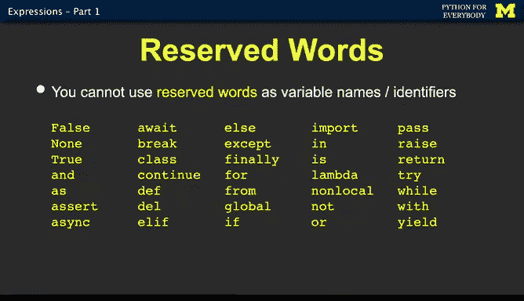
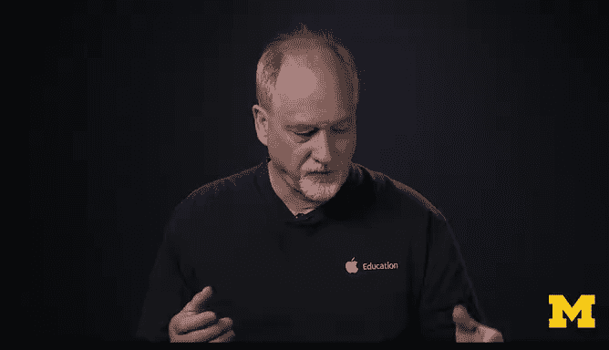
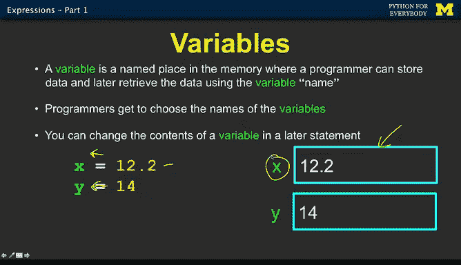
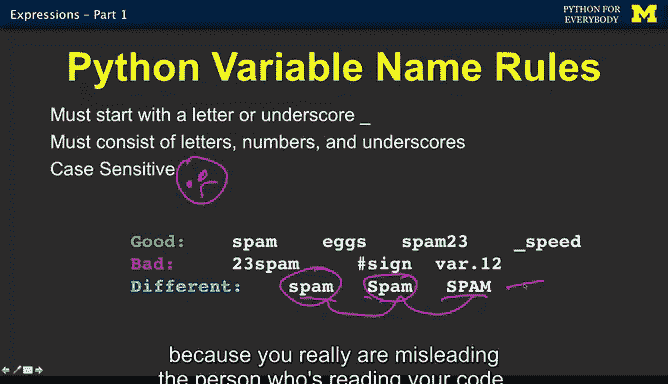
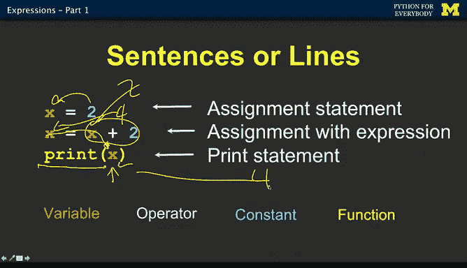
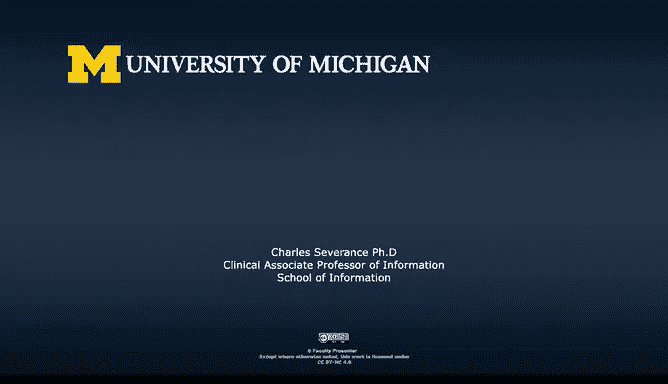

# 密歇根大学《给所有人的Python课》课程1：《编程入门指南（使用Python进行开发）》｜python｜ - P11：11_04_01_常量-保留字-变量.zh_en - GPT中英字幕课程资源 - BV1214y117Mk

。Hello and welcome back to chapter 2 in this we're going to dive a little more into depth on the atoms。

 the nuggets， the little pieces that make up Python。

 and then we're going to work through our first real program that has a sort of beginning。

 middle and end。 so here we go。A big part of any programming language is the syntax for constantss。

 The nice thing about this， it's kind of instinctive。 So like 123 or 98。6。 we numbers。

 both integer and floating point numbers， we've been using these on calculators。

 they make a lot of sense to us， the kind of constants that that are a little bit different are things like string constants。

 So quote hello world is a string constant。 We use that so that our program can say nice things to people that are using our program。

 And so we call them constants， because they don't change。

 but it's kind of obvious Conss iss just a piece of the language。 So that's a constant。

 What else variables and key and reserved words。 So the other thing other than constants are reserved words。

 And as I said in an earlier lecture。 These are like dog language。 blah， blah， blah， blah class。

 blah， blah， blah Dell， blah， blah， blah else。 blah， blah， blah Lada。

 So these are words that when you say them to。😊。

Pyon Python expects them to mean exactly what Python wants you to mean now why is this special。

 it's actually kind of instinctive， it just means don't use these for other things。

 don't name functions， don't name classes， don't name variables， places where you get choices。

To use words， don't use these words。 And most of them aren't too big of a problem。 I don't know。

 maybe break or in or or from maybe there some of these you might naturally use。

 most of them are kind of weird enough that you're probably not going to use them as variable names。

 And so the third atom basically is variables。And you get to pick the variable names。

It it's a little weird that you get to pick variable names， but you'll get used to it。

 And so variable names are places where you're asking Python to allocate a bit of memory and stick something in it。

 And you're choosing the label。 And so if we take a look at take a look at this。

 When we have this assignment statement。 And remember that assignment statements always have a direction。

 right， this， think of these equal signs as having an arrow on them。

 In some languages I saw a language that uses kind of an arrow that uses a less than in a dash as the assignment。

 I'm like， that's how it should be。

Because equal confuses us because equal means something different in mathematics than it does。

And Python or other programming languages。So to look at this very first statement。

 what we're really saying is it's a pretty complex statement after a while you'll just use it。

Python find us a spare piece of memory somewhere and give it a label of X and put 12。2 in it。

 and remember that remember all that stuff。

That's one of the things that Python does for us it remember stuff。

 then we go to the second statement says， oh hey， Python， find some memory。

 some spare memory that you got laying around， label it Y， and put 14 into that。

OkayAnd so that's how these things work and you chose x and you chose Y。Now。

 if we keep on going in this code。And now we have another line。 And we say， oh， hey， X， wait a sec。

 I already told you about X。 X already exists。 So don't go and grab any new memory。

 but stick 100 in that。 So 100 goes in， and it wipes out the old value。 So this， that's what happens。

 That's when this sequence starts。 this happens first， second， third。

 And so the third thing is the last thing。 And so x ends up with a residual value of 100 in it。

 So that's kind of variables in assignment statements。You have some naming rules。

 you can start variable names with letters or underscores。

 although we avoid underscores because Python tends to use underscores for its own internal purposes。

 and the rest of it can be letters， numbers and underscores and。

It's case sensitive。But we don't want you to depend on that。 So spam all lowercase。

 spam with one uppercase and spam， these all are different variable names。

 but you're not doing anybody any favor if you think that's being clever。

 We tend to sometimes use uppercase to signal things which we'll talk about later。

 but we tend to use mostly lowercase。 Some applications use what's called camel case， which is a mix。

 but you tend not to depend on the fact that these are unique because you really are misleading the person who's reading your code。

 but we have some good ones。 spam eggs spam 23 numbers are fine。

 it's fine to start with a underscore。 It's bad to start with a number。

 it is bad to start with a pound sign， although that turns into a comment and you can't use characters other than letters and numbers in the variable。

 And so those are all good variable names。

Now we leave these things into sentences or lines。And so these things is this is just another sequence of code。

 and it shows how you can also use the variable on the right hand side。

 So put two in in some memory and label it X， pull that two back out and then add two to it。

 So this this little thing here becomes4。 and then stick4 into X。 and then this is a print function。

 And the way functions work is they are the name of a function followed by a parenthesesis。

 followed by another parenthees。 and then you can print something。 What you want to print。

 so this causes on some output4 to come out。 So print is the function that you call call to cause output。

