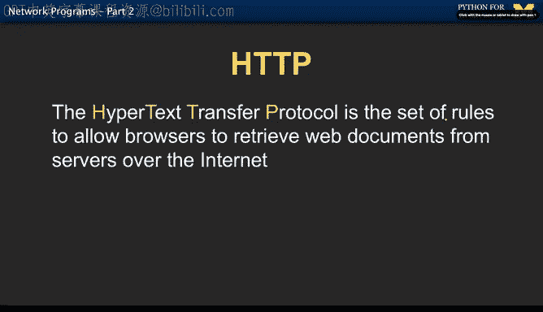
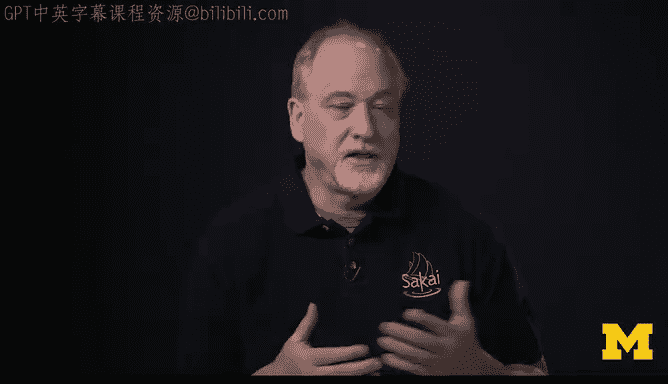
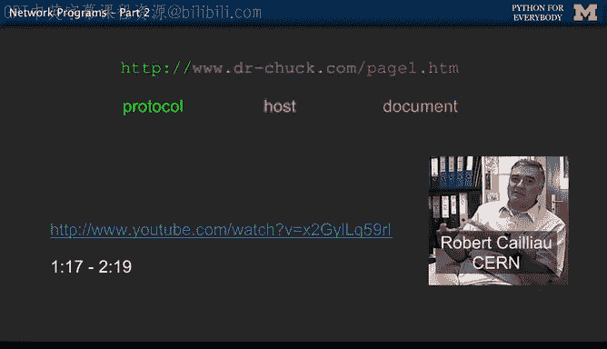
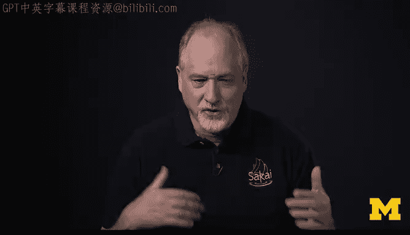
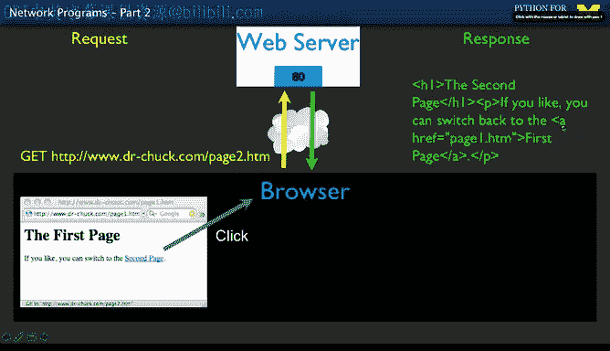
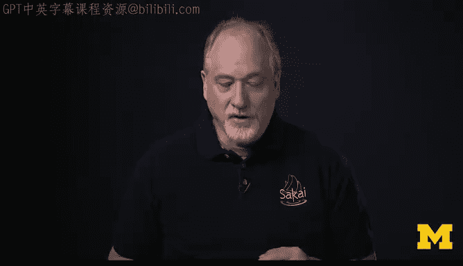
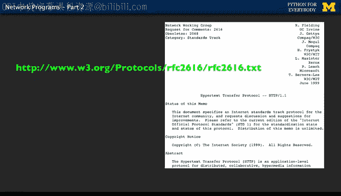
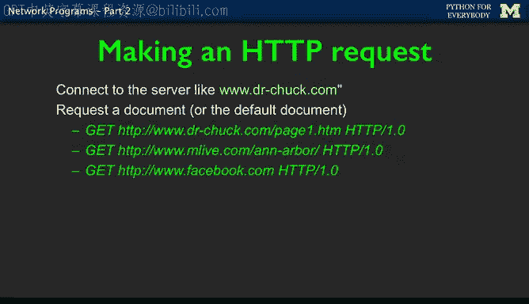
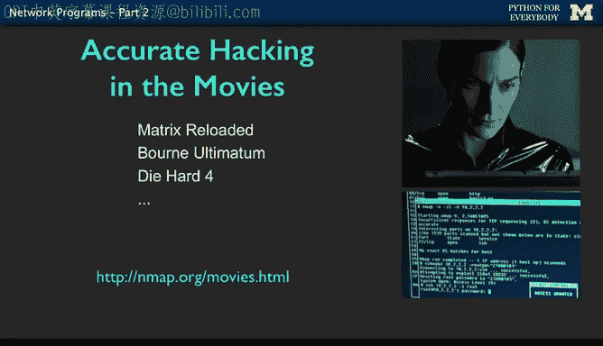

# 密歇根大学《给所有人的Python课》课程3：《使用Python访问Web数据》｜python-network-data｜ - P12：12_03_02_超文本传输协议_HTTP.zh_en - GPT中英字幕课程资源 - BV1Hu4y1e7WS

So we just took a look at the transport protocol， which is our the first layer。

 the lowest and end layer in the TCPIP stack。 And so we wrote a Python program and in that python program。

 we made a connection with the socket and then connect it to a particular port on a faraway computer and now we're going to actually start sending data back and forth。

 we made the connection And so this moves us from the transport layer up to the application layer and the application layer means there's something different when you're talking to a mail server than when you're talking to a web server。

 there are rules that describe how we talk to them， there are the rules of the road。

 So on a telephone call at least in Western cultures when you pick the phone up and it rings。

 you say hello， the person who picks the phone up is supposed to say hello first you may not notice this。

 but that's what it is The person who picks the phone up says hello and then the second person says hello and then hopefully you start talking。

 sometimes if things don't work well， you don't hear it are you there or it gets kind of confusing if the phones。

cellell phones aren't reliable and so this is what we say to phones into phones to get our conversation started is like the application protocol and the protocol that we're going to play with in this segment is what's called the hypertext transport protocol。

Or the hypertext transfer protocol。 It's the dominant application layer on the internet and it really was invented to retrieve web pages。

 And at the moment of its inception it wasn't really thought of as like the greatest protocol ever but it has evolved into an amazing protocol And what happened once is it was so simple that we could just layer new ideas on top of it。

 so we started with this really basic simple application protocol in a way we go And so it's a set of rules that allow browsers to retrieve documents from the web and so if you wanted to go write a browser you could you would just have to go read the specifications for what it is that the servers are going to feed to you or if you're going to write a server and you want to talk to browsers。

 you would also read that specification for HTP And so again it's just a set of rules about just we know what we're going to do first know what the syntax we expect。

 produce and consume and make it so different vendors can work together and it's just a form of standards。

And so one of the things that HTTP standardized， which was really cool。

 was this protocol of uniform resource locators or URLs。

 and we typed them so much that we just think of them as like， oh。

 you type this thing in to get this thing on your browser and so but they actually contain inside them some information Htp colon// says use the htb protocol wwDchuck。

com says go to this host and then s pageage1。hM says go get this document。

Now it's。Many years ago in the 90s， you had to know all these things separately。

 but then we just kind of concatenated them all together and that became the uniform resource locator or hey。

 type this URL into your browser。So every time the user clicks on something and it wants to get a different document。

 So you have a document's got some links in it。 The HTML has this thing called Hf value。

 you click on it and then you're telling your browser。

 get me a different page by clicking on and that's the hypertext bit is that in any document there are links that go to other documents and these links are the magic of the web。

 are the there were ways to access data from servers before。 but the notion of。

The document that you have has links to other documents is a powerful notion。

 We take it for granted now， but it when it first came out in the 19 mid 1990s，93，94，95， It's like。

 whoa， this is better than things we've been doing。 I mean， otherwise。

 we learned these weird commands and did this stuff。

And so it sends what's called a get request to get the document and then retrieves the document and then parsees the document and then displays it for you。

 And so this is a little bit of a diagram of how that works。

 And so you're sitting there you're looking at a web page and you click on a link and I've made the blue link so you click on it says second page and the browser is a piece of software running on your computer and it intercepts that click and it says。

 oh， you've clicked on something and it looks at what's in the HTML of the page that you're coming from to say what web server to connect to what port to connect to on that web server and then what document to retrieve and so your browser then makes a socket connection to port 80 and sends a request called the gett request and sends that get request to port 80 and then it goes in that web server and the web server parses that request and figures out what document you're looking for it might run a little bit of software But when it's all said and done it produces on that same socket a response and it sends that response back。

And that response back is in the form of HTMLl， the hypertext markup language。

 which is really kind of tags inside less than in greater than pairs that H1 says that it's ateer1 piece says it's the start of a paragraph。

 and then the a tag。Says that this is an anchor， and so it's supposed to be clickable text on that next page。

 and then that comes back and your browser reads that。

And then makes the page show up in it so it reads the HTML。

 parses it and there's a bunch of rules about where you add blank lines and all these other things so that it looks the way that you want。

 and so that is called the Re response cycle and it has to do with when you click where it goes to the server gets data back and then shows it to you you basically see click new page。

 but there's a lot going on behind the scenes when that happens。

And all of the rules of exactly what was sent， exactly how it was sent。

 how those strings are put together is theres a standard for it and there are a whole series of standards and thankfully they're free and open and available for you to read and while they're long and complex you can look at them there was a group that was formed many years ago to start building these standards they number each one of these RFCs they're called requestquest for comments that's a bit of a tongue and cheek suggestion that even though there is an RF that guides how your browser works with millions and billion of browsers work with hundreds hundreds of thousands or millions of servers and they're pretty solid ideas that they could always be room for improvement。

 there can always be room for improvement， that's what the request for comments means is that no matter how perfect we think we've got these engineering standards for the Internet。

 they could always be improved So if you took a long enough time and read long enough。

 you would find this one called。

C2616 which tells you something about the HtTP protocol so you're writing a browser。

 you're gonna read the HTP protocol， you got hundreds of pages to read。

 it'll take you a while probably user just download a free browser then make your own but let's hypothetically think you're going to do this you'll be reading through this and you'd be paging through and paging through and you get to this section be like oh this is what the syntax of a request from the client to the server includes with a first line of that message that method to apply to resource。

 identify the resource on the protocol version in use。

And then we look and we see， oh here's a sample of one of those things， right。

 get GET capital letters with a space and then a URL uniform resource locator and then a protocol。

 and so we connect and then this is the line that we sent that's a requesting of a document。

So it turns out that if you have the program TNe and Macintosh people have this and Linux people have this and Windows people can install it。

 go find how to make TNe work on Windows。What you give Tnet， Tnet is a。

It's like a prehistoric piece of software， the reason they don't have it on Windows is because they think it's probably a security hole they might be right。

 but they took it off。 It is a prehistoric thing because it's a way to connect to any server。

 any port on any server in an insecure manner and send stuff to it。

 So what you would type on your computer is。Talnet。And then the host and then the port。

 And by picking this port， I'm saying I want to connect to the web server。And it connects up Now。

 some web servers are impatient because they expect to talk to browser。

 So if you take too long to type this。 it'll like say you took too long to type， you're just a human。

 you're cheating。 but if you type this fast enough， it might help to cut and paste it。

 and you type this exact HTML command。 That is exactly the syntax。 and then you hit an enter here。

 You hit just an enter right there。 Then what'll happen is that will that those two lines are enough to convince that web server to send you a page back and it will send you back two chunks of information will' send you back the headers。

 This is metadata。Metaadata about the file that you're about to get， including what kind of file is。

 and it says， oh， this is just a text s HTML file， and then a blank line blank line splits between the headers and the content and then the content of the file。

And then the connection is closed， so the connection closed is not part of the text that just says it got closed。

 And so this then is that page that is shown with some stuff on there and some more links， et cetera。

 et cea， et ceter。 So this is the request response cycle。

Except normally what's happening is this is a browser making a socket connection and then sending a get and then getting headers back and then getting the body back and then making a pretty page out of that body。

And so。This is how real people hack into real computers is they actually make connections and they send stuff on those connections。

 and there's this famous scene in Matrix 2， I think。

 where she is Trinity is hacking in to the back of the power grid and。

Most of the sort of security moves up to that point postulated that security people when they break in would actually break in with these really cool user interfaces。

 But it turns out in the real world， they usually have really lousy user interface。

 It's kind of like the command line that I keep trying to tell you to use in this class。

 And so this actually is an interesting scene。 you can go to this URL and take a look at this scene and it actually is written using actual securitycing software。

 And it was the first of its kind to actually create in a movie how people really sort of come in the backdoor of computers and do stuff。

 And so it's kind of just an interesting thing。 I'm trying to show you how to become an expert in all this stuff and all this sneaky。

 clever， highly sophisticated stuff often has very simple user interfaces。

 So if we're going to do that same thing， which is make a connection to a port。

 send a get request and then get some data back。 We can then do this in Python。

 So we started with those first three lines in Port of socket。

socketSo this socket first when you do the socket， it's sort of like this。

Porthole that lets you out is like a doorway out of your computer。

 but it's not the doorways not open and the doorway is not connected to it yet。

That's kind of like a matrix thing， too， right， There's a doorway。

 But what's the doorway connected to。 there's a couple of matrix scenes that come to mind。

 all of a sudden。 Okay， well， whatever， That's what this does。 makes the doorway。

 but there is nothing connected。 then the connect basically extends out of your computer。

 this could fail if this server doesn't exist。 So goes and finds the server connects to port 80 and establishes the socket。

 when this line is done。 What we have is we have a socket and it's connected to a server。

 You do know that the servers there， and you know that there's software on the other end of it。

 Otherwise， the connect will fail。 But if the connect works， you're talking。

 but you haven't sent any data。 Now you can call methods on the socket object。

 Now that's been connected like send and receive to send data across this or receive data from it。

 Now， part of the application protocol is what do you do first， you send to receive。 Now。

 it turns out with H T TP。 theres server does a receive first and you do aend first。

 That's the rules。 And so。First thing you do is you make up a request， and this is just a string。

Now we have to prepare it for sending I'll talk in the next section about how this encode works。

 prepare it for sending。And then we send it。And you'll notice there's two new lines at the end of it。

 enterter， enter was what you did when you were in Tnet。 and it was the get blah， blah， blah， blah。

 blah， enter enter。 And then we have to prepare it。 And we send that。

 And so that means that you sent something to this server and the server receives it。

 it goes and read some files and does some stuff。 and then it's go start sending data back。

 and you can use a while loop now and receive is a method in the socket object once you've sent it。

 and's going and it might take a couple of sends to get all the data。

 So we're going to just print this stuff out onto our screen So we're going to receive up to 512 characters。

 if we get no data， that means end of file。Or end of transmission。So we break out。

And then if we did get data， we decode it， and we'll talk in a second about that。

 that' sort of taking data from the outside world and interpreting what it means internally for us。

 So we're going to decode it， and so this loop is going to run a bunch of times until hits end file and then we're going to close the socket which tears all this stuff down because this actually takes up resources in your computer and the far ends computer as well。

 so my sock dot close closes that and that's kind of it。So that basically。

Is a request response cycle in Python and is only like what 10 lines of code。

 And so that's really impressive that Python's capable of doing that。

 And so what we'll get for the output of this is we'll get the same kind of stuff we got from Tnet。

 It's going to just be this loop that reads this stuff。 and decodes it and print it。

 and it'll be header head or head or head or head or head or however metadata。 That's the metadata。

 then a blank line， and then the text。 And so it's the exact same thing。

 and those Python commands did that same， make a connection to port 80， send a get request。

 send a blank line， wait and read the data and then print that out onto our screen。

 and that's what we would see。

So next I want to talk to you about that encode and decode bit because it's kind of important。

