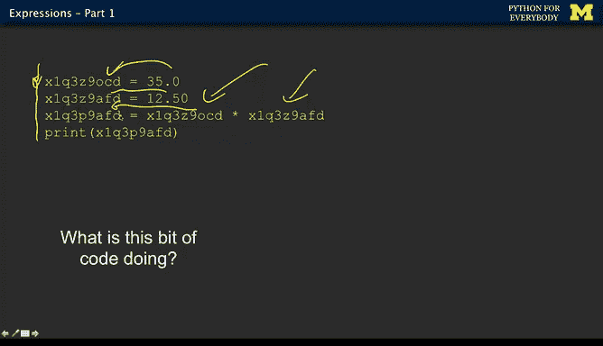
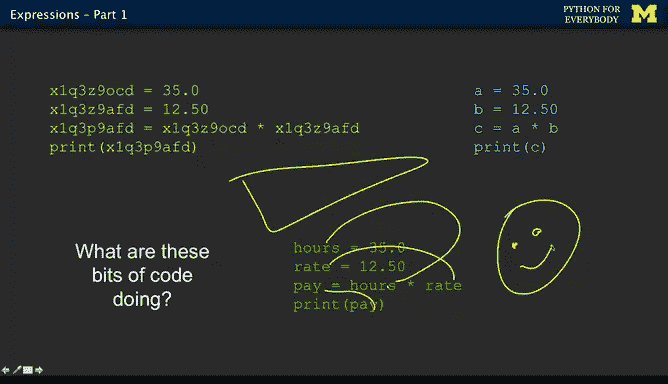
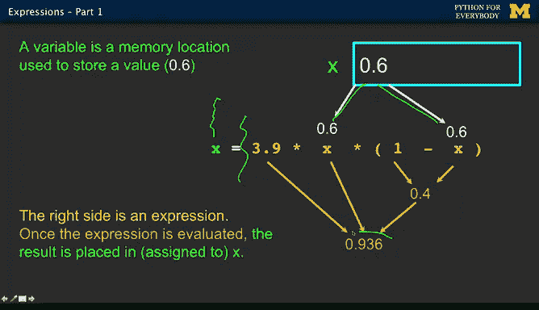

# 密歇根大学《给所有人的Python课》课程1：《编程入门指南（使用Python进行开发）》｜python｜ - P12：12_04_02_变量命名与赋值.zh_en - GPT中英字幕课程资源 - BV1214y117Mk

I emphasize that one of the key things about variable names is that you get to name them。

 and we have a technique called mnemonic。 I think I pronouncedce that right。

 An idea is that when you choose a variable name， you should choose a variable name to be sensible。

And Python doesn't care whether you choose p mnemonic variable names or not。

 and the name that you choose for a variable does not communicate any additional information to Python。

When you're a beginning student， sometimes if you'll use variable names that are too good。

 it's confusing。 So you'll notice as I write， especially in these first two chapters。

 some of my code uses really dumb variable names， and some of them uses really clever ones。

 So I go back and forth to emphasize to you that the name of a variable as long as consistent as long as it's consistent within a program doesn't matter。

 And Python is perfectly happy。So here is a little code， it's four lines of code。And。😊。

Start at the top。 Run this line。 And that says find a little piece of memory and label it that thing and stick 35 in it。

 Find a little piece of memory。 Label it that thing。 St 12 in it。

 pull that first thing out and pull the second thing out。

 multiply them together and pull them into yet a third variable。

 If you look at these things really closely。 They're all unique and distinct。

 And you do have to look at them very closely。 Then you print the third thing out。

And Python loves this code。 Python thinks great。 I don't know why you pick those variables。

 I do not care。 All I care is that they're unique。 It Python really has no opinion about these variables。

 But if you hand this code to a friend and you say， what is this code doing They're like。

 why did you pick such insane variables， because I， I have to stare at it And like。

 what the difference between the difference between like these two things is just the letter Z and the letter P。

 So this one， we're printing the P guy out and this time we're pulling the the Z guy out， right。

And the these two just have a difference of those letters， I think。 And， I mean， you could do it。

 Python， Python loves this stuff to Python， This is perfectly understandable code to human beings。

 It is not perfectly understandable code。 So like people aren't going to like you。

 but Python is going to be very， very happy。 I can't draw a happy snake。 Otherwise。

 I would draw a happy snake。 So this is tacky， bad， not friendly。

 So let's make it a little more friendly。 You could choose variable names。

 So those Python looks at these two things as like those are the same。 they're totally the same。

 Python doesn't care。But now we can look at it go， oh， I see the first variables A。

 and we're putting that A thing there and the second variables B， we're putting the B thing there。

 And then we're multi going going to put them in a C thing， and then we're printing the C thing out。

 That's pretty nice。 So this is a little better， right。

 At least we can parse it and read it and understand what the code is going to do without having to check to see if these two characters are the same or different。

😊，So that's better， but it's not p mneummonic。 Okay。

 pneummonic means that we choose a variable name that makes sense for what we're using it for。 Again。

 the variable name and Python looks at all these three things as the same。

 All Python cares is the dismatches this。 This matches that。 and that matches this。 But humans。

Are much happier。 Human are much happier。 Now， we understand mentally that the first variable。

35 was the hours。 The second was the rate per hours， And then we computed a pay。

 and we printed it out。 So this is really understandable。 The problem is for beginning programmers。

It sometimes is too understandable。It's too understandable。

Right， huh？Python knows about payroll because if I name a variable hours。

 shouldn't Python know that that means ours， And if I name a variable page。

 does that mean that Python knows about this？ And the answer is no。

 Python Python treats all these three is equal Python doesn't look at the name of your variables and think。

 hey， you just had a bug right？ So what if， for example。

 I rewrote this code and I said hours times hourss。😡，And it's like， wouldn't Python say， hey。

 that doesn't make sense， Why would you even multiply in apparel calculation。

 Why would you multiply hours times hours And the answer is Python will happily do it because it's not looking at those words。

 but a human being who's trying to understand what your code is or trying to help you when you're writing code to bugg your code will be very thankful that you chose good names And now I can look at your code And if I see you say pay equals hours times hours like why did you multiply hours times hours。

 didn't you really mean to multiply hours times rate。So pnemonic variables are only for humans。

 We will later see things that will confuse you when I name one variable。Friend。And another one。

 friends。And you'd be like， oh， so Python understands plurals。 The answer is no。

 Python doesn't understand plurals。 Okay， it's really helpful to read stuff so that when something has more than one thing in it。

 you might maybe use a variable that's got a plural in it。 So okay， enough about that。

 I think I hope I made my point。These are all the same to Python。

 but human beings certainly prefer the second or the third。 And so， but be careful。

 in after chapterpter 10， this is all， you'll start using p mnemonic variables and it won't be a problem。

 But in the first few chapters， you have to worry about it。So as I mentioned。

 assignment statements basically are not like mathematics。 Equal sign means equality。

 Assment statements means arrow。 and the key thing is。

 you can almost think of this is like there's a little wall there。

 and it completely computes this expression。This is an expression on the right hand side。

Gets that down to a single variable and then writes it into the variable into the into the memory location。

 And that's why it's possible to have the same variable on both sides。

 because this side happens first， ignoring this side。 And then once this side is done。

 then it actually puts it into that other side。 And so if， for example。X。

 before this statement started， had a 0。6 in it。 Its like firewalls this part off。

 and it computes this part here by pulling the 0。6， the old value of x。Doing the computation。

 running through the things， getting the new value， and then after it's got that new value。

Then， and only then does it store the 9，3，6 into x， and that overrites the 0。6 that was an x。 Okay。

 and so one side finishes。Produces a result， and then it can overwrite。

 It doesn't mean you have to put the variable on both sides， but it's why you can put it。

 And So sometimes we'll say something like x equals x plus 1。 And that's our way of adding one to x。

 And that's because whatever x is， maybe x is 6 or something。 This becomes a 7。

 and then the 7 goes into x。 and then it overwrites it to the 7。 We call this increment。

We'll see this soon。But that's why you can put the same thing now in mathematics。

 x equals x plus 1 makes absolutely no sense， but in programming。

 it is one of the more common things that we do。Okay。

 so that gets us through variables and constants， and now we're going to talk a little bit more in detail about expressions。

