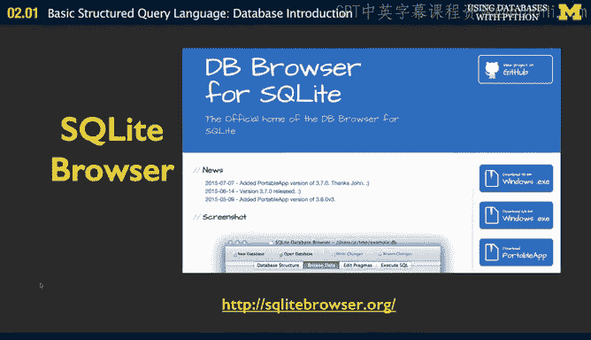
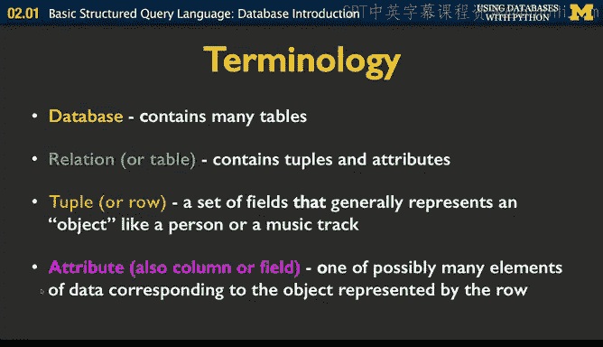
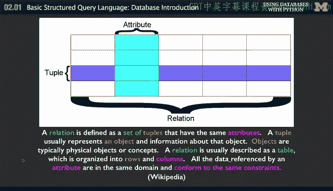
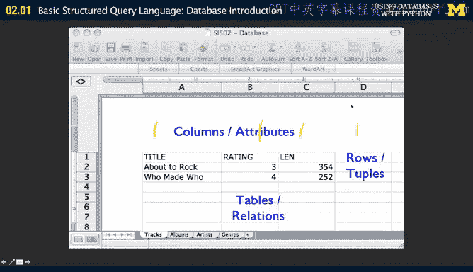
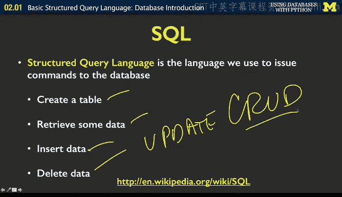

# 密歇根大学《给所有人的Python课》课程4：《使用数据库进行Python编程》｜python-databases｜ - P13：13_02_01_关系型数据库.zh_en - GPT中英字幕课程资源 - BV1PP411W7H1

So now we're going to move into talking about databases and it may seem a little strange to be talking about databases in a programming language。

 but we are using this programming language for doing data analysis and so it turns out that。

It's quite often necessary when you're pulling data。

 especially data you're pulling over a network where you might be rate limited where you want to store the data in a database。

 you have a process that reads the data and puts it in a database and then you can analyze it out of the database and it makes some of your processes go really fast it allows you to change your analysis and not lock your analysis into the retrieval of the information so it speeds up your overall workflow but you have to learn a bunch of stuff so that you can put the information into your database Now the first task that you have is to install your database browser。

There's a couple of different ways to read and write these files。

 we're going to use Python to read andr the files， but we want a way to read andrite the files directly and so this is a code that you can download for the Mac for Windows for Linux。

 but there's also a Chrome plugin that you can get for SQLite that you can do everything that we're doing in the class and so I don't really care how you achieve the things you're going to achieve in the class because we're going to grade you not so much about how you use things but instead we're going to look at the databases that you produce so you know stop now download this。

 install it， it should be simple， should be easy， check with the forms if we have some problems。

So relational databases are a whole subfield of computer science， and it might be best to talk about。

What life was like before relational databases and you use relational databases。

Thousands of times a day without even knowing it。 if you imagine something like。

A learning management system where there's hundreds of thousands of users and terabytes or petyytes of data and you log in in within a half a second it shows you what you're supposed to see。

You can't read petabyteta data。And a half a second， you just can't。And in the early days。

 we used to have。Data that was small。And computers that were didn't have a lot of storage in them。

 and so we tended to use tapes and we would put the data like on a magnetic tape and we would sort the data we would have the old bank balances on one tape we would have the transactions and then we would apply the read one balance check to see if that transaction if changed then we'd store the balance and then you would have like last night's bank balances and tonight's bank balances and then the next day you would put this over here and read the old bank balances and make changes and this is how day after day in the 60s and the 70s we would update data if you look at old computer videos you'll see these little spinning things well those are tape drives and that's where most of the real data was stored and it was。

嗯。But。As computers got faster， as they got more memory and as we started to store data more in the memory of computers and on the disk driveries。

 a whole different ways so you didn't have to read to get through the account of it starts with a letter S。

 you didn't have to read through all the data from A through S just to get to my account that starts with S。

And you then'd be like， oh wait a sec， we have a disk drive that we can skip all the away and skip back and skip over here。

 and so the problem became how to make use of this random access。

mededium in which we can store data in a way that's efficient and fast and clever so just because you could randomly access the data didn't mean it was fast。

 you still had all the data to look at and if you just looked at it sequentially so relational databases。

Weorre this？Applying cleverness to how we would use random access as data storage mostly disk drives that spun。

And it really sort of emerged in the '60s and the '70s and whole companies were formed like Oracle that。

Orracle exists because smart people figured this problem out before other smart people did。

 and so they got to form a company in Oracles the leading database vendor on the planet and much of its revenue comes from its database product and things built on top of its database。

 but literally，Before 1960， the concept of database really wasn't an idea。

 it was something that happened as storage and what we wanted to do with computers。

 so this is where if you had to really read a tape to log into a computer。

 it might take four hours to log in， which would be unacceptable in this modern day and age。

As I mentioned， the database is sort of this technology that emerged and it emerged from a lot of theoretical analysis。

 and the underlying foundations of database have to do with some really powerful mathematics。

And so there's powerful mathematics still is present in some of the terminology that some people use to describe databases and so there's really kind of two parallel terminologies that you will encounter you'll pick a book up and you'll kind of be able to read it and say。

 oh， this is used the hypfaluin， Hoiti Toy language， which is the more math oriented。

 so in the more math oriented， we use the words relation， tuple and attribute。

 that's kind of the fancy way of speaking about it， but sort of we programmers who just do our thing。

 we would call it a table， a row and a column。

Now table and row and column is kind of the wrong way to think about it if you're trying to understand the true underlying amazing mathematics。

 the underlying mathematics is don't worry about the underlying mathematics。

 just be aware as you're reading， don't be surprised when people lapse into this more fancy。

Nomenclature so the idea is that you model data at a connection point rather than like here's data and we're starting here and we're form reading through it。

 the idea is if you model everything is a connection like who a person is。

 a person is a connection between this that and the other thing and so this notion of modeling stuff at a connection is the underlying math that makes databases fast。

But when we programmers think about it， we kind of think about it as rows and columns and so here's just a screenshot of a spreadsheet that I made。

Along the bottom， you see the names of the various subheets， tracks， albums， artists。

 genres and titles。And those are like the database tables， and then each table， if you select it。

 has a row and a column。And so it's got these columns just has three columns in it and it has a bunch of rows。

 The other thing when you're doing stuff in a spreadsheet。

 you just kind of come up with a data model， a schema a strategy so that you know that the first column is always the title second columns of rating because if you didn't labeled it would make no sense so we often do something where the first row of a spreadsheet is kind of metadata about the the columns right now。

The spreadsheet doesn't exactly know that you're doing it。

 even though some of the things you do like sometimes it sorts and says oh check this tick box to say the first row is titled don't so don't sort it so when you sort stuff you only sort like the bottom part of it right and so it sort of knows that the title but in a database this becomes what we call the schema。

All this， all these titles and we have rules like this have to be integer numbers。

 this has to be an integer drummer， this has to be string no more than 128 characters。

 so we make strong contracts about the content that sort of at some level feels very similar to what we're doing when we're writing these titles。

 but in reality， as you'll see， is far more complex and far more intricate。Now。

 if you've ever tried to do something like we're going to do with this database and that is categorize your music collection。

 you find that a spreadsheet is a really hard way to categorize your music collection because of so much repeated data and we'll figure that out in databases。

So the idea that they came up with in the '60s and the '70s is there was a way to represent data on a disk and it could be randomly accessed and there was pointers that point to something else and whatever。

 and in the early days they figured out how to technically solve fast access to lots of data by sorting hopping in various ways indexing。

 doing clever things。And the early ways that we program these databases is we sort of revealed to us application programmers the low levelvel capabilities of read this thing。

 then jump to this other thing， then read this other thing， then jump to the other thing。

 read this thing， jump to this thing， which made our lives really difficult and so we had to write really sophisticated programs but when we did they could function very rapidly and so what happened over time。

Is instead of our code talking directly to the files or the databases？🤧Instead。

 a layer started to build up。That we call the database application or database。Database。

 I'm not doing a very good job drawing there right so here's our database。

And it has lots of complexity in it and originally we would sort of just talk straight to that complexity。

 but after a while we would have a database application and then our application。

 our code would talk to the database application and the database would know all the magic stuff and it was what we call in computer science and abstraction。

 which means that our job， this is us。And our job was easier because of the complexity could all be hidden here。

 and so the question becomes then how do we talk to this really powerful piece of software that we call a database？

What is living here， what is the way we communicate。

 sometimes we would call this an API application program interface， so this is our application。

This is actually another application， the database itself is an application and so we have to have an interface so that our application can talk to the other application and just like in the previous lectures。

 this is like a service that's taking care of it and ultimately let me change the color here let's get kind of messy we can sort of think of this thing right here。

 both the data and the software that understands the shape of the data。

And it's just a service and a service oriented architecture。So once again。

 what we have to do is define to use the service or architecture the cut point。

 what is the cut point between our application and this magic stuff， and this is Oracle。

so it's lots and lots of money and it's amazing， it's just really good software， right。

 Oracle's really good， Microsoft really good。So what happened was as we decided to create a standard at this point。

 the industry did， folks got together with National Institute of Standards and Technology NISistT。

 and they agreed on a language that was the API between an application and a database system。

And the name of that。Thing they came up with was SQL or the structured query language。

And so that means that， wow， I've made such a mess of this。

 I have to start over again and draw another picture。

Right so that means that over here you could have Oracle over here you could have Microsoft and here you could have app one。

And here you could have app two。An app1 could talk to Oracle or it could talk to MySQL or app 2 could talk to Oracle or app2 could talk to MySQL and so because they use the same communication between Oracle and MySQL。

 it means that you can write an app that's portable between different databases。

 and it turns out that this SQL is a beautiful language， it's just a gorgeous language。

 the reason I don't teach SQL is the very first programming language as you would be ruined。

If you learned SQL， you would never want to program in any other language。

 I think it's the most beautiful language that I've ever encountered。

 It's beautiful because it's of its simplicity and its expressiveness and its power。

 but then it's a very beautiful and elegant language， The problem with SQL。

Is it depends on the data being pretty。It's a great way to write。codeode about really gorgeous data。

 So part of what we're gonna do is learn how to make the data look really good and then write really cool stuff。

 Python on the other hand is a little rougher around the edges。

 but it also it just has no problem dealing with unstructured data or data that's imperfect or whatever and you can just keep writing more Python and eventually you're like oh man I thought it wasn't as complex of this so I got to add a little bit if statement here and add another if statement there and do another thing so Python handles unstructure rough data much better than databases and that's why Python plus SQL is such a powerful thing Python cleans up the data SQl is a great way to store and retrieve data So what SQL does is has four basic function we call it crud create read create read update and delete update is missing here。

Crud。So that's a database term is correct great read， update and delete So up next。

 we're going to talk about how you as the application developer are going to interact both in large projects and in small projects。

 small projects are going to be the most more typical thing that we use in this class。

 so that's what we're going to talk about in a bit and how you use software to interact with databases。

