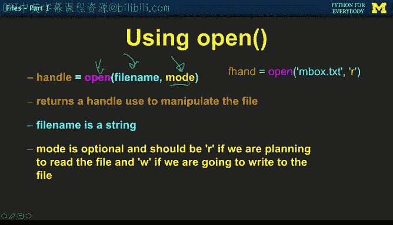
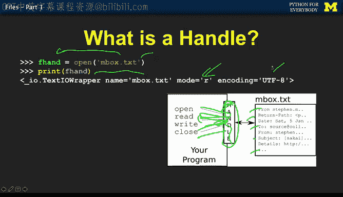
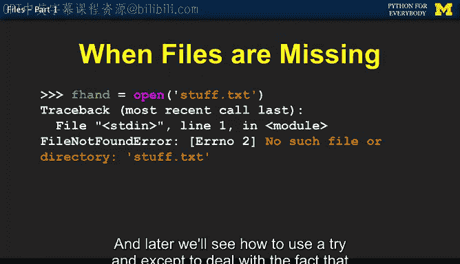
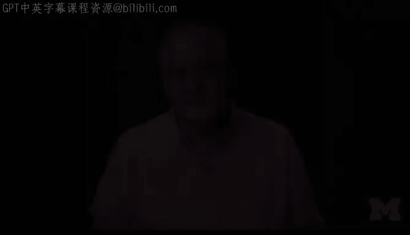

# 密歇根大学《给所有人的Python课》课程2：《Python数据结构课程（密歇根大学）》｜python-data｜ - P13：13_03_01_文件.zh_en - GPT中英字幕课程资源 - BV1yP411a7TZ

So welcome to Chapt 7。 This is the payoff。 I hope at the end of this chapter， you're like， I get it。

 I understand why we had to learn all that other stuff because of reading files。So。

Everything we've done up till now has been sort of just if a tree falls in the forest。

 If a variable gets set in a computer and no one reads it。

 did it really happen or if a tree falls in the forest， and no one hears it， did it really happen。

 So that's kind of what we've been doing so far。 We set X equals 3。 and then ask。

 and we print it back out。 or we do this whatever。 So we actually haven't done anything。

That touches the real world。 I guess we did help people get out of lost elevators。

 But other than that， we haven't done much interesting at all。 And so。

And that's because what we've been doing so far is practicing。

 sending instructions to the central processing unit and getting stuff back and forth。

 And so all the variables like your X and， you know， Y and fruit and letter。 they all live in here。

 and the code gets run in here。 And so we're just kind of doing this over and over and over again。

 This is the first chapter。 of course， we did go read some stuff from input。

 and it comes back in and we do print some stuff to output。 So that we've done that。 But now。

We are going to start working here because this is where the permanent storage is。

 And later we're going to talk to the network and talk to the database well later we'll talk to a database。

 And so these are the kind of permanent storage things。

 And so everything we've done up till now is either been to the keyboard in the screen or just inside the computer because that's what we've been learning how to do basically things。

 But now we're going to do things to something。 and that is to a file or to something。

 and that's where it gets interesting。 And so we have these files and the files we're going to play with initially are what are called flat text files。

 there are files that consist of lines and the file we're going to play with is called inbox Txt or inbox short dot Txt and you'll notice that this first line is the exact line that I played with at the end of the strings chapter。

This turns out to be a standard format called a mailbox format。

 and this is when you sort of take a mail program and you export a folder or a subfolder of that mail program into a flat file。

 this is the format that you get and so it turns out that it's somewhat useful and it's quite common to have to write programs to scan through email and look through stuff in that email so that's what we're going to do。

And so these text files， these flat text files， meaning that they're not like a word processing document or a PDF or something like that。

 They're just a set of lines that a program can read。

 Every program that you've written when you're writing Python programs are also flat text files。

 they just happen to end in dot Py。 And so here is a sequence of lines。

 It's some characters and then a new line。 It's like you hit the enter key。

 And then there's more characters， and then you hit the enter key， and then it goes back。

 It's like a type type type type type enter type type then goes back etc cea。

 And so it's a series of lines。And so before we can work with the file inside Python。

 we want to tell Python that we're going to work with that file。 This is an act we call opening。

 It's not actually reading the file。 It's just making the fileo available to the code that we're going to write and so the function that we use is a built in function in Python we pass in the name of the file and whether we're going to read it or write it if we leave this out it's going to be read and then it gives us back what's called a file handle So an example but a code is open inbox Txt so we can read it and then give me back the file handle。

File handle is not the data。 It's just a way to get at the data。

 And we'll see this later wind up with these handles or connections or sockets or whatever that they're not actually the data。

 but a thing we can manipulate。 So this handle is something that's sort of a port hole between your program and this file that's sitting on the disk and we can open it。

 we can read from it， we can write to it if we want。

 and then we can close the handle and then the handle goes away。

 But the handle is like our connection。 And so if you just open a file。

 This is for read because I forgot that second parameter。 I didn't put it in。 I print it out。

 And it is not the actual lines。 It says this is。A file。And it's a thing this is what its name is。

 we're reading it， and as we interpret the data coming out of the file。

 we're going to use the UTF8 character set to do that so it's telling us something。

 but it is not the actual file there could be hundreds of thousands of lines of data in that file。

If you try to open a file that doesn't work， that's not there， not surprisingly。We get a trace back。

 okay。And we could later we'll see how to use a try and accept to deal with the fact that sometimes files don't exist and you want to know that。

Now， an important character that we haven't played with much that's going to kind of rule your life when you deal with files is what's called the new line character。

And so here is the new line character in a string， you go bh， blah， blah， blah， blah， back slash n。

And so if you print this out one way， which means you just type it here。

 it shows you the backslash N。 But if you run it on a print statement。

 it actually interprets it and treats that as a nonprinting character that basically moves to the beginning of the next line。

 So that's what the new line does。 the new line is not two characters。

 the new we represent it as two characters in a string， but inside the string inside Python。

 it's really just a single character。 So if we say x new line Y， and we store that in stuff。

 So new line， we print it， and it goes like， you know， it shows this。

 But if we ask how many characters in it， it says there are three characters because that's character 1。

2 and3， actually， it's 0，1 and2。 But whatever that's three characters， it's not four characters。

 So the new line is one character， not2。 But we represent it when we're typing in to Python。

 we represent it as backslash n。 So if we。Think of this file as a sequence of lines。

We sort of visualize it this way that's like line 1， line 2， line 3， line 4。

 but actually what's going on is it's actually a long string of characters。

Which are punctuated by new lines。 And so these new lines are really in the file go back to the beginning。

It's like hitting the enter button。 This is that it remembers the enter button。

 It's not like it's magic。 There is an actual character that represents the enter button。

 And these this sometimes on different operating systems。

 There are different different versions of this， there's the Uniix and Mos there。

 But at the end of the day in these files， there is a character that says。

 go back to the beginning of the next line。 And even a blank line ends up。

 So it's like da da a new line。 And there's new line again， and that gives you a blank line。

 So if you take a look here， this blank line is really got a character that you don't see。

 It's a nonprinting character。 Remember， when we talked about white space。 new lines are white space。

 that's things you don't see。 but exist。😊，Right things you don't see。

 You just have to believe that they're there。 You have to believe there's a new line there on that little line。

So after a while， you don't need to imagine these， just remember that new lines are there and that's how the and the other thing is interesting that the print function。

If we print something out， it automatically sticks a new line at the end for us。

 and there's a way to tell print not to do that， but by default， print actually prints out da do。

 and then it puts the new line there on purpose。Okay。

 so that is how files are structured and where we store them inside the computer。

 and up next we're going to take a look at how we read files in Python。

