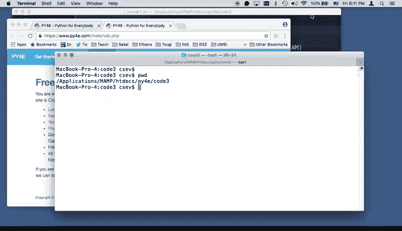
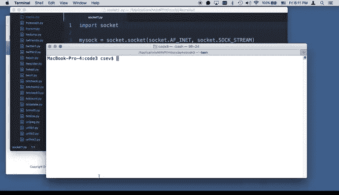
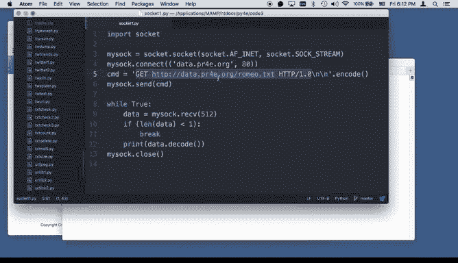
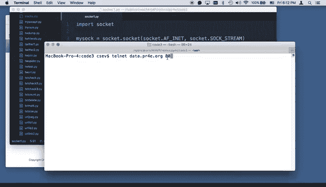
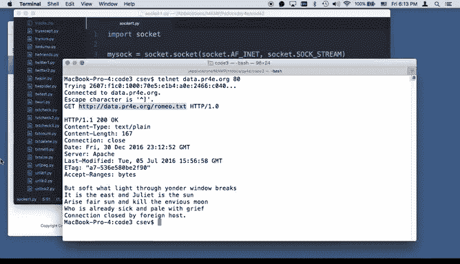
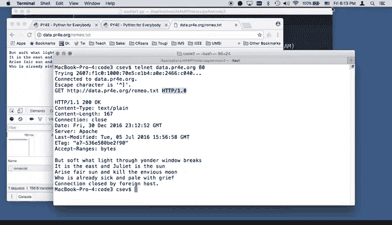
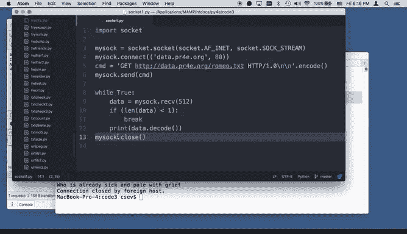
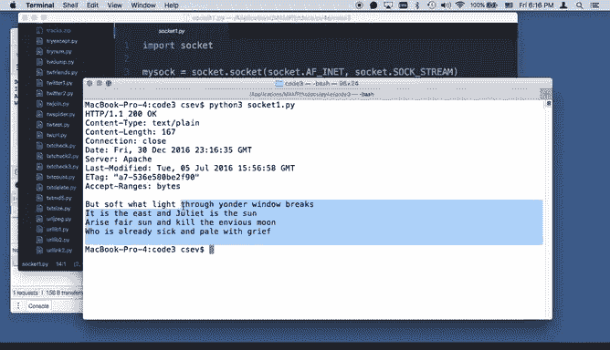
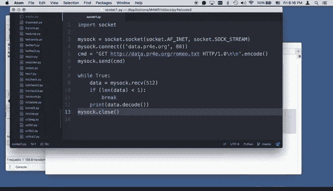

# 密歇根大学《给所有人的Python课》课程3：《使用Python访问Web数据》｜python-network-data｜ - P13：13_03_03_实战示例_套接字.zh_en - GPT中英字幕课程资源 - BV1Hu4y1e7WS

。Hello everybody and welcome to some Work sample code if you are interested in the source code you go to materials and download this sample code。

 zip I have this downloaded it'll be in a folder called code3 on my computer this is where I'm at I'm in the code3 folder and this has a ton of bits of code here so if I do an LS you'll see I got all these files here and so。

We'll just leave those there and so this the one I want to work through right now is this socket 1。

pyy code and basically what we're doing here is we're simulating what is going to happen in a web browser。

And the cool thing about the H， the HP protocol is that we can do this by hand and I'm actually going to hack this HTP protocol。

 This is going to go to data。pr4 e。org and retrieve a document。

And so I'm going to do tnet。Now you can do this on a Mac and Linux and if you put Tnet on a Windows box you can do it here data。

pr4。org and I want to talk to port 80 and the port 80 is a different port。

 It's a nonstandard port but what we're doing here is talking to the HtTP port and so I'm going to be able to hand send commands to the web server and retrieve a document So I' going I've already copied this string。

 this get http Romemeo。 Txt。

I'm copying that into my buffer because if I wait too long。

 this won't work so here I go and now I'm going to type that and I have to hit enter twice and that literally was the HTTD protocol what I typed there with the HTTB protocol and the web server responds with some metadata about the document how much data there is。

 the kind of data is there， a blank line separates the header information from the body of the document if I was to go to this in a browser right there。

 you would see。

And if I turned onDevelop console。And I went to the network， let's make this a little bit bigger。

You would see that。It retrieves file Romeo。 Txt， and it gets back that it tells us that shows us the headers and it shows us the response and so this is all the same way of doing the same thing and that is how to do the HTTP protocol okay but now we're going to do this in Python and so here's the code we're going to write。

So we're going to import the socket library and we're going to make a socket now this doesn't actually make a connection。

 think of a socket as a file handle that doesn't have any data associated with it yet。

And then what we're going to do is we're going to reach out and connect that socket to a destination across the internet with the domain name of date PR 4 E do org。

 and the second parameter in this tuple。 this is a function call with a single tuple as a parameter。

And so Tuples0 is datad。pr4。org and Tples1 is the 80， which says I want to talk to board 80。

That could fail， it will make the connection。And if the port 80 is there away it goes。

 And then we're going to actually send the HtTP command。 So get。

 this is the HtTP rules followed by an end of line， followed by a blank line。

 So you saw me do this this was what I typed here。 and then I had to type a blank line。

 Now if you want to go read the RFcs for how to do this， you can figure this out。

 So the only other thing that's kind of weird here is we have to add this dot in code。

 And that's because there are strings inside of Python that are in Uniode。

 and we have to send them out as what's called UTF 8 and in code converts from Uniode internally to UTF8。

 So this command is a set of UTF8 bytes that we're then going to send it still has that same set of characters in it。

 and now we're going to send it。 And that's after after we've made the connection We're going to send these two things。

 and then we're going to wait。And my sock is like a file handle at that point because it's been opened and we've sent data。

 The HtDP protocol told us what this we had to send and the fact that we did have to send it。

 So now I have just a simple while loop and I'm going to ask up to 512 characters and you know receive up to 512 characters and get that back if I will know that this is the end of file if I got no data back。

 So the length of the data the byte array that I got back is less than one then I'm going to quit otherwise I'm going to print the data and I'm going to use this decode which is kind of the opposite of this end code what I'm getting is UTF8 encoded data most likely and decode basically converts it to the internal format called Unicode that runs inside。

 and so this is going to run a bunch of times pulling in the blocks basically 512 up to 512 characters of time printing it out and then when it's all said and done we will close that connection and so it's not too exciting Python 3。

Soocket。1。 py and you'll see that it's just going to Python is now going to do what I did by hand。

Now， of course the interesting thing is these are all in strings right。

 and so you know this way we could write code that does stuff with this。

 but all we're really trying to do in this particular situation is show how you open a socket。

 send a command， and then retrieve the data。

