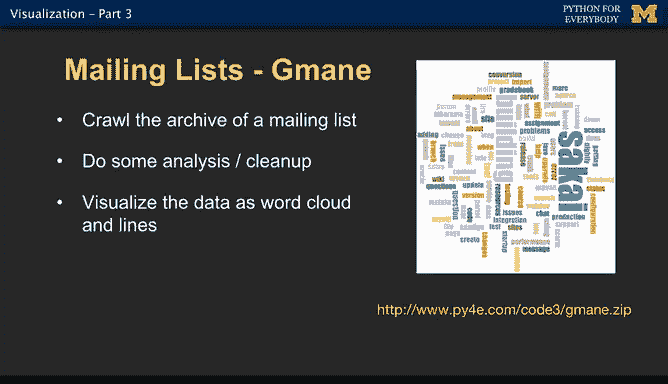
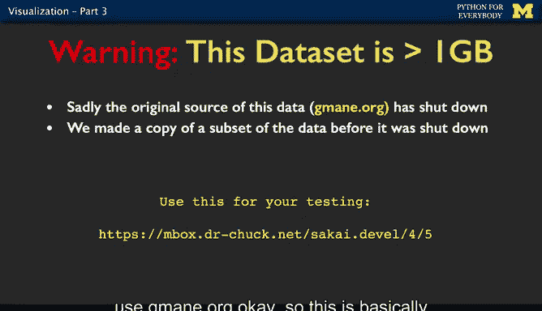

# 密歇根大学《给所有人的Python课》课程5：《毕业项目：使用Python检索、处理和可视化数据》｜python-data-visualization｜ - P13：13_04_01_Gmane系统介绍.zh_en - GPT中英字幕课程资源 - BV1Eh4y1U7aE

So now we're going to do our last visualization and it's interesting that it's kind of we're coming full circle。

 we're back to email。 And so instead of you know a few thousand lines of email。

 we're going to do a gigabyte of email。 And you're going to spider a gigabyte。 Now actually。

 if you look at the read me on G do zip。 it tells you how you can get a head start by doing this first 675 megabytes by one statement and then you can sort of fill in the details。

 The idea is is that we have an API out there that will give us a mailing list。

 given a URL that we just hit over and over again， changing this little number and then we're going to pull in this raw data and then we'll have a analysis cleanup phase and then we're going to visualize this data in a couple of different ways。

 Now。

This is a lot of data it's about a gigabyte of data。

 and it originally came from a place called Gmain。org。And I've got this H DTP Mbox， Doctor。

 Chuck dot net that has this data， and it's on super fast servers that are cached all around the world using this thing called Cloudflare。

 So they're super awesome。 And you can beat the hack out of Doctor Chuck do net。 And I guarantee you。

 you're not gonna hurt it。 You can't take it down。😊，Good luck trying to take it down。 Okay。

 because it is a beast。 So make sure that when you're testing。

 if you're better use doctorchuck do net， don't use Gma。 org。 Okay。

 so this is basically the data flow that's going to happen。

And that is， you know， we go to this Drchucknet， which has got all the data。

 it's got an API and we basically had their sequence of numbers so that just message1 message2 message3。

 And so we can you have a message1 message2 message3 and we know how much we've retrieved And so this program when it starts up it says how much is in the database go down down。

 down down down down okay number4。 so then it calls the API to get message number 4 brings it back and puts it in calls the API message number 5。

6，7，8，900050200300 O crash。 again， this is a slow but restartable process。

 Okay And so then you start it back up and it's like， oh， we're 51。 So we go 51，52，53。

54 And if you are really gonna spider this all I think when I spider it the first time it took me like three days to get all of it。

 And so it's kind of fun right unless of course you're using a network connection you're paying for。

 do not do that。Because you're going to spend a lot of money on your network connection if you're on an unlimited network or you're on a university that's got a good connection。

 then have fun， run it for hours， see， watch what it does。

 it just grinds and grinds and grinds and grinds。Now。

 what happens is it turns out that this data is a little funky。

 and it's all talked about in the Readme， but this is like almost 10 years of data from the Sakai developer list。

 and people even change their email address。 And so there's this little bit of extra like patchy code called G model that has some more data that it configures it。

 and it reads all this stuff。 and it cleans up the data。 So this ends up being really large。

And if you recall from the database chapter， it's not well normalized。 It's just raw。

 It's set up to be。 it's unindexed。 It's very raw。 It's only there for spidering and making sure we can restart our spider。

 If you want to actually make sense of this data， we clean it up by running a process that reads this completely wipes this out and then writes a whole brand new content。

 And if you look at the size of this， this is really large。 and this is really small。

And if you have the whole thing it can take， depending on how fast your computer is。

 it can take minutes to read this data because it's so big。

 and this is a good example of normalized data versus non normalizedormalized data， so it takes like。

 let's just say it takes two minutes to write this because it's reading it slowly。

Ca that's not normalized。 This is nicely normalized。

 It's using index keys and foreign keys and primary keys and all this stuff。

 All the stuff we taught you in the database。 That's here。 So this is a small。

 And you look at the size of the file。 It's roughly got the same information。

 but it's represented in a much more efficient way。So then this produces content。 SQLL。

 and then the rest of the things read content。 SQLL because this is the cleanup phase。

That's the cleanup phase。 Now， what you can do is you can。You know， run this for a while。

 then blow that up， then run this。 And that's fine because every time this runs。

 it throws this away and rebuilds it。 and maybe look at some stuff and you say， oh。

 I want to run some more。 And then that's okay because now you can start this backup。

 And as soon as you're done with， however far you went there， you stop that。

 And then you do this again。 So that you do this And it reads the whole thing and updates this whole thing。

 And so then once this data is been processed the right way。

 Then you run G basicic do py and it dumps out some stuff。

 but it's really just doing database analysis。 And then if we want to visualize it with a line。

 you run this G line do py。 And again， that loops through all the data and produces the data on g line do js。

 And then you can visualize this with a HTMLtm file and the D3 do js。

 And if you want to make a word cloud， you run this G word， which loops through all that data。

 produces some javascript that then is combined with some more HTMLl to produce a nice word cloud。

 And so the read me。Tells you all of this stuff and gets you through all this stuff and tells you what to run and how to run it and roughly how long it's going to take so you can work your way through all of these things。

So in summary with these three examples we're really sort of writing a little more sophisticated applications。

 I've give you most of the source code for these applications。

 but you can kind of see what a more sophisticated application looks like and based on these you can probably build your own data pulling and maybe even a data visualization technique and adapt some of this stuff so thanks for listening and we'll see on the net。

