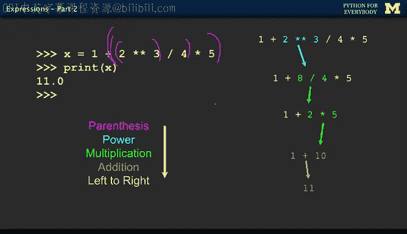

# 密歇根大学《给所有人的Python课》课程1：《编程入门指南（使用Python进行开发）》｜python｜ - P13：13_04_03_数值表达式.zh_en - GPT中英字幕课程资源 - BV1214y117Mk

So welcome back， now we're going to continue on the right hand side of assignment statements and talk a little bit more about some complexity about how what you can do with these expressions。

So。All programming languages have various operators where you say you know x plus1 or x minus1 or something like that。

 these operators historically come back to come from the kind of characters that were on computer keyboards in the 1960s literally these things called teletypes came from the end of World War I and they had a certain set of characters and we were going kind of from mathematical character set where multiplication as a big cross or a dot in the middle and exponentiation is raising a little tiny number above it。

 and we just couldn't represent those on these really rudimentary key punches or rudimentary terminals so we had to map mathematical formulas and functions into what could be done。

And so those keyboards from you know。40 years ago，50 years ago， they had a plus on it。

 So plus is a plus， they had a minus on it。 but multiplication， which is normally cross。

 is star and division， which you can't put things on top of one another。

 So you just made a slash for division and raising to the power is double star。 Now。

 the remainder operator is something that's not typically on calculators。

 but it' really important for computers。 and we'll take a look at this。

So so the addition operator pretty straightforward。

 I've kind of been using that without even talking about it， the multiplication in the division。

 So this is 5280 divided by 1000， which gives me 5。

28 but the one that's probably the most interesting is this modulo or remainder operation And so the way the remainder operation works is in particular if this is an integer is it does the division。

 so it's like it's almost like a division j divided by 5， but instead of giving the quotient。

 this is the quotient。It gives the remainder。So 5 divided by 23 is4 remainder 3。

 the three is what you get back。Now you might ask yourself， why is this useful？

 So one of the ways to do make this useful is to pick a large random number and then use the modular operator as a remainder operator with 52。

 And then you end up with a number between 0 and 51。 And then you can pick a card。

 So you can take a random number， but you modo at 52。 and now you can have a random number。

 that's that is a card。 Or if you want a roll a dice。

 youd make a big random number and you take it modo 6。

 and then you can tell it tells you what side of the dice。 So I like games and stuff。

 There's other situations where you can do even an odd calculations like is this an odd number and even number。

 divide it by  two and see what the remainder is。 And so， so this whole notion of。😊。

The modlo operator， it's， it's really useful in some situations。

 And so that's why we obsess about it a little bit。 The power operator， this is 4。

 This is like 4 times 4 times 4， which is 64。 So those are the numeric expressions。Now。

 these also have an order of evaluation and the way it works is。In in mathematics。

 there's order of evaluation， There are some operators that are more powerful than other operators。

 And you can always， if you're clever， just put parentheses in。

 And most programmers always put parentheses in。 So if I was writing this line of code。

 and I want it to be friendly to you so that you could read it more easily。

 I would simply put the parentheses in for you。 So I'd say5 to the sixth power goes first。

 then this four divided by that goes next， then this two times3 goes next。

 And then we evaluate the rest of these things left to right。 So I just added the parentheses。

 that are the same this is exactly the same as what it would be without the parentheses。

 because this happens first， This part here happens second。 This happens third。

 and then all this other stuff happens forth。 So there's an order。

 But we're going to teach you what the order is。 if you weren't going to use parentheses。😊。

So the rule is parentheses overrite everything。 Exponentiation is the most powerful multiplication and division and remainder are equal。

 They're the next most powerful in an addition of subtraction。

 And then when in doubt you just go left to right。 So within if there's a bunch of additions。

 you just go left to right or if there's an addition and subtractions and a bunch of stuff。

 you go left to right， okay so。This is a classic exam question on computer science homework that you just say。

 okay， what does this evaluate to Now， of course， if you have Python。

 you just type it in and tells you what the answer is， but。

So the way I used to do these back in the day when I was doing these homework is I would write the expression down on a piece of paper and then I would look through it。

 and I would figure out what the first thing was。 and I'd be very careful about this。 and I'm like。

 okay exponentialonentiation happens first。 So I'll do the two to the third power， which is 8。

 And then I'll rewrite the whole thing 1 plus 8 divided by 4 times 5。

 And then I would forget about this one and I'd look here and I'm going go look okay。

 what's the first thing here。 Well，8 divided by 4 is a first thing there。

 So then I'd be like8 divided by 4。 Well that gives us 2。 in this case it gives us 2。

0 And then I have1 plus 2。0 times 5。 and I look and that's the next one。

 So that ends up being actually this ends up being 10。0 and that ends up being 11。0。

And that's why this prints out 11。0。 And so if there are no parentheses。

 you can figure out another kind of exam question is to ask what the parentheses would be。

 So the exponentiation happens first。 the division happens second。

 and then actually you'd put another parentheses because you know that result is multiplied by5。

 And so that's another way to kind of answer the same question is say。

 put the parentheses in where they belong。

Like I said， parentheses first， power second， multiplication， third addition， and then left to right。

 So when you got nothing but addition of subtraction， you go left to right。

 when you got nothing but multiplication division， you go left to right。 start with the leftmost one。

 Sometimes it doesn't matter， but in addition to subtraction， it generally doesn't matter。

 but in multiplication of division， it can matter left to right。

