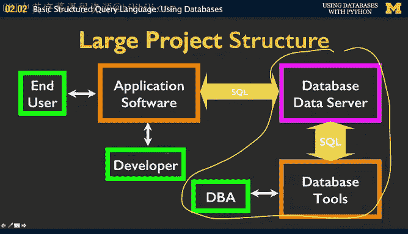
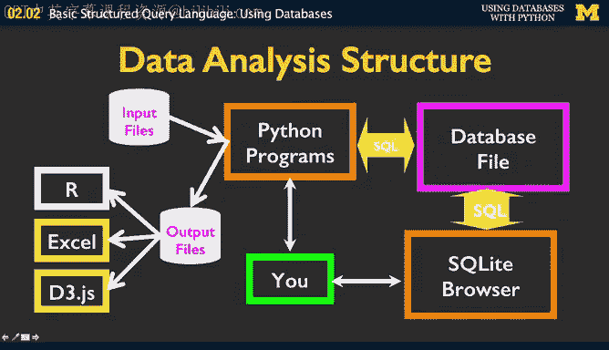
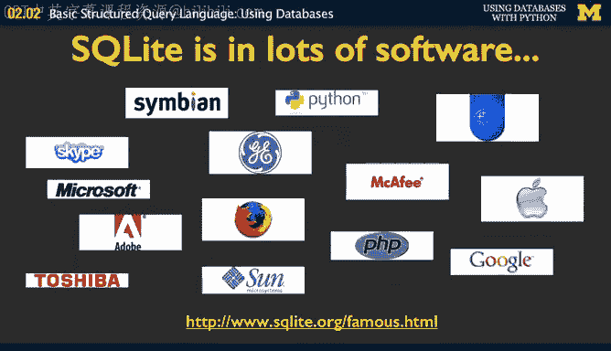

# 密歇根大学《给所有人的Python课》课程4：《使用数据库进行Python编程》｜python-databases｜ - P14：14_02_02_数据库使用.zh_en - GPT中英字幕课程资源 - BV1PP411W7H1

So now we want to talk about how we place the database and the database software in relative to the other aspects of the programming environment that we're going to build and we're talk both about large projects in small project and a large project would be sort of a website like you know maybe you build a website to track comic books or something and used or all the data and database and so in a large project and we're not going to do it in this so much in this class。

 but I figure it's time now that we're learning about databases to sort of give you a sense of how they're used in these online systems and maybe in a future course you'll see how they're used learn how to do this in large projects but there generally sort of two roles one is the person who writes the application and it produces the user interface for the application and for the website and then there's the other that actually sort of monitors and adjust the database and that person is the database administrator often in a large project。

 you will get some advice as an application developer from a database administrator and the idea is the database。

Tuning and monitoring is a somewhat specialized job。

And so in a professional environment like the open source learning management system that I work on named Sakai。

 in production I don't get as a developer so that's who I am， this is me I'm a developer。

 I write cool code I make really neat widgets for the end user and this is the end user in a web browser talking to my cool thing and I add a little button and stuff like that and I write code that actually talks to the database。

 the database server which is both code plus the database storage itself。

 and I write code that talks SQL to the database server and gets database and then formats it for the end user and that's what developers do。

 they are the ones that create application software。

The database administrator。Generally， we don't let the developer talk to the database。

 the production database directly because we're afraid the developer will break it。

 and that's probably because there's been a lot of experience where developers broke it。

 so we have a special person called the database administrator and they're the ones that are allowed to talk to the database now because the database is both storage and software。

 it can take SQL queries from many different sources， both the application or database tools。

 and so the database administrator has like a direct way to talk to the database and get data back and so if something's going wrong like。

It's gotten really large， what's going on so the database administrator will start running commands straight to the database。

 whereas the developer generally has no access to the real database。

 eventually we can write a new version of the application software。

 and so that's kind of the split between the roles between developer and database administrator in large projects。

And the database administrator does all that helps with the design and implementation and often a database administrator is shared across a number of software projects。

 but that's not exactly what we're going to do so it'd be nice maybe you have a job maybe you do have a job that there's a database administrator and it'll kind of look like that but right now during this class we've met the database and the application developer and they're both you okay they're both you or me right and so what's going to happen now is you get to do both roles and later if you have somebody to help you with it。

 you might turn more into the developer side or more into the more in the database administrator side that's perfectly fine so we still have a database system。

Right and that's got both the logic， the software that is makes the database smart and the data itself。

 and we talk to it and the program we're going to use。

Initially right now as we're going to study the DBA way of doing business， you're going to write SQL。

 you're going to talk to this little piece of software that's going to submit stuff directly。

 and so you are going to act as a database administrator we're going to create tables。

 put data in them and we're just going to type stuff in to this application called SQLI browser there are others of these applications that are like database administrator applications much later。

 much later。We are going to start writing Python programs and in those programs we're going to talk to the same database files using SQL and we're not going to write programs that have a web interface that would be like Twitter or comic book registry。

com or whatever we're going to have various sources of input sometimes files， sometimes network。

And we're going to write programs that read this stuff and clean it up。

 often there's a cleaning step。And then we are going to write the data into a database。

 and so we're going to grow this data， fill it up。And then。

Then we'll sort of be done with this phase of acquiring data and all our data will be sitting in a database。

 then we will write another Python program to read this data and maybe make a pretty file and even later in the class we will be visualizing that or sending it to various other places you might send it to R to do statistical analysis or Excel to do some simple analysis or visualization or we'll use JavaScript to make pretty pictures and spinning things and whatever。

 so the basic pattern here is it's the same we're going to have sort of apps。

And then we're going to have DBA。But they're both you。

 so the thing we're going to focus on first is right here。

The database we're going to use is a thing called SQLL and the software we're going to use is what I told you to install right at beginning a while ago。

 hopefully you've done that SQLite browser because otherwise you can't talk to the database unless you have something equivalent to this and they do exist。

 but the basic pattern is read data， clean it up， stick it in the database。

in a sensible and organized way and then write other applications to make sense of it and analyze the data。

 and that's what we're going to be doing coming up。

So when we build this data。I that I mentioned the word schema right that we come up with a contract for exactly the way the data is supposed to look and with this contract the database software can make the best use of itself right。

 it can make good use of the disk drive， it can make good use of all these other things and so we call this the database model and it's best thought of as a contract。

Okay we're going to talk into this file， there's going to be magic things that are stored in here。

 we use this database software and the schema is our way。To inform。The database。

 how we think this how we're going to use the data and let the database figure out the way to plate it。

 where to put it， I'll put this thing over here， I'll put another thing over here and I'll put a little shortcut over here。

 We don't care about that。 We say this is the data model we're going to work with and you the database code are supposed to be really smart and figure out how to make the most sense of that so the data model。

He's not just the SQL Aqu yet， but the data model is our contract about the shape。

Of what we're going to store and retrieve in our database。

So there's a number common database systems I've mentioned several of them。Wacle？Is awesome。

It's a company that was effectively created just to make a database system and they were founded at the birth of the relational movement and。

One， because they were very good at it。The others who didn't win were like IBM and others。

 although they all have relational databases as well。

 a lot of those other vendors who did not who let，Well。

 I don't know if letting Oracle win is the right word， those vendors that did not。

That Oracle out competeetd were the ones that didn't embrace this relational stuff because I was。

I was in college when NA saw was coming down and some of us are like ah， relational， too much math。

 give me the quick， dirty stuff right and it took a while to the relational model really to win but when it won it won big time and Oracle was a company that made a bet on it winning。

And so by the time we all realized， whohoa， it's a good idea because we all thought it was a bad idea。

 or at least I did。It was too late Oracle had the best implementation of the good idea that we all finally realized was a good idea hence so Oracle kind of wins so then what happens is。

Oracle's kind of the old dog in the marketplace， the very expensive commercial。

 a lot of people think it's the simply the best， but there's alternatives that are quite nice。

 there's mySQL。Wwhich is a open source， MyosQL has been purchased by Oracle。

 but continues to be open source if you really want to be open source， there's a MySQL Mariah Db。

MariaMaria Db it's called starts with an M on purpose so that it starts with the same letter as that and so Mariaia Db is a copy of the open source version of mysql which was made at the moment that Mysql was purchased by but MyQl remains open source so a lot of people who use Mysql are switching to Mariah but a lot of people just keep using mysql and if Oracle does something bad with mysql we'll all switch to Mariaion that'll be the end of that so at that point Oracle't hasn't done anything really bad with mysql and so it's okay so we tend to use mysql for online websites a lot of website stuff Oracle tends to be used for enterprise kinds of things and then another one that's very popular is Sql server it's the Microsoft one you may have even used Microsoft access and you might have even done like a screen where you're dropping things down that turn out to be SQl under the covers don't know SQl server for Microsoft is a very good。

Product some enterprise organizations are all Microsoft and so they use SQL server don't feel bad pretty much everything I'm going to talk about applies equally to SqL because SqL is a standard and that's nice There's another one called Postgres。

It's also open source it's very nice and it's kind of more of an imitation of Oracle than MySQL MySQL is designed to be simpler and faster and solve less problems than Oracle。

 but do them super fast and that's why it's often very popular in websites Postgres is sort of more of a rich database that's very very much a direct competitor oracle。

 MySQL is its kind of own world。And we're not going to use any of these。

If you go take sort of a web class， you will probably use my SQL and everything I'm going to teach you in this class is useful there。

 okay all the knowledge， all the SQL， but we're going to use a thing called SQL light。

 light meaning little， tiny， not very heavy， and so SQL light is what's called an embedded database。

And MySQL or Oracle are whole pieces of separate software that we sort of talk across a network connection to。

 but SQLIite is actually part of software， and so it's built in your car。

 if it's a reasonably modern car， probably has five copies of SQL light in it。So your car。

Has SQL light if you have a fancy music player in your car， it probably is using it if you have。

On iPhone， it probably has 30 copies of SQLI in it because SQLite is designed designed to be really small。

 so small that you actually don't have to separate it。

 you just build it into the application and the thing that matters most to us。

iss that it's built into Python it's already there in Python so that's super awesome right and it's fast and aimed at smaller amounts of data。

 but because in Python we're doing data analysis， we will make good use of SQLite and the fact that it's built in just makes our life really simple we don't have to install a bunch of software。

 Python has it with nothing more than an import statement。

You know how this story goes if you're in Python and you got to get something done。

 the first thing you do is figure out what import statement。You need。Okay。

 so that gives us a sense of the SQL applications that we'll be using up next。

 we're really going to start writing some SQL， make a database and put some tables in and put some data in those tables。

