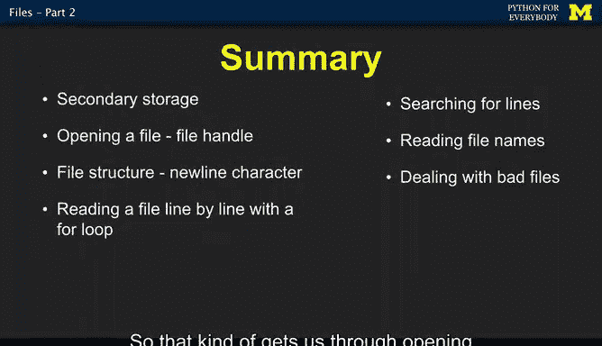

# 密歇根大学《给所有人的Python课》课程2：《Python数据结构课程（密歇根大学）》｜python-data｜ - P14：14_03_02_处理文件.zh_en - GPT中英字幕课程资源 - BV1yP411a7TZ

Okay， so now we know how to open files。 Now we have to learn how to read through the files。

 and it couldn't be easier。 It really couldn't be easier。

 It's almost at the point where you probably would have guessed it if I didn't tell you。 Well。

 so X file， remember， is not the data。 It's a way to get at the data。 It's a sequence。 Well。

 we already have a loop that determininate loop， the for loop。

 And all you do is you put the handle here。 Now， this is not the same as putting a string there。

 The for loop is smart。 this is some kind of a sequence of things。 So。

A file handle to the for loop looks like a sequence of lines。 It's a sequence of lines。 So again。

 the for loop is going to run this code multiple times where the iteration variable。

 Che in this case is going to take on the successive lines。 if this file has 10 lines。

 this loop is going run 10 times， cheese is gonna be the first line。 The second line， third linet do。

 So that's it。 That's it。 In't it pretty， no while loop， no end of file， no nothing。

 run this is many times as necessary。 one time through for each of the lines in the file。

 you take care of all the the stuff。 And if you've done this in other programming languages。

 you'll be like Python。 you are my friend。 because it's simple。 And you can look at it。 go like。

 I know what it's doing。 Whereas all these other programming language。

 I have like total gibberish ways of doing this。 And yes， you can figure out。

 And after you use C or or or some other javascript language or whatever to read a file。

Just Pythons better because Python is elegant and straightforward。

 and it has to do with this for and in clause， which I'm so in love with。

 So that just says treat a file handle as a sequence of lines and allow us to iterate through it automatically using the for loop。

So。We can write some smart things， right So accounting loop let' just do counting。

 So now we actually have something to count where we don't exactly know how many things there are。

 right， If you go back a couple of chapters， we are counting things。

 we knew how many things there are， but now we don't。

 So we set counter to0 and then we loop through each line or don't do anything with the line count equals count plus1 and we're done。

 We know that this line has this file has1 hundred32045 lines。And away we go。

 so we have built a line counter， a file length counter。

Just by looping through that simple stuff now， sometimes not not so much when we're doing files。

 but often when reading data from other elsewhere， we want to read it all。And so this time。

We will read the whole thing in with dot read。 Now。

 the thing about this is it doesn't split it into lines。

 It actually just reads all the stuff with a new line， all the stuff with a new line。

 So you got to be careful。 But of course， if you print it out。

It will give you all the new lines because the prints will show the new lines。

 But you have to realize you've got the whole as one big blob of characters punctuated by new lines。

 Whereas the for loop knows to go to the new line and then give you the first line。

 go to the new line， give you the second line， et cetera， et cetera。 But we can read the entire file。

 So in this case， we're reading embox short dot text， read the whole thing into a string。

 So that takes all of that file， whatever's on that file and takes the characters and sticks them in。

 And we can say how many things did we get。 Well we got 94626 characters in this case。

 And we can just print like with slicing， start at the beginning up to。

 but not including the 20th character。 So that's really the first 20 characters that we would see from that file into a single string。

 And sometimes we'll use that sometimes we'll write a for loop。

 depends depends on what we're trying to achieve。We can search through things and we can show the lines that meet a search criteria so we open this mailbox。

 we're going to loop through line by line and then we're going to ask if the line starts with from colon and space print it So this is going to read the lines and then once in a while to run this loop and read some more lines and then once in a while to run this loop read the lines so it's like a search operation through the file and then so this is going to there may be many lines。

 but then there's a from。And so it skip， skip， skip， skip， skip， and then prints that one out。

 so it's a very， very nice way。Now， if you run this code。

 you're going to see that it prints out the first from line， the second from line。

 But the question is， something is wrong。 We're seeing lots of blank lines。 lots of blank lines。

 blank line， blank line， blank line， blank line is like， what's going on here。 Why are they。 Well。

 it turns out that the print statement， as I mentioned before， are the print function。

Adds a new line。But。Actually， I'm pointing at the wrong new line。The print。Adds a new line。

 this new line right here。 But the file that when we read it from the file。

 the string has the new line at the end。 So this new line is part。

 this part is what we read in from the file。 And this is the new line that was added by the print statement。

 So then we end up with two new lines， which leads to a new line。

When there's no characters leaves a blank line， that's how we end up with blank lines。

 The print statement did this。 and then I sorry， the text from the file did this and then the print statement did one more。

 and so that we ended up with new blank lines， So how do we deal with this。Well。We have a function。

Function we talked about in the last lecture called our strip， which strips off whitespace。

 New lines are part of whitespace because you don't see them。

 And so we read through we're going to read each of the lines in the file。

 and then we're going to grab and strip off the white space from the right side。

 So we're going to wipe out the new line that was here on that string。

 and then we're going to print it out。 and prints going to add a new line。

 but now we don't end up with two new lines。 So you are going to write these lines of code over and over and over again。

Open a file， read through all the lines， throw why the white spaces at the end。

 and I'll do something fun and interesting with those lines of files。

 So this these three lines you're going to get to know really。

 really well before the end of this class。Sometimes we'll write a if statement where we say。

 you know， if something， if we're looking we're throwing away most of the lines in the file。

 but keeping some。 So this case， this is these are the good lines， right。

 the ones that start with from or the ones we're interested in。 So we're going to print them out。

 Sometimes what you want to do is actually flip the logic， right？ So in this case。

 it's a different way of writing this same loop， but just a little bit differently。

 We do these three lines， that's the same stripping the white space。

 And here what we do is if the line does not start with from。 So that's the opposite。

 If line starts with from this not turns it flipping it。Continue。 So this is a way of going back up。

 Remember how continue works goes back to the top of the loop。

 So all the lines that are uninteresting to us were going to skip。 You might want to call this skip。

That's what we're kind of doing。 Sip。 but it's just skip this line。 go get the next line。 S， skip。

 skip。 Oh， wait a sec。 This one became true。 We found one。 And so we print that one out。

 And so that's going to produce the exact same。Exact same as the previous one。

It's just what we're doing is we're skipping the lines we're not interested in。

 And then because often the amount of code we're going to do is quite a bit。 dilah， blah， bh， blah。

 bla， blah， add some things， parse them in different ways。

 It's better to sort of skip the bad lines and then fall through for the good lines。

 It's just sort of a stylistic thing between this code And this code is just a stylistic difference。

 Not something really to worry about。And so this again is code， we can do all kinds of things。

 we can look for all the lines that have UCT， we can use N。

And so we can say if UCT is not in the line， if not UCT in the line， we're going to skip it。

 and so that's going to find the various lines that somewhere inside those lines have UCT and print those lines out UCTTT。

 and so this is that's the output that comes out of that particular loop。Now。

 often you're going to get assignments from me where you have to do it for the long mailbox and then the short mailbox。

 and so it's good to learn how to read and write the name of the file。

 read the name of the file from input， so we just use input。And we say enter the file name。

 so you type in the file name。 that， of course， is a string that goes into this thing。

 I call it F name。 I tend to use that variable over and over F name， and then I open it。

Get a handle and then I loop through it and count the number of subject lines right that's what this is doing If line starts with subject colon count equals count plus1。

 and then it just prints out how many subject lines there were so you know it's going to count them in the big mailbox there are 1797 subject lines in the big mailbox and if we run the same code again mailbox short dot Txt then there were 27 subject line in mailbox embox short do txt。

 So the idea is this is the different file name we can teach Python to open file names instead of just using strings we prompt for the name of the file on input and then we open that file instead。

Now。If the user types in a bad file name， it's gonna to blow up， let's say we want to deal with that。

 We can。 We can deal with that。 So in this case， we're going to take input。

 and that's going to work because no matter what they type even if it's junk。 Okay。

 it's going the input's going to work。 But the open is going to blow up if the file name is a bad file。

 And so we indent that and put it in a try block。 So we don't know if this is going to work or not。

 Of course， if it works， it's going to just keep on going。 if it fails， if something goes bad here。

 it jumps to the accept block。 So an accept block， we put out a message。

 file cannot be opened and then print out the file name， be nice to our users。

 And then we put this quit statement in。 the quit statement says I'm quitting。

 I don't want to continue it。 Otherwise， it would continue down here and the quit statement。

 It's a function that it goes into but never returns from。

 And so it makes sure that you don't actually fall through and run this code because F hand is not properly defined。

 So it's going to just trace back down here。 if it。If it runs， so you got to add this quit。

 So when things are bad。When something is not working， this blows up， it runs this code。

 It prints that out。 And then it quits。 And so it otherwise。

 you get trace backs down here If you didn't put that quit in， you'll get used to this。

 So when when you， there's no reason continue because you didn't get the data you expected。 Now。

 some of you are going to want to change this so that it's a while loop。

 we'll talk about that later So at repro for the file name。Little complex like right now right now。

 I just want to show you how the try and accept can compensate when you're prompting the user for a bad file name and you're trying to read that bad file。

 but if you don't want to have a trace back， you just want to print out a nice message so。

That kind of gets us through opening files and looping through files and doing something intelligent in the loop。

 And we're going to do a lot of this。 We're going to be opening and stripping and looping and parsing and doing all kinds of fun things。

 So so coming up next， we're going to learn switch gears a little bit and learn about data structures。

