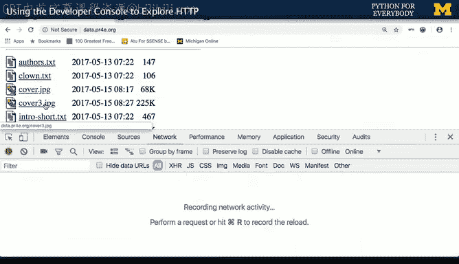
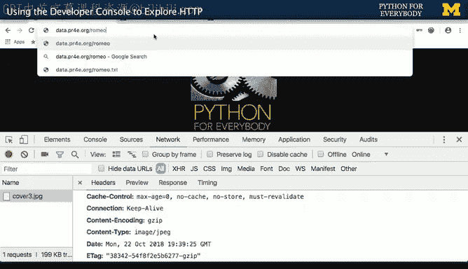
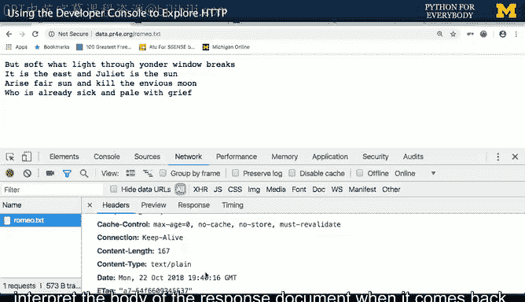

# 密歇根大学《给所有人的Python课》课程3：《使用Python访问Web数据》｜python-network-data｜ - P14：14_03_04_使用开发者控制台探索HTTP.zh_en - GPT中英字幕课程资源 - BV1Hu4y1e7WS

So in this video， we're going to talk a little bit about how to use the developer console in your browser。

Really， in this course， we're ring Python programs to talk to the internet。

 but sometimes you want to debug how a page is really working and the tnet program is on less and less operating systems。

 they took it out of the Macintosh。 it's still there in Linux。

 But so I want to tell you how to use this developer console to find out various things about your request response cycle。

 So let's take a look here at this page。 So this is our page1 Htm。

 And we've looked at this a lot of different ways， whether it be tnet or in a Python program。

 And now I'm just going to type it in on a browser。

 and then we're going to kind of tear apart what's going on。

 So I did this in view developer console and under the network tab and then I refresh the page。

 And so what this is doing is showing each of the requests in the request response cycle。

 And so page1 Htm is the document。 remember we talked about that。 there is the protocol。

 the server in the document page1 is the document。 So if I click on this。

 then I get to see all kinds of things。 So the preview， that's the HTML as it's rendered。

But the more interesting thing is the get request， the headers。So remember it does a request。

 in this case， it's a get right， and then it gets a response in the 200 and if you look at all the little things I had in the other lectures you'll see these 200s are coming out。

You see the IP address of where it's going to and then the response headers， cache control。

 Now I actually have an assignment where you're supposed to read some of these things and type them in。

 can you'll get these exact same headers either in Python or with Tnet or with the developer console。

 So in that assignment you can do it any way that you want。

 So like that E tagag or the content type that says this is an HTML page that tells it when it gets the actual response。

 the actual response is like got lessons in greater than that's HTML but says format this with HTML。

And so the request headers， these are I wish they put these in a different order because the browser makes the connection to port 80。

 and then it sends the request on port 80， then it sends the request headers on port 80 and then it waits for the response right And so these are the things and it's telling it various things like accept language。

 for example， says that I prefer English if you can have multiple languages and you can have a priority for them。

 So it's like English is my primary language and Spanish might be my secondary language。

 and the browsers doing this， sending this information to the server on every request。

 and that's how some webp pages know that they should render themselves in Spanish if you're a Spanishs speakingak student。

And so that's the request。 And then the response is this H。

 And that's literally what came back from the server。

 And then it shows up as this of the way it's rendered is this H1 turns it into， you know， text。

 etc cetera。 And so that's what it is。 You see the request response cycle。 So I'll， I'll go back to。

Get rid of this， so I'm going to clear this。And I'm going hit refresh。

 and that's going to trigger another get request。And there you go， and you can look at headers。

 preview， response， etctera， and timing。Okay， so that's the basic idea。

 So I want to show you a couple of other things about this request response cycle。

 You can kind of stop watching now if you wanted to。

 but I want to show you a few other things that actually come from my other specialization web applications for everybody。

 So this is a guessing game that I wrote and you're supposed to guess a number。

 And if you've taken this class long enough， you know what the number is that will be the correct answer because it's always the right answer。

So。I want to show you the idea of putting parameters on a URL so I can put a parameter。

Guess equals 12。 so I put a question mark and you'll see URLs。

 if you're using Google Google Maps or whatever you'll see these question marks。

 these are parameters that go on in addition to the URL。 So here we have the URL is this。

 and then there's parameters that bring sent to this interactive application on on this server。

And so if we take a look at what happened， we do a get request。 If I look at the headers。

 It sent in this whole URL as the document to retrieve Que mark guess equals1 web applications after the question mark。

 see these as key value pairs for the parameters it comes like a little dictionary in。

 And and so if we look here， that's what the URL was。 we did a get request to that。

 that was these are the IP address that we connected to， got a 200， the response headers。

 we see that it's content type text HTML。 and the request headers。 again。

 these are the ones we were sending in。 there's a path and a scheme and all these other things。

 And then these query string parameters。 And so these parameters that are sitting there at the end are called get parameters or query string parameters。

 and you can put more than one in。 although this application doesn't care。

 I could put  am percent x equals 14 Am percent ABC equals 22。

 And then all those that be3 key value pairs that are being sent。 So if we take a look。

 that's the URL that it hits。 But as its。Perceived inside of the server。

 it sees that there are three variables that have been sent in at the end of this URL。

 So that's another thing that you're going to see。 Again， you don't need it sort of for this class。

 But sort of as we talk about the request response cycle， sometimes there's other information。

 And now I want to show you one last little example。

And I want to show you how this status code can change。 So in this case， the 200 means。

I ask for a document。 The 200 says here's your document， but there's 200 is not the only one。 Oh。

 let's do another one。 Let's do this one。 Let's see if it works。 Let's go to。

We'll see what happens here。Go to a bad URL。 This might be one that， you know。Okay。

 so let's go to the very first one， see this one。40，4。It did it right。 So if I click at this。

 and I went to get this URL， Zap is not there。 And the answer the server gave is not 200。

200 would mean， you're good。 Here's your document，404 means not found 404， not found。

That's kind of another meme， just like 42 is the meme。 So that's 404 not found。

 So that's in the response。 So that's part of the response headers。

The status is 404 and the other ones， the status will be 200。 so those are two statuses。

200 means good。404 means not found， and I want to show you one more status。 And so what this does。

Is this is a application that does what's called a redirect and it's if I do a get request and then the server says。

 you know， you're at the wrong page。 I'd like to bounce you over to this other page。

 It sends me back a responses as a 302 and it says， hey。

 redirect to this other page 302 means you're at the wrong place and then it gives me back a URL which is the right place。

 And so I'm going to say to here。 and we'll see what happens。

 I I'm going to ask the server for a page and it's going to send me back a page and then my browser is going to grab the next page。

 So I'm going to ask for it。 And so I went after reader 1 do PhP。

And you'll notice I got nothing back on this particular one。 So there's two。 here's。

 here's the second one。 here's the first one。 If I look at the headers， I did a post request。

 which is kind of like get it's a different request to this thing。 And I sent。The number2。

I type memory type number2 in there。 and then I got back a302。

302 means I did not give you a document。 What I actually gave you is location header。

 which is you're at the wrong place。 This is the right place。 Reader 2 do PhP is the right place。

 So your browser receives this 302。And then it immediately goes and does a get request on the URL it was redirected to。

 so this is the redirected URL。Okay， and so that was a get request and now I actually have a real response and it previews。

 et ceter， et cetera， et ceter。 so。That gives you the basic idea of how the request response cycle。

 I click on page 2， and then you do a get， and it's okay。

 And so that gives you a basic idea of the request response cycle。

 and how you can look at those headers and see the interaction between your browser and its server。

 how status responses work， how the output。 Oh， let me show you。 let me show you one more thing。

 Here's some files。I'll click on cover 3。 I'll clear this out first just so it's a little prettier。

 cover 3。 JPG， watch this。

So that's the cover to the textbook。 Now， if I look at this， I can see some things。

 I did a get request to that。 JPG is a picture。 I got a get request。 I got a 200 okay。

 which means you asked for something And I gave it to you。 and everything else is the same。

 But the thing that's different here is the content type image JPg。 So that means that the response。

Yeah， we can't see it。 Theres a bunch of little numbers。 The numbers themselves are that picture。

 but we know， but the browser knows that it's a picture because it's been told it's a picture with this content type header。

 So that's one of the things these headers do。 If you recall headers come out first。

 then the data comes out second。 So it can look at the header。 say， oh， this。

 I'm supposed to interpret a certain way。 And I can show you one more。

Romeo dot Txt。so if I look at this， this is another document， Romeo。 TXT is another document。

 it's a I got a 200， it's a text， but you'll see that this is text slash plain。

 the other one we said was text slash HTML， so the metadata in those headers tells the browser how to interpret the body of the response document when it comes back。

Okay， so with that I'll let you go this is something very useful。

 whether you're a web application developer or whether you're like playing with APIs to be able to go into this console and find your way around and figure out what's happening I mean and it doesn't and just because there's only one down here doesn't mean that there's not a lot there could be like 40 or 50 and you notice I had to scroll up and down to find that 404 not found so hope you found this useful。

