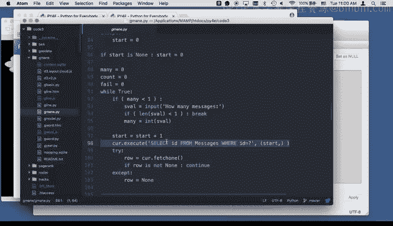
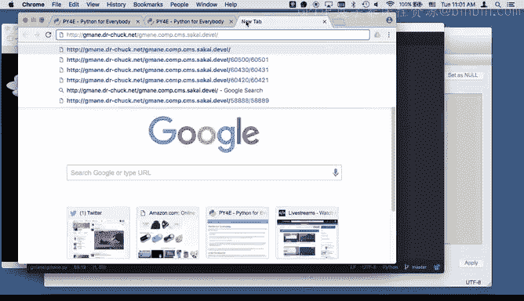
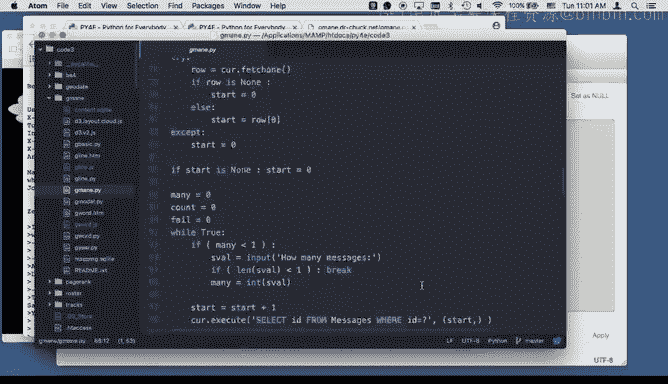
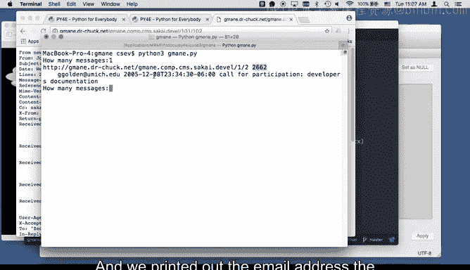
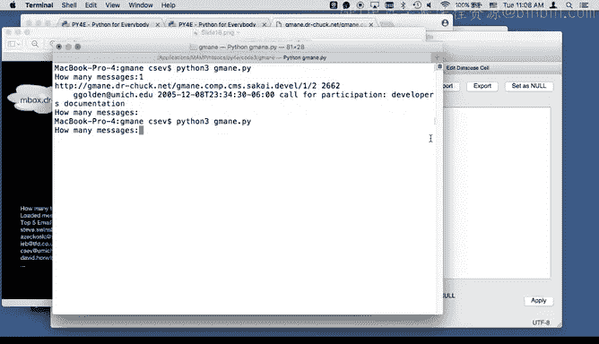
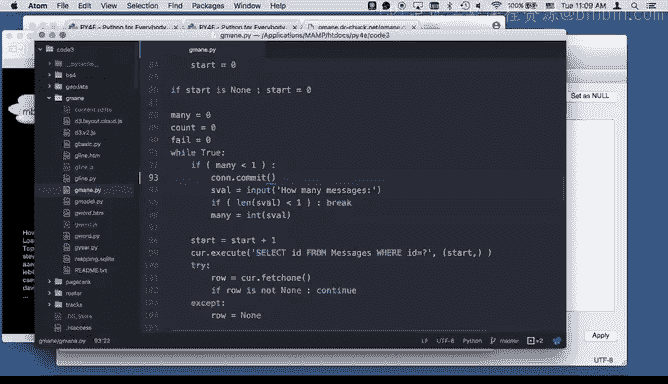
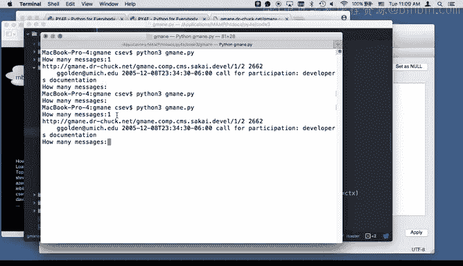
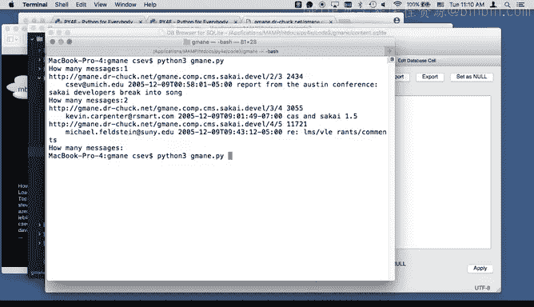

# 密歇根大学《给所有人的Python课》课程5：《毕业项目：使用Python检索、处理和可视化数据》｜python-data-visualization｜ - P14：14_04_02_实例演练-Gmane邮件检索.zh_en - GPT中英字幕课程资源 - BV1Eh4y1U7aE

Hello everybody welcome to Python for everybody we're doing some code walkthroughs if you want to get the source code you can take a look at the sample code and download it and work through it and so what we're working on now is doing some retrieval and visualization of email data it's kind of ironic we are going to now look at the email data that we。

Look at the email data that we started with， it's the same Sakai developer list email data。

And so there's this service called Gmain and Gma archives developer lists and various email lists and I've made a copy of their data because all the students in my class hitting the same their server with their API would crush it so in order to be a nice guy I put up a much more powerful server with just the data from this one list and it's about a gigabyte of data so be real careful if you're paying for network so the basic process we're going go through is we're going to have a spidering process that's a simple restartable focused on the network problems。

 data pulling to pull content at SQL light and there's going to be a database there and then we're going to have a cleanup process this database is going get large about a gigabyte and then we're gonna to have a process that takes it kind of grinds through this data it takes a while and and so then it's going to read this mapping and I'll show you that when it comes because things like people's names have changed over。

all these years and it does a cleanup and makes a really nice highly relational version of this data and then we visualize from here and so this could take you several days to finish this this will take like a few minutes to run and then this will just take seconds to run and so this is a multistep process where if you were doing something like running something for two days to produce a visualization and it blew up three cars the way through it would do you know good so that's why we break this into simple parts but right now we're just going to focus on this part right here and and take a look at the mail bit。

And you know， the mail bit and retrieve the mail， and then we'll have another video to talk about the rest of this stuff。

 okay？So。Let's take a look at。The code。So here is G。t py， that is the basic code and it's。

Hopefully this stuff is look starting to look familiar the thing that's weird here is we've got to do some datetime parsing and there is code that's out there。

 but you may have to install it and I had to write my code in a way that。

Dididn't assume that you could install the datetime parser and so it has it even if that's not there。

 it uses my own datetime parser and that's what this code is， don't worry too much about that。Um。

 and of course， we have to deal with the lack of certificates inside of Python。

And so we start things out。And this is really a simple table。

 we've got a messages table that's got a primary key， the email itself， when it was sent。

 what the subject and the headers and the body。Okay。

And so what we're going to do is because we have to pick up where we left off。

 we're going to select the largest primary key from the messages table and retrieve that。

And and then we're going to go to the one after that， okay。

 and so we know what the ID is and we're going to pick up where we left off and so we have a starting point。

It starts either zero or one。And we're going to ask how many messages to retrieve。

You've got some counters。And so we're going to say， okay。

See if select ID for messages where ID equals whatever that starting is。

 it's the highest number we've seen so far and we've if R is not none。

 that means we've already retrieved this particular email message。

Otherwise we're going to keep on going and we're in good shape and this is one that we want to retrieve。

And we're subtracting that so we don't。 And so this is the base URL。 This is the。

This is the URL of our API， the one that I cop I have a nice copy of all this data。

On a server that's accessible worldwide and won't crash。

So the format of this is you can say， I would like the email address from one to two or from 100 oops。

From， you know。102101 message 101 to 102 and we can just kind of walk through these things。

 So that's the message ID。And so if we're going to make the URL。

We're going to take the base URL， add the starting address and then add plus one。

 so we got the slash at the end of the starting address and so that's how we form those。U and。

We're going to retrieve that and we're going to decode it。We've seen this in some other ones。

 we're going to check to see if we got legit data。If not， if we didn't。

 if I got a 404 not found or something else， we're going to quit if someone has control C。

 which is our control Z， we'll get the program interrupt and we'll stop。

If there's some other problem。we're going to you know complain and keep going and if we have five failures in a row。

 we're going to quit， but it will'll just keep on going because these things do have glitchy bits here。

And so at this point， if we've made it this far， we've retrieved the URL and we've got the number of characters we've retrieved。

And。If we get bad data if it doesn't start with from because this is a mail message right and they all start with from space。

 if it's right， it starts with from space。嗯。Then what we're going to we're going to。

Tolererate up to five failures there for bad data because it could be bad and then we're going to find a blank line because that's the new line at the end of one line and then a blank line and then we're going to take and break this into the headers。

 the male headers， which is that male headers is this stuff right here。Up to。

 but not including the blank line， and then the body is everything after that， okay。

And and so we'll just have break that into pieces， otherwise we'll complain and tolerate up to five characters。

 and then we're going to use a regular expression kind of from the regular expressions chapter to pull out an email address。

From the。From colon lines somewhere in these headers from colon right there。

 it's going to go find a less than and then pull oops come on pull this stuff out up to it so you got the less than you got the parenthey。

 you got one or more nonb characters followed by inside followed by one or more nonbl characters and。

We'll get back a list of those， we should only get one。If we find one， we're going to grab the email。

 we're going to strip the lowercase。 And if we got some little nasty le end sign in there。

 we'll tolerate that as well。 So this is kind of clean up and you get used to this where you're like。

 oh， how come all those email addresses have this other stuff in them。嗯。

And then we also look for it if there are no less than signs and we do this way。

 this is and that's different some some mail messages have it this way and others， again。

 you write this code after you watch it for a while you're like。

 oh it's craped out and giving me bad stuff and I make them all lowercase so they match better and get rid of bad characters but I' now I got an email address。

Then what I do is I look for the date of this， so I got I'm going to these by date。

 so I look for this line and use a regular expression。To pull that out， right， So it's。

 I'm looking for a date， followed by a blank， followed by any number of characters， followed by。

Coma so I'm not interested in this Wednesday bit， so I'm skipping that bit right there and going and grabbing everything after that comma space and so it's really here。

To the end of the line， so that's the new line。 so that's it's going all the way。

 it's going to pull this bit right here， that's the text。And this is where we're going to like say。

 oh， that's kind of a funky looking date and we want to standardize that date so we're going to let's see。

Yeah， we're going to chop it off at the 26 character。

 apparently I don't know what the 26 why that we care about the 26 character。

 but we chop that off at the 26 character。And then we're going to parse it。

 and that's going to give us back a nice clean date sent at date。Now why it's going to complete。

 we're going to quit。And if we can't parse it， then we're going to tolerate five bad email addresses in a row。

 then we're looking for the subject line using another regular expression， subject line。

 regular expression， that's pretty easy up to but not including right， there's a blank there。

 it's a subject。And we pull that out， we get the subject。Now at this point。

 we parsed it and we got good stuff， so we reset the fail counter because I kept saying if you fail five straight times。

 you quit。And we're going to print it out and then we're just going to insert that stuff we've got the ID of the message which we've got the email address that has came from。

 the time it was sent the subject and then basically the headers in the body and we're just inserting it and now we're going to say every 50th we're going to commit it so that speeds things up and every  hundred0th we're going to wait a second so that's you know count is going up up up up up and every 50th you'll see it pause and then it will every hundred0th it'll pause for a second mostly that's to let me hit control C or to not overload any server。

Okay， so that's that's the simple one， the problem is is this data just gets ugly and so you'll find yourself wanting to reset this and start it over。

 this one's going to work of course， buts these are hard to build and that's why it's a good idea。

Python。3 Gma dot Py。How many messages？Well， let's just do one。穷。Okay， so it went and grabbed， oh。

 do I have this already running？51 through 52。Let me start over。Let's find sell star SQL Li。Okay。

 R am content。 I must have run it to test it。So let's run into again。

 Pythonji made at P Y and ask for one message。Okay。

 so there we went and got message one from one to two， we got 2262 characters。

 and we printed out the email address， the time we got it after all that hacking。

 and the subject line， and that's what we got。

So if we take a look at the database and we go into。jima。

Oh anytime you see the content SQL light journal， that means it it needed to run a commit and it hasn't run a commit。

 but I'll hit enter and that will do the commit and you see that vanish so now I can open it。

And I take a look at。I come there's no messages。Did that one not get stored in there for some reason。

Use to refresh。h， let's run it again。Maybe it didn't commit。Maybe got a bug in it。

Let's make a change to the code。Mhmm。😊。

I'm going to。See this connection。 commit。See that。Connection。 commit。I'm going to commit there。

And the other thing I'm going to do is every time I stop to read。

I want to commit right before I read it， so I think we should I hope that doesn't blow up。

 we'll see so the idea is is if I want to stop， I want to commit it。

So let's do this。 Let's do one message。And now I should hit。

Is it committed now that I should put the commits in， I think that I will it will look better。

Ch。can't refresh and so there it is because I committed it and I don't have yeah I don't have the journal file so that's good so that's a good idea to put those commits there so i'll just leave those commits in when you download it it'll have those commits in there so again I put a commit here and a。

A commit at the very， very end to make sure and then so that I missed that。

But now we get one right and so let's just run it again and you'll see how by selecting the max of the ID。

 it's going to select the max of this and then add one to it so it doesn't doesn't do the next one。

 so if I run it again。I say， give me one message so it goes two to three and give me two messages。

so I hit enter and I can do refresh and now you see we've got four messages。Okay， and so's just。

 u let's just fire this baby up until to get 100。

呃 run run run run， run， run， run。it just goes and goes and you'll it pauses once in a while to do a commit and if I if I made a commit every time。

 o it just pause there now it finished so this will run and we will get a bunch of data。呃。

The problem is is if I just run this， it'll take about five hours okay。

 to run this and get this all and I've got a really fast connection。

 so I have got a file that you can download， let's go find it。Let's see if I can。

Let's see how long it'll take me to download this。 I've got a file that you can download and save。

 Now， I'm going to use the command line。Curl。Or Wgi is another command that we Linux and Mac people can use。

 I don't know， I might have to use your browser do it。 Let's see how long this is going to take。

Zs retrieving。Minute 30。Okay， well I'll。I'll just wait when this come back。Okay， so now that's done。

 I was averaging 10 megabits a second， I downloaded about 600 megabytes。

 10 megabits a second that will probably be slower for you， but so now if I take a look。

 you're going to find that that content at SQLI。Is 624 megabytes now what happens is I've prespied this and so now if you run Gma。

pyy and ask for five more messages， it will pick up where I left that one off。

So it's up to message 59000 and I think that oh you saw an error， you saw a bug in that one。

 I don't know what's wrong with that one， so let's see if so at this point we're going to have most of the data it might find its way to the very end。

Once you get this it's it should be not too much more， I don't know， maybe it's like 63。

000 or something。So what we'll do is we will let that run。

And we will come back when that one's finished and run the next phase after it's got all of its data。

 okay， so thanks for listening。