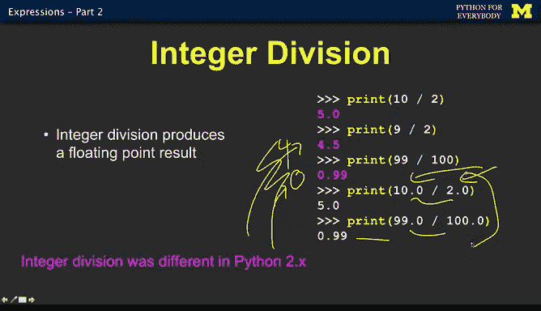
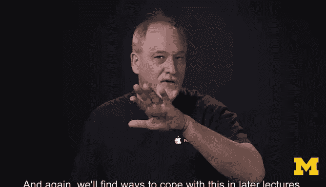
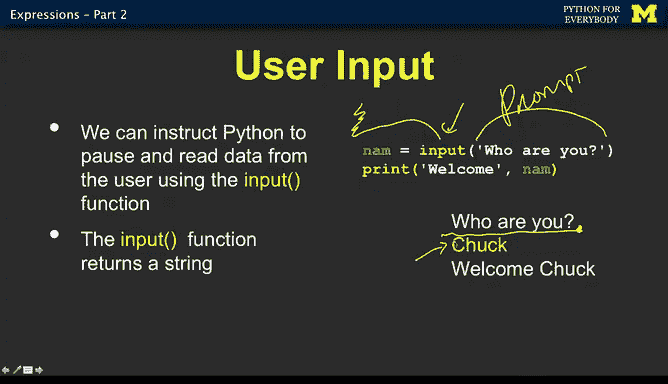

# 密歇根大学《给所有人的Python课》课程1：《编程入门指南（使用Python进行开发）》｜python｜ - P14：14_04_04_变量类型.zh_en - GPT中英字幕课程资源 - BV1214y117Mk

So we've been talking about variables， and we've been talking about constants and we've been talking about expressions。

 but we also have constants that are integers。 We have constants that are floating point numbers。

 We have constants that are strings。 And we can manipulate these。

 And Python carefully tracks not only what the value in a variable is。

 But what kind of a value It is。 So is it a string。 is it integer， I it a floating point。

 And sometimes this makes a difference。 And here's a little example code。 We have this plus operator。

 And the plus operator is looking at its two operas 1 in  four is like， oh， those are integers。

 I know what to do with integers。 That means addition。

 And so it adds this to be 5 and then sticks it into D D。DDD and Out 5。On the other hand。

 we can actually use this same plus operator concatetnating strings because the plus operator looks to its left。

 looks to its right， says， ho， those are strings。 And I know what you mean。

 I think you mean to concatenate this。 And so then we end up with hello。

 This space is very carefully constructed right there。 because the plus doesn't add a space。

 So this ends up being hellello space there。 And that little space is the space here。 And so。😊。

Python knows the type of in this example， these are all constants。

 but it knows the type of constants and it knows the type of variables and it can do very different things and it can blow up and be unhappy。

 as we'll soon see。Based on the type of things。So here we have an example of something that's unhappy。

 So I have now concatenated。 hello and there。 and then Python's perfectly happy to do that。

 And then I stick that in E E。 And now I say， I want to add one to it。 It looks to its left。

 Look to its right。 This is a string， and this is an integer。 And Python says。

 I don't know how to do that。 Python could know how to do it。

 but it's chosen not to know how to do that。 And so you get the dreaded traceback。

 And traceback is like syntax error。 It is Python telling you。

 it's not Python telling you that you're a bad programmer or that you're never going to be a programmer or that you're completely unsuitable for a programmer。

 What Python is saying is I Python am lost。 You told me to do something。 I don't know how to do。😊。

You need to go remember what it is that I'm capable of doing as Python。 Please come back and fix it。

 It also means that the program stops， meaning that if you're in a multiline script and you're doing a bunch of stuff and there's a traceback here。

 the code after that quits， okay， And that's because you've hit this line that Python is lost。

 And Python is loathed to continue another， we'll see in a bit。

 that you'll be able to force it to continue if you want。 But because Python。

 because you said something that Python didn't understand， it just quits at that point。

 And trace back line1 in this case， tells you where it is that this thing blew up。

 And so this looks like nasty gibberish， But after a while。

 it won't take you long at all to just relax。 Look for the word trace back。

 That means Python quits somewhere。 it tells you where。 and then you look a little bit farther。

And it tells you what's wrong。 Type error。 It's unhappy with the type。

 And it's still referring up to this line of code。 It says。

 I can't convert integer objects to string implicitly。

 So it's like you have told it to do something combining a string an integer and Python is like。

 I am lost。 But I'm giving you as much clue as to how I got lost。 What got me lost。 where I got lost。

 I got lost。 where I got lost and what caused me to get lost。

 And Python is trying as as hard as it can。To clue you into to what's going wrong。

 So don't look at this as like bad。 Look at this as like， oh。

 I'm not quite communicated to Python the way I want to communicate。 There's a way to solve this。

 There's a way to do something here， but。And so if we take Python and we think about Python， say。

 hey， you're so picky and you blow up if I do the least big， least little mistake on types。

 like help me out here。 And so it turns out that Python has a built in function。Called type。

 So again， it's type with parentheses， function calls， appheses on them。 And we pass something in。

 And we're like， hey， Python， tell me what the type of the variable Ee is。

 And then Python prints out， oh， it's a， it's a， it's a string。

What is the what is the type of the constant quote hello， quote， that's a string。

What is the type of the constant one that would be an integer。

 And so Python keeps track of the value of variables and constants， the value and the type of it。

 And so we have to kind of manipulate this and be aware of this as we move forward。

And so there are several types of numbers that we've already sort of been implicitly playing with。

 Like I said， you can give a variable to type， or you can give a constant to type variables that and constants that don't have decimal places are integers。

 what are called integers and variables that have decimal places are called floating points。

 if even if this was a 98。0， it would still be a floating point。 As soon as you put the point there。

 then that means it's a floating point。 They are represented internally differently。

 floating point numbers have a greater range than integer numbers。

 but they are not always as precise as integer numbers。

 So there is floating point numbers have more range。And less precision。So integers are perfect。

 but there's a limit like 4 billion or 4 trillion or something。 There's a limit。

 Don't worry too much about that。 There is a choice that you make。

 You tend to use floating point numbers for things like temperatures。Or speed。

Turns out that you don't use floating point or for money， you don't use it for money。

 even though in our first examples we'll be bad and we'll use it for money。

 but don't tell anybody that I'm using floating point for money。If you want。

 you can play with floating point and start finding some things where money goes bad。Okay。

 there's actually a number of different movie plots that come have to do with computer programs that use floating point for money。

I think office space is one of them that I particularly like， but there's other ones as well。

Why you don't use floating point for money。I kind of got off track on that， but that's okay。

So we also have a set of built in functions that can convert from one type to another。 there's float。

 there's int。And so float is a function。 It again， has parentheses。 We pass in 99。

 So as this expression is being evaluated， it has to call float， it passes in 99。

 And then what comes back is 99。0。 which is a floating point representation of the number 9999 and 99。

0 are not the same。 This is a floating point number。 So when this addition happens， it produces 1 99。

0。 So that is a floating point 199。0。 you are force converting by putting this calling float。

 you are force converting that to a floating point number。 If we look at like I 42。

 we ask what type it is。 Well that I is an integer。

 We can take a variable and pass it into the float function and get back 42。0， 42。0 comes back。

 And we say what kind of thing is in F。 Well， F is a float。

So you can see how we're manipulating the type of things and controlling it and anytime we get a little confused。

 we use the type function and say， hey， what's going on here。

 why don't I understand what's going on here？Integer division is something that actually changed between Python 2 and Python 3。

 it's one of the bigger changes the bigger non upwards compatible changes between Python 2 and Python 3。

 and so this we're just reviewing there are some things that were different in Python 2。

So 10 divided by  two， even those are both integers， produces a floating point result。

 This makes kind of doesn't make much difference。 And if these are evenly divisible。

 but if they're not evenly divisible， it makes a big difference。 So 9 over 2 is 4。5。 Think about。

 like， if you put in 9。Divided by 2 in a calculator， you wouldn't expect it to say 4。

 And in Python 2， it said4。 it actually truncated actually threw this bit away。 But in Python 3。

 it just automatically converts divisions to floating point。 And so it works out quite nice。

 so 9 over 2 is 4。5 in Python 2， This used to be 4。 And then 99 over 100 is 0。99。

 exactly what you'd expect in Python 3。 In Python 2， that was a 0。 Why， because it truncated。

 It didn't even round the numbers。 It chopped them off。 So this was really quite a silly。

Artact of Python 2。In Python 2， if you get stuck in Python 2， you just use floating point numbers。

 and once either side of the division or any other operation is a floating point number。

 then the calculation is done in floating point。 So if it's floating point。

 if it's floating point input on either side， then it floating point output。

 And this is what we used to have to do kind of in Python 2。

 is force things to be floating if we' are doing divisions。 It wouldn't hurt to do it in Python 3。

 But now integer division in Python 3 makes a lot more sense。 Thank heaven。

Okay， string conversions。 So if we read data， which we're going to see in a second from the outside world。

 it comes in as strings， whether reading from a network or from a database。

 we tend to get these things as strings。 And so what we're showing here is。

A string value that's 1 23， but it it's not really 123。 It it's three characters。

 It might as well be ABC。 So 1，2，3 are the first three characters。 So we take this string constant。

 We put it in there and we say， okay， what kind of thing is in there， It's a string。

 And if we try to add one to it as we saw before， you add a string and an integer and it gets really python gets really unhappy。

 can't convert int object to string implicitly。 But what if we know that inside of this string are actually digits and we want to get an integer representation or a floating point representation of that。

 Well， in that case， we can we can call the int function or the float function passing in a string and getting back an integer。

 So this basically reads these characters， the 1，2，3 and goes oh， that's 1 23 and gives us back 123。

 and we say what kind of thing is in there。 Well， now in eyeval， there's an int。

 Now I'm being mnemonic here， I'm remembering that this is an integer and this is。😊。

StBut Python doesn't care what I name my variables。

 Remember Python never cares about what I name my variables， so if I start naming them conveniently。

 don't all of a sudden think that everything starts with a prefix I is an integer and everything starts with the prefix s is a string。

It'll be a number of lectures before I stop reminding you of that。So Ival ends up with an integer。

 the number 123， and now we can indeed add one to it because it's an integer and Python's happy and out comes a 124。

 So this works pretty well unless the string that in question has no digits。There are no digits。

It's going to blow up。 It's like， whoa， now let's read it。 Traceback means I quit。Where line 1。

 it's always line 1 because we're in this interactive environment。 So， but if you were in a script。

 it would tell you what line it is。 And then it says invalid literal for in with a base 10 x。

And that's like。Okay， it's not working very well。 And so， you know， I say， oh。

 that's an invalidveed litter。 And again， we'll find ways to cope with this in later lectures。

Okay。😊，Now。How do we get data from the outside world。 So this is the keyboard。 Eventually。

 we'll talk to networks and databases and files。 But right now。

 we want to take the keys from the keyboard and get it into a variable。 So we have another function。

 a special function， the input function。😊，And when Python comes running in here。

 it starts the input function， and the parameter to the input function is what's called a prompt。

It prints out who are you and then it waits。And then。We type into the keyboard Chuck。

 and then we hit the inner key， and then it takes this string right here。

 and then it puts it in this variable right here。 It is a string。 even if I typed in 1，2，3，4。

 it would be this string 1，2，3，4， not 1234 okay。

And so that is the way。 And so this program at this point pauses until we type and we hit the enter key。

 and we then it takes that line of input， including spaces。

 whatever I've typed and puts it in that variable。 and then the program continues。 and in this case。

 it just prints out welcome， comma， and then the contents of the variable N AM。And in this case。

 this space right here that you see between Malcomm and Chuck， that is caused by this comma。

 So we mostly seen print being printing one thing， but you can have as many things as you want with commas in print。

 And every comma adds a space。 And so it's kind of friendly。 If you wanted to。

 you'd have to concatenate these things together to eliminate that space。 But most commonly。

 you're printing out a list of things you probably want spaces between it。Okay。😊。

So that's how we read input。Up next， we're going to combine all these things and we're going to make our very first program that does actually something useful。

 so we'll see in a bit。

