# 密歇根大学《给所有人的Python课》课程4：《使用数据库进行Python编程》｜python-databases｜ - P15：15_02_03_单表增删改查操作.zh_en - GPT中英字幕课程资源 - BV1PP411W7H1

So now we're going to get to the heart of the matter。

 we're going to actually write some SQL and we're going to write make a database Okay。

 you holy by now I've told you a couple of times install the SQLite if you haven't。

Do it you could also write a Firefox plugin that can be used to manipulate SQLite databases I used this before SQLL browser came out with our newest version so everything I'm going to do could be used by either one and there might even be a way to do it with a SQLite admin tool if you've downloaded like a map or an Xam so it doesn't matter you just need some piece of software that gives you a place to type SQL you hit a go button and it sends it to the database and comes back that's all you need。

Okay， and so this is what it looks like SQL SQLite browser。

 so let me go ahead and start this thing up。

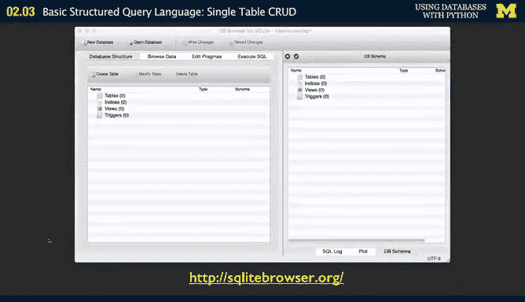

SQLite browser， and there we are。Database browser for SQL Li。

And what it basically does is this is going to read and write a file and that file that it's going to read and write is in very specialized format that's highly optimized for rapid retrieval and rapid storage of data。

And so we'll start by saying new database。And I'm going to pick a place。On the disc。

I will put it in the desktop and probably point them for everybody。Databases， and I'll call it。SqL1。

That'll just be the name of the database now it's writing to a file as well this file is not something you should read using anything other than SQL light library。

 it's a funky look file， so we're going to save it。Wop。And。

And it's asking us if we want to create a table， I'll just hide that thing， so we have no tables。

 no indexes， no views， no triggers， no nothing。And we have a place that we can execute SQL。

 so when I said you're a database administrator。

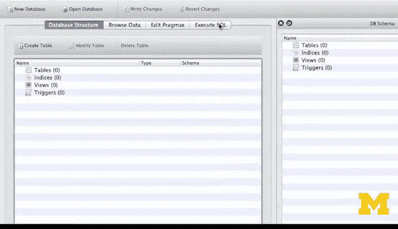

We've got a file back there called SQL1 that everything we do is actually reading and writing to that file。

 but we don't write code to touch that file directly， we always are using the SQL library。Okay。

 so we're up， let's create a table now this is our first SQL and so create table。

And then the name of the table， users， I'm just going to use uppercase。

 upper lowercase generally matters， there are a few weird situations where it doesn't matter。

 so just pretend that case matters in this situation。

And it teaches you something right away about SQL。 SQL is designed to be somewhat conversational。

 and so the keyword create。Create table is kind of like one keyword。

 We're creating a table then the name of the thing and then a parentthesized list of the fields and then the types of the field。

 That's what we're dealing with。 So this is create table named users and we're gonna put two columns into it and one is of variable length character 120 up to 128 characters an email that's also variable length character up to 128 characters So this is sort of our schema this is our contract We're saying these are the only two things we're putting in this table We can't put a thing called age in the table We can't put a thing called favorite beverage in the table and we can't put 129 characters in the name column we can put zero or one or two or 127 or 128 that's just fine。

But。We can't put 129， this is a contract。And。The database。

If we want to put longer characters then we just say， no， no， no， no， we want to put 1024 in。

 and then the contract will be we could put up to 1024 and if we put 1025， the database would be mad。

And like why do you do this is it know why is the database so obsessed about this and the answer is as it lays the data out on this disk drive and it wants to get to it fast。

 it really is helpful to know the size， the maximum size because if you say this is only going to be four versus four megabytes。

 it might lay the table out differently on disk， you don't need to know that you just need to be explicit about the contract。

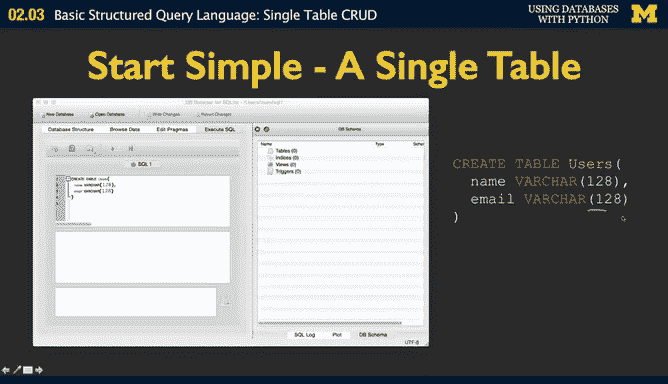

Okay， so this is part of making the data model， figuring out in advance the kind of data that you're going to use。

 how you're going to use that data， and then you communicate that to SQL and then you don't worry about all the magic that makes that super fast。

 so this is the contract that you make so that your data is really fast by being very explicit about your data。

You get in return， the database does a lot for you and does it really fast。

So now I'm going to go into my little SQL window and I've pasted in that create table statement。

And different user interfaces will have different things。

 but they all kind of have a window and you all put some database stuff in them and then you hit this execute button。

 this little play button and this one might be something else in yours。

 but at some point you go do it。And down here it says query executed successfully。

 create tableable yada yada yada， so now if we take a look at the data。

We see that we have one table and the table is named users and there's name and email and if we pull this over we'll see that the Var cha is 128 so the database knows the contract that we just gave it okay so that's your first SQL command。

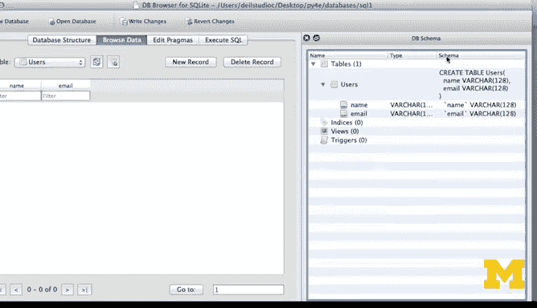

Your next SQL command。Is。And you price your just。

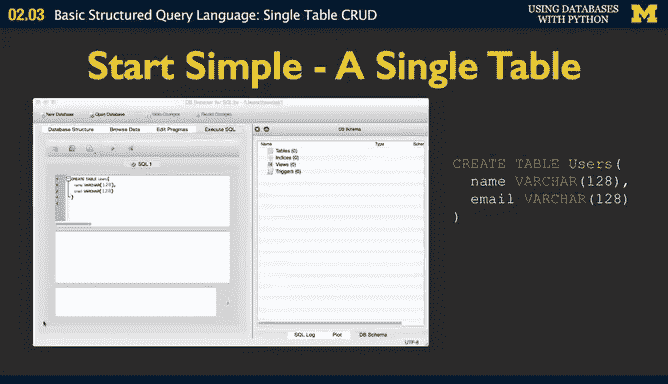

Copy and paste the stuff off the slides is what I'm doing。So there's your table。

 we we're going to put some data into it。

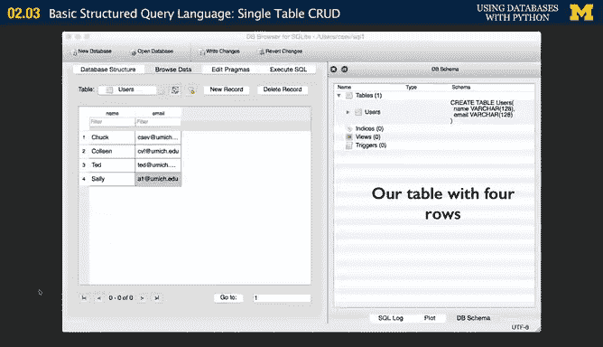

So let's go ahead and do that。

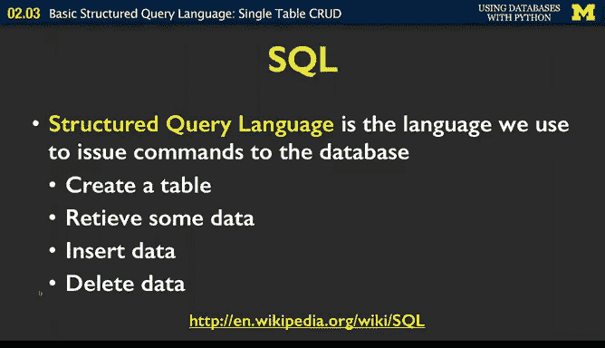

And we can put a new record in there we can say。Chuck。C7 at U Mh。On EDU， we can say。

Another new record， you can say Colleen。嗯。We'll call her VL。You minister EDU。

 I want it to the sort right EDU。Another record will make this be Sally。

Sally at U may study to you and then we'll have another one we'll call like Fred， I don't know Fred。

Fred。You missed now it turns out that everything we're doing。Is actually running SQL？

And I'm going to finish that and if you take a look here at the SQL log。

 you can see all the SQL that's going on right here， just insert。

 but let's kind of leave that alone for now， we'll just kind of hide that。

 but that's what's going on right now。

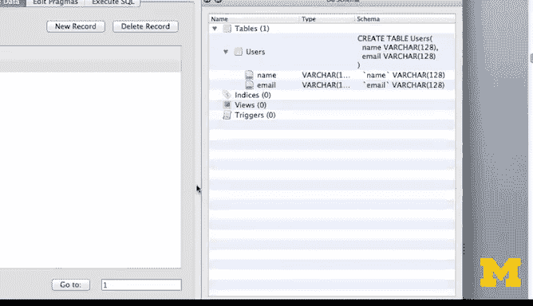

And so we made a table and it now has four rows in it。

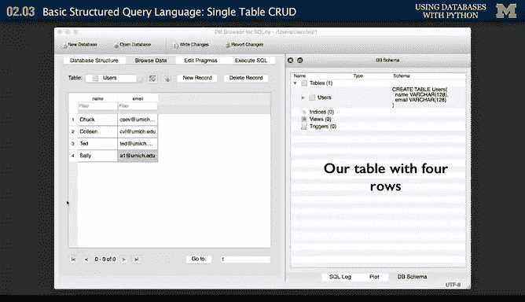

And。And now we're going to do some SQL to we've done the create and now we're going do some inserting and deleting and retrieving of the data so the first thing we're going to do is insert another record now what we were just doing in that user interface was exactly this here is another example of some SQL where insert into is kind of like a single keyword。

 the name of a table a parentthesized list of the columns and then the word values that's just part of SQL and then a parentthesized list of the corresponding values so Kristen is the name and KF@um。

du is the email address and so that is a SQL statement that inserts a new record into our users's table。

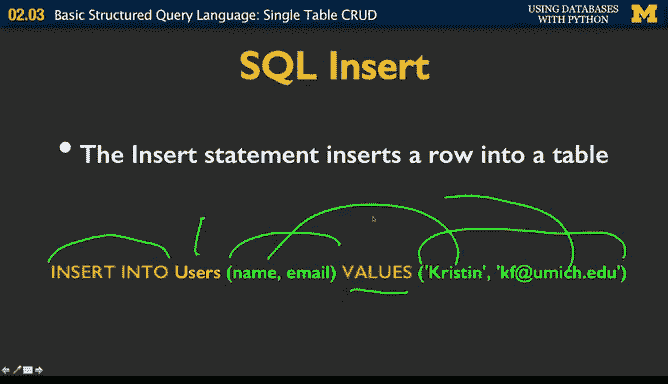

So。We'll just cheat and grab this， copy it。And then go to the SQLI browser and we will go to execute SQL and I will get rid of the create table because we already did that and just type in insert users with that parenthey。

 it's doing syntax coloring for me which makes it very。

 very helpful and then if I got the right SQL and let's just say I make a mistake let's just say I call this Zap instead of values I will run this and it'll go like Zap is a syntax error and so it does talk to you and then you can go fix that and say values。

And it's actually helping me and then I can run that。And then it says success。

 and I go back and look at my data structure， I'm going browse the data and there's Kristen。

So the insert added another row。

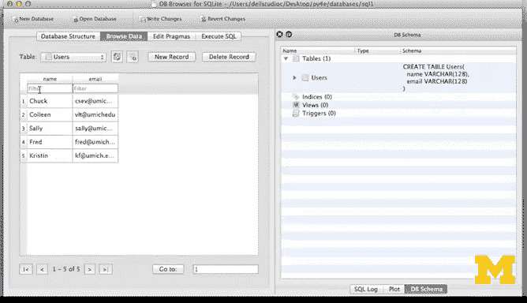

Pretty simple stuff， isn't it？Okay， so there we go with that。

We inserted another row with Kristen in it。Now we can delete a row。And so we say delete from。

 which is again， kind of like a key word delete， it could be delete users， but it's sort of like。

We're not actually deleting all the users， we're deleting something from the users。

 and so they add this keyword and askQL， that's kind of redundant。It's not necessary。

 but it lets us read it a little， delete from users， what sounds like words， sounds nice。

 delete from users the name of the table， and then a where clause and you can put where clauses on lots of different SQL statements and that says don't delete all the rows。

 only delete where this is true and in this case we put a logical question so this is like a question mark in an if statement right？

Delete from users where email equals TedD@um。edduu this could be one row。

Or there could be 100 rows that all have that email address。

That would actually be bad to have 100 rows that had that email address if it were a key。

 but whatever， so that just says delete from users where email equals Ted@um。edu， so let's do that。

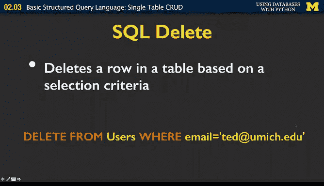

Again， I just copy this。Copy， go back to my SQL light browser。

 I could use the delete record button but I'm trying to teach you this SQL language now。

 so this is the way to do it delete from users where email equals Ted@ U missedu I hit the play button。

And it says executed successfully， and I go back and I look at the data。And。

Was there no TED in there， I better delete a different one， let's call Fred。

Let's call it Fred at Yume。

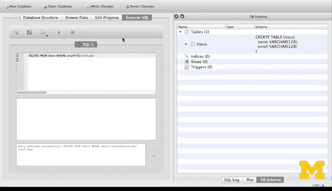

So now if we do the browse data， Fred's gone， so the delete works。

 that's why I do cutting and pasting on this。So that's a delete。

Update allows us to sort of reach into to a particular cell or set of cells in a table。

Many rows or many columns or many row column combinations and we just say update。

 which is the SQL keyword， the table name set， which is an SQL key， keyword。

 and then the column name。And then the new value。The wear clause is important because without the wear clause it would do it for all of the rows。

 so the wear clause reduces the rows， so we have a wear clause here that says where email equals c7@umme。

 so we're really saying is go find the rows that have that true and change the column name to be Charles the column named name to be Charles。

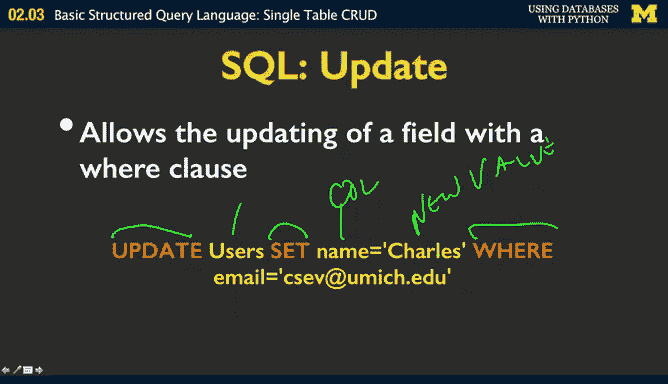

So let's do that one。And hopefully you're at this point you're sort of following along and you're doing your own data because that will be one of your assignments is to make a database and turn it in。

So I will say execute。都。

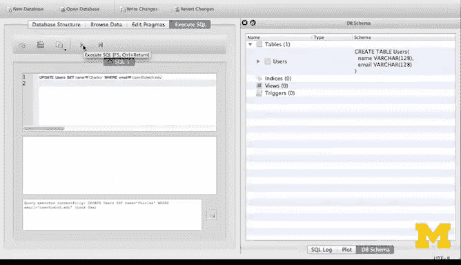

And I take a look at browse data and you see that Charles has now changed。So far so good。

 you see why I really like this language。I mean it makes so much more sense than Python。

 but don't criticize Python， don't be hat on Python， Python is powerful and flexible。

 this is powerful， but not so flexible。So we've did a insert， we've did a delete。

 we've did an update， now we have to do the read， there are part of crud。And so that is select。

And select takes a list of columns， that's a column list。

And star means all the columns from is a keyword and the users is the name of the database and you can have either with or without a where clause。

 and so this says select that really says all row all columns from the database named users select star from users and this says this will turn out to be one row in our little database。

 but it might be more than one if this was true if this where clause was true for more than one so let's run those commands now it turns out that we're kind of implicitly running those commands the select star from users every time I hit that browse button whoops。

 don't do that。

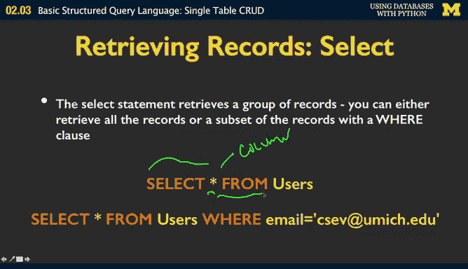

So if I go over here。And when I do B， I could actually see that in SQL log， the last thing。

Was that okay， and so that's。That it's doing the select on our behalf。

 but we're learning how to do SQL so we don't want to。We want to do it the hard way。

 so we say select star from users。Hit that and now down here we see that and we also see in this log as the log goes by that it sent that stuff now it's also sending more stuff we'll get rid of the log。

 it's too complex， but it's really just SQL。I'm giving you the simple stuff at the beginning， okay。

 so that was a select and I can add a where clause where email equals C@um。

edduu let's see if I type that right。And that should show us all those rows。

 but only show the ones for which that's true。

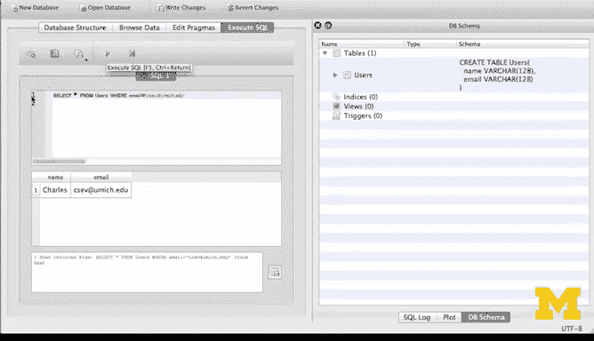

So that's a where clause。In a select you can also throw another clause on the end of a select or you can have an order by。

 So in this case， I'm going to select star from users， which is exactly what I did before。

 select all the columns from the table users order by again a twoword keyword that rolls off the ton more naturally email which is a column Soing is one of the things that databases do really。

 really well and that's because it actually sometimes for sorting it has these things and then has these little tricks that say。

 oh that one goes here and this one's the next one and so if you really want it in sorted order I have a really quick way to figure that stuff out but that magic you don't worry about that's the databases problem。

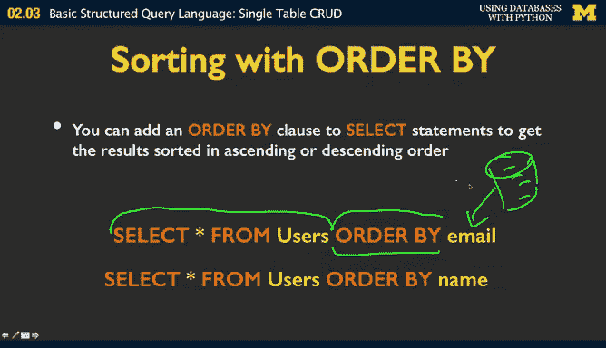

So you just say， hey， smart database from billion dollar company。I would like to order this by email。

I don't know how to do that， I don't even know how to write a sort algorithm。

 I just know that I want it ordered by email now do it database。

And there you go and you see these things ordered by email。

 and if I want to change it to be order by name。It's ordered by name。Okay， so name this time。

 email that time， turns out sometimes you can just click on this header。

 but we're learning the tough way， which is actually not all that tough。

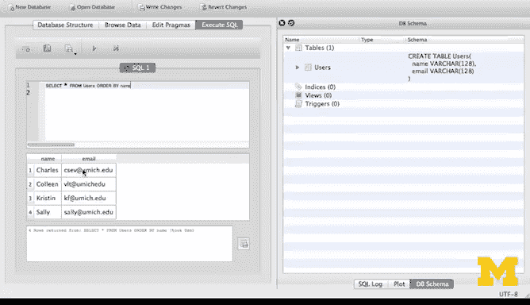

So you can select and you can order them， you can have a wear clause and。Ultimately。

 this is the summary of what I've taught you so far。An insert。Into a table with columns values。

 a delete from users where， and a true false with updated users set。

 select star from users or select star with an order by。So at this point。He'd be like。Wow。

 I needed to go to college to learn this。😮，It's like so easy ha it is easy that's why I don't teach you SQL until later so you learn the hard stuff so you're tough now I can show you the easy stuff now of course there's some complexity to come but at the end of the day when we're talking about a single table in the statements that are one table it looks like a really big fast smart spreadsheet and that's why some of you may recognize what you're learning here you may say you know what I've actually been doing this and I didn't realize how smart I was I didn't realize I was doing databases。

But we're still just at the basics， the power comes with what we're going to talk about next and that's when we have more than one table and we start modeling data at the connections between things and that's when we really start to show how you can make things really fast。

When we exploit the relationships between tables， so that's what's up next。

