# 密歇根大学《给所有人的Python课》课程2：《Python数据结构课程（密歇根大学）》｜python-data｜ - P15：15_03_01_文件练习题讲解.zh_en - GPT中英字幕课程资源 - BV1yP411a7TZ

Hello and welcome to Python for everybody。 My name is Charles Severance。 I'm your instructor。

 And in this particular video， we are going to do exercise 7。1。 And this honestly。

 even though it's a really simple exercise is one of my favorite exercises in the book because in chapters 1 through 6。

 we've been just kind of learning the basic mechanics。 It's like we just， you know。

 it says bonejour and we say bonenjour。 and it's we're learning。

 but it's not very fun because they're not really solving it。

 So this is our first program that's going to read a file and do something with it。

 And the only thing we going to do is going to convert a upperpper case。

 So it's just a really simple file okay。😊，So here we go。

 but the nice thing is so this important though I keep it simple because you got to figure out how to manage files and that's the payoff for everything that we've done up till now。

 so let's close that one。

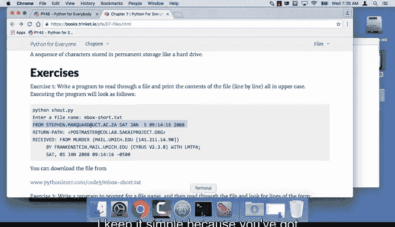

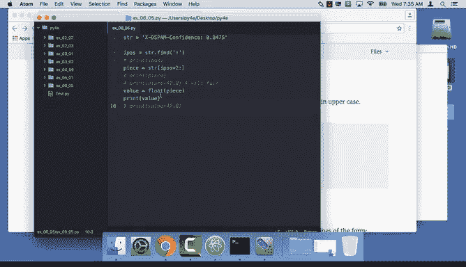

And say file new folder。

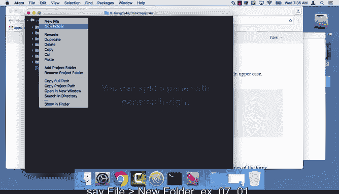

EX 0701 We to files， here we are in files， file new file。

And I'm going to say file， save as。

And put it in。EX0701， and I'm going to call it。I could probably come up with a better name and convention than these things。

 but it works for me。 and I'm a programmer。 so here we have this file。

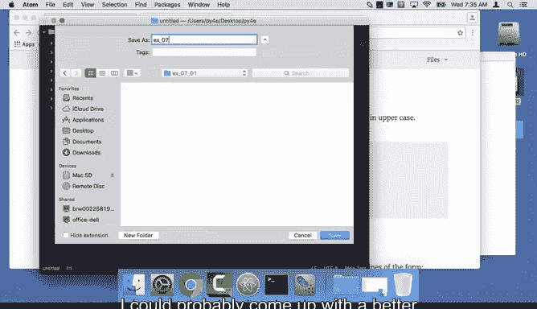

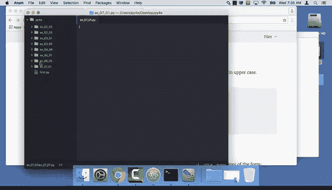

嗯。Let's start up a。Shell， a terminal program， command line in Windows。Shell and Ex。CD desktop。

CD Python for everybody folder in the desktop， oop P for E CDEX 07 tab to get me to that。

I'm in this working directory and I have these files in there and so I say。Python 3。Python3 EX。

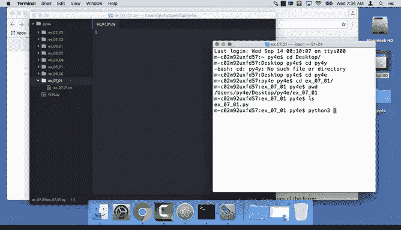

07， I saved this， so it's an empty file， Python's perfectly happy running absolutely nothing because I guess you've made no mistakes。

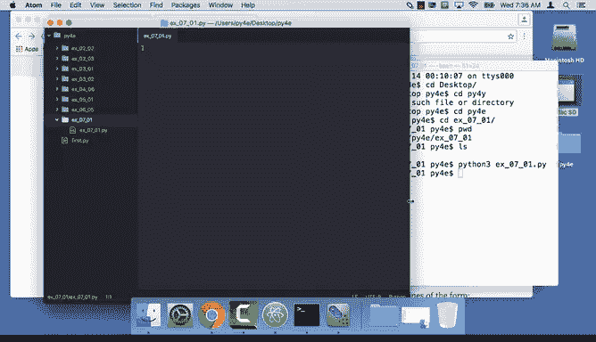

Okay。Now， here's the key thing。We have in this situation we've got to have this file and this this version of the website has Pythonlearn。

com， this could also be py4。com， but what I'm going to do is I'm going to control click on this control click。

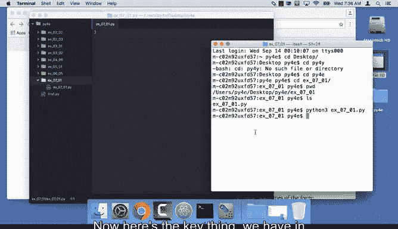

Open link in New tabab。So now I have this new tab and this is the file。

OkayAnd this is the file that we're going to read。We're going to read this file。Okay。

Lots of stuff in this file。 you're going to get to know this file really well。 The key is。

 is we've got to put this file。In this directory， because this program is running in this directory。

 and this program needs to open the file。 And this is where if you got some magic little button in。

 you know， whatever， click run Python， It doesn't know what directory it's running in。

 And that's so we've got to get this file in directory。 So the program runs in the same directory。

 So it can open the file we're looking at right， So here's the directory where you want to go to。😊。

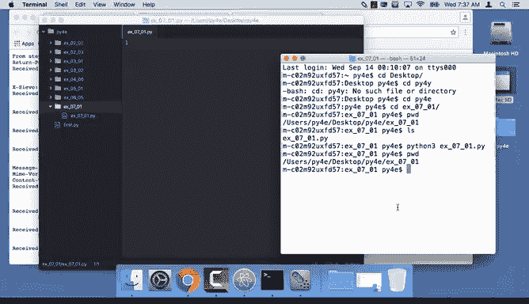

And I'm going to say， so I've got this file sitting here and this works for text files。

 once they're sort of viewable in the browser， I'm going to say file， save page as。

And I'm going to go to my desktop。Make this little bigger。Python for everybody。EXO 701。

And you'll see this is sitting here， and I'm just going to say save。

So that's now been saved as if I downloaded the file， so let's go into the terminal and do an LS。

And so you see that by my action here in the browser。

 I have saved a file into the exact same folder that I've got the code for 71。

So now I can open this file and I can make sense of this file okay so I'm going to Adam and you see Adam even sees the file so now I can even open the file in Adam and here's the file in Adam Adam knows how to read these text files and so away we go so now EXO7。

pyy。

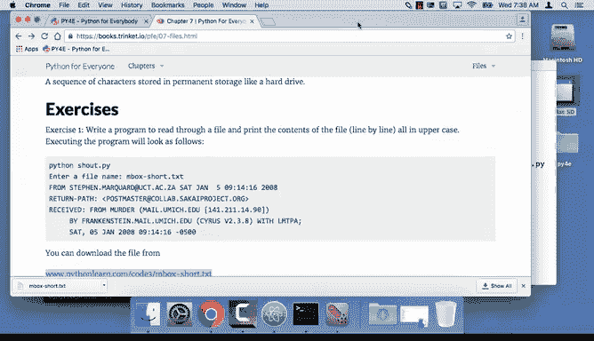

This next few lines of code， you're going to get to know pretty well。

 And so I'm gonna create a variable called the O， come back。 I was in the wrong place。

And I'm going to open the file with the open command， FH equals open。Inbox。Short dot TXT。

Now remember that open does not actually read the file。

 it kind of gives us this little portal where we can take a look at the file and so if I print FH。

 you might expect it would contain all this data， but it doesn't it just is a file handle。

 so let me run that。

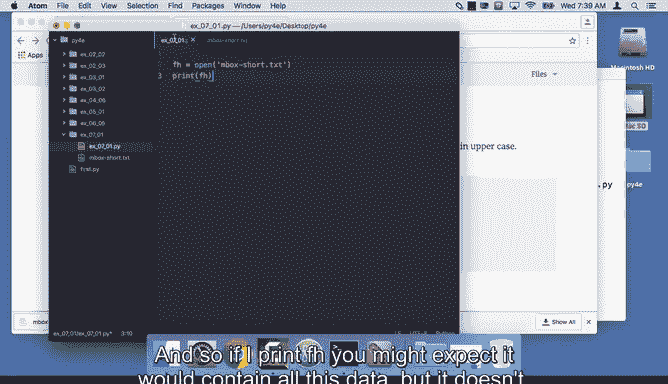

Python 3。

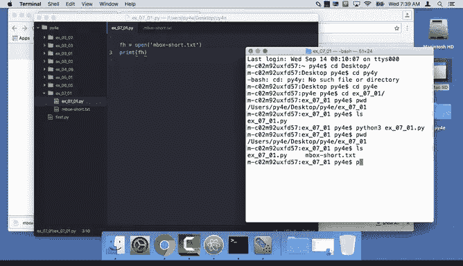

YeahX O7 dot py， Okay， so it's。Know some information， this will learn later what objects are。

 this is a Python object that has some information in it。

 but the information in this object is not actually the file data。To read the file。

 we're going to write a while loop。I mean， a four loop， sorry， not a while loop。

So we're going to say four。LX， again， that line is a good name here。

 but I want to use a non mneonic variable。Four line in FH。And then I'm just going to say print Lx。

Okay， so this is going to loop through every line in the file and print it out。

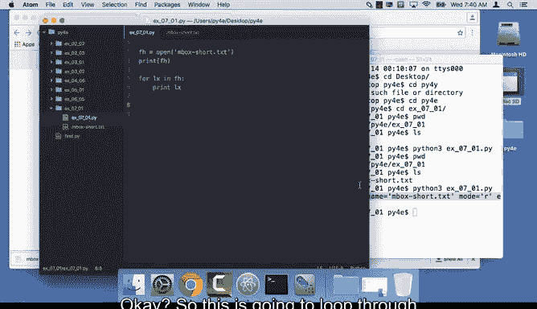

I'm going to have to make this a little bigger now because it's going to be very chatty so if that is just our loop to read through。

 maybe make this a little smaller。

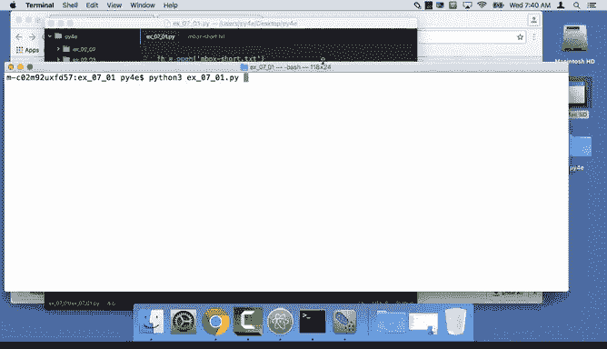

There we go。Oh， boy， boy， boy。Missing parentheses and call to print。What am I doing wrong here？Well。

 her problem is is I've been using Python 2 for so。

 so long that when I'm not drinking enough coffee then。

I'm going to talk Python2 So the right way to do this， so let me just run this iny never one。

 I won't run it in Python  too， I'll just fix it。

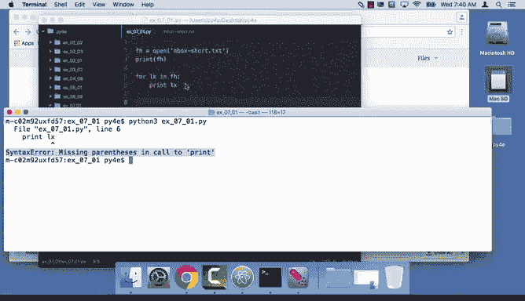

Because print Cohen parentheses in Python 3。

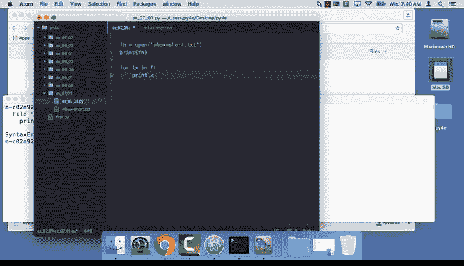

So I save it。And now let's run it again， Okay， so there you go now as we scroll through this。

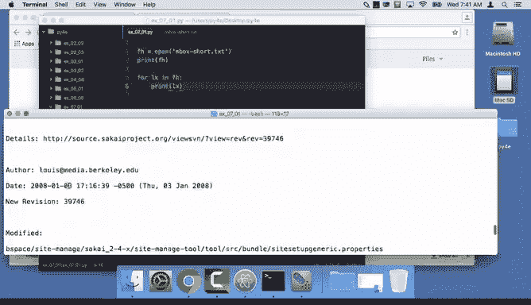

You see right away the problem that。I'll get rid of that print statement right there。

 let's get rid of that guy， just delete him。

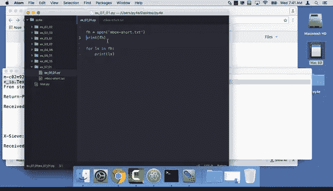

We know how that line works。But you see this extra space， remember because in the file。

 there is a new line。 So if you go over here， we make this wide as well。

 there is a nonprinting character at the end of every line called the new line。

 which is the way in files we store the fact that it goes back to the beginning。 so it's like。

Character， character， character， character， go back to the beginning， that was a new line。You know。

Character， character， character， character， character， character， character。

 the next character is a three， the next character is a new line and so it goes to beginning the next line。

 So that's the new line and print。The print statement automatically adds a new line。

 and so in this case we have one new line from the file， and then we have another new line。

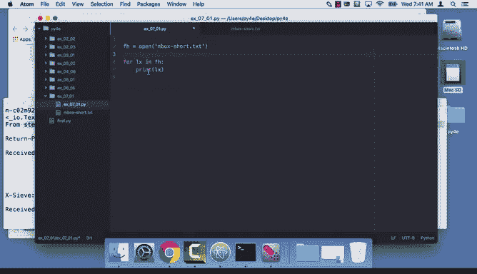

That prints adding， okay？

And but that's okay。We can say。LY equals Lx dot strip。Actually， our strip。

To strip the characters from the right hand side， the non printing characters from the right hand side。

 and then we'll print out LY。

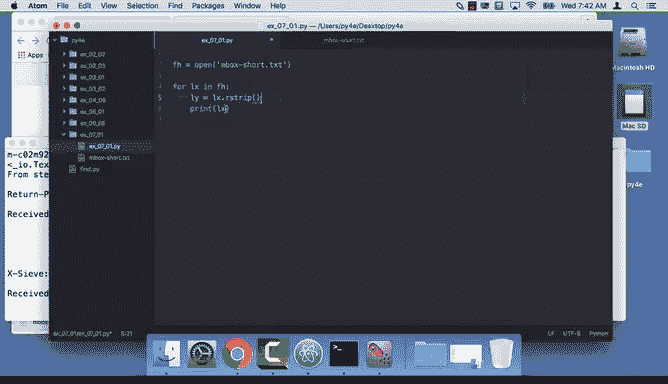

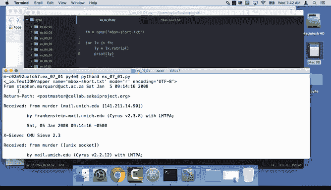

So I'll clear my screen and run that again， so it is exactly the same thing。

 but you don't see all these blank lines and so this， so LY is a different variable。

 I made a strip of it and then I did printed LY instead of LX if I had printed LX I'd get these extra blank lines。

And so this is a very common thing， you open a file， you loop through it。

 through all the lines in the file， and then you throw away the non printinging characters at the end of the line。

 and then you do something with it。So right now we're just printing it。

 but what we're supposed to do in our assignment is make it uppercase。嗯。And so。

Let's just call the upper method。

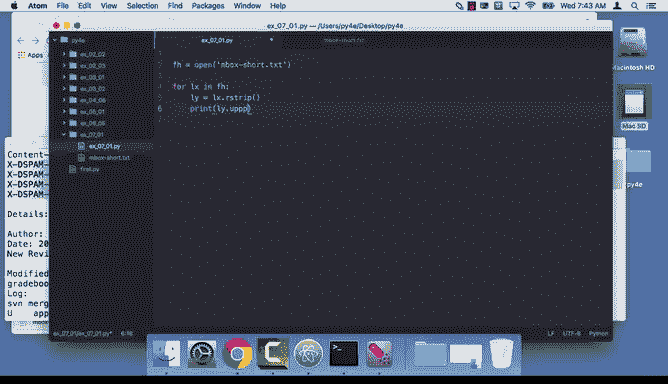

make them all uppercase， see if that works。

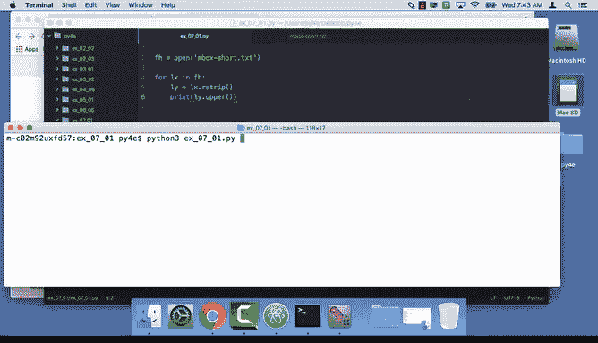

And there you go， and so now the line has been shouted。

 there are only one line and everything is fine， right。

It's been shouted all uppercased This little syntax here is what's called a method。

 This is a string variable and upper is a method within the string variable that returns us an uppercased version of that and again。

 that's object oriented terminology and we will learn about that in upcoming chapter but for now we just sort of type it and understand it and later we'll understand better that there's a whole series of things you can do after this dot for a variable in in Python and so there you have the。

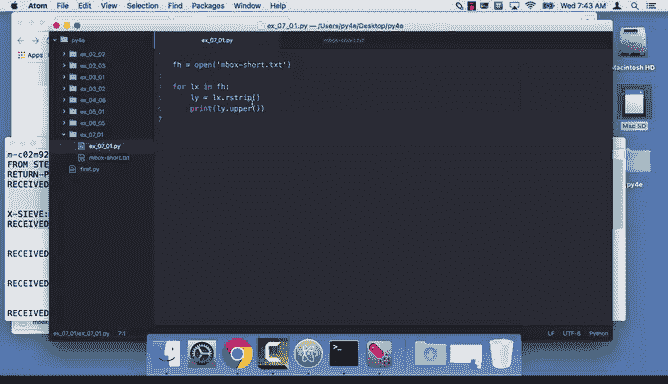

Exercise 7。1 for the book Python for everybody。

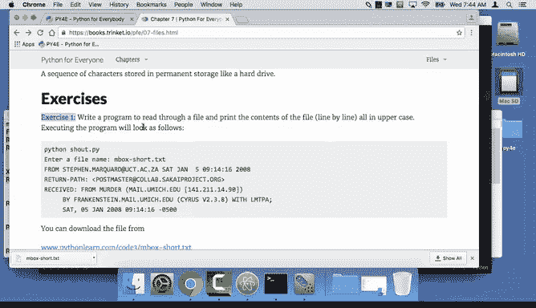

I hope you found this useful， See you on the net。