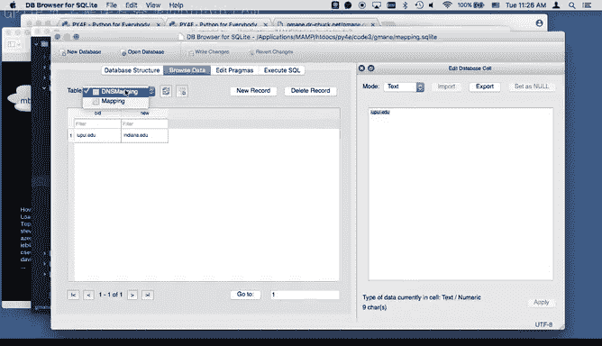
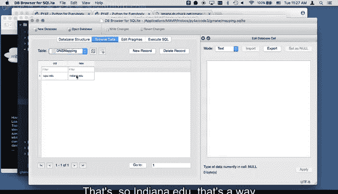
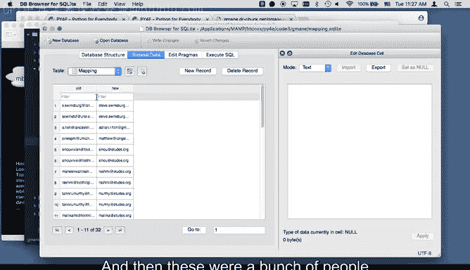
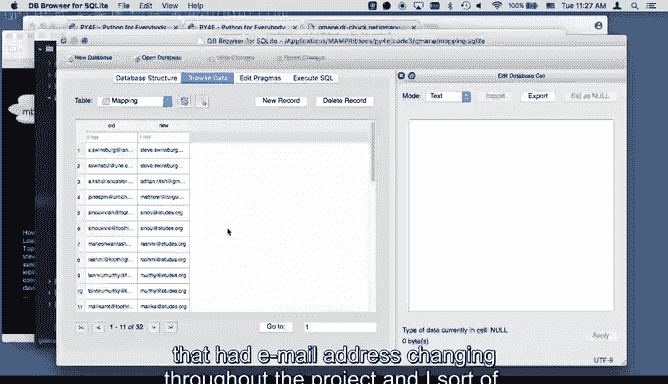
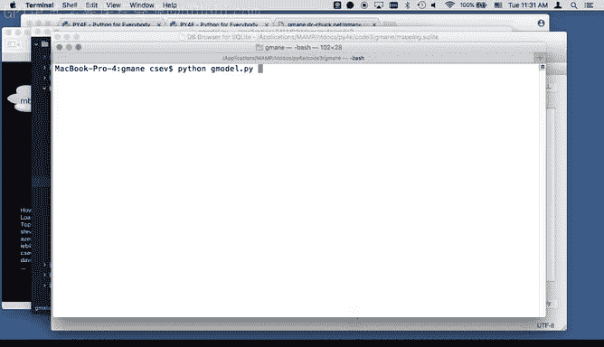
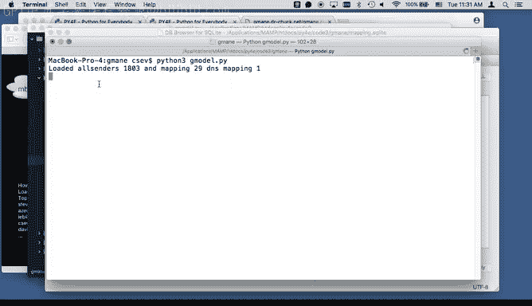
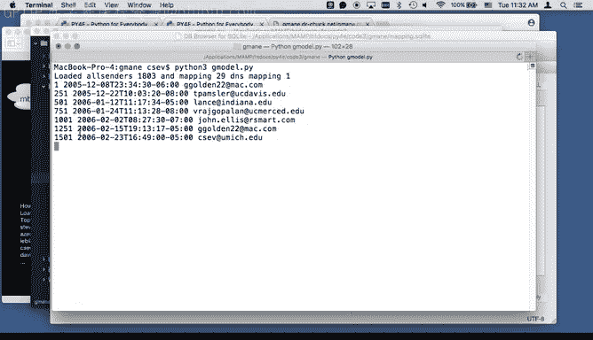
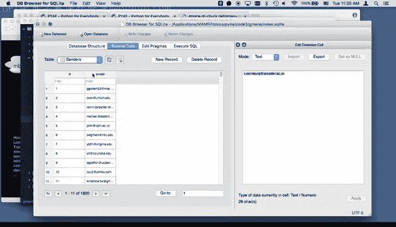
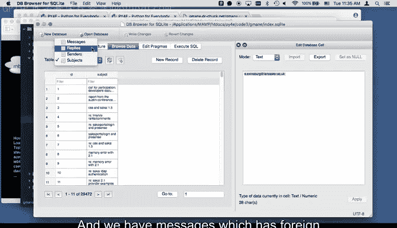

# 密歇根大学《给所有人的Python课》课程5：《毕业项目：使用Python检索、处理和可视化数据》｜python-data-visualization｜ - P15：15_04_03_实例演练-Gmane邮件建模.zh_en - GPT中英字幕课程资源 - BV1Eh4y1U7aE

Hello everybody and welcome to Python for everybody。

 we are going to be doing some code walkthroughs if you want the sample code you can download the zip from our website。

The work that we're doing right now is we are in the process of building a spider and visualization tool for email data that came originally from this website G。

 but I've got my own copy of it and so what we've done before is we ran G。pyy and I grabbed a URL。

I have a URL that has all this data and I downloaded that and then I ran Gmain again to catch up and so it took quite a bit of catching up but by the time I get to remember how it said it run tries to fail five times well it ran out of data at 60。

421 and then it started failing and then it quit and so we pretty much have all of our data now we have all we have finished this process in S content SQL light。

Okay， and if I take a look in the database browser。

 we can see weve got 59823 email messages and so if I look at any of these things you see the headers。

 you see the subject line， you see the email address。

 you see the body of it so remember I split the body into in half and。

And headers and so that's I made this as raw as I possibly could because as you saw。

 I had to spend so much time in the G just getting the data successfully retrieved and so I don't like cleaning the data up too much and so what we're going to look at next is the data cleaning process。

Okay， and and so thiss a G model。tpyy is what we're going to take a look at now。

So let's get rid of those guys and look at Gmod。pyy。嗯。I don't think I need URL Lib in this code。

Do I have any URL Li？No。So I don't need that， sorry。Fix that。Okay。

 so it's going to read from the database it's got a call it's going to use regular expressions and ZlibB is a way to do some compression and so I'm going to do in this one I'm going to compress some of the data to make it so that I have less data to some of the text fields are going to be compressed I wanted to keep these fields uncompressed inside of messages。

And so we so so we have some just clean up messages and cleans things up and it turns out that the way email addresses is in this particular。

Mail corpus， they changed over time and there's certain kinds of things sometimes the G。

org is the email address when people want to hide their address and I made all kinds of stuff and I split it and check to see if it end with this and I cleaned up things just that thing and so I have all kinds of cleanup stuff going on in here and I have this mapping and DNS mapping that I'll talk about in a bit where organizations sometimes sent email with different addresses over time and people sent email from different pot time and we're going to do the parsing of the date and that is the code for that。

We're going to pull out the header information， this is sort of borrowed from the other code。

 we clean up the email addresses and the domain names。And we'll pull the date out。

 pull the subject out， pull out the message ID。Various things。Here's the main body of the code。

We are going to go from content。 SqLL to index。sqLite and what I'm going to do every time is I'm going to wipe out index。

sqlL and drop the messages， senders subjects and replies so this is a normalized database in that it has foreign keys。

So there's a messages table here with the injuter primary key， the GuOID for it。

 the GoodOID stands for global unique ID scent times sender ID， and it's going to have a blob。

 these are blobs by near large objects for the headers in the body because I'm going to compress them in this database to make them。

And then the senders each sender has a key and then。

 each subject line is going to have a key and then replies our connection from one message to another。

 and so this is like a many to many。Now I also have this file called mapping。

sqlL and so we can take a look at that one。Mapping。sqI。

And so what happened is this has two tables that I hand deal with。 And so sometimes Indiana。

 this was a email address that mapped to that。 That's， so Indiana got E to you。 that's a way to take。

Then ats the email address and then these were a bunch of people that had email addresses changing throughout the project and I sort of kind of mapped them in a way。

 and so this is just sort of like a I pull this in really quick and I read all this stuff from the DNS mapping and I。

Other than stripping and making this lowercase， et cetera。

I just am going to make a dictionary DNS mapping， which is the old name to the new name and the email address mapping from the old name to the new name and I'm using fixer Fender is because the email addresses even within G main we kind of funky。

Don't worry so much about this。Okay， and so now what I'm going to do is I opened up a connection just to read all that stuff in and now I'm going to actually open the main content and I'm asking it to open this a little trickier。

 I open that read only that was so that I could potentially be running the spider and running this at the same time。

 I get a cursor。And so I'm going to read through， so in the content file， this is the big one。

 I'm going to read through and go through everyone and write all of these things in。

And I'm going to take all the email addresses and I'm going to put those in a list。嗯。

So I loaded that， I've got the mappings loaded， and so now I'm going to go through every single message。

 I got all the senders， all the subjects and all the global unique IDs。So I read in each message。

 so now I'm going through content one at a time。I parse。The headers。I check to see。

If the sender's name email address after it's been cleaned up is in the is in my mapping mapping。

ge sendender and the default is I get back sender， that's what that's saying。

 look up sender if it's in there， give me the entry of that key， otherwise give me sender back。

We're going to print every 250 things we do we'll complain if this is true。

 we're going to go get the mapping between the senders。

 which is a way to look up the primary key I could have done this with a database thing but I wanted it to be fast so that's part of the reason I read all these things in。

So I could have those mappings to be really fast， you'll see this takes a little while。

 even though it。Even though it' got all this stuff cached。嗯。And so then if I don't have a sender ID。

 meaning that I haven't seen it yet， then I'm going to do an insert or ignore into senders。

And then I'm going to do a select， and then you've seen this where I grab the row back。

 and I'm really just trying to look at the recently assigned ID。

And then I'm going to not only set the sender ID for this iteration loop。

 but I'm also going to store it in the dictionary and so that builds this dictionary up and you'll see the same thing is true for subject ID I'm going to insert it into the subject table and get a primary key if I don't know what it is and then I'm going to put it into not only am I going to put it into the database。

 but I'm also going to put it into my dictionary and the same thing。

I guess I didn't do it for the goit。ok。So now what I have is the sender ID and the subject ID。

 which are foreign keys into the center table and the subject table。

 and I'm going to insert the message with the sender ID subject ID， the S at headers and body and。

The values here are the good send ID subject I he sent at。 Now this here is Zlib compress。

So what I'm taking is the。The message。The header。And the body。

 And this little bit ends up with a compressed version of this stuff。 And you'll see it in a second。

 And this keeps the size of these text things down at the cost of the computation of。

We have to at the cost of the computation to compress and decompress when we want to read it， okay？

And then I pull the GuIids out， the ID， which is the GuOI。

And I pull out the primary key for this thing based on the GuOI。And I update this dictionary。

Let me run that code， it is doing a lot of cleanup and I'll tell you it took me a long time to make this work so just。

So this code that I'm running now， oh， don't forget to take a Python3， Chuck。

So this is going to run every 250， so did all this precaching。

 so that's how long it takes to do 250 now there's 60，000 in here。

And so this is。Really busy the reason it's bouncing back and forth is that every time it makes this journal file that's and then does it commit so you can kind of see that it's。

It's busy making journal files and committing and there's a lot of activity going on here。

This so happens that Adam shows me these files。Okay， so it finished。

 it took about three minutes to finish that right， and so if we take a look at the size of the files。

We will see that the index is much smaller。 It's fully normalized。 It's still 263 megaby。

 It's all compressed。 So let's take a look at that in the in the browser。So it's 200 megabytes。

But it loads up a lot faster。There we go， so we have a senders table right。

 which is just kind of a many to one table， we have a subject to table which is a many to one table and we have messages which has foreign keys。

 takes a little bit to load that up。

Okay， and so。So we see the foreign keys for center and subject and that saves us all those foreign keys save us and so we have you can kind of see that I can't see the headers in the body because now they're compressed that saves me a whole bunch of stuff right it saved me a whole bunch of stuff。

You know， and so so that's what's in that file and that we've finished this process okay。

 and we've finished modeling the data and making it really clean and we'll pick back up and the rest of the stuff we will do is actually visualizing pulling data out of index。

 SqL light The idea is this can be restarted this can be run over and over and over。

 even though it takes like three minutes to run this that's way better than five hours to run this So three minutes。

 five hours and then you'll see we'll see now reading this is in seconds because we got it all nice and normalized in a quite pretty way So I hope this has been useful in the next one we'll actually do the visualization。

