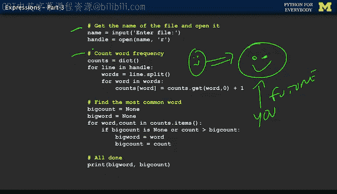

# 密歇根大学《给所有人的Python课》课程1：《编程入门指南（使用Python进行开发）》｜python｜ - P15：15_04_05_在Python中编写注释.zh_en - GPT中英字幕课程资源 - BV1214y117Mk

So now we're going to combine everything in the previous lectures and we're going to actually make our first program。

Before we make this program， we need to talk a little bit about documentation。

 We talked about p mneummonic variables as a friendly thing for humans。

 Another thing that's a friendly thing in programs for humans。

 and you will tend to realize that the human that you're being friendly to when you're writing code and you're doing it well is yourself。

 So good variable names are going to help you a lot。 They might help your teaching assistant。

 but they're also going to help you。 and comments， comments are a way for us to add text that's ignored by Python to our programs。

 And so it's a great way to give little idea what's going on in code。

 maybe there's a couple of lines coming up that are you know 10 lines long， that's a little complex。

 And you want to say， oh， all this is really doing is reversing the order of these two things or knows what or you might document who wrote the code。

 and you can actually just take a line of code and put a pound sign in front of it And then instead of deleting the line of code。

 And sometimes you do that for debugging you add debugging code。😊。

And then when you don't want the debugging code， you just put a pound sign in case you want to take the pound sign out to turn the code back on。

 So we turn it， I use it as a way to turn it on off and on lines of code。

 So here is our word frequency that we keep coming back to。

 And what I've added here is I've added four comments。

 I've added comments that basically help us Under what's going on。 And remember。

 I call these like paragraphs。 Our first paragraph has human readable code， human readable text。

 Get the name of the file and open it。 That's what's going to happen in the next two lines。

 These next five lines are count the word frequency。 Maybe I should say， make a histogram。

So make a histogram。 And you can just read this。 And so again。

 don't think of this as like the teachers telling you that you've got to write comments。

 Think of this as like， I'll write comments。 So I remember what I was doing here。 Why。

 why did I write this code， So write the comments to help yourself out？

 And now here the last thing we're all done and we're printing the stuff out。 Okay。

 so that's comments。 That's an important part。Of documenting your code so that you can figure it out later。

 And again， the human who's going to like you for doing all this stuff。Is you。Right so you。

 this is you and you're giving a gift to the future you。Right。

 so you are writing comments so that the future you can read the comments because in a day or a week or a month。

 you't quite remember what you were doing。 So go ahead and write comments。

 but don't write them because I said so write only the ones that you find useful and don't do something like X equals1 pound sign。

 put one in X。 that's kind of silly。 I mean， everyone can figure out what x equals1 means。

 So you don't put silly comments in just for silliness。

 You just put them in so that you can especially when you you have to understand what's going on here so that people don't have to read quite so detailed。

 And one of the things they would do is they would read this and check to see if it really did what you said it was going to do to help you debug it。

 for example。 So So that's comments。 documentation。 very important。

