# 密歇根大学《给所有人的Python课》课程4：《使用数据库进行Python编程》｜python-databases｜ - P16：16_02_04_实战示例：统计数据库中的电子邮件.zh_en - GPT中英字幕课程资源 - BV1PP411W7H1

Hello and welcome to a code walkthrough in this bit of code we're talking about emaildb。pyy。

 this is a beautiful little example and then it sort of reduces talking to the database to kind of its pure essence。

And so we'll start out this code and we import the SQite3 just to get the library there。

 we make a connection and in databases we sort of end up with a open that's two steps there's the connection of the database with checks access to the file and the cursor is kind of like our handle it's not as simple as you just open it and read it。

 but you open it and then you send SQL commands to the cursor and then you get your responses through that same cursor。

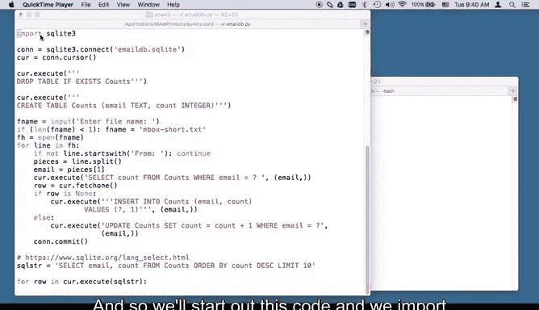

So CUR here is the variable that we're interested in and the first thing that we're going to do is we're going to we' got this file。

 it will either create this file and right now this file doesn't exist。

 it's going to be in the same directory。

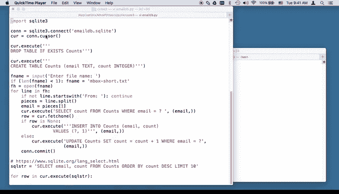

Oops， email。Yeah there's there's no email DB， so this is actually going to create the file when it runs。

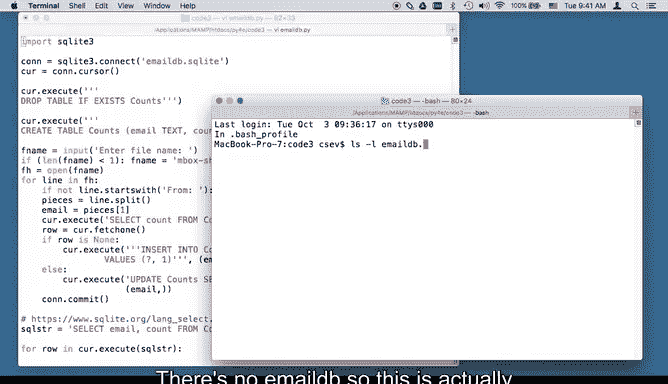

And then the first thing we're going to do is drop the table if it exists。

 drop table is a bit of SQL， the if exists just keeps this from blowing up if we start with a fresh database。

 and in this case there is no file there， so we are starting with a fresh database。

 so this will accomplish absolutely nothing， which is just fine。

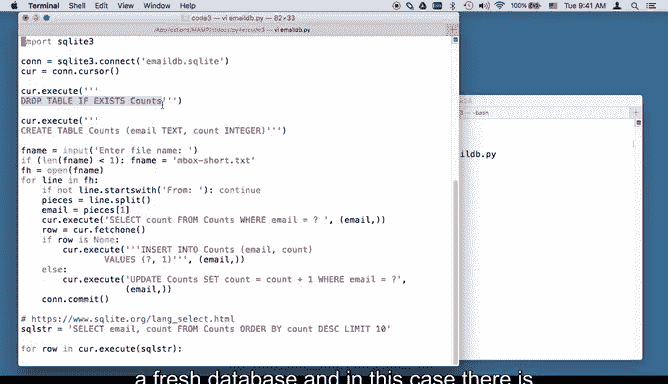

Now while you're using triple quotes here， I'm just kind of using that to make this a little bit easier to read。

 I probably could pull those lines up a bits this one's actually small enough that I could maybe I'll just do that let's do that let's bring that baby right up and turn this into a single quote。

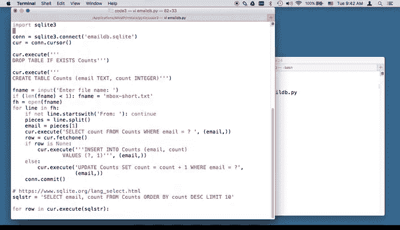

BecauseThat's short enough， right？But triple code is just this one here is a little longer so I use triple quote so we're going to drop table that's going to do nothing first time through then we're going to do a create table now sometimes your application will have like a readme or something says go run these commands to set the database up but we're able to just set this database up in this particular application we'll see later ones where we're going to leave the database and not start it fresh and in this one we can do the same and so but this one in this one we could but we're just going to start fresh by dropping the table so we'll create it。

We're going to have a email an account， we're going to basically what we're doing here is we're really going to pretend that this is a dictionary if you recall when I said dictionary dictionary is like an inmemory database well。

Now we're using a database to do a database， but the first thing we're going to do here is pretend it's a dictionary so that's a little crazy。

 So these next lines of code hopefully are pretty familiar to you right。

 get a file name loop through it， check to see if its if it's you grab inbox short by default so we can press the enter key and then loop through it right and so this little part right here。

 this is our basic this is our basic loop that we're doing and so you know that is pretty normal and if we look at this line right here that line right there is the line that is that line right there make sure that we can。

Only get the front lines we've done that a bunch of times and we're going to split it we're not going to strip the right because the split's going to take care of that。

And then we're going to grab the email address， which of course。

 in the from line is the second part and then we will have that。

So now we're going to do some database。 So the first thing we're going to do this。

This bit right here is kind of like the dictionary part。

So the first thing that we're going to do is we're going to select count from our database that is an integer where email equals。

 and this part right here bears some explaining。This is going to be c7otum。

edu or whatever Now it is dangerous to put those strings。

 especially from user enter enter data into your SQL you technically could。

 I could make this be a email equal single quote C7um。edduu I'd have to escape the boats and stuff。

 but this question mark is a placeholder。And this is a way to basically make sure that we don't allow SQL injection。

 go Google SQL injection to get a sense of what that is。

 it's more of an issue in online applications， but in this application we're just being good。

And so the way this works is this is a placeholder in this SQL that will ultimately be replaced by this Now you could have several question marks we only have one in here and so you give a tuple and if we just put email it won't turn into a tuple。

 this is a one tuple basically this little weird parenthey email comma。

Prenhesy that is a tuple with only one thing in it and that's just the weird Python syntax it's rare that I apologize for Python syntax。

 but that's a little bit less than pretty but it's okay it's a tuple and normally there if there were like two of these then there would be email name dott dot do dot okay so。

So this cur dot execute is actually not really retrieving the data in a way it's looking at the SQL and making sure that maybe it might verify that the table name is right or if there's any syntax errors。

 et cetera， et cetera。 So this this actually is not really reading the data so but we have prepared this cursor。

 this is kind of like the opening of a file， but what we're opening is a record set。

 we're opening a set of records that are going to you know。

Be this wherever it's true so it's like we're going to read this like a file。Now， later。

 things will loop through this， but we're only going to say， hey， grab that first one， right。

 We could have even put maybe a limit clause on there or something。

 grabbed the first one and give it back in row。 And so row is going to be a。

Row is going to be the information that we get from the database， and so that is。

If there are no records that meet this， then Ro is going to be none。So here's kind of again。

 like the get， here's like the get where if the row wasn't there because the way we're doing this is we're going to end up with this row in the database。

 here's this database and there's going to be two columns and there's a bunch of rows and then here's going to be CE4 and Gen。

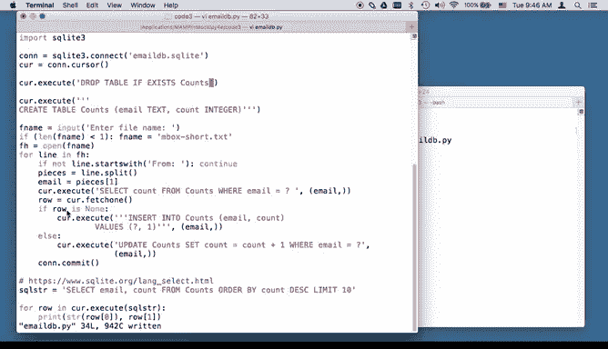

3 and Stephen6 right So these are the counts。 And so we're grabbing this variable out if it's Cab that we're grabbing and that's going to come into here right that's going to show up in here and that row that row is actually it turns out that the row is a list。

 but we're only getting one thing and what we really are doing is if we。

 if we search through and we got through and there was nothing then row is none means that there was no and you're seeing like like chs for the first time and we have to insert it。

 So if row is none。We're going run an insert statement insert into counts email count Now we've got to set it to one because it's the first time we've seen it so values and then again the question mark the question mark basically says hey I'm going to have a value in this tuple and there's an ordering to the tuple and so there's only one question here when question mark placeholder here and then one is the initial count so email question mark count one a away we go and so then then we have again we have a tuple that gives to this execute statement just like in that execute statement the corresponding sort of strings or integers that that are to be placed by each of the questions so when this runs。

 there's going to be a new record and there's going to be a one that's put in there into that new record。

If on the other hand we pull back a row that exists， we're going to get this for number。

 and you might think we want to take this for number and add it。

 but in databases it's always better to do an update because。

There might be multiple applications that are talking to this database at the same time。

 so no matter what update does is in a single atomic operation it turns whatever this number is into one higher and we don't have to worry about other pieces of code potentially modifying it now in this case we don't have to worry about that because we're the only piece of code。

 but using update to increment something is way better than reading the value and then doing an update to adding one inside of Python and then updating the new value。

 which is that's two SQL statements， but it's also not atomic okay。So if the row is none。

 if the row exists， we just know that it exists and we just want to add one to the number。

 we don't we do have the number sitting here in the row variable， but we don't need it。

 and so we're going to say update counts。Set count equals count plus one column name。

 where email equals and then another placeholder and then another tuple for the question mark okay。

 and so that's what this little bit of code does that is kind of the the read it， parse it。

 check to see if it's there if it's not inserted if it is updated。

And so then we see this con commit and this con commit。

 basically the way it works is that the database。Is efficiently keeping some of the information in memory and at some point it has to write all that stuff out to disk so you can choose at times where you put this commit right now we're going to commit every time through this loop。

 but you might commit every 10th time through the loop because the commit will take some time because it forces everything to be written to disk and these can run really fast and the commit is the slowest part here。

So sometimes we do things like commit every 10th record or every 1 hundred0th record。

 if it's an online system， which is not what this is。

 you have to commit at the end of every sort of screen paint。

 but for this kind of a system because we're putting so much in this is kind of a bulk insert。

 we might come up with a thing where we you know every every 10th time we do a commit。

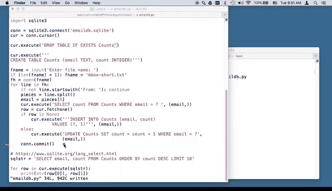

But ultimately， what this will do when this is running is it will build up slowly。

 but surely adding new records and then one，1， and then a build 2 and a 3 and all these things and add another one。

 That'll be one。 It'll do this thing， right。 And then at the end of the day。

 that is what's going to be in the database now。嗯。So now we're so let's take a look what's in the database and then we can actually read the database and so in the database。

 we're going to run a select。And we're going to say we're going to select the email and account from counts order by count descending。

 so look at that isn't that cool we're getting in the top 10 because databases are good at sorting and they're good at all these other things。

 so we're going to then execute this。

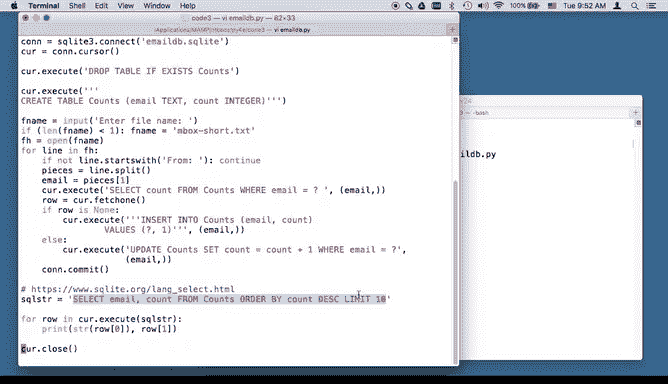

And then we're going to ask for the rows one at a time and the rows are going to be rows sub a tuple and rows sub zero will be email and rows sub one will be count so we run all this stuff and then we close the connection and away we go okay。

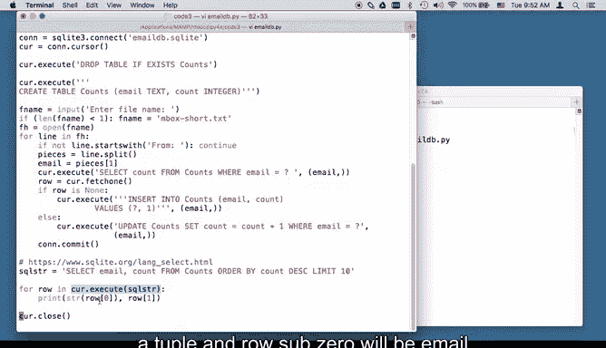

Let's go ahead and run this。Let's go ahead and run all this up。Python 3， email Dbt PY。

 it asks for a file name andbox。

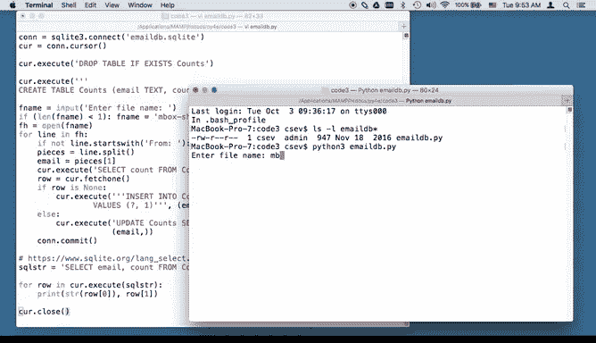

Short， and I can hit enter， right and buck short。And that's it and it looks just like that and it counts it and away we go Now the difference is at this point we have a file emaildb。

sqlL and we can run the SQLite browser。And we can then open this database。

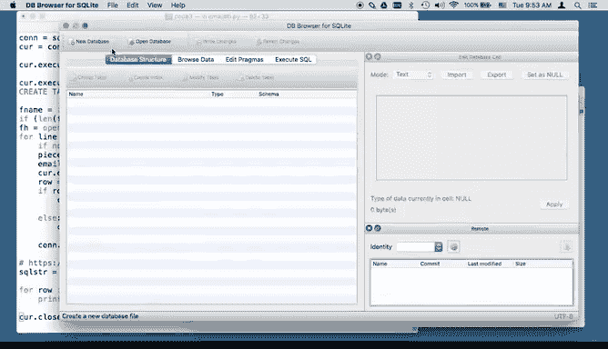

And we can see what's in there， so here we go it is made an SQLite database。

 we have a table of counts， and then we can take a look at the data and there we go。

 we've got the data in a way and we can do this。

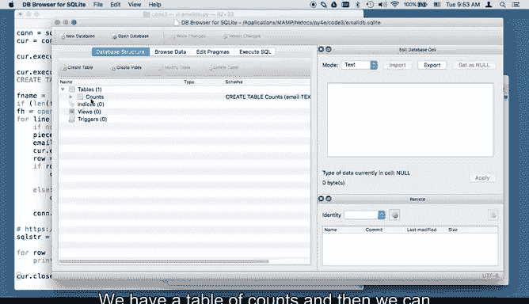

And so let me close this， it's important。At times when you don't want necessarily to have， well。

 let's see if we can cause it to lock up， let me run this again and it's going to drop this table so I'm going to run the code again。

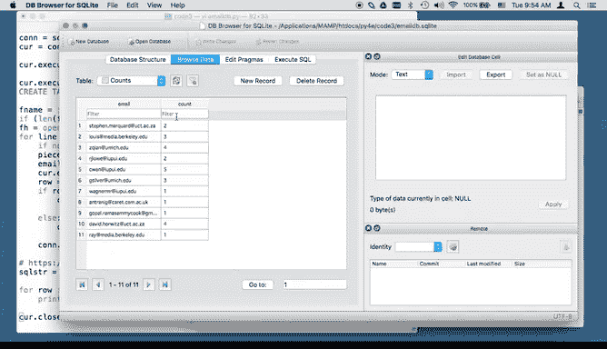

But this time I am going to do the full one M box。Dot Txt。Now we'll see what happens here。

But it ran and now so what we have to do then to see this date。

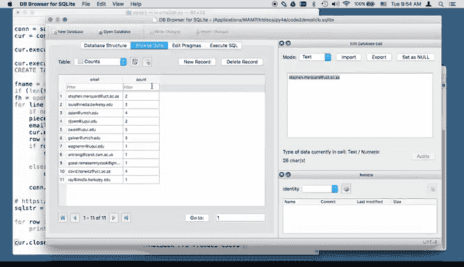

🎼Is from the previous run， but if we want it the most recent one， we hit refresh and then away we go。

 and so we can see this stuff。 And so this is just a real simple start to see how you can connect some of the stuff that we've been doing。

 but store the data in a database， But the nice thing about the database is that it can store this stuff from run to run。

 even though in this case， we're dropping the table every time in later things we will see how we can store data from run to run to give ourselves more restable processes。

 cheers。

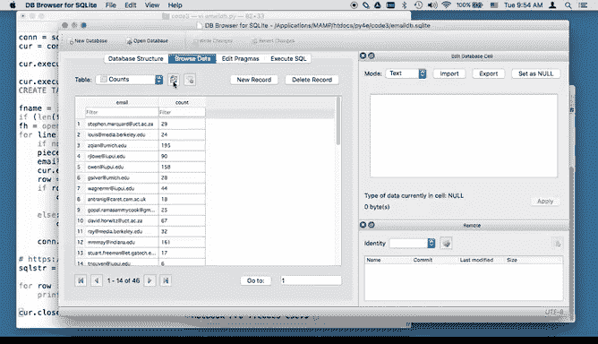

🎼。