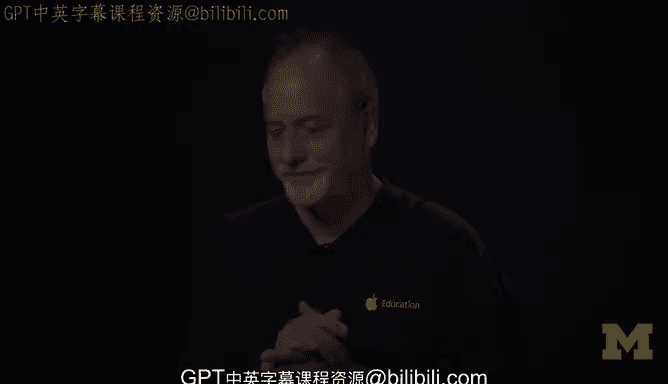

# 密歇根大学《给所有人的Python课》课程1：《编程入门指南（使用Python进行开发）》｜python｜ - P16：16_04_06_你的第一个输入-处理-输出程序.zh_en - GPT中英字幕课程资源 - BV1214y117Mk

So now we're going to do our first programming code。Now。

 the pattern that's going to happen in here is a pattern that I call and I was taught。25，30。

 many years ago， input， processing and output are the essential things that computers do。

 They gather some input， maybe from a file or from a web service。 They do some work to it。

 and then they produce something in work out。 The work is the hard part， usually。

 And so this program is our first program that demonstrates all three of those things input processing and output。

 And it's a three line program with one comment。So the problem that this program is trying to solve for those of you who have traveled in the US and traveled everywhere else is that the ground floor in hotels in most of the world is the zero floor and the ground floor in the United States is the one floor。

And so you might find yourself in a European elevator asking what floor， I mean。

 what is the equivalent United States floor to this floor that I'm sitting on。 So if I'm on floor 7。

 what would be this floor if I was in the United States。

 And that's the problem we're going to solve now it's。

Probably not going to make us rich if we build an app for this。

 but perhaps someone can get the European elevator converter app into some app store。

 and maybe you will get wealthy after all， but。For now， it just is sufficient。

To teach us about a full blown program that does input， processing and output。

It's as simple a program as I could make。So let's take a look at it。 a comment。

 convert elevator floors that has nothing to do with Python has to do with you or me reading about this。

Then。Input， well， remember， input prints out the prompt。And then pauses in weights。

And then we type and then we type the enter key。Right and then this zero， this is a string。

This string ends up being input put in the variable imp。And then it continues to the next line。

 And it works on the right hand side。 We're going to pull this string 0。

 We have to convert it to an integer。 Otherwise， we can't add one to it。 if we didn'。

 if we just int plus one， we get a trace back。 but we say int of Imp， convert it to an inger。 Now。

 if you if you mess this up and put bob in。 Then this thing is gonna to blow up because int can't convert Bob to an integer。

 But because we have a0 here。 We're okay。 So then we add one to it。

 and store that in USF USF pnemonic variable name， United States floor Imp。

 the input we got from the user， I'm using good variable names here。 So we store this in。 And so。

 you know， we got that becomes one。 and then we print out US floor comma USF。

 Remember the comma produces this little space down here。

 And so we have our input processing and output。 in a way that builds us on application。 now。

There's lots of things allowed to do。 and most programs aren't one line long。

 And there's a lot of work that we're going to have to learn。 But this gets us a start。So。

We've talked a lot of stuff。 We've talked about constants。 We've talked about variables。

 We've talked about reserved words。 We've talked about type。

 We've talked about pnemonic variable names， which are both wonderful and a little confusing at the same time。

 operators， operator precedents focus a little bit on division where we talk about Python 2 versus Python 3 type conversion and comments and then writing an entire program。

 So up next， we're going to。😊，Start talking about conditional execution using the if and the else and other of the reserved words。

 And this is where some of the intelligence starts to seem to come into computer。 So up next。

 conditional execution。

