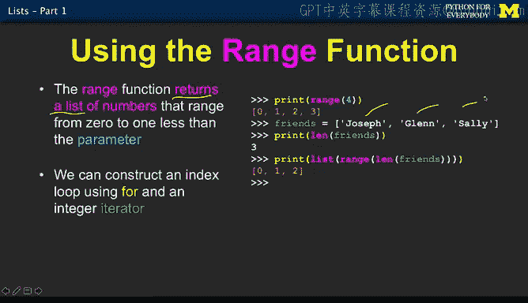

# 密歇根大学《给所有人的Python课》课程2：《Python数据结构课程（密歇根大学）》｜python-data｜ - P18：18_04_01_列表.zh_en - GPT中英字幕课程资源 - BV1yP411a7TZ

Welcome to chapterpt 8。 So in chapter 8， we're going to take a little things in a little bit different direction up to now we have doing what we've been talking about and building code to understand what we in computer science call algorithms。

 algorithmris are the paths that we call right code to go certain paths。

 We go here and we go over there， we go back up and we come this way。 We check to see if it's this。

 we do this。 that the algorithms are like GPS routing for code。

Data structures are structured variables and up to now we've been using very， very simple variables。

 we've been using variables that are like x equals or y equals or whatever。

 but there are more complex ways to use memory， use the variables there are are collection variables and so。

This is the first time we're going to really start talking about ways to use variables differently and the design of your variables。

 the design of your data structures， how you organize your data while your program is running。

 can help you solve your problem。 So you have a set of steps and you have an internal shape of data。

 and lists and dictionaries and tuples are the first three data structures we're really going to talk about。

So these are collections where we have more than one value in a variable。

 And so before we talk too much about collections， let's talk about what's not a collection。

 So in this little example， x equals 2 that finds a piece of memory。

 Python labels at x and sticks a2 in it。 Then later， it says x equals for it。

 finds that same piece of memory overwrites the two with a four。 so when it's all said and done。

 what we have is a4。 Now， a list is a collection， meaning that in a single variable。

 we can have more than one thing。 And so in this， we've actually。

We've actually been using lists all along when we see the square brackets syntax。

 we've been using these in four statements， et cetera， et cetera， et cetera。 This is a list。

 Square brackets is a list constant。 But what you're noticing here is I can put three things。

3 different strings。 Joseph Glenn and Sally into a single variable by enclosing them in this brackets。

 And so it's still a single variable。 friendsend is no longer a string。 It's a list of strings。

 which is different than a string and the same for carryon socks， shirt and perfume。

 So you can think of it as sort of like a piece of luggage with a name X or y。

 But then you can put multiple things in it。 And the interesting thing about these data structures that we use for different purposes is how you put them in and then how you get them back out will be the distinctions between these three different kinds of collections that we're going to talk about。

 So like I said， list constants are anything in square brackets。

 So that's a list of three integers 124。76This is a list of three strings， red， yellow and blue。

 You see it can be either kind。 We just use commas。

 and we use square brackets to start them and stop them。

 You do not have to have the same type of data in a list。 Here is a list that has a string with red。

 an integer of 24 and then 98。6 which is a floating point number。 And it doesn't even have to be。

 we won't do this too much for a while。 but this is a three element list。

 The first element in the list is an integer。 The second element in the list is a anotherher list。

 Its lists within list。 It's turtles all the way down。 Its inception。

 So you can have list that include list。 and。When we talk about data structures in a more advanced way。

 having a list that includes another list or a dictionary that includes lists is just part of the design now。

We're way， it's way premature to talk about why you would do this。 But it's possible。 So this is a1。

 a list and a 7。 And so there are actually three elements in in this particular list。

 and you can have an empty list。 And so that is list constants。 Are these square brackets。 Now。

 like I said， we have been using lists already。 We have four loops。

 and we've iterate the I through 5，4，3 and 2 and 1 to print these five things out。

 which means that4 is going to run this once for each value in the list and I is going to take on the successive values in the list。

 And like I said， we have already been doing that， right， you know。

 we've been doing that since Chaer 4， Chapter 5 or something like that。So lists and definite loops。

 the kinds of things that we've been doing all along， our best friends， the in。

 so you can think of a list as like a set。It's a set of three strings and the in is like for all the members of this set。

And so for friend in friends。And remember the fact that I use plural here in singular hair does not mean anything to Python。

 it means something to you as you're reading the code， that's a p mnemonic variable。

It can be anything you want。 As a matter of fact， this is exactly same code Z equals Joseph blah。

 blah， blah， and 4 x and Z Xon takes on the success of values。

 Python sees these two things as completely equivalent。 But you as a human being。

 read them as something different。 And so that's the choice of reminding us of the choice of variable names。

So these collections， there's putting stuff into the collection and putting multiple things in the collection。

 but there's also getting them out。 And so we use the index operator。

 the same operator we use to look inside strings to look inside lists。

 So I read this in my mind as sub。 So this is friend sub1。 Now。

 remember that be using the elevator scheme in Europe technique。 the first one is0。

 The second one is one。 And so friendend sub1 is actually this second item in the list。

 And that's how Glenn ends up getting printed out here。 So you can look inside lists。

We can change this and the word that's used in Python speak is called mutable means changeable。

 it can be changed。And so you'll notice that some things are not mutable。 So like strings。

 So we put in banana in fruit。 This seems like it would change that first letter to lowercase B。

 We got sub0。 fruit sub0 equals B。 unless you saw this trace back， you know， you might think。

 this is no problem。 Stactically， Python could actually support it。

 but it doesn't because we are not allowed to change this string。

 And that's part of the reason that when we do things like that lower on strings。

 we always say it makes a copy of the string and gives us back a lowercase copy without changing the original string。

 and that's because strings are not mutable。 It assignment is another word that Python uses to talk about this item assignment。

 So strings are not mutable。 Okay， but on the other hand， if we have a list。2 1426，5 integers。

 and we print it out， and then we say lotto sub2 equals 28。 Well， that is this thing。

 so that puts 28 into that position。 and at this point the list is truly changed， right。

 so we print it out the original 26 is long gone。 It's just like any assignment statement。

 except that we can assign into a piece of the list。 we can put something into a piece of the list。

Ls have length， just like strings。 We use the exact same function。

 Python knows the type of its parameter and the length of the thing that we're looking at。

 And it says， oh， I know what that is。 In this case， it's a string and it's 9 characters。

 And if we say， oh， here's this list。 And this is another list that not all the types are the same。

 It's one，2，3，4。 how many things are in there， tell me about that， four things are in there。

 So then is you can pass in various sequences and we'll use them for dictionaries and tuples as well。

 When we get to that point。The range function is kind of a weird special function that we use mostly when we're constructing loops。

 but the range function returns a list， returns a list。

 And so it returns a list0 up to but not including sound familiar。

0 but up to but not including the numbers。 So range 4 gives us four numbers。

 but they start from 0 to 3。 And the reason for this is that they can then correspond to the index position either in lists or in strings because  zeros。

 you know a three element list is 0，1，2 up to but not including3。

 And so if we have a three item list here。 And we say how many things are in there， it's3。

 And if we say print range of land friends。 So this land of friends is3。

 And so then this range is0 through2。 And so we can use these to construct lists。

If we want to have a counted variable。 So the best way to sort of go through a list is this one here。

 It's a nice， simple determinant loop that basically has an iteration variable。

 And it's very clear if all we're going to do is print them out。

 But what if we somehow want to know where they're at relative to the list。 We want some I variable。

 You could say I equals 0， use a while loop， I equals plus 1。You can do all that stuff。

 We've seen those loops in previous things。 or you could use a for loop。

 But instead of having the iteration variable go through the actual elements of the list。

 we have the iteration variable go through the numbers0 through 3。 And so that's what this is。

 So range here is 0，1，2。 And so then I is going to go through 0，1 and 2。

 And then when we want to look at the particular item of the list。

 we use just use the index operator sub0， sub1， sub2。

 So these two lists produce the exact same output。 But in this one。

 we know during each iteration of the loop， we know what I is。

 And there may be reasons that you want to know that。 You might want to print out， oh。

 I found something at the third position， which you wouldn't be able to see here unless you added like I equals 0。

 I equals I plus1。 So this is a way to create what we call a counted loop。

 So instead of it being sort of a loop that just goes through a set。

 it is a counted loops because it's going through a range of numbers。Okay， so up next。

 we'll continue talking about some of the things that you can do with lists。

