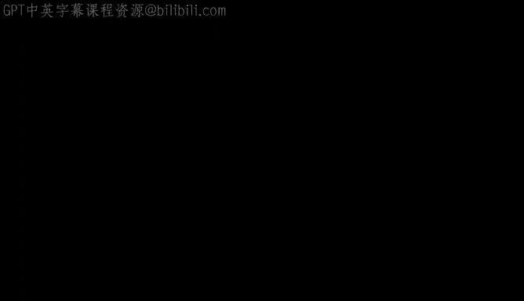

# 密歇根大学《给所有人的Python课》课程5：《毕业项目：使用Python检索、处理和可视化数据》｜python-data-visualization｜ - P18：18_05_01_办公时间-Chuck博士扮演Anthony Bourdain.zh_en - GPT中英字幕课程资源 - BV1Eh4y1U7aE

My name is Charles Severens， I'm a faculty member of the University of Michigan School of Information。

I've also taught over a half a million students around the world since 2012 using a platform called Coursera。

When I travel， I invite my students to what I call face to face office hours。🎼，Hello Chuck here。

 we are here in Paris， France with yet another face to face office hours for Coursera and I'd like you to meet some of your fellow students。

 so say hi， say your first name and if you want to say hi in French go ahead and say hi in French or say hi in English。

ま十学ても。Hi， Sydney。Hi， I'm Alex。嗨水牛。Okay， there you go。

 yet another successful office hours in a bit I will hop on a plane and go to Milan。

 This is called the fashionashion tour Paris and Milan。

 except that I don't have the clothes for that， but we'll see you soon in Milan bye。We're in Milan。

 Italy with one of the largest office hours ever and I'd like to do our standard introduction so that you can see everybody so give us your name and say hi or say something about the mark I just really like the course that don't have anything to say Okay I am Lucca。

And I mean， I mean for。你ever上班。Okay， I'm Ivan。 I like the teacher and I really love the the course。

 Great， thank you。 Hi I'm Sebastian， and I attended the Internet history course， right。😊，Hi。

 this is Antita learning Python and getting excited about the course Shao I'm Barbara and I like your course。

 Thank you little Cha Thank you Barbara。😊，😀Hi， Alberta。 I just want to learn programming。 Okay， hi。

 I'm Andrea， I took Internet history。 And when I read that the doctor Chuck was coming。

 I started screaming。 Doctor Ch is coming in the office And no one understood anyway。 hi I'm David。

 It's my first course on Cosera。 And they wish everybody good luck and say focused on your goals。

 we we because don't make write a python program right， and I do the same thing。

 but the interesting thing is， when I'm writing a Python program。😊。

🎼When I'm writing a。An operating system， I'm saying， oh。

 here's this problem I've got to solve and here's these specifications in performance and I'm thinking like a computer scientist。

 but when I'm writing a Python program， that's like looking through a mailing list for certain kind of mail messages and then matching those mailing messages up with something else or seeing who the most prolific poster in your form is。

What you're really doing is you're slowly but surely putting yourself into that program After meeting with the students。

 I went to dinner with Mauo tosally who' has been in one of my volunteer teaching assistants in Coursera since 2012。

Okay， one thing is not another thing is from another with no CA or just CA that's arrived to yeah。

 once in a while， okay say yes， no， yes， no， and I participate a lot。

 and also is for that reason that Nor and Kate approaching me asking to become cityA and Im Italian maybe my English is not very So not' important being in Italian in IT。

 sometimes is kind of the world of internet and they are asking me to become a teacher assistant I felt very。

 very well。 And also I put all my also to say thank you to Cora。

For giving me this kind of opportunity。