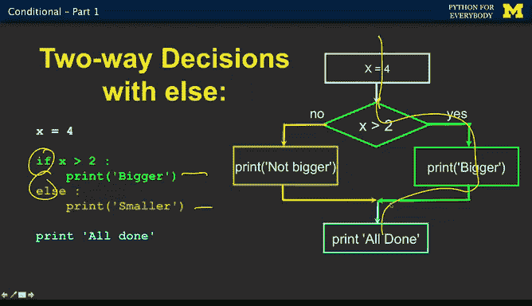

# 密歇根大学《给所有人的Python课》课程1：《编程入门指南（使用Python进行开发）》｜python｜ - P18：18_05_01_条件语句第一部分.zh_en - GPT中英字幕课程资源 - BV1214y117Mk

Hello and welcome to chapterpt 3 Now we're going to talk about conditional execution Conal execution is where we start sort of adding more intelligence。

 sequential execution， you just type them in and Python does it。

 but sequential execution is where you can like make choose one or two paths。

 turn left or turn right or go straight， you can make choices and this is an essential part of making computers seem intelligent。

And so the key to this is the if statement。 So the if statement is the reserved word that indicates that we're going to do something conditionally。

 and it's not that hard to read。 So the if statement has a condition。

 It's really a question this unlike x equals 5， which changes potentially a value of x x less than 10 is asking a question。

 It's asking is x less than 10， and that returns a true or a false。In this point， because x is 5。

 x is indeed less than 10。 And so it's true。 These if statements end in a colon。

 and they start an indented block of text。 It's kind of like an outline that basically says if this is true。

 do this statement。 Otherwise， skip a statement。 So in this case， it comes in。 X is less than 10。

 So does the statement， then it comes back， It says if x is greater than 20。

 this one evaluates to false。 And so that skips it。

 So that's why we see smaller printout and fy printout and this line never execute。

 So that's why I call it conditional。 Depend on this question that's being asked。

 the line inside the indented block will either execute or not execute。

 And so you can kind of look at this。From sort of as if you are driving a car， right。

 you execute this statement， then it goes to the next one， then and ask the question。

 is x that less than 10。 If the answer is yes， it turns this way and drives down here and runs this code does that thing。

 And then it rejoins。 And then it says， oh is x less than 20。 Well， since x is 5。 The answer is no。

 And so that skips that completely。 And then it runs this。 and then it's done。

 And so this code never runs。 Okay， And so so when we say conditional， we say yes， that one ran。

 but that one did not run。 And so that's why we call it conditional because it may or may not run。

 The other thing that's important about this is this indenting notion that we start with an if have this colon and then we indent。

 the indenting can be a variable。 we tend to indent by four spaces。That's the recommended pattern。

 And we'll see in a bit the indents can be longer than one line。

 This is only a one line indent where you have one line that's conditional。

 but you will see in a second how we can do this with more than one line。So。

Good time to talk about the comparison operators。 Again。

 The problem here has to do with the limitations of the keyboards in the 1950s and 1960s of computers when most of these languages were kind of designed。

 So less than is on keyboards less than followed by an equal sign is less than or equal to double equal。

 This is probably the part that's the hardest。 double equal is a question mark。

 Remember equals is an assignment statement。 It has kind of a direction。

 X equals1 X equals1 that puts one in x。 this， if you say you x equals1。

 you're asking the question is x equal to1 and it doesn't harm X。

 So that's probably it takes a while， you know if I was designing a language。

 I would say assign x into one， and then this would be single equals。

 but sorry that's I didn't design Python。 So that's not the way it is。

 So double equals is the question mark version of equality greater than or equal to。And greater than。

 And then not equal is exclamation point。 In other word for exclamation was bang。

 we say bang equal or not equal。 And so the exclamation point is like not equals or like emphasis。

 I don't know。 That's how I remember it。Remember that none of these harm the data that they're looking at。

 they evaluate and then return us a true or a false。

So here's an example of all these things kind of in action for x equals 5。

 they're all going to be true。 if x is equal to 5， remember that's the question mark。

 if x is greater than4， yet and the answer is yes。Print greater than 4。

 if x greater than or equal to 5， that's also true。 So this part runs。 you can also。

 if it's only one line of stuff。You can sort of pull this line up to the end here。

 if x less than 6 print less than6。If x less than equal to5， print less than or equal to 5。

 if x is not equal to 6， print6， and so you see this pattern of indent， end of indent， indent。

 end of indent， indent end of indent， indent end of indent， so this is an important part of Python。

 not a lot of languages make the indenting of lines a syntactically meaningful thing。

 but that is how Python works， and so if you don't indent and it's not going to work the way that you expect it。

 especially for coming from a programming language like Javascript or Java or C where the actual spacing doesn't matter in Python。

 the spacing does matter。And so this is an example of you know a longer block of text that's indented and you can now see kind of how this indent works。

 you know x is 5， we print before5， if x equals 5， this is going to be true because it is colon starts an indented block now。

By maintaining the same indent， you make this all part of the conditionally executed block。

 So this is。Three lines of code that it runs， runs this line， then sequentially runs this line。

 sequentially runs this line。 And we indicate when it is that we want to get out of this block and then continue by D indenting。

 Okay， so it runs when it's true， it runs all of them， then then now it's running sequentially。

 sequentially， sequentially， and now it says， oh， if if x is equal to 6。 Well。

 this one's going to be false。 then that skips。All of these， none of these run。

 skips all of the indented blocks， and so this indenting is a way to in effect。

 make bigger blocks of conditional code or multiline blocks of conditional code。

So indentation is important in Python， it's more important in Python than literally almost any other programming language。

 We always use indentation in other programming languages to mentally keep track of blocks of text。

 but it's not where the programming language will complain if you get it wrong so you have to sort of think why did you increase the indent。

 which is like if after an if a4 or a while statement which we'll see in a bit you maintain the indent which means you stay the same or then you de indent or you reduce the indent back and that is the way to end a block reduce it blank lines don't matter and then comments by themselves on a line don't make any difference for indentting。

And so。As you're doing this indentting， it's really natural to hit the tab key on your computer and to move in so you blah。

 blah， blah， and then on the next line， you hit tabab。

The problem is is that Python can get very confused if you sometimes are using four spaces。

 space space， space space， and sometimes use tab， and the danger is it can look right on your screen。

 but Python will still complain to you。And so if you're using a text editor that might be putting tabs into your document。

 you find where it turns them off。 So a program editor and like we're not talking a word processor now。

 we're talking about a program record like notepad or text wrangler。

 These have a setting whether or not to turn tabs into spaces or not。

 So it either puts a tab in the file or put spaces。 And so this is a good time。

If you're using one of these text editor to make sure to turn tabs off or cause tabs to be expanded so you don't end up with in a few weeks or a few days with Python errors that you just don't understand and that makes you grouchy。

 So you have to think about this about the indenting and the de indenting。

 When do you go in and when do you come back out And so it's the way that we define block。

 So we have sequential code which maintains the same indent。

 now we see the if and we see the colon that means we start an indent。

 and then to stay inside that block of code， you maintain the indent and then to end that block of code。

 you de indent So you think of this as like I'm de indenting。 I'm doing this on purpose。

 It's not like randomly if this was in， then it would be it would function differently。

 The fact that this print is out means it's not part。Of this if block。

 these two statements are part of the conditional code。 The print really is。

The print really is the thing after the if right， And so this is going to run no matter what these two may or may not run in this case。

 because it's true， they are going to run and come back out。 So this is conditional code。

This is sequential code。Sequential code。And if we continue down， we haven't talked about loops yet。

 but the four keyword is a loop， and this is telling it to run this thing five times and it ends in a colon and then you go in。

 and then you have some sequential code， then you have an if， this is called nested。

That's a block within a block， so the if has another cone， so we going even farther。

And then we deindent to this level of this if， and then later we deindent to the level of the four。

 so you kind of have to match these things up and decide how you're going to end your conditional code or in the looping code。

 which we're going to learn in the next section， how that works。So what you want to do after a while。

 I it won't take you too long but sort of train yourself to start thinking about the fact that these are blocks of code that you can sort of draw these squares around the blocks of code。

 and and I've drawn the square here， the if starts it。

 you can also kind of use the colon is your little mechanism。 and then the D indent stops it。

 And so this is the conditional code， and then you can see where the F starts and then it's the line that lines back up with the4 that is the scope of the entire for loop。

 same here with the if， the thing that lines up， that is the scope of that if block。

 So mentally you have to realize these d indenting and indenting。Adds meaning to your program。

 I mean， they absolutely define which things are going to run as part of an if statement。

 or regardless of of the value in the if statement。 So start， start seeing these。

 start seeing these And in terms of nesting。 You can see them inside one another。

 It's like the Russian dolls where you've got a block of code within it。

 You got another block of code And believe me， we'll go down， down， down， down， down， out， out， out。

 out out。 And so start seeing these indenting as blocks。 is just start， start feeling that。

Like I said， nested decisions， there was a for loop with an if。

 we can also have a decision where there's an if within an if。And so in this case， x is 42。

 if x is greater than1， that's true。 So then we're going to print this。 If x is less than 100。

 that's again true。 So we're going to go in and run this。 And then we've deindented twice。 And。

 so this does line up with the if。 So this functions as the end of both this block and the end of this block because it lines up out here。

 So if we look at it from a GPS perspective。 That's true。 X is greater than one。 we print that。

 we ask another question。 It's a question。 And it yes。And now we're continuing back down。

 so we kind of come out of the indent block。 and as you're drawn。

 you kind of see this is indented once and this one is indented twice just the way I drew it and the same is true here。

 this is indented once once and then。To getting too busy there。 This one's indented once。

 This one's indented once。 This one is indented twice right。

 So start counting those indents and knowing how the D indents work。

So we have one way decisions and very commonly we have a two way decision。 we call this else。

 we want to basically do one thing or another。 it's like a fork in the road。

 If something is true in this case is x to the two， well it's4， so it is true， we do one thing。

And if it's false， we do another thing。In this particular example， we don't do this one。

 We only do this one over here， but you got the idea that with one if test。

 we choose alternatively between one and the other of the choices。

 So this is how we write that in Python。We say sequential code， question mark， colon。

And then we have the true part。 This is the part that executes if the question evaluates the true。

 And then we deindent and use the keyword else。 So else is a python keyword。

 And you see another colon here。 So we sort of deindent， say else and then reindent。

 And then we have this part。 And so that's how we capture the other half。 and then， of course。

 it runs no matter what。 So if we are to do this， if it's true， it runs this and then skips that。

 And if it were false， which is not。It would skip this， run this and then continue。 The point is。

 if you use。 and if else structure， one of these two things is going to run。

 And it's sort of the same as this。 It comes in here。 There's no scenario in which both run。

 it's going to run one。 And by running one， it's not going to run the other one。 That's how。

 and if then else happens。

So coming up next， we're going to talk about some more conditional execution patterns。

 a little more complex stuff， Elsif， etc。