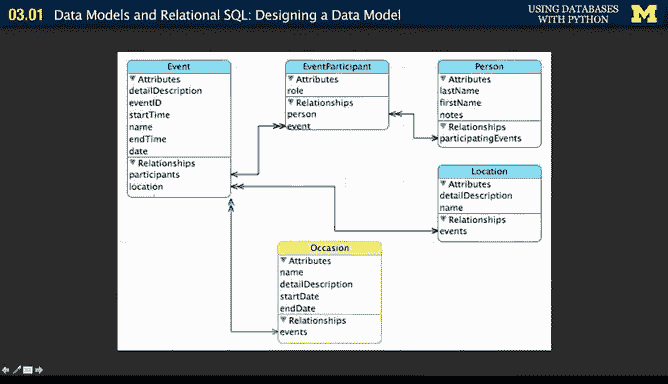
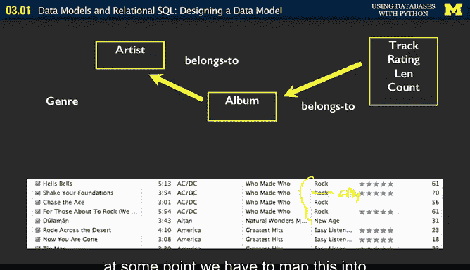

# 密歇根大学《给所有人的Python课》课程4：《使用数据库进行Python编程》｜python-databases｜ - P19：19_03_01_数据模型设计.zh_en - GPT中英字幕课程资源 - BV1PP411W7H1

So now we move from sort of the SQL and the contracts we need to talk to a single table to linking multiple tables together and this is where the real power comes and this is where the complexity comes so up till now it should be real simple。

When you start a company， we're going to kind of pretend we're going to start a small company to build an application to manage music。

When you start a company， you're going to build an application， lots of applications need databases。

And you need to design the database for your application。

And often this is very much a team effort with a lot of different people with skills。

 some people worry about the user and user capabilities， some people worry about the performance。

 etc cetera， and so database design what I'll show you coming here is just the beginnings of database design but the basics are very powerful and it's something where smart people should take time in database design and so it's a very collaborative process and if you。

Ultimately look at the database designed for applications。

 we draw these crazy pictures right and in these crazy pictures we are capturing this is basically multiple tables。

 table table， table， table， and this particular database is kind of about an events like you know。

reserving the picnic shelter at a park， right， what times who's going to be there， who reserved it。

 all these other things。And。What we're starting to show is that how these tables are connected together。

 so each of these little arrows， so these are the you know this is the table and these are the columns in the table。

 and then some of the columns are special columns that represent relationships with other tables。

We're not going to go into all the detail， you can eventually go into some of the detail where you see what this little arrow means and that means one and this means many。

 et cetera， et cetera， and there's all this fancy stuff and so we'll talk about this eventually。

But this is sort of like what we're going for， we're going for a picture of how we want our applications data to be stored in the database。

 and this then becomes our schema。And it's the contract。

So we made one thing we made one table with two columns and that was a schema and a contract。

 but now we're going to make multiple tables with many columns and some columns that are specifically there to connect from one to another so if you're working at a large application。

 you might walk in and see a picture like this on the wall。

And you think a look， whoa， that's really important， that must be really complex。And it。

For this application， it probably represents years of clever engineering to make sure that the application runs well。

But this is basically how this。I don't know what it is OpenMake or medical record system might just kind of borrow the picture this is how the data is stored in its database and these things can be very complex in a project I work on called Sakai it's probably four times bigger than this and but if you zoom in on it。

 which you can't。But it's just a table and some columns and some connections。 And then oh yeah。

 there's a table。 Well， that one's kind of complex。 Here's a table， some columns and two connections。

 So yes， it looks complex on the surface， but ultimately。

We're just trying to figure out which tables we are going to make。

 what we're going to put in those tables， and then how we're going to connect the tables together and the connections are the thing that make these things so powerful we could just put all this data in one file。

 but then this thing would run like terribly slow。And so the trade off of thinking through how your data is going to look is that when you're done。

 it's fast。A lot of times we don't worry too much about how fast your program is going to run。

 but once it comes to scanning data， especially if it's a lot of data， you think about that a lot。

So the whole idea is to figure out the data that you need to represent and then drawing a picture and then lines between those pictures right and the basic rule that we're going to use is don't put the same string data in twice so for example。

 if we have a column of something， don't put the chuck。In twice。

So that's bad so if you have some column and you're replicating the same string data twice。

 that's not good what you want to do is you want to make another table and put a chuck over here and give a number to chuck like one and then。

Put one1 so to indicate that something longs to chuck which means you're modeling data at a connection between one table and another we'll go through this in super great detail so the basic rule is don't put the same string data in twice user relationship instead and the other thing is sort of like model the real world if you have users and tracks and Christmas tree farms and whatever you'll have a table for the Christmas tree farms and you'll have another table for the Christmas tree types and you'll have another table for whatever and so。

Often you're starting to sort of build an application and so the application that our little company is going to build is an application keeping track of audio our company has decided that people don't use albums anymore and aren't interested in buying whole CDs of music so we're going to sell music by the track I think this is a great idea and I think we're all going to get rich with this little company and this is the user interface that I invented。

Or I screenshot it from another vendors but whatever this is we are going to this is the program we're going to build we're going to make a track making thing Now just looking at this user interface。

 we see some problems right away and often if you try to just turn this into a spreadsheet these things would become the problem and the problem has to do with replicated data in columns and so it's like great。

 this is all cool until。You have the same artist's name。In the columns。

 that could be once or hundreds because Black Sabbath is written hundreds and hundreds of tracks。

 and then even in the album column。That's a problem， and then it gets even worse。

When you're in the genre column， you're putting the string in a zillion times。

And if you've been writing Python programs they kind of finish really fast。

 that's because the only assignments I've given you are tiny。

 but when you're going to do a million or a trillion things。

The difference between metal and the number two，2，2，2。

2 to replicate this is actually very significant。Because this isn't just a six or five character string。

 this could be a very long string and so in your data you have to allow for very long strings and so。

These are the problems right there， all this replication now it turns out。

Then we have a user interface person in the room and the user interface person we say like hi。

 we're a database expert， we took a class online and we know that you're not supposed to replicate data。

And the user interface person says， oh no， this replicated data， we've done surveys。

 and that's exactly what。User wants to see。And you can't argue with that if that's what the user wants to see。

That's what they see。But we still have to write an efficient application。

 and so that's where we start going through a data modeling exercise where we say this is the kind of stuff we want to represent。

 and this is the kind of user interface we want to support。How can we build a really good data model。

 so it's not like you've got to change the user interface to make it good， you change the data model。

 then to represent the stuff we want， and then construct it in a way that the user interface is exactly what the user wants。

So the idea is as you look at the data that your application is going to look and we add all these columns and you say。

 you know， is this column represent a thing in the real world？

Or is it just another attribute of a thing， so there's like a thing and then attributes of the thing or two things。

 and so you got to go across all of the columns。And so that's what we're going to do。

We are going to look at all the columns and we are arguing so right now imagine we're in a conference room。

 we're sitting around a table and we're going to draw this picture and this picture looks like the thing it's got a little boxes in lines right we're going to draw a boxes in lines picture。

And we have a blank screen right now， so the first question actually in these meetings is commonly。

Where to start？Because you got a lot of stuff in our simple， it's really simple。

And it turns out that it's not so critical where you start even if you start at the wrong place。

 eventually you're just going to have this web of information and it's all connected and it'll all work out if you do it right。

 but it does simplify the drawing of your picture if you start at the right place and so the way I was taught to start at the right place was to think about。

The thing that is the most essential to this application。

 what is the one sentence description of this application and in this application。

 it's a thing that manages。Tracks， it's not an album managing thing。

 it's not an artist managing thing or a genre managing thing， it's a track managing thing。

 and we kind of see that in our user interface， we see that every line is a track。And so。

That makes it easy。The first table we're going to build is the track table。

And once we build the track table， then we have to look at all the other things and say， look。

 which of these things are themselves tables and which of these things are just attributes of track。

Okay， and so it turns out that things like numbers。And like star is just a number that's five。

These are all fives apparentlypparently I only like stuff or hate it and then this is the number of plays and so you go like oh that's part of it that's part of a track that's part of a track well and now we come to the three things that aren't part of tracks because they have the replicated data that's the red flag that says not part of a track so somebody gets up to the board grabs a piece of whiteboard and they go like that's our first table it's a track table and it's gonna have a rating length and account I guess there should be a title in there as well for this column here so we have a title field title okay so now we're good right we've got that。

The question is。What's connected to that？Right。Well， what is the thing that's the next thing to draw？

Well。Tracks could be connected to artists， they could be connected to albums so let's just say kind of albums have many tracks so the next thing we're going to do is we're going to make an album table and we're going to say on our whiteboard we're just drawn on a board right now we're not writing code yet that tracks belong to albums and now it's kind of easy that what albums belong to well all albums belong to like groups。

Now， if you're a music expert， you kind of understand that we're oversimplifying things。

And that's a fine argument to have when you're starting your company。

 but we're going to pretend the world's simple and that tracks belong to albums that belong to artists。

So we're almost done with our meeting。So we got， we got。Artists。

 albums and tracks that we drawn a picture and the question is。Where does genre belong to。

 what does genre connect to？knowBecause does genre connect to an album。

 does genre connect to an artist， or does genre connect to a track？

Now you may want to go to your iTunes and go to a track and change it genre。Change it to you know。

 easy listening。Now， if the track was， I mean， if the genre was connected to the artist， I mean。

 this is the album， sorry。It means that it would then immediately change all those to easy listening because that means that albums have an attribute of what their genre is。

If it was the same for an artist， that means that all your ACDC would be changed to easy listening。

 and if it was an attribute of track。Only this one will be changed easy listening。

 so the question is when you go into that system。And you change one thing。

Does it change all of these based on the album or the artist？Wong。

You can go pause and go ahead and do that， but I'm going to tell you。It turns out if you change that。

 it only changes one。So that actually tells you。In in the meeting we're arguing about this。

 I think it should be here and I think it should be here and then you say well but if you do it this way。

 that means that it's going to change I mean like then a UI person like no no no。

 we can't have it connect to the album because then our users would be so mad at us blah bh。

 blah bla， bla， we wouldn't make a lot of money so when it's all said and done you've argued through it took you a lot longer to like this argue this last bit this was a hard part to say okay genre belongs to track it just does and this is a simple trivial example of how the data model creates the features of the application when we started we saw this big picture that what's in the data model determines what the application is capable of doing。

And we have to get the data model right so that it can all be very efficient。

So now that we've drawn this picture on the wall in our。Conference room。

 at some point we have to map this into a database， into a database structure。

 okay we're going to figure out how to actually map that logical picture that we just drew into a physical picture。

 exactly how we're going to represent this in a database。

