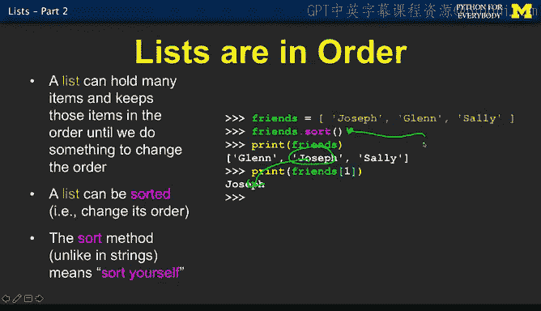

# 密歇根大学《给所有人的Python课》课程2：《Python数据结构课程（密歇根大学）》｜python-data｜ - P19：19_04_02_操作列表.zh_en - GPT中英字幕课程资源 - BV1yP411a7TZ

So now we're going to talk about some of the operations that you can do to lists。

 we've been talked about their internal structure but now we're going to start working with them。

 so the first thing that we see here is that we can add them together and it's just like concatenating strings。

 we cancatenate lists together it pretty much works the same way adding A and B to make C does not hurt either A or B。

Slicing operator again， think of strings， think of slicing。

 think of beginning position up to but not including so sub1 is that position right there up to but not including sub 3。

 which is 4112， so that's what we get there just like with lists。You can emit the first one。

 so that's up to but not including four， which is this one right here， so this is the you know。0，1，2。

3，4。 you'll mentally have to count that up to， but not including4。 That's that one，3 to the end。

 So 0，1，2，3。 that's 3 to the end。 So that's 3，74 and 15。 And then just like with strings。

 you can have the beginning and the end。 So again， it's very much like strings。

 Slicing of lists is like slicing of strings， except that the list is slicing entire cells within the string。

Just like in strings， we have lots of library methods， there are lots of methods in the list object。

 a pen which adds a thing to the end of the list count which actually L tells you how many things are in a list。

 count tells you how many things that match a particular thing are in a list， extend index， insert。

 pop， remove， there's a whole bunch of things and they're all very well documented in the Python documentation。

So we'll use a couple of these things。 There's a couple of ways to build a list from scratch。

 We're calling this this is constructor。 And so list is a predefined type。 This is the type of list。

 So we say make a brand new list So that's like it's almost it's the same as saying give me an empty list and then assign it into stuff。

 So that is a list with nothing in it。 So the length of that is zero and then we say oh。

 let's append the string book and then let's append the string 99。

 and we print it and now we have a book with two items And so you can sort of do this over and over and over and append things if you like。

 and you can keep on going。 we can append string cookie。 so at the end of cookie。

 you've got three things in your book 99 and cookie。 So append is a method。

 Now recall that strings are not mutable， So all these methods would return variables。

 but lists are mutable。 And so appending actually changes this variable。

 So note that stuff is different from here to here because we appended it。

 And that's because lists are mutable but not strings。 And so they。

Kind of functional a little differently。 And just when you learn strings and you learn that the return value So。

 so for example， you don't want to do something like。X equals x dot aend。

Because the return value that you get back here， the residual return value actually messes x up。

 so you do not want to do that。 you just say you know x dot a pen and that works a lot better。

And again， one of my favorite Python operators is in in strings。

 you were asking if a character or substr was in another string here now you're looking at the members of a list and you're saying is 9 somewhere in the list。

 Yes， it is。 is 15 somewhere in the list。 No， it is not。 and then not in is also an operator。

It's the opposite of n， so it's 20 not in the list and the answer is 20 is not in the list。

 so we get back true。That's just a question that you can ask in any old if statement that you want。

Ls maintain order。 The order that you put things in is the order that you get them out。

 So aend to pen to pen。 whatever you've appended， it comes out in exactly the same order。

 lists maintain that。 They're kind of dense and compacted， and you can only add to the end。

 Although you can say， push all those ones down and put something in the middle。

 using insert if you like。 But it also means then we can sort them。 And so， you know。

 here we have three things。 Joseph Glen and Sally。 And we say， hey， friends， sort yourself。

 This is kind of more object。 or we call the sort methods within the friend's friend's object。

 And then now it has been changed， right， So so it actually changes it。

 And so it's now in alphabetical order。 Glenn Joseph and Sally。And friend sub1 is the new sub1 not。

 and so this actually changes it because lists are mutable。

We have lots of functions。 We've already played with Lyn and talked about Lyn。

 How many things are in the list。 We can say what's the largest number of a list。

 What's the smallest number of list。 Add them all up。 What's the sum of this list。

 Some of the list 154。 And you can calculate the average by the sum。 Now。

 some of you who will go back to chapterpter 5 and say like， well。

 why did you give us all those forlus to do the same thing。Instead of just telling us this function。

 So the answer is， well， there are reasons for knowing how to construct those four loops and they were good。

 easy to understand for loops。 If you have a list and it's a list of numbers。

 these are far better than constructing a for loop。 So all those examples from that earlier chapter。

 they're not the way you would do that particular problem。

 But sometimes you're reading through lines in a file and you have to do it a little bit differently。

 So here's a couple of loops that sort of demonstrate this notion of how you might use these functions to calculate an average versus how we calculate in average in the earlier chapter。

 although I kind of redo this in a different way， because now I'm pretending I'm reading from a file。

 but instead I'm going to read from input， I'm going to read the numbers dot dot dot until I get it done。

 and I'm going to calculate the average of those numbers。

 And so it's just a standard loop where we set total to0 and count as0。

 I'm going to make it a while loop。 if I was reading a file it be a for loop。

 but this is I'm going to ask for some input prompt it if。

It's done I'm going to break out of the loop so that handles this case so I can get out of the loop somehow。

 and then I calculate the floating component value of that input and I add it to my running total and I add my running count count equal town plus one and then this runs you know in this case three times and then comes down here and computes the average and prints it out and away we go and so that's kind of the manually constructed loop with a manually constructed counter and a manually constructed sum。

And away you go now。If I were to use， try to use Max and Min to accomplish the exact same thing。

So what I would do then is I would accumulate these values in a list。

 So I'm using a data structure now rather than just logic。

 And so this is kind of an algorithm that's carefully constructed to produce the count and the sum when it's all said and done。

 Now what we're going do is you can use a data structure to solve that same problem。

 And so we're say， hey， let's make an empty list because we're going accumulate some numbers and then we have the same while loop same two lines。

 we we look for actually same three lines。 we get a value。

 we check to see if we're done to get out and we convert it to a float。

 But now instead of doing the summing as we're doing here。 we say let's just remember that。

 We got this list， we're going to fill it up。 we're going to put numbers in it。 So we put a three in。

 we put a nine in， we put a five in and then。Put a three input a9 input a five inch。

 so we't we're not actually calculating any calculation。 And then when we hit done。

 we come out and we say， oh， let's calculate the average。 Well。

's you got these numbers in a list now， we have a list that looks like three， comma 9， comma 5。

That's what's in here， so we take their sum of that and the divide it by the then and then we have the average。

 and this same program produces exactly the same output。

So that both these things produce the same output and you can decide for yourself what you think is more elegant。

In general， I would there is one tiny difference between these two。And that is。

 this one actually has to have all of the numbers in memory。

 And if it before it can actually do the calculation， this only keeps one number in memory。

 And that probably doesn't matter if there's like 100000 numbers or less。

 But if there's like 100 million numbers， this one doesn't use 100 million spaces in memory and this one does use 100 million。

 So there are。Sizes of data that are large enough that it matters the memory usage between these two things matter because this requires two variables for any number。

 this one here requires two variables for any number of things we're going to do the average of and this requires an extra bit of memory for every single number so it scales based on the numbers。

For the small stuff that you're doing， it hardly matters。

 And if you already somehow have these numbers in a list， this is a great way to come do a sum。

 You wouldn't write the for loop to do the sum。 If you've already got numbers in a list。

 then add em up with a sum or figure out the maximum using a function。 That's just a perfectly fine。

 So that's kind of manipulating lists and writing some interesting loops。 and up next。

 we're going play with connecting lists and strings together。😊。

