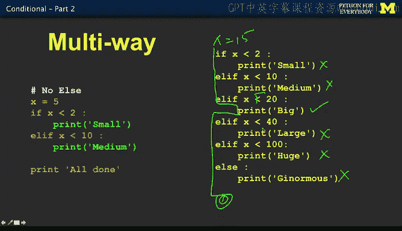

# 密歇根大学《给所有人的Python课》课程1：《编程入门指南（使用Python进行开发）》｜python｜ - P19：19_05_02_条件语句第二部分.zh_en - GPT中英字幕课程资源 - BV1214y117Mk

So welcome back。 Now we're going to build up and talk about some slightly more complex conditional execution patterns that you can build up。

So as you do the if then else， again， one of the things to do is to visualize the blocks。

 start thinking of the blocks。 And in this case， you think of the block as sort of starting at the if。

 and then ending after the last indented line。 But the if and the else kind of our piece of one thing。

 and you can sort of think of this is the block， right。

 And one of the things about these blocks is they have one entrance in one exit。

 Not that that's a big deal， but it's a good way to think about how you mentally start drawing the blocks。

 You see one entrance and one exit。 And there's some complexity。

 There's some logic that you're sort of building。 And' that's how these blocks work。So。

The next step up in complexity is a multi wave if， and that uses a keyword called LF。

 which is really a combination of else and if。So the way it works is probably easier to do this on the GPS version of it is it comes down here。

 Forge what's in here。 It asks the yes or no， if it's yes， it runs this one， and then it's all done。

 If it's no and then yes， it runs this one and it's all done。 And if it's no， no， no。

 it runs this one and it's done。 A key thing is it's only going to do one of these three。

 It's not going to do two， is only going to do one。 and it checks these questions in order。

And then this else is like a catchall。So let's take a look at how this particular one works。

It depends on the value of x。What if x were 0， Well， if x were 0， it would come in。

 ask the question is x less than 2。 Yes， it is。 So it would run this code。

 and it would finish down here。 So it would come over here。 Tru， run and now skip all the way down。

If you draw a blocks， the box will be this box right here。 It skips out of the box。

 Or if you draw the box over here， the box will be right here， you， you。

 once you're done with this line of code with this block of text right there or block of code。

 you exit the block。 You don't like， Come back and look at this question。 You have run。

 One thing is turned true and you're done。If， on the other hand， X was 5。

 you would see a situation where it would come in。 This would be false。 And so it would skip。

 then it comes to this next L。 This becomes true。 So then it jumps in and does this code runs out and is done。

 does not run。 that。 does not run That。 does run that。 So comes in。 No， It's not less than 2。

 it is less than 10。 So we'll run that little block of code。 And now we are all done completely。

 So no， no， but yes， And so that's how it works。 These are done in sequence。

 They're not looked at sort of in parallel or all at the same time。 If on the other hand， X was 20。

 It would say false skip。 Que mark false skip。 Oh， else。

 then it's the it's the else always gets triggered if it gets that far and then it runs that one。

 So here we say if it's less than 2， No， it's not。 I it less than 10， No， it's not。

 And if it's there， we just hit the else part， and we finish and we continue on。

 So this part doesn't。This part doesn't run and that part runs。

 The rule is one of the three will run， and the other two will not。

 It only triggers once once it's triggered， then it's done with the whole if statement。 And again。

 I think of this as the block。And you'll see in a sec you can have one。

 and once one of these things hits true， it runs this and then exits the block completely。

So there's other variations on this。 you can， if you want， have no else。

 So there is no need to have an else。 What we've done is we've simply deindented this next line。

 There's no else here， but that's okay。 it does mean that for some value of they might not either execute。

 right， because there's no else。 if there's else， then at least one will execute。

 But if there is if there's no else， then it could be possible that zero execute。 In this case。

 x is 5。 It's not going to do this one， but it is going to do that one because x is less than 10。

 But if x was， for example，50。 Then that be falses。 That we falses。 and we just go。

 And then neither of these two things would execute if x for 50。

 So it just means that you don't have to have an else if you don't want to。Further。

You can have lots of LFs。If X is less than2， do this LF， LF， LF， LF， LF， LF， And remember。

 it checks them in order first， second， third， fourth， fifth。So if if x was 15。This would be false。

 This will be false。This would be true， so it would run this code。

And then it'll come down whatever's next down here。 So So again。

Only one of these is going to trigger。 No， no， yes， no， no， no。 I mean，15 is indeed less than 40。

 If it came here， it would be true， but it doesn't matter because one has triggered。

 And so then it takes the entire block。 and there is our entire block。 So as soon as it executes one。

 The next thing to do is escape at our exit right out of the block。

Okay。😊，Got it。Okay， so here are。A couple of puzzles。

I'll give you a second to pause this and the question is。To look at。Some of these。

 depending for a particular value of x。You will have none of them execute。

 So which will never happen for some particular value of x。

 meaning you can pick any value for x you want， but there's some that you can't cause to execute。

 Okay， so I'll pause for a second。 let you let you pause the video if you want。

 and I'll come back and explain it to you。Okay， you had some time to pause。

 Hopefully your you did pause or didn't pause， but it doesn't matter。

 You can still pause while I'm talking until I start drawing and telling you the answer。 Okay， so。

In this one。If x is less than 2， do this else if x greater than or equal to 2。

 the one that's never going to execute is this one right here。

And that's because no matter what value of x， it is either less than equal to 2 or greater than or equal to 2。

 So for any value of x， no matter what you pick， it's either going to run this one or this one。

 but it's never going to run that one for any value of x。Okay。😊，That's a little tricky。

 I just happened to have constructed my logical questions in such a way that they covered all values of X。

 And so the else was kind of。Irrelevant。Now， I wouldn't even draw this this way。

 If I was going to draw this or write this code， I would probably just like， you know。

 make this be an else。Colon and this not be there。 But this was more of a puzzle than anything else。

So in this next one， we have to remember that these things happen in order。 So if x is less than 2。

 we're going to run this。 If it's less than 20， we're going to run this， If it's less than 10。

 we're going to run this。 But the problem is， all values of x that are less than 10。

 for which this would become true， this is always true。 So a value like 6， this becomes true。

 So that means that if it's something like 6， It's going to run this and come out and never ask this question。

 So that's the key。 even though this is true and this is true for the 6。

 it never even gets here because this one triggered first。Okay。

 and so that's that's why this is the line of code that no matter what the value for x will never run。

