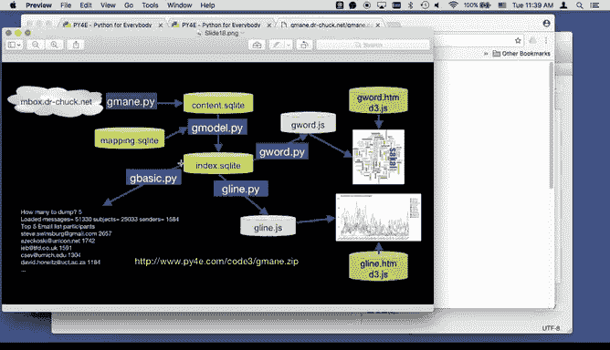
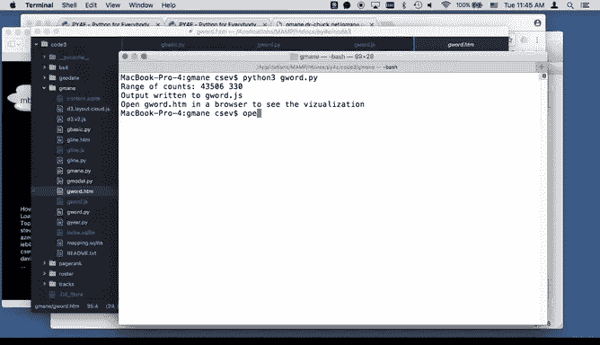
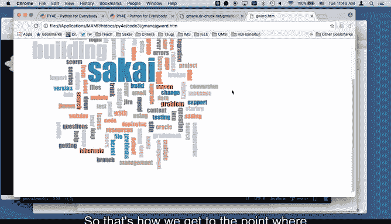
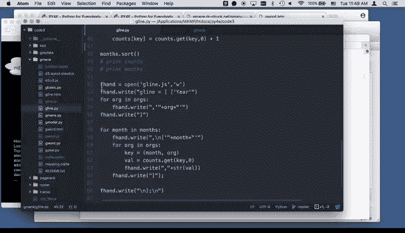
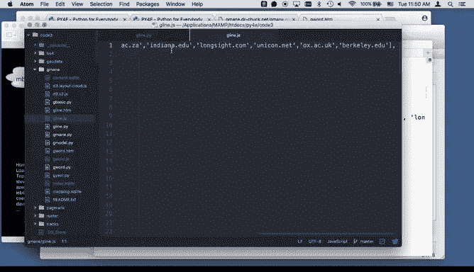
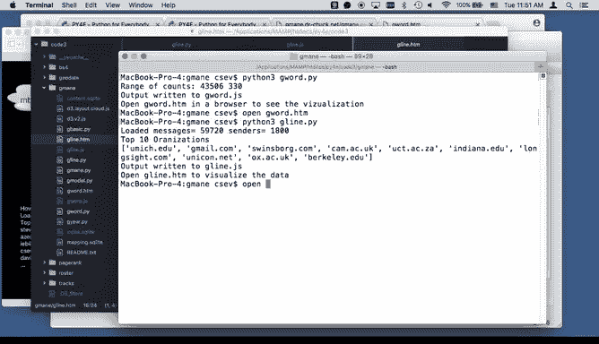
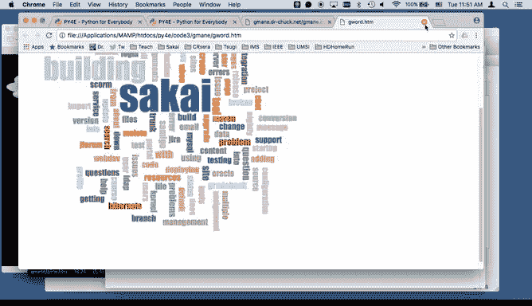

# 密歇根大学《给所有人的Python课》课程5：《毕业项目：使用Python检索、处理和可视化数据》｜python-data-visualization｜ - P19：19_06_01_实例演练-Gmane邮件可视化.zh_en - GPT中英字幕课程资源 - BV1Eh4y1U7aE

🎼Yeah。Hello everybody welcome to Python for everybody。

 We're doing a bit of code walkthrough If you want to follow along you can download the zip file for the code from our website We are in the process of retrieving data from this G main server one that I've made a copy of and we have so far spider it all and up with 600 megabytes of spider information we have ran a rather complex cleanup process that you probably don't need to fully understand you can look at it for patterns but in general the cleanup process will be very sensitive to the data and then we have this index SQLite which is 260 megabytes right now and we are going to now do the easy the fun easy bits here where we're going to run little queries that just pull data out and so these are much simpler so。

Part of what I wrote when I was doing this is I wanted to do some simple basic calculations on the data to make sure I really was sort of looking for anomalies right。

 what was working， what wasn't working， so I wrote a series of really simple things like this G basic。

The G basic code just give me give me some basic data right so I wrote things down and I counted things and so do I need yourlib request in this one I don't think so。

Let's fix that bug， it's not there， no reason to put any of that stuff in there。

So it just it reads that indexex at SQL light which is our cleanedup data it reads through and makes a dictionary this pattern you're going to see a lot where I'm going to make a dictionary of ID to senders save myself repeatedly looking at things I'm going to grab the subjects I've cached them all I could have done this all with SQL but I just wanted to do things faster and now I'm going to go through each of these messages and make a dictionary of them I'm going to put a lot of stuff in memory and then I'm going to do some counts I'm going to see who is sent the most right the organizations and so now I've got to go through the all the messages。

I am not actually， so you'll notice that I'm not selecting the body or the headers here。

 I am just getting sender ID subject ID， I probably could have done this with a join it would have been cleaner that you can do that you can make that change。

Do that with a joint so it's cleaner。And。So I'm going through all the messages except not the body。

 so this is going to be really quick and I'm pulling out the sender's ID。

 I'm breaking the sender into pieces， see my data is clean now。

 I cleaned it all up in the previous processes and if I don't have two pieces。

 I continue and I get the domain name so I have the person I'm doing a basic。

Dictionary histogram for the people and the domains， and then I'm going to sort them。Right。

 with a sorted。And we're going to grab the key， we're going to sort it by the how many there are reverse and then print out the top few of the organizations and the top few of the people okay。

 so we'll just run that code。Python G basic dot Pyth Py， let's type the dump out top 10。

 so we loaded。59，000 messages， 29，000 subjects and 1800 senders and figured out the top 10 people and the top 10 organizations and you can you can write various things like that that just sort of scream through your data and。

It's good to get sanity checking on your data。Okay， so that's G basic。Now I want to do Gword。pyy。

Because that's kind of fun Gword。pyy。I don't need URLlib why do I keep putting URLib in all these things so I'll get rid of that So this is really simple because I'm just going to go for the words in the subject line and so I go through index。

 SQLite I read in all of the subjects。嗯。And I make a dictionary of those。

 and then I go and find all the subjects。This and then I'm doing this code right here。

 I'm pulling out the subject。Based on the message。And I'm doing this so that I when the subjects are used more than once I count the words more than once this stir make trans I talked about that in an earlier chapter。

 this basically throws away a punctuation in numbers so that when I make my words I don't end up with words that are like dashes it compresses them down then I。

Sttriip it， I convert everything to lowercase， this is basically just to keep too many words from showing up then I do a split and then I got accounts a dictionary。

 so this is a no trance， no punctuation， no numbers， dictionary count。诶。

And then I just take the and do it a dictionary。And then I sort them in a reverse order。

And then I figure out what the highest and lowest is by running through。

I could have probably done this with a max in the min if I felt like it。诶。

And so now I have the highest and the lowest。Yeah， I should have done a maximum min on that one。

Why do I do that， But oh， well。嗯。And now I've got it。

Spread out the size and so I'm going to produce this file Gword。js。

 which is needed by the visualization because it's going to use D3。js a word visualizer and Gword。js。

 I have to tell it how big the text is and so I'm doing some text normalization took me little experimentation。

So if I run this now。And I say Python G word。Gword。js。And I say Python 3G word dotjs。

 which is a lot better。Oh， not。Python。Okay， so now I can go look at the Gword。tjs， wherever that is。

 Gword。js， yep。And so this is basically it normalized all the frequencies and made it font size。

 these are font sizes now okay and so this is just the data that's needed by this Gword。

jm which uses this D3 visualization word cloud code。

 so this pulls in all my data and then this is just some JavaScript that draws the picture in on the page okay and so the easy part now is to just open Gword。

 HM。

In a browser， just so happens on a Mac， I can do this， and so that gives me a word cloud。

Based on that data。It kind of randomizes it shows different stuff， but it's using it's using this。

It's using this data to generate how big those things are and then using a bit of randomness and simulated a kneeling to lay it out that's not stuff that we actually have to worry about okay so that's how we get to the point where we're seeing a word cloud from this。

Now we're going to do another visualization and this time we're going to do a line visualization and we're going to create a thing called Gline。

js and produce with another HTML file we're going to use D3 and produce that output so let's say goodbye here goodbye goodbye。

Goodbye， goodbye， So Gline dot py。Get rid of that file。嗯。So again。

 I'm going to preload all of the senders。In this case and again I could have done this with a join。

 probably should have done once with a join， I'm going to preload all the messages。The sender ID。

 subject ID， et cetera， and I'll load those up。And now I'm going to read through and I'm going to have the sending organizations and the senders。

And。And then I'm going to accumulatem split the senders and I'm going to have the sending organizations。

 and then I'm going to do a simple dictionary as I accumulate the sending organizations by splitting the person's name into a signs。

 and then based on the organization， I accumulate it。

And then I sort them and I pull out the top 10 organizations， print those out。

 and now I'm going to produce， break this down into months。And。

I'll show you what this looks like in a second， let's go to the Gline。js。

So the month looks like this。Okay， so the month looks like that。

 so that's the first seven characters of the date So if we look at the date。

Date looks like that and the month is the first seven characters。

And this is the data that I've got to give it。We'll clean that up in a second。

 That data will look better， in a moment。Go back to Gline。tpyy and so this is。We're doing a。

The key is a tuple， which is the month and which organization is it is that that did it and it's only the top 10 organizations and then we're going to do a。

We're going to basically do a dictionary where the key is a tuple。And then we're going to sort it。

Sort by key in this case， not by value that's in the months I going to sort that。

 And then we're going to write all this data out。

Into Gline do Js， so let's go ahead and run this。 And again。

 this is just the data that has to be written in a way that the JavaScript can understand it， Python。

 G line， Python 3。Gline dot py。

Okay， so top 10 organizations， so let's take a look at that ja， So this is what it looks like。

 So it just so happens that you got to tell it the the the。

These are the data points， these are the lines so there's this is the year。

 the line for universityMichigan Gmail。com Swsbo。com。

 so this this first column is the that line points and the next line points。

 so you know all this code was to get the data in such a way that I could produce this JavaScriptscript file because if I look at Gline。

htm。I need that data in that particular format。II've got all this stuff。

 I make a line chart and I draw it with this data， that data。

 I had to go read all the documentation on how to figure this stuff out。

Right and that's the data that I'm going to use and I had to figure this out and I had to transform it and make it pretty。

 it took me quite a while to get this to work and this is not a JavaScript class nor a how to visualize in D3。

 but basically we pulled all that stuff in and。Here's the G line that came from the JavaScript and then it makes an ad data table。

 and then that data table is what G line draws。 so with no further ado， let's open G line。

 HM to show that data。

So there you go， that's the SI developer participation from 2015 through 2005 through 2015。

 based on which organizations did the most commits in SI。

🎼And so I know that I haven't done this all this code full justice。 there's a lot of code here。

 The fun is just to kind of run it and see it。 And then when the time comes to come back and see the techniques that are used when you're trying to build your own visualization pipeline so I hope that you found this useful you know this is a lot of code。

 hard to explain in 1520 minutes， but I hope you take some time and look it over and I hope you found all these videos。

 this is kind of the last walkthrough video for chapter 16 of the book and so I hope that I will see you on the net。

