# 密歇根大学《给所有人的Python课》课程4：《使用数据库进行Python编程》｜python-databases｜ - P20：20_03_02_数据模型表结构表示.zh_en - GPT中英字幕课程资源 - BV1PP411W7H1

So welcome back to lunch right if you remember the morning。

 the last lecture we argued we drank a bunch of coffee， we scribbled on whiteboards。

 we erased whiteboards， and we argued about where the genre belonged。

 but when we're all said and done， we ended up with this picture it's still on the whiteboard we're coming back from lunch now This is not how databases represent data we have to be a little more explicit there's no like belongs to magic in databases。

 but when you're building your data model you don't want to be thinking explicitly too much about the database。

 you turn this logical model into what we call a physical model by mapping it into the database。

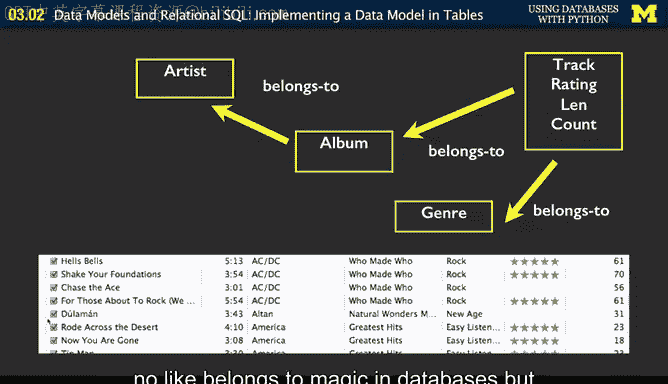

So what we do is we just take each of the tables and the relationships between the tables。

 and we have to augment them with little bits of information。

And so here's the track table and so we'll make a table called track。

And we take like title rating length and count and they become just columns in the table。

 that's the data we have to represent， and then we tend to add things to it。

And so we're going to add what we call a primary key and the primary key is a way for us to refer to a particular row。

 and so it's a unique number like one，2，3，4 So each album is going to end up with a number we'll put insert the title and the title will get a number right and then we use that number in another。

In a column of a different table to sort of point to it。

So these primary keys are the endpoint that we're pointing to。

 so that we can create an arrow to a particular album， we've got to add an ID to it。

 so we add a primary key。And then the other thing we do is we have to add the columns that are the other end of the arrow。

 the starting point of the arrow， and so Im by convention in this particular model。

 I'm naming the primary keys all ID in track you've got a thing called ID and then album ID is sort of the starting point so album is the name of a table。

 followed by underscore followed by ID now there's no rules about how you name these things。

 these could be named X and y if you wanted to， but as we've learned in programming Python and other programming languages。

Making sensible names really reduces the cognitive load of understanding what the heck you meant when you were creating is。

 so we create a convention， a naming convention。And we have terminology for each of these things。

 the primary key is the key for which there's one key for every row it's used as the way to point to that row in other tables。

 the foreign key is one of these columns that we add to be the starting point of the arrow so the primary key is the ending point of the arrow and the foreign key is the starting point of the arrow the only other thing that we do。

Is we may or may not designate one of the columns， sometimes more than one as what's called the logical key。

The logical key is that unique thing that we might use to look up this row from the outside world like in this case the album title might be a way we'd look it up like oh。

 where is LED Zeppellin4 you know type in IV and it'll search it so led Zeppellin4 is going to be the title now all we are doing is saying hey database。

We're not looking these folks up by rating or length or count。

 but we might be looking tracks up by title， so somehow on your storage。

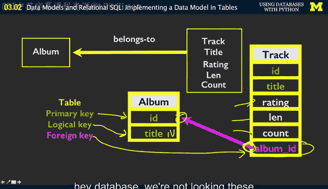

Maybe you leave some shortcuts to get to this more efficiently or more effectively。

 so the logical key is really our way of saying we might use this an aware clause。

We might use it in a wear clauses helping you out here， or going might use it in a wear clauses。

And it also sometimes it's like we also might use it in order by clause or aware clause and so that's the logical keys so we have these three things primary keys。

 logical keys and foreign keys and so if we keep drawing these pictures， it starts looking complex。

 but then it turns out really simple if we take the whole data model and sort of add these primary keys。

 logical keys in foreign keys to model the beginnings and ends the beginning and end of arrow beginning and end of arrows beginning and end of arrows。

 we have to stick primary keys in all the tables。We stick foreign keys in those tables that have starting points。

And then we indicate that certain things are our logical keys， it looks kind of complex。

 but once you've drawn the picture and you have the naming convention for what you're going to name these things。

 it's a surprisingly manual task， I mean the mapping from the logical to the physical is beautifully simple as long as you have a naming convention now。

If you walk into an organization and you took this class and you say like Dr。

 Chuck's Naming convention is awesome， as a matter of fact。

 I stole this naming convention from a thing called Rubyion Rails， the name of the ID。

 the artist underscore ID， it's a good naming convention。

Nming conventions are kind of like artistic somewhere you think are prettier or not prettier。

 but any naming convention works and you walk in and you go like oh I took this class and I learned this naming convention of ID and under table underscore ID and they'll say well we don't use that we use this thing where we start with a lowercase eye and then we uppercase the eye track。

Id， that would be their primary key for a track or maybe they call it PeT ID for primary key right so that would be the name of this thing and you're in this company and you're like。

 whohoa Pet ID， that looks like crap， it's a terrible stupid idea。

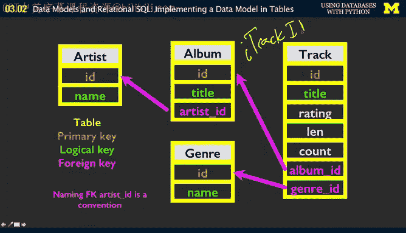

Well。Don't do that。I mean。This is not a superior aim convention。To this other one。

 however they do this other one right what's important is that there is a naming convention and when you work for a company just learn their naming convention and don't complain about their naming convention unless you get to know them or maybe you're sort of out for coffee or something later and you go like well how come you guys never did the cool Ruby on Rails naming convention I took a class and it was pretty cool you know as long as you're nice and you don't threaten them or don't make them don't tell them how dumb they are by choosing the wrong naming convention。

So now what we're going to do is we're going to turn this into a new table。Okay。

 and so I'm going to use the wizard to make a new table in our little database。

Let's go over to we're still in our database。And I am going to go to database structure。

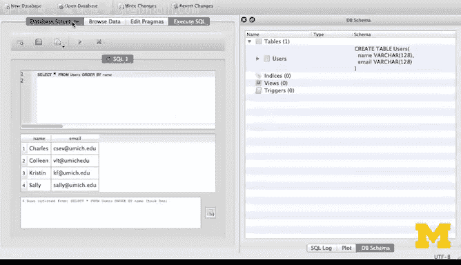

Where's the new table button， new table， new table？File。New table， create table， there we go。

 editit Cre T。Okay， so we are going to create a table。And。

I need to kind of look at and need to look it for my cheat sheet， we'll start with the artist table。

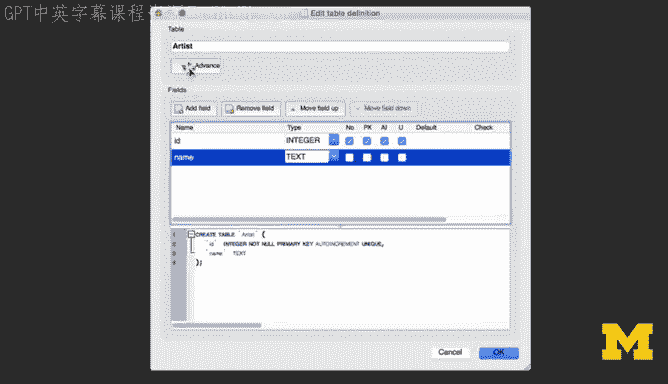

The artist table。And we're going to add a field to it。And we're going to name the first field。

 an ID field。And it's going to be a number。We're going to say that it's not nu。It's a primary key。

We're telling it that we're going to use this a lot， and if we're linking into this table。

 that means we're using it a lot。Auto increment， it means that we as the programmer don't actually have to specify this value。

 it's going to be automatically specified because pretty much one， two， three， four。

5 are the values that we're going to use。And then unsigned is whether it's positive or negative。

 and for this one， I'm going to leave that off， the other thing that's in our little table。

 let's go back and look at our little picture is the name。Add another field and we'll name that name。

Lercase name。And we will make that a text field。And in this case。

 we're not going to give it a length。There's a way later we'll give other ones length。

 and then we're going to hit the OK button。And when it's all said and done， we have an artist table。

Okay， this is our old user table this artist table， we could make a whole new database if we wanted。

 but we're not going to we'll just kind of put all these things in Actually let's just give rid of this table you to users edit。

 delete table， goodbye user table that was from the previous lecture so now we have our artist table Okay。

 so that's the wizard way of creating a table。

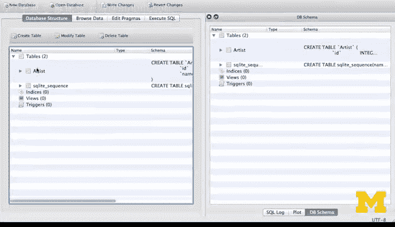

The next table we're going to create is the genre table now the idea is is we tend to work from outward in the leaves of this tree outward in。

 so we created the artist table then we'll create the genre table then we'll create the album table and then we'll create the track table because you kind of want to create the ends of the arrows before you create the beginnings of the arrows。

 okay。

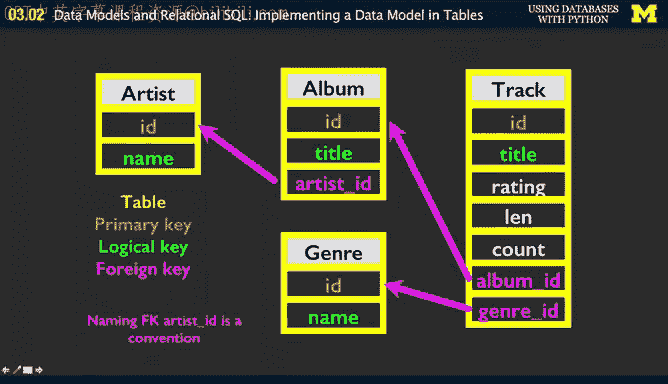

So we'll create the genre and now I'm just going to use the SQL because that's a lot quicker for me to type here's the create table。

 we're going to say that this guy is an integer， it's not null。

 it's got a primary key and it's auto increment and it's unique and that is our way of saying give each row a little number。

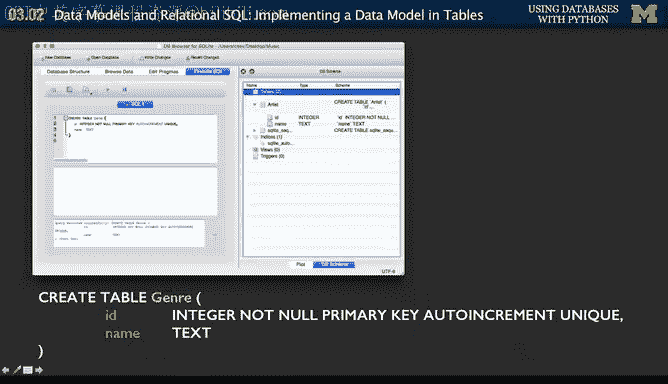

So I go to executeQ SQL and I put this bit in here。And then I run it。

It worked and if I take a look at our browse data or our database structure。

 genres in there and genre has two columns， ID and name。

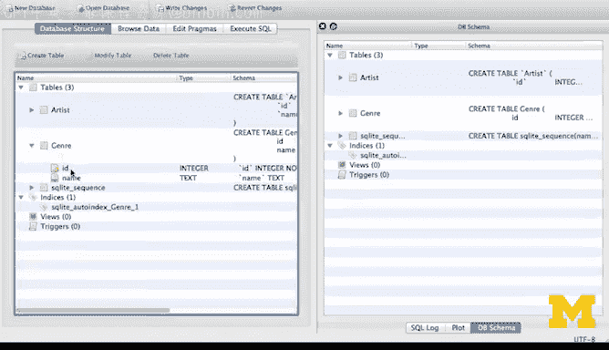

And then we have the other tables， so now we're gonna to create the album tables。

 So the thing that's different about the album table is that the album table is our first example of a foreign key。

 So this is our foreign key we've been putting primary keys in every table primary key pretty much just say this over and over and over again is the long integer not in all primary key auto increment unique just say that over and over and over again Now we're going to have a foreign key which is the you know the start the foreign key primary key and so we're just going to call that an integer in other databases you can add some stuff to it to talk about what to do if the parent thing but we're not going to do that for now。

 we're just going say that's an integer， that's the starting point of an arrow and we're naming it artist underscore ID just to jog our memory that that's what's going on there。

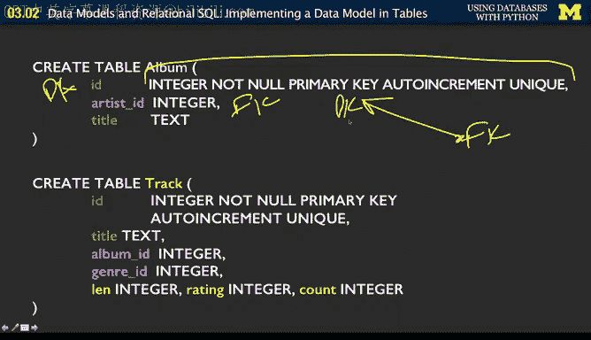

Go to cute SQl， paste it， run it， poof， she works。

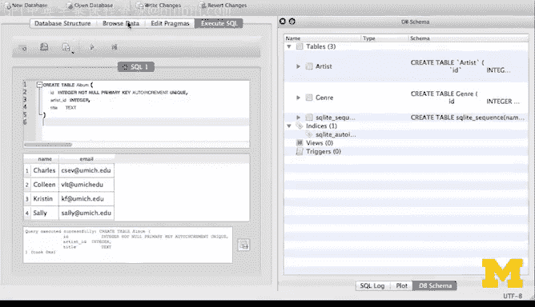

Database structure， now we got a genre， and let's look at the last one。Okay。

 so the last one is the track。Okay， so create table， the name of the table。

 we've got this sort of thing that by now we're cut and paste a bunch of times。

 We have a primary key。 We have a logical key。 It just happens to be green It's text。

 and then we have two foreign keys because if you remember there were two arrows coming out of track。

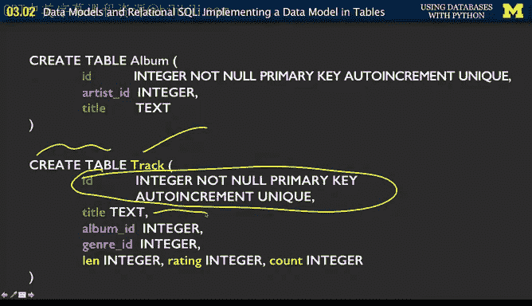

Both to album and to genre， so remember oh album， album underscore Scie genre underscoresy Naming convention is your friend。

 and then we just have some stuff that integers like the length。

 the rating and the count and we put those in so now we have the columns and the rows and all the foreign keys for track。

And then we will run that。And if we take a look at the data。

We will see we' got all of them done Al is now complex with all these things。I yeah。

Wait a sec and I not what I get wrong here。 Oh no track is the complex one。

 So track has a bunch of stuff。 So there we go。 So if we take a look at we've got all of these things。

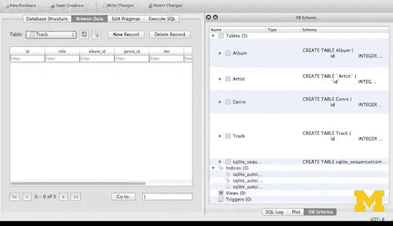

And we have translated our logical model into a physical model and we translated the physical model into a series of create statements and we've run those create statements and now we've represented the various kinds of tables that we want to insert data into so we're going to stop here。

 but next we're going to start inserting data into these tables。

