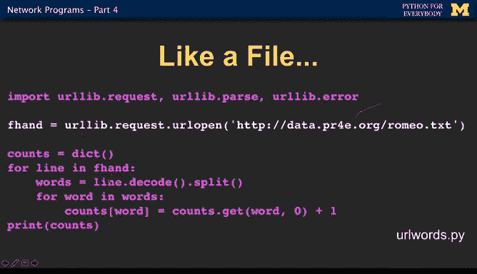
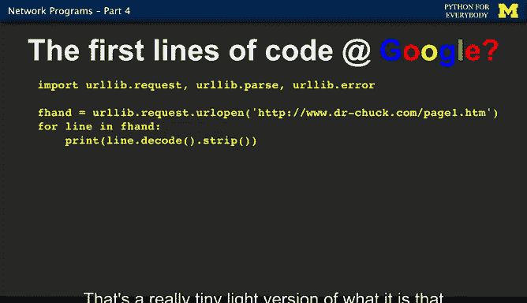
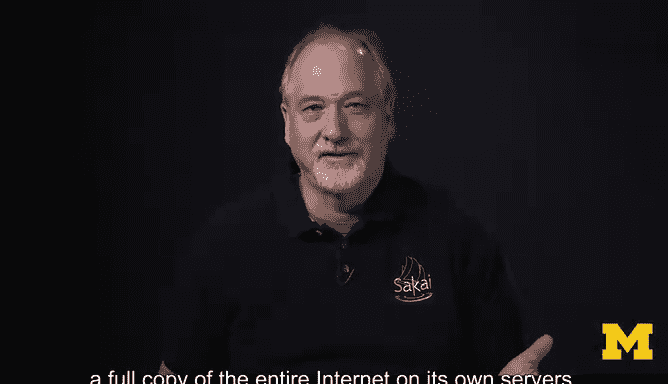

# 密歇根大学《给所有人的Python课》课程3：《使用Python访问Web数据》｜python-network-data｜ - P20：20_04_02_获取网页.zh_en - GPT中英字幕课程资源 - BV1Hu4y1e7WS

So it might be amazing that we can use sockets to write a 10 line program that retrieves a web page。

 but hey this is Python we're trying to make this as easy as possible。

 we don't want to repeat ourselves DRY don't repeat yourself so there's another library that wraps that socket stuff and does it for us automatically called URL Lib and so it's a bit long to type we're going to import some stuff we do a URL Lib request open so we import some library bits and then we say okay URL Lib request URL open。

That's a string hot bytes if you remember from the last one， here's just a plain old URL。

 it's going to parse the URL。 It's going to figure out what server to talk to。

 what document retrieve， what HtP version， the get request， all that stuff。

 it's inside it because it turns out it's the same for every time you're going to do a web request right so why not write code to do it。

And so this opens it up and returns us back a file handle。

 It's kind of like a normal old file handle that you would if you open a file。

 So this is this line right here is almost the same as open。For a file， right。

 it gives us back a handle， it doesn't actually read the data。

 but it gives us sort of an opening so that we can run the reading。Now， a common thing to do。

 certainly not the only thing we can do is to run a for loop for line in this handle。

 so that's going to iterate through all the lines of this URL。 So that's going to open the URL。

 read the data and iterate with a four loop once through each line now this line iteration is actually a byte array。

 not a string and so we do have to do the dcode to get ourselves a string so this gives us a string version of it and then we'll do something like you know our strip or strip or our strip or whatever it is we want to do it。

 but at this point we've got ourselves cells a string that is all the lines of the stuff and so that's like really simple this is what the output would be。

 it's going to open this thing up。 Now you'll notice the headers aren't here and it just shows you the data so you know that there were headers and turns out URL open eats them and remembers them and you can actually ask for them later you can say hey give me the headers if you want but most of the time you're not interested in the headers it just skips down to the data and it goes through the for loop four times and prints out the four。

Lines that are in that file， so that's。Pretty impressive。Because it's like four lines of code。

 and we're reading a web page in Python and that's。

Probably the easiest in any language that I know of to do that to actually get the data off of a web page and just treat it like a file。

 So that's， I think， really and truly amazingly beautiful and simple to take this。😊。

Whole internet and all these architecture and HtTP and all that stuff and roll it in to one import statement and three lines of code。

And so it treats this like a file， and so if you start thinking about this。

You can think about instead of loo open statements， you do URL open statements。

 and then you write whatever loop you would write， and then you can handle data on the internet。

 So this is no longer a web page， even though you can hit that URL。

 this is like a file on the Internet。 It's an internet file， as it were。

 And then what we do is we open this thing up。 and then we we make a dictionary like we did before。

 and then we read through it。 and then we get each line。

 and the only thing we have to do a little different because this is coming from that outside scare UTF8 world。

As we do have to decode it before we get it， the line is a byte string as compared to a character string。

 so the decocode says give me the byte string and turn it into a unicode character string。

 but then all the string methods work on it because that is gives us a string。

 and so we just split it。But now they're all strings。 you only do the decode once。

 it's like the first moment you touch that data and pull it in， you decode it。

 and then pretty much you work with a string from that point on。

 and now you have an array of words and you iterate through the words in the array and you do the account thing and then you print them out。

So the only real lines that changed were these two lines。 And we had this little decode。

 But other than that， this is identical to opening a file and reading through all the words in the file and counting them up。

 And again， that's why we like to use Python to go get。Web data。

Now we don't have to just read text files， we can read。Ht files just tell it。

 go give me that HTML file and then write a loop， so now we have basically built a web browser in four lines of files and this will print out that content of the webp page again remember the headers are there。

 but they don't come out in this for loop you have to ask for them in a different way。

And so that's it。And if we want to write another loop where we actually read the stuff and we go look for Hf equals。

 quote and then pull this out， perhaps with a regular expression or a split statement。

Or some kind of find operation。 because we're good at strings by now。

 we're good at tearing things apart。 If I gave you an assignment to go look through pages like this and find things that look like H F E equals。

 H。 I say， oh， here's your assignment。 Look for H F equals。

uble quote and then some stuff and then that and pull this stuff out。

 And then what you do is you go back up and ask for that link right so here's another link go ask for that link。

Okay， so you could write a program that pulled down a web page。

 look for all the links in that web page， and then pull down all those web pages and on and on and on and on。

And so then you have written Google。You've written a Python program。

 I'm guessing because Python' is a very popularto language at Google。

 And so I don't know if it's true， but I'm going to guess the first web crawler was， you know。

 a few hundred lines beyond this。 And by the end of this class， if you keep on going。

 we'll actually write a Python web crawler using a database and a whole bunch of other stuff。

 that's a really tiny light version of what it is that Google is doing when it's trying to make a full copy of the entire internet on its own servers。

 So。

Up next， we're going to talk about how you can more efficiently take apart the HTML and look for various things and print those things out because it turns out that HTML is so ugly and so inconsistent that things like regular expressions don't always work very well with HTML。

 so we'll talk about some techniques for parsing HTML next。

