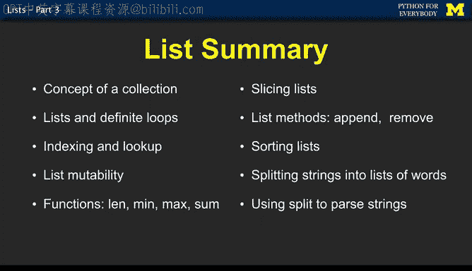

# 密歇根大学《给所有人的Python课》课程2：《Python数据结构课程（密歇根大学）》｜python-data｜ - P20：20_04_03_列表与字符串.zh_en - GPT中英字幕课程资源 - BV1yP411a7TZ

So now we're going to talk about how strings and lists work together and this is one of the more common things that we're going to do。

 we're going to read some data， we're going to bust it into pieces and we're going to look for little fragments of pieces。

And this is one of people's favorite methods in strings。 And that is the split method。

 So we're going to come up with a way to split a string。

 And the simple thing that we're going to do is we're going to find the spaces and split it into pieces。

 And there is a builtin function in Python called split。 So it's a member of ABC。 So ABC do split。

 And this returns a list。 So it basicallyly takes a string and gives us back a list and the list is with three words。

 the spaces are gone， they're chopped up and we have them。 Now when we're done。

 we see theres in that particular string there were three words。

 And we can pull out the first word by printing stuff of zero。 So this is a really convenient thing。

 Sometimes we want the second word or the third word or who knows。

 maybe we're going to loop that loops through all the words。 It's very， very， very easy to do。

 And so now we have stuff。 And now we have a we're going to loop through them。

 And then we have an iteration variable W that's going to go through the three words in the list。

 So the code to make this work is here's my string。😊。

Split it and then write a simple for loop that's horizontally going to go through and look at each of the three words in that。

 So it only took three lines of code to do that。 So this loop runs three times。

 and each time through it's with three words。 And this pattern when you're lost in a future assignment。

 come back and look at this slide because this is the pattern for how we read a line。

 break it into pieces and then look at each word in the line is。A splitlit and then a for loop。Okay。

 a couple of subtle details about split is that splits by default on white space and it treats more than one space as a single space。

 and so even though there's extra spaces here and we split this line， we still get four things。

 a lot of spaces， the words that you would expect to get out of that and so it's kind of intelligent and extra space doesn't freak split out。

The second thing about split is it doesn't have to work with spaces。

 And so if you get data like this， maybe from a logging system or from your counting system or something。

 And they have some weird delimiter， you can tell split to use a different delimiter。

 If we do it just this way， It's looking for spaces。

 And it finds none So we get back a list of the words as defined by spaces。

 and it doesn't realize the semicolons or what we want it to split on in the first place。

 And we just got a list And that list had one string in it。

 And that's what happens if there are no spaces in the string。 On the other hand。

 you can tell split to split based on a different character other than white space。

 So when you tell the split on a different character。

 it doesn't do this fancy thing of compressing multiple spaces。 It doesn't split on spaces anymore。

 it only splits on what you told it to split。 So it looks chops looks， chops， looks， chops。

 And so what we get is a list first， second and third。 And again。

 this is when you need to do this because you've got some data that's really weird and we'll see situations where we use。

instead of looking where we're finding a character and we do a find and we do another find。

 we use split and then just grab things。Okay， so this is an example of how we would use split as we parse mail data and we are going to do a lot of parsing and mail data。

 And so here we go， this， again， these lines you're going to get used to open the file。

 loop through the file， the strip the white space off the right hand side of the thing。

 Check to see if it starts with from from space in this case。 if it's not continue。

 So this is the skip code， skip lines we're not interested in。 and then we're going to split it。

And what we're interested in this particular thing is here's these from lines。

 We're only going to read the from lines because there's a lot more in this embox short。

 we're looking at what day of the week this thing happened in。 And so you can see these lines。

 they always have spaces。 So we just chop it based on spaces， chop， chop。

And they'll always be the same thing。 And so that'll be word 0， word 1 and word 2。

 And so word sub 2 is always going to be the day of the week。 And so this is gonna skip the lines。

 skippped the lines that don't have from as soon as you from。 we split it。

 and we pull out the second word。 And this is really simple code。

 the split makes our life a lot easier。 We don't have to search for a space。

 We don't have to search for another space。 If you were doing this with just find。

 You'd have to do something like search for the first space。 Then in another line of code。

 you'd search for the second space。 and then you'd search for the third space。

 and then you'd do string slicing to pull this out。 E yuck， just split it。

 go grab the third word and you're done。😊，So now what we're going to do is we're going to show you a pattern that I call double split and that's you split something。

 and then you split it again。 And we're going to go back to the problem that we were solving earlier。

 And that is， we want to pull out this information， right， And the last time we did it。

 we did a find。 And then we found the space afterwards。 And then we use string slicing。

 And that still would work。 That's not a bad way to do it。

 But let's look at how we could do this with splitting。

 So the first thing we're going to do is we're going to split this into。

Splilit based on the spaces using the normal split。 And so now we have world 0，1，2，3，4，5， and 6。

 And now we're going to grab out word sub1。And so that's not the host name。

 that's the email address okay and so that pulls out the email address into really elegant lines。

 and if you go back to the find strategy， we had these variables。

 we had to remember what the variables mean draw a little picture。It's hard now it's like， oh。

 it's the second thing， just grab it， it's the second thing and so that's what it would be。

Then what we're going to do is we're going to do a double split。 we're going to do a second split。

 and so we're going to put this variable word sub1。

 which is this one right here into the email variable。 and now we're going to split this。

 this thing right here based on at sign because we know that the email consists of two parts one is before the at sign the second is after the at sign And so now what we get is a list。

 And so you see that it's split that based on the a sign。

 we have the second So this is the zero piece and this is the one piece。

I tend to use the word pieces on this all the time。 You see my code。

 I use pieces because when I split it， it gets split into pieces。

 And that's why I use the name variable。 That's why I name my variable pieces。

 And now I split that this is pieces sub one。 It's not word sub1， but it's pieces sub one。

 So words was each of these words。 and pieces was the pieces after we split that into pieces。

 And pieces sub1 is the second part of the pieces that came after we split。With an ad sign。

 and so you could look at this， compare it to what we did before and like。

I understand what that is and I could write that code quickly and it's predictable and I don't have to remember what those variables are。

 I don't have to draw myself any pictures， I just go like chop， chop， this is the one， chop。

 this is the one of that little second piece of pieces。

So that gives us sort of a good start on lists， our first real data structure。

 the concept of a collection and where we put multiple things into one variable。

 these collections have internal organizing mechanisms。

 lists are organized sequentially with the bracket operator as the lookup operator and then we did some operations on strings like we sorted I mean unless we sorted the lists and we used split and so in the next two chapters we're going to refine all of these techniques and add new techniques to them。

