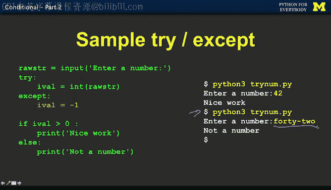

# 密歇根大学《给所有人的Python课》课程1：《编程入门指南（使用Python进行开发）》｜python｜ - P20：20_05_03_条件语句第三部分.zh_en - GPT中英字幕课程资源 - BV1214y117Mk

So the last conditional code is what's called the try and accept structure。And。

 you know that it's if you， if you learn other programming languages。

 this sort of catching errors is a more advanced concept。 But in Python。

 we tend to have to use it earlier because there are there are things where if you don't use it。

 the code blows up。 And the whole idea of a try try accept is that you have a bit of code that you know。

Might fail。And so you kind of want to take out an insurance policy on it and say， hey。

 give this a try。If it works great， if it doesn't do this other thing， don't blow up。

 Don't get a trace back。 And so this is a way to eliminate。Or catch。A traceback。

 something that would otherwise be a traceback。That's what this is for。

 So if you've got some line of code and you know that this might blow up and have a trace back。

 then you use trycept around it， okay。So let's take a look at something。

This is a sample we had from the previous code and it comes down， it sticks a peo bob in。

 then it converts this to an integer， and we know that if these things aren't digit。

 this code blows up。And so it runs， and we get the trace back and the traceback happens because of this line right here。

 But the key thing about the trace back is that。The traceback， as I told you before it， it stops。

 and it stopped at line 2， which means this is the last line it executed。 But it doesn't continue。

 which means this code is gone。 I mean， it， it never gets there because it's like， I'm confused。

 I'm quitting。 I have quit at line 2。Okay， I quit it line too。So that code。

 it's as if it's not there。Now sometimes that's fine with you。

 you just want to blow up and you want to see the message。

 you want to go look at line2 and fix line two or maybe type the wrong stuff in。

But sometimes you want to control for this。 you want to say， you know what， I。

 I know what I want to do here， and I don't want to die。 I don't want to blow up。 I want to continue。

 I want to put out an air message， instead。And so so the key is is when this code blows up。

 it's something that you kind of take personally because， you know， you are that set of instructions。

 And when a traceback happens inside the memory or CPU， that's you that's being vaporized。

 You've been traceback。 And so we take it kind of personal。 I mean。

 if you were to use software that I built like the autograder for this class。

 and you started getting tracebacks， I'm like， hey， that's kind of a personal thing。

 I didn't do my job Well。 I didn't catch all the errors。 I didn't think of everything。

 You could type something that would cause my code to blow up。 And so I take that kind of personally。

 And so we have to be able to compensate for situations that we know might cause errors。

 especially those where the user can type something that can cause my program to blow up。

 That's really like I'm gonna to let you blow my program up。 I am going to compensate。 I'll tell you。

 sorry that's bad data， but I don't want to ever you to ever see a traceback because it's kind of shameful to see a traceback for a professional program。

 okay so。Here's how it works， it's a bit of stuff。With some indentation in Cols， it。

 it looks like a lot。 but don't worry，'ll， you'll figure it out。 So the idea is。

 is you have a line of code。That， you know， is dangerous。 So this conversion of an integer。

 Let's just say this came from an input statement。 In this case， we'll just make it be hellello， Bob。

 We know this is going to fail。 And， and so this is the line in which we kind of want to take out insurance on。

 So instead of just putting this line in here， like we did in the previous example。

We just had it right there。 Instead of taking that line there， we say， you know what。

 we're going to take and stick this in a try and accept block。

 So we say the word try tris in a colon， which means it's an indented block of code。

 And then we put the dangerous line in there。 And then we put accept。

 And then the accept is kind of like an else。 and if then else。

But what it really is is code that Python will execute if something goes wrong。

 So this is either going to run and work and skip this， or if it goes bad， it's going to run。

 blow up and then run this stuff and then continue on。 But in no case， will you get a trace back。

Meaning if this line is going to generate a traceback， it actually just runs the except clause。

 So it's kind of like an if things work out， do this， if things don't work out， do this other thing。

 So in this case， when this runs， this is going to fail because that's hello Bob。

 And then it's going to come out here and set this to negative1。 So that's going to blow up。

 set this to negative 1。 that's going to print it out。 So it says first equals negative 1。

 And so we didn't trace back in the previous time we ran this， it traced back because we caught it。

 Now， the way the try accept works is if everything is fine， it has no effect。 So if we。

 the next thing we're going to convert is 1，23， the digits 1，2，3 in a string。

 we do a try and we try to convert it and it works。And so we just keep on going。

 We don't run the except。 So this code does not run because this code succeeded。

 There was no traceback that was going to be generated。 There's a traceback generated up here。

 There was no traceback generated here。 So it comes through。 And the result is。

 Iister ends up with a integer 123。 And so it's， it's。It's an insurance policy， or it says。

 I know this might blow up and if it does， I'm giving you alternate text or alternate code to run。

So the thing about the Tri set block and you might be tempted to do this。

 and that is put your entire， if you're getting tired of tracebacks and blowing up。

 you might want to put your entire program in a Tri set block。And you might say try blah blah。

 blah blah， and then accept something bad happen。 The problem is， if your program's blowing up。

 you actually want to know about it。 And the way the triniccept block works is if it's in the middle of a trinic step block and something goes wrong。

 like in this particular line， it doesn't come back and finish the trinic step block。

 it actually exits to the accept and then comes out。 And to draw this in a diagram。So here we go。

 We start this thing。 We're in the try block。 We're doing print。 Pri save doesn't hurt anything。

 We do this。 This blows up with a trace back， trace back。 And then that says， go to the accept block。

 run whatever's in the accept block and then continue on。

 What's not going to happen is it's not going to go back up and do this or back up and try this one again。

 No， no， no， no， no， once it gets the accept block， there is only one way out to the bottom。

 And so this la code， never execute。 And so one， that's one of the things we try to do where we just。

 you don't put too much stuff in。 you would， you would put this print statement out here and this print statement out here and you'd only put one line in the try accept block if possible。

 Sometimes you put a few more lines in there。 But you try to minimize。

You know what line is dangerous。 Print is not dangerous。

 Print in these two prints are not really dangerous。

 Don't put him in the block because any line in the block as soon as it hits a bad line with a traceback。

 It's out of the block， runs the except and then continues on。So here is a more practical example。

Where。We're going to read a number from the user and， you know。

 print out either nice work or not a number。 And so we take an input statement。

 which stops and waits for us to type。 and then we type 42 and then 42 goes into roster。

 And then we know that this int is dangerous。 right， And this roster came from the user。

 whatever the user typed。 And so we put it in the try block。And if it's 42， it converts。

And it says eyeval is greater than here， we print it out， so it says nice work。

 Now we'll run this code again。Okay， we run it a second time。 And now we enter something。 It says 42。

 but it's like F O R T Y。 And so 42 is what goes in here。 We， as the programmer。

 had no control over what our crazy user was typing。 right。

 You're starting to be a programmer and crazy users do crazy things to your poor programme。

 even if there are only like 7 lines long。 So we got 42 coming in here。

 We know this is going to blow up。 This int is going to blow up with a trace back。

But that's okay。 We've compensated for that。 And we told Python， hey， we know that might happen。

 And if you detect a trace back， jump straight in the except block， run this， set it to negative one。

 and then continue on。 So this is the D indent of the try accept block。 And if it's greater than 0。

 we say nice work。 But in this case， it's not。 And we say not a number。

 And so it comes out with number number。's here， what's not here is a traceback。

 there is no trace back in this。 That's what we achieve。 And it doesn't hurt。 there's no， you know。

 when it works， you don't need the try accept kind of does nothing because the accept code when it works is ignored。

 So it's like code you add in case something happens in other line of code。Pretty cool， actually。

So we you have a couple exercises and then I've got some videos of those exercises so in summary。

 what we talked about in this chapter is comparison operators， a logical questions。

 key is is that these comparison operators don't change their arguments。

 you can say if x is less than 5 doesn't change the value for x。

We have indentation and how important indentation is。One way decisions with if。

 two way decisions with if then else， nested decisions where you have an if inside of an if that moves on in else if。

 and then try and accept to catch errors that you want to catch。

