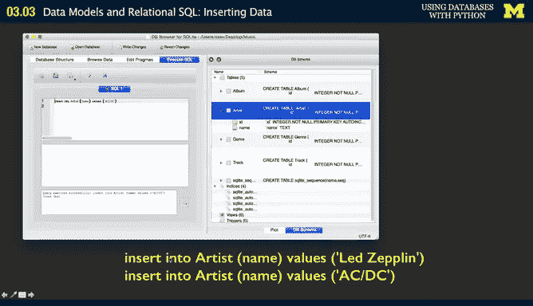
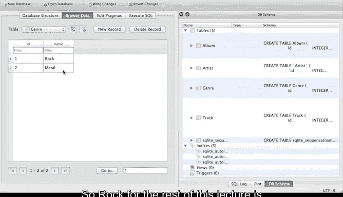
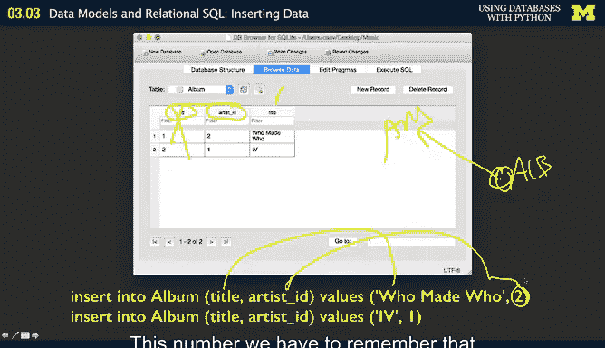
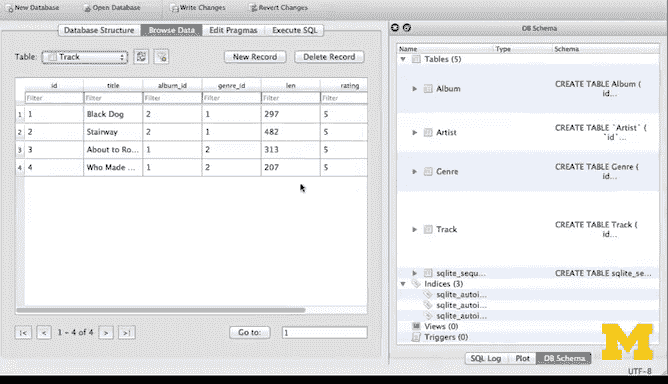
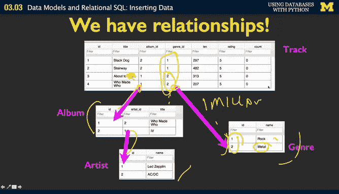

# 密歇根大学《给所有人的Python课》课程4：《使用数据库进行Python编程》｜python-databases｜ - P21：21_03_03_关系型数据插入.zh_en - GPT中英字幕课程资源 - BV1PP411W7H1

So。Before lunch we developed a logical model after lunch we developed a physical model and sort of implemented in the database and then we went home for the night and now it's next morning and it's time to insert some data into our tables now you got to remember all the keys and fields and stuff like that。

Just like we're inserting data from kind of like the outward simple things to the more central ones。

 we're going to do the same thing when we insert data okay and so we're using insert into and this is a good time to point out that the keywords inside of SQL like insert into dont the case doesn't matter the names of the tables the names of the columns may or may not matter and the actual data you put in that's case sensitive because that's your data so I'm going to type insert into artist。

And the key thing that is important here is we're not specifying the ID field， so if you recall。

In the artist table。In the artist table， we have an ID field and a name field。

 but if you look over here， the ID field。Is an auto generated field。

 it's not really showing up very well because we have the type， so the ID field is auto generated。

 so when I write this SQL。I don't need to specify the ID because as part of our contract。

 we made a contract with a database that says you assign that， so I'm going to run this now。

 insert into artists with a name of led Zeappin。And if then we browse data and we go look at the artist。

 it's added the number one kind of predictable， you can kind of guess what the next one's going to be so the next one thing we're going to do is we're going to insert。

Another artist in， and we're going to insert ACDC in。And。And we inserted that。

Now if we go take a look at data again， we got two and if we did a new record here it would automatically provide this for us right and it would let us change this but it would want to pick the next number three so what we've done here is both inserted the record but we've also established for within this database a new number。

One means lead Zepein and two means ACDC。Okay。So then。The next thing we're going to do。Is。

Answered in the genre， kind of working outward in。And insert the value rock and the value metal。

 and I'll show you a little trick here。You can actually in this user interface。

 if most of these things， not just this one， you can usually put more than one command in as long as you put a semicolon at the end of it。

 so I'm going to if I did that right， semicolon in the end of it。

 so I'm going to do an insert into genre of rock and then insert into genre metal。And I'm going。

Run the SQL。Oh， I wonder if I did it twice。I did。So I'll just delete this record goodbye。

 delete that record goodbye。I did two inserts and then I hit the button twice so that's how I ended up with two copies of it so rock for the rest of this lecture is the value one and metal is the value2。

And again， now when we're making the track table， you don't have to put rock rock， rock rock rock。

 we just put 11，111 because one is not a string， but it's a number that turns out to be okay。

So now we're going to take a look at the album。And this is the first situation where we've got to do a primary key of a foreign key right。

 so weve got an album table and the album has a primary key which is going to be automatically generated for us and a foreign key called artist ID because the album。

Points to the artist。And we only add data at the starting point of these arrows。

 and so that's what we're doing so this one we have to put in title。

But we don't have to put an ID so we don't have to put that in。

 but we do have to explicitly put an artist ID so we insert into album we're going to have a title and then we're gonna to have an artist ID This number we have to remember that two was ACDC and one was led Zeppellin Now when we're doing this by hand it's a little tricky and you find yourself flipping back and forth to remember like oh which one was led Zeppellin。

 which one was ACDC and it seems like in the short term。

 it'd be easier just to put the string in but。

That's the whole thing we're trying to avoid okay so for foreign keys。

 we have to put the numbers in explicitly because we or the code we write has got to remember them。

 so remembering what these numbers are the two and the one is a lot easier for a program to remember than it is for you to remember doing this by hand。

Now normally you wouldn't insert this stuff， we'll have code that inserts it and it's real easy for it to say。

 oh， I just insert his genre and I inserted rock and I got back a two so actually you can get that and so you the human don't have to remember this so let's run these。

This is our first one that's doing。And I'll put a semicle in here so we can do it all at once。

And I'll only push the button once。And if we do browse data。And we look at the album。

The ID was auto generated and artist ID was something that we chose and title was something that we put in。

 so now we're in pretty good shape。Now the last thing we're going to do is probably the most complex。

But it's not。We have。And ID is coming for free， titles data， length rating account， that's just data。

 and then we have two arrows， right album pointing to album and genre， album and genre。

 and so we have two foreign keys。Now here is where we have replication now。

Those two are going to the same album。And these two are going to the same album， same genre。

 same genre， it's okay to have replication as long as their' numbers。

That's really the essence of what we've done， we just like went in the big circle。

Replated strings and turn them in replicated numbers so these are okay and so then what you're going to do is you're just going to take each of these rows that you know well we don't need that that clear。

 take each of these rows and you know most of the data we're going to put in the title。

 we're going to put in the album IDD， the length， the rating count， put all those things in。

Explicitly， this comes automatically and we're going to do that。Title， rating， length， count。

 album ID， genre ID， then we have the values and then we have these are the two four key values and they point to those rows and again this is a point in time where you sort of have written down on a piece of paper what these little numbers were if you were doing it by hand。

It won't be too bad。I luckily have them cut and pasted。

 so they're all easy for me and if you're following along， then you just cut and paste these guys。

 and I'll be super lazy and I'll copy all four SQL statements and run them over here。Paste them in。

And then I am going to put a semicoe carefully not on each line， but at the end of the values thing。

 some point a semie on each of these guys。You don't have to put a semicloe on last one。

And I'm going to hit the run。And I will look at the data and I will look at the track data。

And there we are that's all there I can kind of move this over and that's the track data and again we specified all those things so if you look at all these tables we've constructed them outwardly in we started like at the genre and the artist and we worked our way in so that we could establish these numbers so that then we could link to those numbers as we put things in the album and then we established numbers and so the foreign keys of the starting points。

 the primary keys of the ending points and we worked in and so we have replication of numbers in this column but we don't have replication of string so the word rock if you look at all those data。

Okay， that's a bad example right there， forget that， pretend that the word metal。

Is better that doesn't count that's just a title that's not really word rock。

 the word metal as a genre only appears once in the entire database and the thing about is like what if there were a million of these right1 million。

You say okay what's the difference， the word metal versus whatever versus the number two if there's millions of them。

 it's not just that it takes up storage it it has to do with how much has to be scanned so part of what we're trying to do in databases is reduce the amount of data that has to be scanned to get to a particular piece of information and so the difference between metal which might actually be 128 characters and a number which is actually four characters。

That turns out to be different and it's not we can't start on disk drives， disk drives are big。

 it's just that we can't scan past it fast enough and we can't build indexes so we can jump past it even faster so that's what we have achieved in this section as we've inserted all these data and we've linked things together and we've modeled relationships and connection points rather than replicating data。

