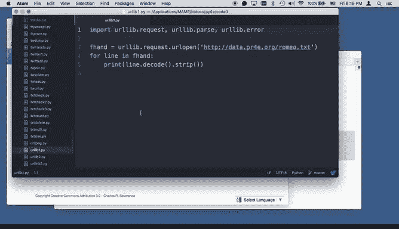
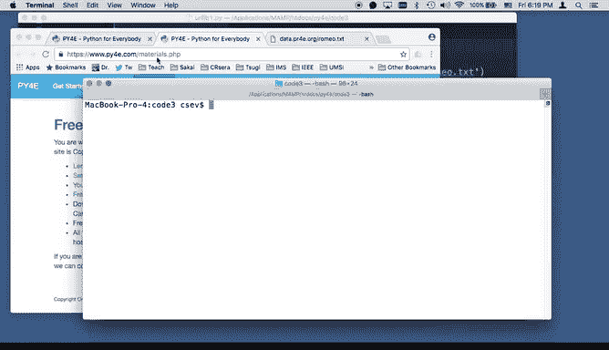
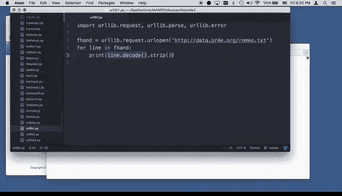
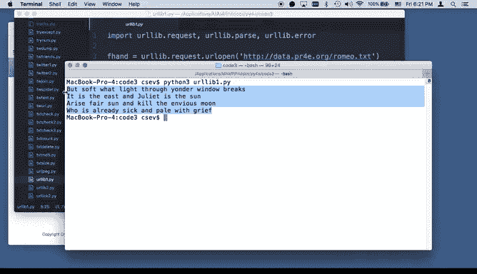
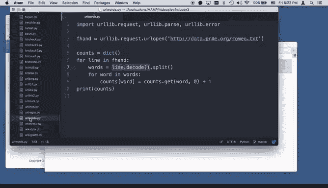
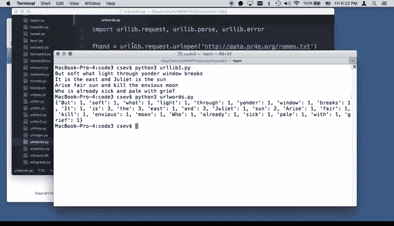
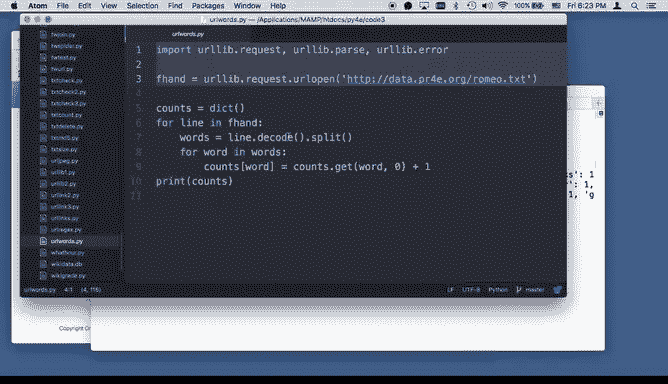

# 密歇根大学《给所有人的Python课》课程3：《使用Python访问Web数据》｜python-network-data｜ - P21：21_04_03_实战示例_使用urllib.zh_en - GPT中英字幕课程资源 - BV1Hu4y1e7WS

Welcome to Python for everybody。 We are going to be talking about some code。

 If you want to download all the code。 it's right here。

 it's all single big zip file and all this sample code。

 the one I'm going to talk about is URLib 1 py it is not very exciting It's short that's what's kind of nice about Python code and it's really if we go and take a look at the code we played with just previously。

 which is socket。 the idea here is URL Lib is something that Python has produced for us to make socket communications and HttP communications a lot better。

 So socket this is making socket calls underneath it。

 but there's a library that makes this quite simple。 And so we have to do some imports。

 So instead of importing socket we' import these URL we are going to create a handle。

 request URL open and just pass in a string So we're not encoding this orre not sending get command all the stuff we did in the previous。

Sockets's example is gone。 And then we can just put this as a for loop。

 And so we're not using this lower level read and write code。 We're just using a for loop。

 And so that literally is going to read the text line by line。

 And the line does come back as an array of bytes。 So we have to do a decode。

 But then we got a string。 And then we can do a strip on it。 So this is like a super simple。

Super simple。So there we go Now the interesting thing is is you also don't see the headers we just read the contents now it turns out in URL Lib and we'll see this in later more complex application。

 you can get the headers if you want， you can get various other things。

 so that's URL Lib a simple URL Lib tool。

嗯。Now we can also use this in URL words to show you something quite interesting。

If you look at this from right here， other than the decode。

 this is exactly the code we wrote to compute the words right So line other than this line dot decode。

 this is just a open something up。 In this case， we're going to open a URL。

 we're going to create a dictionary， we're going to loop through each of the lines in that thing。

 We're going to decode them and then split them。 So once you do line dot decode。

 This is now a legitimate internal Python string。 we split it。

 we run through the words and run the counts。 And so this is exactly like code that we did before to run counts。

 And so。

Python 3。URL words。And so that gives us a dictionary which is the word frequency and we could do all kinds of crazy stuff in here。

 you know with sorting and all the kinds of things。

 the important thing is once you've done this and this。

 the code other than the need to decode these lines when you first get them。

 it really works just like makes a URL Lib makes URLs function inside Python very much like files。

 so these are shortened to the point and very simple and I hope that they were useful to you。

