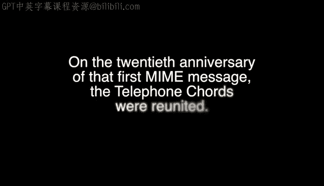

# 密歇根大学《给所有人的Python课》课程5：《毕业项目：使用Python检索、处理和可视化数据》｜python-data-visualization｜ - P21：21_06_02_访谈-Nathaniel Borenstein（MIME协议之父）.zh_en - GPT中英字幕课程资源 - BV1Eh4y1U7aE

🎼你。🎼Yeah。🎼宝宝。I never set out to go into the business of email。

 I got to graduate school and Carnegie Mel at the time。

 I think still had a thing called the Liberman Q， grad students had to be in a queue and when their number came up。

 they were assigned a sort of community service to the department and mine was maintaining this ancient email system on tops 10。

And。It was。 It was such a crafty system that I got motivated to just rewrite a system on Unix。

 So I wrote a mail system there。 And then I thought， well， that's enough of that。 And I am。

I did my thesis in user interface design。And then when I was looking for jobs， post thesis。

 after I'd gotten all my interviews， my thesis advisor， who was also the head of the Andrew Project。

 said， how would you like to stay here for a while and build the world's greatest mail system。

 E was a text thing in English only。There were extensions that had been made for other languages。

 but they only worked within。National or linguistic communities。

 So if a Japanese person went to France and used a computer there。

 he wouldn't be able to read Japanese email。 so that was clearly not an optimal situation。

Also back then， we didn't have just the internet。We had a whole bunch of networks。 We had Binet。

 We had Usenet。 There were NSFnet， and people sent mail。To each other across these networks。

 they were connected by gateways that were。Not always perfect because it wasn't wasn't always possible to preserve all of the information exactly the way it was intended。

 So the way I like to put it is I've never met a gateway that made a message better right the best you could hope for is that it doesn't make it worse So there were a number of problems and I came from a research background where I had built a system that did multimedia mail which meant you could have pictures and sounds and animations and all sorts of stuff that was was relatively ahead of its time。

It was part of a team at Carneygie Mellon did that。

And what really got me thinking standards was this， one day Steve Jobs came to visit。And we demoed。

The Andrew message system to him。And he immediately tried to hire our whole team。And nobody went。

 you know I suspect that was one of his worst days ever in hiring。 So he went home。

 this was when he was with next computers and he put together a team to build a multimedia mail system。

 So next mail is sort of an imitation of the Andrew mail system and you know imitation is the sincerest form of flattery that's wonderful。

 I didn't have any problem with it。 But once it was built。😊。

It was hard to ignore the fact that while my users could send pictures to each other and his users could send pictures to each other。

 my users couldn't send pictures to his users because we weren't doing it the same way。

So I started thinking。There really needs to be a standard here。Now， simultaneously。

 there are a lot of people almost all outside the US worrying about the language problem。

 worrying about getting non English characters and other languages into email。

And there was a third problem， there were people who worked on gateways。

 this gateway problem I described before， who wanted standards for formatting that would make it possible to gateway a higher level of information to some of these other systems。

So what mime was was a fortuitous coming together of those three needs。

And the man who deserves credit for starting that process was a man named Einar Steorud。

 who was one of the。Great unsung heroes of the Internet。 He was on the Internet from the early 70s。

 He started the first Internet mailing list。 So he was he was a pioneer in many ways。

 He was also kind of ornerary。 and I think didn't get as much credit as he should have because of that。

 He passed away a few years ago。😊，Anyway， he introduced me to Nedfred。

Ned was working on gateway issues。 We quickly met a lot of people who are interested in the language issue and I was interested in the multimedia issue and quickly found that we could put together a solution for all of those things and what's good about that from a standards perspective is bandwagon All those people who don't care about multimedia mail get it because they want to get the multilingual mail when you put together those three motivations I mentioned multimedia multi languagegu and gateway you had a lot of people concerned。

And it doesn't matter how much good will you have when you have that many people involved。

 there's going to be differences of opinion。I'd say there were about 70 people involved。

 not all of them as actively as others。And it took us about a year and a half， I think。

 to produce what we considered a stable first draft， the first one that was published as an RFC。

And it was a roaring success almost overnight。 One reason I think。

 was that the whole time I was writing the draft。I had a program called Metamail that I had written。

 and I was updating it to follow each version of the draft。And what Metail did。

Was it allowed you to make a very simple patch to existing text only mail systems。

 and it would call programs that could display the mindme parts。So all of a sudden。

 these ancient systems with a very little amount of work。Started working with this， this cool stuff。

 languages， pictures。 And so that made it， that made the adoption。Incredibly fast， in fact。

We released the MIme standard， and then I released the Memail software。

 and I started getting patches for it， people augmenting it the next day。And within the first week。

 this was a Unix program within the first week。I got the patches for the Dos port。

 and the Amiga port。And at that point， I was pretty sure I was onto to something。Let me send you。

 We may leave you high。🎼And有。🎼そし？对。🎼me new give。🎼That we。唔系。🎼You have lots of bandwidth。

 I have lots of。😊。

meLet my for email， blame it。えs？Or can we pretty much trace what we're doing today all the way back。

 my。 it's been very linear and it actually hasn't evolved all that much and。

I'm tempted to say that's because we did a lot of things right， But lest I sound arrogant。

 I also need to say that mine is one of the ugliest things I've ever seen。 it's a。

 it's a tower of hacks。Honestly， it is。 And that's one of the reasons it was successful。

 We had a tremendous problem or issue of compatibility with the installed base。 You。

 Even then there were。😊，Probably millions of people using email around the world and a lot of software that wasn't going to be thrown out。

 And so there were a lot of things that were constrained。 And that LED to my being ugly。

 But because it was designed with that in mind。ItIt was。 It was ready for adoption。

 Another reason it didn't have to evolve that much is that it it was almost a version 2 of something else in one sense。

 which is X 400。X 400。Was the email standard from the OSI protocoltocol stack。

 which was supposed to replace the whole TCP IP stack。And never did。And we looked。

 a lot of us looked at X 100， which was。Tremendously complex and would be very hard to entererate with existing。

Mail systems。 And so our more simplified approach was a reaction to that。

 And that's why you have some things in mind that you would never design if you were designing from from scratch。

 So， for example。80 column lines。 and it limits a little longer than that。

 but basically limited line lengths。 Why is that it dates back to teletypes。 Actually。

 it goes further back than that。 It goes back to punch card machines because the first video terminals had 80 columns so that they could easily handle punch cards because they had inered I just went on for then。

 So basically your mail today is limited to 80 column lines more or less because punch card machines were 100 years ago。

So we made this ugly thing。To be backwards compatible。 And that's why it took off like a rocket。

 I think， Another reason it took off like a rocket。Was that as we were finishing it up。

I got mail from a fellow who was working on this project in Switzerland I'd never heard of and he said。

 I'm working on a project called the Worldwideide Web and right now it's text only and we're looking for how to make it multimedia and we were thinking that mime might be the way to do it。

 Do you have any opinions or ideas and so having the web pick up mime did not hurt of having it take off like a rocket either and what it really picks up is effectively the typing a various to be able to mark in a common language between mime and。

 Yeah， there are several parts of mineme and certainly the anologies by the web。 at its core。

 the most important part of mine。As you say， is the content type registry。

So if I need to be able to send you some weird type of data that I've just invented。

I have to label that somehow， and there's a way to label it for experimental stuff。

 but there's a registry to go to for something that you want to be interoperable semi permanently。

 at least and。When we released the I standard， I think it had 17 content types that defined something。

Between 10 and 20。And last I looked， the Ana Registsry of Min Times was over 1000。1200 or something。

So， so so that kind of extensibility did not hurt either because a lot of people who had totally different motivations。

 you know， for what they wanted to do had an easy way to identify the data for the web and for email。

🎼啊。