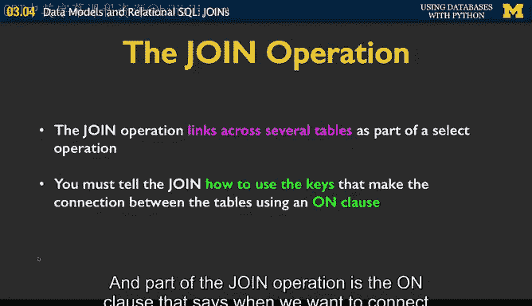
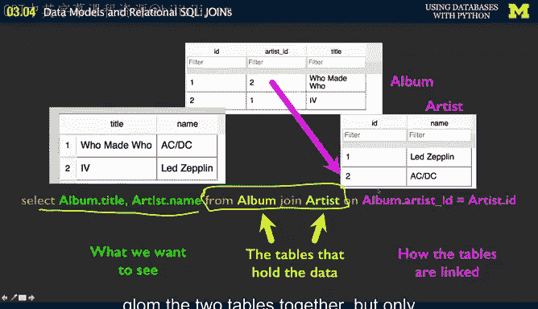
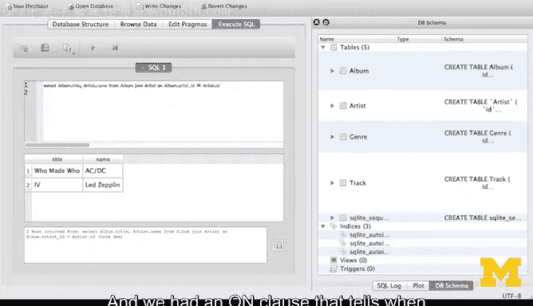
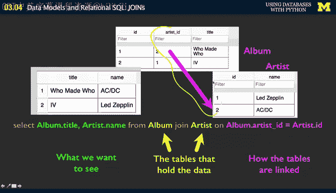
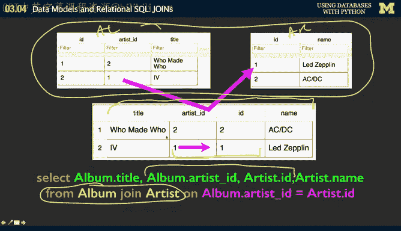
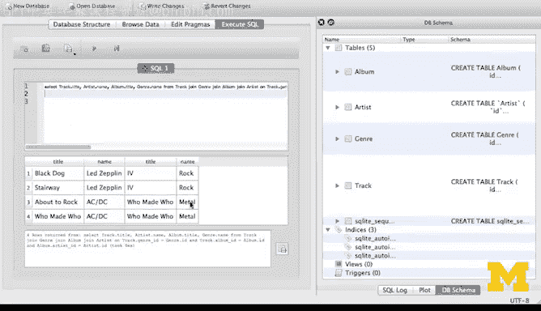

# 密歇根大学《给所有人的Python课》课程4：《使用数据库进行Python编程》｜python-databases｜ - P22：22_03_04_通过JOIN重构数据.zh_en - GPT中英字幕课程资源 - BV1PP411W7H1

So we're about to come full circle， we just created these many database tables。

 we've spread things out， we've linked them all back together with these numbers。

 and it seems like we've just created a mess of everything。

 but now we're about to bring it all back together using the join。

We finally have touched the relational power， and it may seem painful。But this is important。

 especially when data scales and if what you're doing matters， then data is going to scale。

 you can't say， oh my data is so small， I don't need to do this well。

If you're doing it and it's big and you're really doing data analysis and it's like something you're doing professionally。

 you tend not to do small things professionally， you tend to do large things。

So this notion of primary keys and foreign keys and the little numbers that point to stuff。

 that's what it's all about。So we need to reconstruct for our user interface。

 the data and reconnect all these connections。And the SQL syntax that allows this to happen is the join operation。

 and the join basically says we are selecting data from more than one table and part of the join operation is the on clauseuse that says when we want to connect one row and one table with a corresponding row in a different table。

And so we have this example here of our data where we just want to sort of pull the artist's title and the artist's name out。

 except that the artist title is in the album field。And the artist's name。

 because we did this relationally is in the artist field。 So we don't have it in one field。

 So we have to pull across two tables。 So that's where we say select。 And then we want the things。

 Now this is a syntax here， where you have table name field name， table name dot field name。

 The title column from the album table， the name column from the artist table from which is the same from we've done for。

 here's a table joined with another table。 And what we're doing is we're saying let's make a super table that really is the rows of this table as well as the rows from that table。

 And that's what the join does。 It's like we're not going to one table， we're going to two tables。

 Then in addition to the join operation saying we're going to do all these tables。

 the on clause decides when we connect a row in this table to a row in this table。

 So row to row row to row。 and the on clauses that we're going to write is。

When the album's artist ID， that is from the albums table， the foreign key。

 the start of our little arrow is equal to。The ID field from artist， artist ID。

 so it is the destination， so this is the starting point of the arrow and this is the ending point of the arrow。

 so this is the start， this is the end， so that's matching the reconnecting all the arrows for all the corresponding rows。

Select these two fields， one field from each table。

 and then we've got to column the two tables together， but only connect the rows when this is true。

For me， I would call this win。Some people prefer to write this as a longer wear clause。

 some databases prefer that， I tend to like using the on clauses。

 so I don't kind of confuse my wear clauses， but if you learn the wear clause tech trick。

 it's the same as the on clauseuse。So let's run this one。That's already in there。Oops。So I'll run it。

So here I go。I've got the title， oops， I've got the title from one table and the name from another table。

 and we joined them all together and we had an en clauseuse that tells when they're supposed to be connected。

Okay。So we can look a little more deeply into this relationship that we have or we can you know clear this。

 look a little more deeply in the relationship that we have here by actually looking at all the data that's actually participating in the connection between these two rows so here we once again have our select and our from Cla goes between album and artist so we're of this is our super row from the album table and the artist Art table that's artist that's album and we have the four key relationship still。

And we're going to add to this select。These two fields everything is the same as before。

 except we're going to show you how this connection is made okay so we're going to select the title。

 the artist ID， the artist ID and name and so you can see how we're seeing the whole table at this table these things have been joined together like there's glue in the middle between them they've been glued together and they're glued together in the situation where these two things match so if you type that that's what you see and so that's a way these don't really need to be shown but they are the source of the connection so that's the source of the connection and by just selecting them you can see what it looks like。

Okay so let's construct another one let's say we want the tracks title and the genres name and if we take a look at the track right we've got genre ID now we have some replication here and then we do need to do this lookup right and we want to see all the tracks right all the tracks with along with their genres right rock rock metal metal so now we've reconstituted the duplicates right this is what the user wants to see but this is what we're storing in our database right so again we say select track title that's this thing genre name that's that thing from a different table from track join to genre so that makes like this big blob thing that's a super row that smears across two tables and then we have an en clauseuse。

And you think these are hard to construct， but oh this is the track table。

 there's a foreign key name genre ID oh and that's going to be equal to table name ID right I almost cut and paste these things so fast as I write them and so they get easier and easier and easier when you going from the track table to the genre table and the syntax that I use for the connection is very canonical I do it over and over and over again。

so let me run this guy。And there we go， we've reconstructed the replication。

 but this is also a good time to show you a little bit more about what's going on underneath this join right and now it seems all pretty and simple and this on clauseuse。

 but what happens？If we just take out the on clauseuse。Select these two things from。

These guys glued together， somehow we've glued these two tables together。

So if you don't have an en clauseuse， what happens is it basically says all combinations。

All combinations so there's four rows here and two rows here so all combination of each row here so this turns into two this turns into two this turns into two so that turns into eight now if this had 1 hundred0 and this had 100 that'd be 10000 and so if you don't have an on clauseuse it ends up with all combinations and we can show this so this is exactly the same select statement track title genre ID genre ID we're adding the middle to joiner guys that would been an on clauseuse and we're saying from track join with genre and no on clauseuse okay that's the thing that's changed we added these two columns and。

We took away the joint clause， so let's take a look at what happens when we run this one。

And lines don't matter， so the fact that I put this on multiple lines， you'll see it doesn't care。

And so you can add spacing and lines to make your SQL look prettier。

 I do that all the time I indent them， indenting has no significance but it is still very pretty。

So now we see that we're getting all the combinations， right， one，1， one，2，11。

 so all of so black dog has got both genres， so it got genre  one and genre2。

Because we don't have an encluse， so it's not interested in matching and so you can think of a join。

You can think of a join as building across both tables。All possible combinations between the tables。

 the encluse is throwing the away the ones that don't match。

Or a better way to say it is it's picking the ones that do match。Right， we like this combination。

 we like this combination， we like this combination and we like this combination that's what the on clause is doing is it's picking the ones where there's a match。

 if you don't have the on claws， then boom， all combinations， one to two。

 you know this is one row and it's being combined with that。

 this is the next row and we want both combinations， This is the third fourth row third row。

 all combinations， fourth row， all combinations， and then。The oncluse。Wips out the non matching ones。

Oops， I did it wrong again。Keep doing it wrong， but you get the idea， so that's the on clauseuse。

That's really how it works and frankly this is one of the things when I first looked at it like it must be doing that。

 but it doesn't do that when it sees the on clauses。

 it's really clever about pulling things in super clever again。That's not our problem。

 so now it can get complex because now what we want is the track title， the artist nameme。

 the album title and the genre name， and this looks like a lot of stuff。

 but if you follow it it's a pattern so we have a select these are the things we want that is the list of the output we want。

We're not interested in all the IDs and we have to have this long from clause， it says。Track。

 join with genre， join with album， join with artist。That's all the rows。

 all the tables concatenated together and then the on clauses， which seems kind of tricky。

 but now we we start from track and work out that we have the foreign key and track of genre ID is equal to the genres primary key and the tracks album ID is equal to the album's primary key and there's one more foreign key and that's the album's artist ID equals the artist ID。

 so go back to that little picture that we have this that pointed into this。

That pointed to that that pointed to that we just look at this the picture and this is why the pictures are so important and we reconstruct all this and so this for me。

It may look a little complex， but if you do it a few times。

 you realize that the naming convention really， really saves you。Okay。Let me show you that。

 select this whole monstrous mass。Tiper in。And then run it。

And we've reconstructed it right now we've got replication here， but that's the output。

 that's the beauty of databases you reconstruct any replication but you don't actually store the replication and that's why you have to learn to write join clauses。

So if we think about this。We've gone full circle。It's takenking us just like any startup it just took us like three days to build our product we started with a user interface that we designed that had replication。

 then we came up with a data a logical data model and a physical data model then we inserted all the data。

 we connected things with numbers instead of strings and now we use a join to reconstruct it and so we start here we go through a step a step a step a step and then we come back to here and we're able to reconstruct and effect the output that our end users are going to want to see except now we can handle millions or billions of rows because we have carefully constructed a data model that makes sense。

