# 密歇根大学《给所有人的Python课》课程2：《Python数据结构课程（密歇根大学）》｜python-data｜ - P22：22_04_01_列表练习题讲解.zh_en - GPT中英字幕课程资源 - BV1yP411a7TZ

Hello and welcome to Python for everybody。 I'm Charles Severance and now we're going to take a look at how we would write some code to do some parsing。

 read some data。 As a matter of fact， we're going to read through our famous mailbox data。

 look for lines that begin with from space and extract the third word， a matter of fact。

 we already have some of this code already written， we're going to debug it。

 we're going to look at code and we're going to debug it so here we go it， here we have it。

 and it's a pretty basic program it opens a file， loops through the file。

 throws away the white space， splits it into words and checks to see if the zerowith word。

 the first word is from and if it's not we skip and read the next line and otherwise if we find a line that starts with from space then we print the third word which is word sub2。

So this is what we've got and we carefully saved this file into the same folder that we've got EX08。

 and so let's go ahead， CD desktop， Python for everybody， EX_ 08。

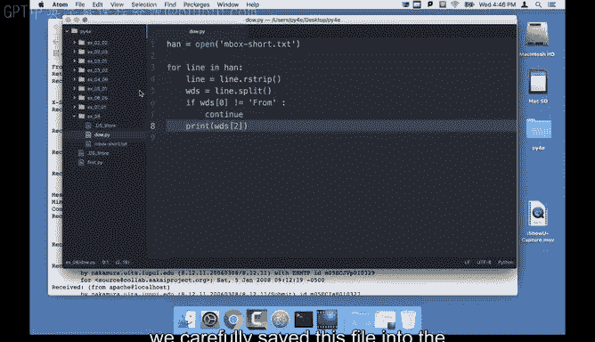

And so this is。Some files， we got our day of the week Python and our inbox short。

 so that's sitting there， okay。

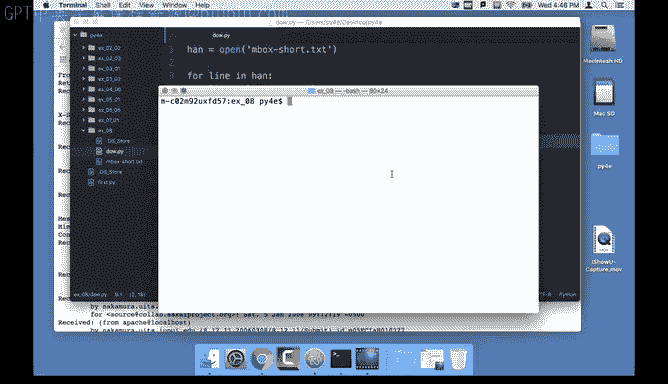

And so let's run this program， this is the program that we've got right here， Python3 DOw。PY and。

It doesn't work Now， by now you've seen a few tracebacks and there you go。So you know the。

When you look at a trace back， you think to yourself， well， I made a mistake。

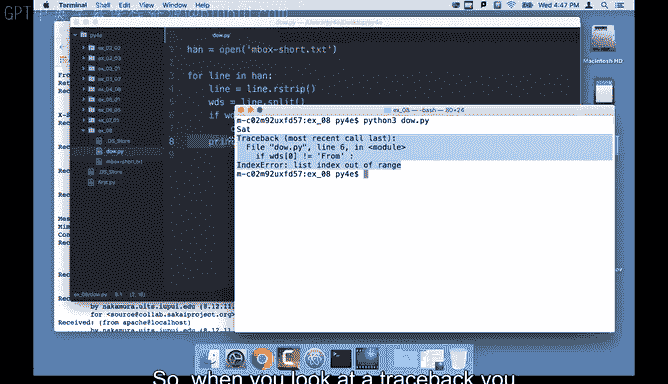

And you've gotten pretty good at looking at that line。 So there you are。 You're like。

 this is the line。 There must be something wrong on this line。And you want to change it。

 but that line's not actually the problem in this particular thing。

 and so you got to be careful sometimes， and one of the things that you didn't notice in this one right away is that it actually worked。

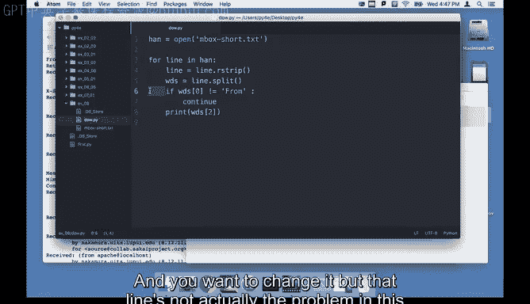

It printed the first line out。 So if we take a look at our data set。

It found the line started with Thrrum's space。 It split it and printed out the third word。

And it blew up later and so part of the problem is we don't know what it was doing when it blew up。

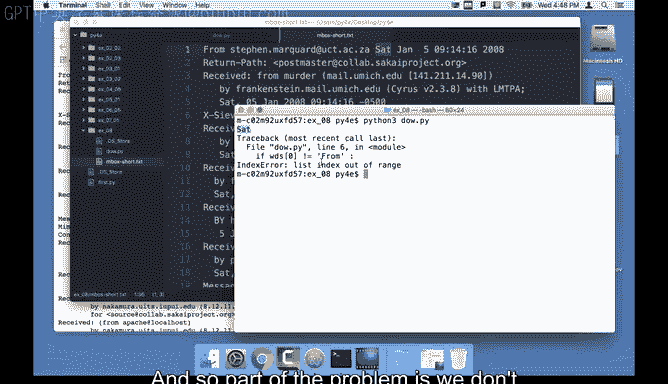

And so the first thing I'd like to do in this kind of a situation is find the line and make sure there's a print statement right before it and so in print。

Words colon， and then comma WDS。 I want， I want to print right before the line that blows up so that I know。

 I know really when this finally does blow up， what was going on in that line。

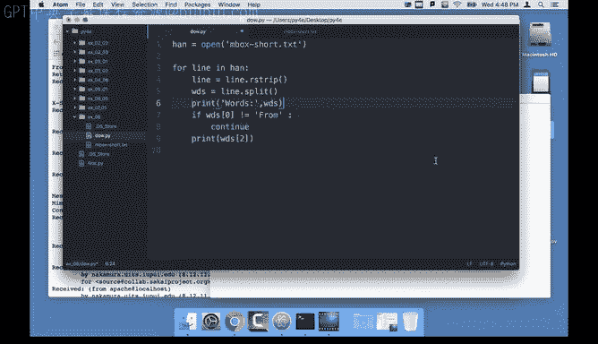

So I'm going to run it again。And oop， did I forget to save it， No， I forgot to save it。 Look at that。

 See the little blue dot forgot to save it。

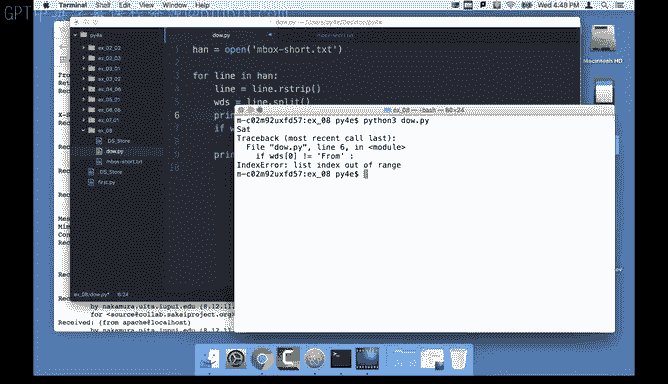

So now we see a whole bunch of output and we see that it's actually doing a whole lot of work before it's blowing up and so you see that it prints the words out from that first line and prints out Saturday。

 which is exactly what we expect， it's the third word in the line and then reads a whole bunch of stuff and it's actually what's doing now is ignoring I mean just put something here。

And'm going say， print。Ignore。

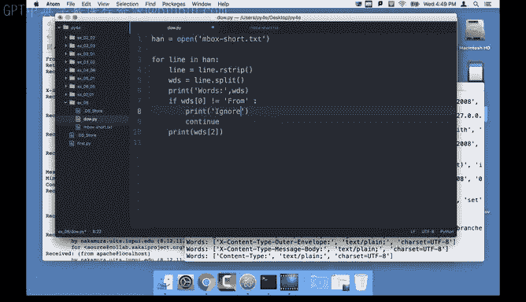

So I can keep track of when these lines are being ignored。

 so let's run again and have the word ignore pop up。

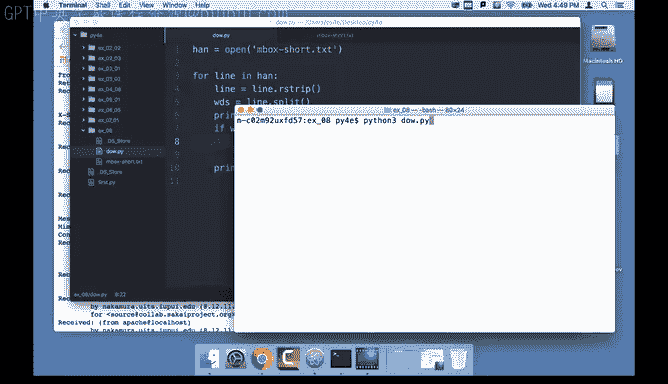

And so it's doing a lot of ignoring， it prints finds these words， prints out Saturday。

 reads this line and ignores it， reads this line and ignores it， reads this line and ignores it。

 so a lot of stuff's going on here that you might not realize。

And so we have to take a look at what the problem is。 And so it is now blowing up words sub 0。

 And now we can scroll down and we can look at exactly what happened right before the trace spec。

 So we really now know exactly what happened before the trace spec。 And the interesting thing is。

 is that there is an empty。Empty string。 I mean， empty empty array。 There's an array with zero items。

 So I'm going to print the line out too。Currentrant。Line colon。

 Now I haven't changed my program at all。 I'm just trying to figure out what's going on here。

So I'll save that， and I'm going to run it。And we've got a lot of stuff and it's still working。

 It reads a line。It reads a line， splits it into words， and then prints out Saturday。

 which is the third word on the line。 Now， here it reads a line， and this line is a blank line。

And it has， because it's a blank line， the splits returns no words。 and that's what blows up。

 And the problem now is， oh， wait a sec list index out of range。 So word sub0 is not valid。

 which is the first word when there are no words。So。This is a statement that works most of the time。

 Now， you might think， oh， I want to just put a try and accept in there well。

The right thing to do is to say to yourself， oh， wait a second。If。

The I don't have enough words if the length of the words is less than one。Continue。

So basically it's going to come through here， it's going to split it， and if we don't have any words。

 meaning it's a blank line， then we're going to skip it， so let's run that。是。

So now this ran all the way to the end。 It did a lot of stuff。

 and it did not blow up specifically didn't have a。Traceback。Another way to protect this would be to。

We'll take this part out， this is called a guardian pattern。guardian pattern because this。

 this is dangerous， this could blow up， but this it it won't blow up if it makes it past here and it won't come through there。

Under the conditions that are causing it to blow up。

 Another way to do this might be to protect it as follows to say， oh， wait a sec。

If the line is a blank line。no。Continue。So now what we're going to is we're going to skip blank lines I maybe even say this。

Print。Skip。Blank。So if it's a blank， we're going to skip blank and keep going。

This will skip blank lines， it'll come through here， and this will skip lines that don't have from。

 but because we're not processing blank lines words sub zero， always works so I can run this code。

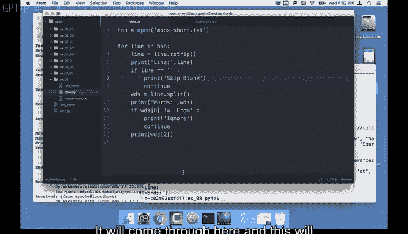

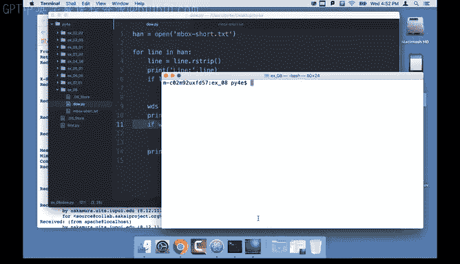

And it works again， so here we have a blank line， we skipped it， here we have a blank line。

 we skipped it。Now here we had a non blank line。 so we parsed it， but then we ignored it。

 And then up here， we'll find it from somewhere。Let's find it from。Here comes。Ohpe。

 now I just ignore， ignore。I got too much debug print， I can't find it here。

 I'll just hunt for from with find。Okay， so there we go。 there it's from and we print a thing out。

 So we're getting a lot of。A lot of extra stuff， so I'm going to comment out some of these debugs。

And I'm actually just going to get rid of this whole skipping of the blank line。

 I'm going to do it with the words。 I'm going to go back to the guardian we had before。If。

The number of words that we got， land of words is less than one。Continue。Okay。

 so now this is going to be a working program。Oops。I gotta take another print statement out。

GoGotta take another print statement on， we can sort of know what we're doing here。

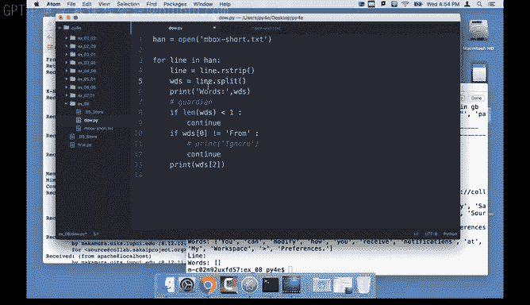

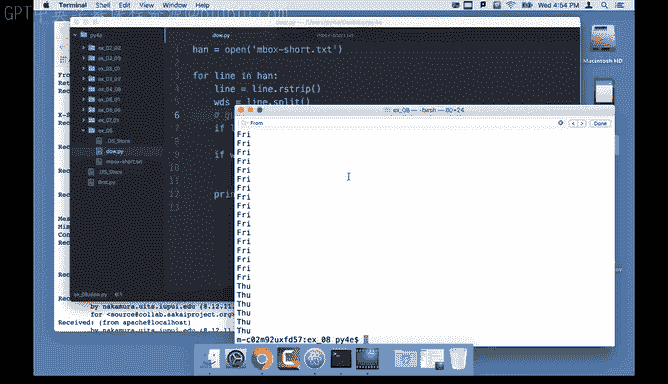

Okay， so this looks like a pretty safe thing。 This guardian is protecting this dangerous。

 I get rid of that one， too。 This is the word that could was our trace back。

 and nothing else in this thing changed from when we started。

 except we've added this little guardian。 Now， the interesting thing is。

 if it comes through here in Prince words sub2， what happens if somehow we find a line that has from is its first word。

And there's only one word on this is going to blow up so we can make our guardian a little stronger。

And we can say， you know what， we're going to skip this line if it doesn't have the three words in it。

 so it has to have at least three words， and if we see less than three words。

 we're going to skip it and that just makes the guardian a bit stronger。

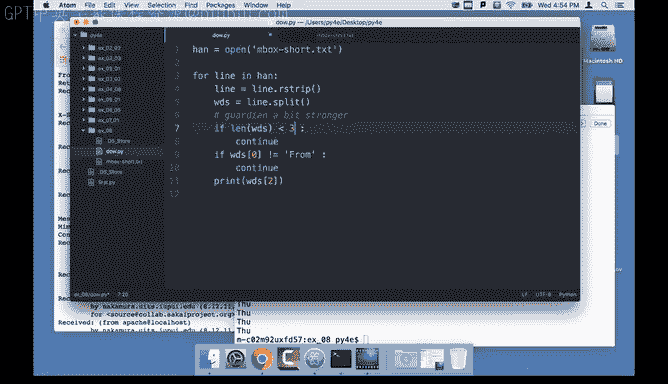

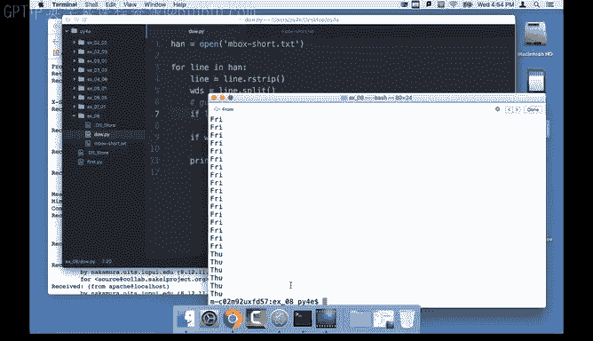

And so the program works safely and you see these things where sometimes you want to check to see reasonable that your assumptions about the data are reasonable and skip things where the data is not reasonable。

Now so that's one guardian pattern。 Let me show you a slightly different way to do this。

 And this is with an or statement。 So I'm going to take this code。

Copy that and put it here with four。Get rid of all this stuff。Well，This is the Guardian。

In a compound。Statement。So。Or saying is if there are less than three words on the line or if the first word is not from。

Continue now， we' are doing this in order because the way it works is or is true if either that's true or this is true。

 but if it knows that this is true， then it doesn't bother checking this。

 And the checking of this is what blows up what causes the traceback。So if we flipped this order。

 it would fail if we do it in this order， it will work， so let's do this one right。It works。

 but if I get this backwards。It's going to check this before it checks this。

And we're going to go back to failing again。 So youve got to get the order of these things right。

 the guardian。Comes before。In the or。The Guardian comes before and if this is true。

 then it doesn't check this。 this is called short circuit evaluation where it knows that as long as this part's true。

 it doesn't evaluate this second part and so now we have a guardian in a compound statement you'll see this a lot sometimes if it's more complex you do it in multiple statements or you say fall through check for sanity check for sanity and only run the code So I hope that that was useful to you looking a little bit about how to debug where you don't just start chopping on the line that had the problem it's not always that line because we never did change that line although we did change it a little bit at the end we added this guardian here but we also fixed it without it you know sometimes you add some print statements to figure out what's going on before you just start chopping on that line So again I hope this helps thanks。

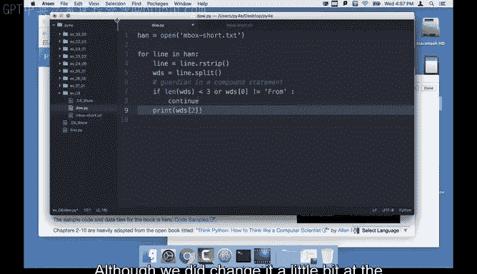