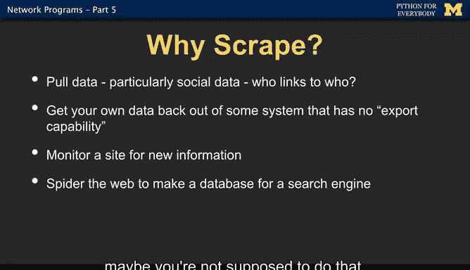
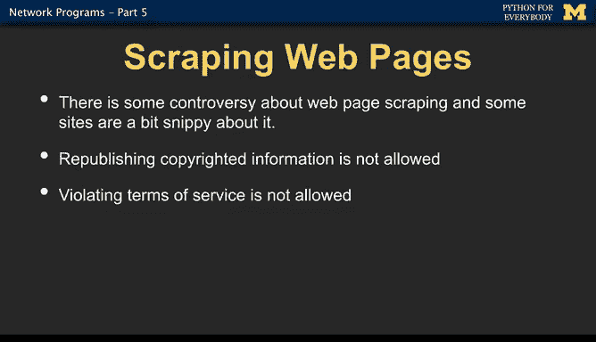
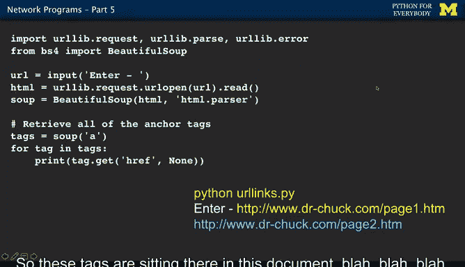
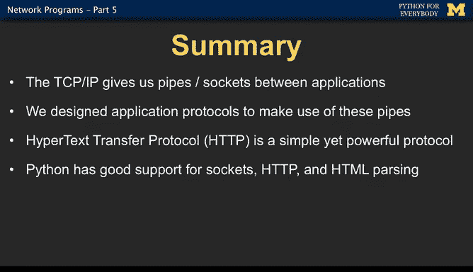

# 密歇根大学《给所有人的Python课》课程3：《使用Python访问Web数据》｜python-network-data｜ - P22：22_04_04_解析网页.zh_en - GPT中英字幕课程资源 - BV1Hu4y1e7WS

So now we're just going to talk a little bit about webs scraping why should come back and visit this again later in the book。

 but the basic idea is is now that we have this protocol that we can send get requests and get data back。

 that's how browsers talk to servers， what scraping really is is when we write a Python program that fakes or pretends to be a browser。

It retrieves the web pages， it looks at them and maybe extracts some information。

 maybe for searching or for more links and then goes and perhaps gets more pages。

 and we call this either spidering the web because it kind of works its way out like a spider's web or we call it crawling the web So it's going to crawling and crawling。

 crawling from one place to another and eventually is going to crawl one link at a time and it finds all or nearly all of the web。

Now， why might you scrape？ Well， you might scrape data that you can't get any other way。

 Now you got to be careful because it might not be legal to do this。 you know。

 you want to scrape the inventory of a competitor。 maybe I'm not supposed to do that or maybe you posted a bunch of things to a blog and you lost the blog is about to get shut down。

 I actually use scraping recently for a wiki that I typed a bunch of stuff into someone else's wiki and they're gonna shut the wiki down。

 I'm like I want my pages back and I could have pulled them all out my hand。

 but just wrote a scraper and I scraped all my pages back。

 you might write something that runs every night to check to see if something changed。

 or you might build yourself a simple equivalent of a search engine。

 Now there's lots of controversy about it。 People who build website So often copyright their material and say you can't have it。

 You can't just like make a online store by borrowing Amazon's inventory from their pages。

 they won't be very hyppy about that and they will catch you。

 They have terms of service and they can block your network， They can block your computer。

They can shut your account off and so be very careful about the things that you spider things like Wikipedia or Drchuck。

com somewhere that really doesn't care if you look at their stuff and actually is happy to have their stuff looked at。

So the biggest problem in spidering is the parsing of the HTML that comes back and like I said before。

 HTML is as a nasty little representation and it turns out that when your browser retrieves HTML it goes through a whole bunch of things that effectively forgives。

Syntax errors in HTML because they figured out we'll just show it why tell people about it syntax errors。

 so it turns out that there is lots of HTML on the web that has syntax errors in it。

 but you don't even notice it。And so you could do regular expressions， you could do fines。

 you could do splits， you could do all kinds of things。

 and you would find quickly just after the it'll work for the first two pages。

 but the third through the thousandth page it blows up because oh。

 I didn't realize that's what the HF， I didn't realize you could put a new line there。

 who would have put a new line there， why would they do that and then you fix that。

And you realize after you try to fix this and you try to parse all the links that there is just so many variations and someone's already done that。

Ands a library called Beautiful soupup from a place called Crummy dot com。

 I think this all the naming of this is all sort of this tongue in cheek of like what a mess Hm is。

 And so instead of a calling like Hl super parser， they just call it like something silly because it's kind of a silly problem because Hl on the Web is just so bad。

 And so it's like kind of fun。 But once you use this。😊，You've taken the easy way out。

Now， the first thing that you've got to do is you've got to install beautiful soup and there's two ways to do it。

And I put in in the code， the code folders and all the zip files so you can either go and file the instructions at their site and install it and that installs it for all Python programs that's fine if you can figure that out。

 but sometimes you're running on a campus computer and you can't actually reinstall software on that。

 you're gonna to maybe you're bring in your Python programs on a USB stick or on a Sha driveri or something。

 and so you actually have to kind of locally install it。 and so if you make this file。

 you actually can download this file BS4。 zipip and then unzip it and so if you put it in a folder with the URL links this one。

Py。And there's a folder BS4。And then this is actually a folder and then all the stuff underneath it。

 Then in that one folder， beautiful soup will work okay so you can either have it installed for all pythons or you can put it in any folder that you're going to use beautiful soup。

 you make this subfolder called B4 and it's got some Py files in it etc etc。 etc。

 you unzip you download this file and unzip it into that same folder and then this import will work now until you get beautiful soup properly installed。

 this import is going to blow up and so you just keep running it until the import works and then the import works and you can focus on the rest of the program。

 So you got to install it one way or the other look at the instructions I'll probably have oops。

 I'll probably have a little screen capture or something that shows you how I make this work。Okay。

 so assuming that you can import beautiful soup， we're going to read some data from the net。

And we're going to import the beautiful soup library， we're going to ask for a URL。

Then we are going to open it and then do a dot read。Okay， we're going to do a dot read。

 remember what dot read is that says read it all， it's not a for loop that read it。

 it reads the whole blob with new lines at the end and it all comes into one big string。

And then we're going to tell beautiful soup to parse it。 Okay。

 now beautiful soup is smart enough to convert all this stuff。

 So it just takes the whole file and uses this HTML parser。

 There's some other options that you can have here。

 But that's one the one that that I recommend in this case。 And then you get back an object。

 And what happens is in this soup variable。 It's somehow taken all the nasty bits that come from the web page and clean them up and made like a little pretty tree of things。

 And you don't have to worry about the internal structure。 It is。😊，A soup object。

I name the variable soup just because it's cute to name it soup， that could be X for all we care。

And you can ask soup some questions at that point。 So it takes the nasty H and cleans it up。

 That's what this parsing is doing。 It's like that's the ad hoc， heuristic， challenging。

 difficult part of it。 Thank thank you。 Bea soup for writing such a wonderful library。

 And then we can ask questions of it。 And this first question that we can ask。

 And beautiful soup is a little tricky to use。 And so you'll end up reading some documentation。

 If you want to build really sophisticated programs。

 But this basically is we are going to go through all of the anchor tags in the document。

 Give me a list of all the anchor tags and documents。

 So these these tags are sitting there in this document。 You know，lah， blah， bla， bla， blah。

 anchor tag， blah， bh， bla， bla， blah， anchor tag， blah， blah， blah， anchor tag。

 And so what this basically says is give me a list。😊。

Of those anchor tags， anchor tag， anchor tag anchor tag and comma， comma comm。

 Now these tags are themselves objects， and it has the data in the anchor tag and you have to kind of query those。

 But given that this is a list， then the tag is going to go through each of the anchor tags in the document and iterate through them and it's going to pull out the HR Hf equals。

Quote quote right， it's pulling this text out。 and that's what we get using tag dot get。

 So this is like a dictionary。 get the HF key。Or none。

 And so then this will loop through with it retrieves Drchuck。com page 1。

htm and it prints out trivially with no regular expressions， no nothing。

 it just prints the links out。 Now， if you do this to a page that has more links。

 you will get many links here。OkaySo that is a simple use of the beautiful soup library to retrieve and parse HTML and pull out anchor tags。

 which is really sort of the beginning of a browser， I mean， a beginning of a web crawler。

So if we go all the way back to the beginning of this chapter。

 we started with a notion of computers making phone calls using sockets。

 they called to a host and a port within that host。

 and then they have a two way socket that they can send and retrieve data。

We have to consult the application protocols like HTTP Hytext Transport protocol to figure out what we send and how we send it and when we send it。

 who talks first， what the responses are and what the data is and how to interpret that data like the headers followed by a blank line followed by the data that's all part of that protocol right。

 and then we made it even simpler with URL LibB。

So that's just like one line。 go get it。 And if you do a dot read， you get the data as well。

 And then with beautiful soup， if you're dealing with HTML， beautifulut soup really simplifies it。

 So in a surprisingly few lines of code， you can do the hard part of a web crawler。 And you know。

 that's one of the things that。😊，People really like about Python， you think。

 oh I want to do this and like 30 minutes later， you've got a basic web crawler working and so the support for HTML。

 HP and sockets in Python is one of the very， very charming things that people really like about Python。

