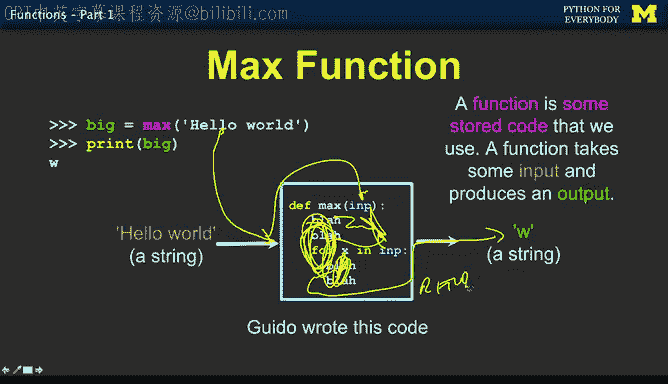

# 密歇根大学《给所有人的Python课》课程1：《编程入门指南（使用Python进行开发）》｜python｜ - P22：22_06_01_使用函数.zh_en - GPT中英字幕课程资源 - BV1214y117Mk

Hello and welcome to Chapter 4。 Now we're going to come back and visit what I alluded to in the first chapter of the fourth pattern for code。

 sequential， conditional。Ittererations。And then store and reuse， this is the store and reuse pattern。

And the basic essence of the store and reuse pattern is that we as programmers do not like repeating ourselves。

 So if you have like four lines of code and you want to do the same thing later and you put it down here and then and then you put it later。

 And what if you find something wrong with those four lines of code。

 then you got to find all the places。 And let's just say you put it 100 places in your program。

 You got to find all hundred places and fix the mistake So we say， well。

 why don't we put that one place and give it a name and then use it in all the other places。

 And that's exactly what store and reuse is。 It's the idea of don't repeat yourself D R Y。

 don't repeat yourself。So this is what we've got here， stored and reus steps。

 and functions are those things that we're storing and reusing。So let's take a look。

 So the new keyword that we've got is de DF， which stands for start the definition of a function Def function。

 D is the keyword。 it ends in a colon just like lots of things that start an indented block that starts an indented block。

 you get to name the thing that you're storing I call it thing for now。

 and there are some optional parameters which we'll see later inside parentheses right now we have no parameters in this function and then there is an indented block and then when you deindent that defines the function right so this thing has been deindented。

 but it also this t is deindented and so that is the definition of the end of the function now。

It's key to understand that as this is parsed or looked at by Python， it actually doesn't execute。

 There's two executable statements there。 print and print。 But all it does is it remembers it。

 So it's sort of like stores it into a little area， almost like a variable right。

 like a variable X equals 2。 Well， there's some X out there。 And you put a two in it。 Well。

 there is this thing out there。 T， H I N G， and there's two lines of code in it。

 So it's like a variable except that it holds code。 Okay。

 so a function is kind of like a variable except it holds code。 And most importantly。

 it doesn't execute these lines of code。 So no output。There's no output here。

 Nothing comes out from that first part。 Now it has a side effect of extending Python。

 So there's this new thing thing that we can call。 So we call this calling or invoking。

 So we've made one of these things。 Now let's call the thing。 So we say thing parenthesesis。

 and that's the syntax to say go call the function。 Now we've been using functions。

 print is a function。 right， print parenthey， parenthey parameter。 that's how print works。 Well。

 thing is a function。 thing parenthesesis， but there just happens to be no parameter in this because this is a really simple function。

 so。What happens is def does nothing but remembers thing then says， oh。

 let's go back and run that thing。 Run those two lines。 So it' come hello and fun。

 And then it comes back down to here， runs this print statement。 So I' come zip。 And then it says。

 oh， run that code again。 So this is the don't repeat yourself part。 Run this。 print， print。

 do it again， and now the program's done。 So it comes back here。

 So one of the things about functions is that Python。 when it calls a function。

 it kind of remembers where to come back to。 It's like， oh， okay， go up here。 now I'm done。

 where do I go back to。 Oh， I remember to come back to here。 So then do this。 Okay。

 here's my coming back place。 run up again， run， go back to the coming back place。

 So it's like it sort of pauses this code。 pause here， run this and then resume there。 So it's like。

 jump and then come back。So we've been using functions all along， things like print。Input， tight。

 float， in， in and float do conversions， type tells us what kind of a thing something is。

 print print stuff out and input read stuff from the user。

 and then there are later we'll talk about functions that we're going to make and then use。

As we extend to Python by building functions， we can think of them as like new reserves or function names。

 and so the naming conventions for function names is the same as for variabless。

 and you want to avoid things like reserved words and other things like that。

So function some bit of reusable code， we define a function using the deaf keyword。

 and then we call or invoke。We mostly say call， but I think of invoke as a little clear。

 It's like invoke this function。 like do it right here with function name parentheses and then optional arguments。

 So here's a function that we haven't played with yet called the max function。

 It's also another one of Python's built in functions。 And this is an example of an argument。

 We're passing in a string。 and where' max finds the largest of something。 And in this case。

 it's going to scan through this string and find the largest letter。

 And it decides that W is the largest letter。 A lowercase letters are bigger than uppercase letters。

 And then it does what's called a return。 and it gives us back。

The thing that it's like you asked me to find this。 And now I found a W， here you go。

 and then that W gets assigned into V。So。If we do a min， which is a different function。

 we pass it in the same hello world， Look for the smallest thing。 And for some reason。

 space is the smallest thing。 So this space is what gets sent back to tiny。

 and there's a space right there and away we go。So at some level you can think of this max function as a chunk of code that's been built into Python before we are passing in an argument。

Which is a string。 Theres some code inside here that runs， reads through the argument。 It comes in。

 and then it reads through and looks at that stuff， reads some stuff， and then sends us back。

The answer， which is W， which is that this is called return。It returns us something。 And then that W。

So you think it's working on this side of this assignment statement。

 the w is the residual value once the max function is executed。

 and then that then is assigned into big and so big has the letter W in it。

So the kinds of things that we've been playing with so far are type conversions。

 And so here goes Python。 It's looking at what to print。 It's like， oh， I got an expression here。

 but wait a second I'm going to do this but wait oh。

 I got a call a function So there's a little float sitting out here little code for float We pass a 99 in and we get back 99。

0 and then that 99。0 divided by 100 gives us 0。99。 So it sort of pauses its calculation and then it goes and runs this float code and then comes back。

Now we're going to make a variable I42， say what kind of thing it is。

 it's an integer Now what we're going to do is we're going to pass this integer。

Into that same float code， 42 into the same float code， and now it's going to come 42。0。

 and that's going to replace this in the function， and that's going to be assigned into F。

 And so surprise surprise we have 42 in F。 We ask what kind of a thing it is。And then。

It's going to do this calculation。 Remember， it's going to do the multiplication first。

 the division section second。 So it's looking at two times float。 Oh， hold on for a second。

 stop for a moment。 We now have to run float， which means we take this 3。

 we pass it into the float code。 the float sends us back In this case 3。

0 which replaces this in the function as 3。0 and then we end up with this calculation of 2 times 3。

0 or 6。0 and then on and on and on the rest of it finishes。

 So you think of this function calls as suspending what we're doing you know just for a brief instant。

 we're going to suspend that and then wait。 and then the function will give us something back till replace that。

Okay。Streng conversions as well。We have been using int and float to do things like read things in because input。

Is a function， but it always gives us back a string， And it gives us a string。

 We might want to use this as a number。 So the string 1，2，3 is not the same as 123。 That is a string。

 And if we do something crazy， like add one to it， boom， we get a trace back。

because we can't concatenate string an integer just because they're the wrong type。

 but if we take this same 123 and here's a little code called the int function。We pass Sval in。

 which is 1，2，3， the string， and we get back 1，23， the integer。

 and that replaces this in the function。 and then 123 the integers assigned into eyeval。 We say， hey。

 what kind of thing is Ival。 Well， it's an integer， We can add one to it and get 124。

 And just this came from a previous chapter。 If we happen to be called int。 and we pass hello Bob。In。

I should have used a different color。We pass hello Bob in， this code blows up。And it says， oh。

 trace back。And that blew up， so even a function can blow up and you know what， our code blows up。

 so the function blows up and away we go。So up next we're going to stop using built in functions and actually define and use a few functions of our own。

