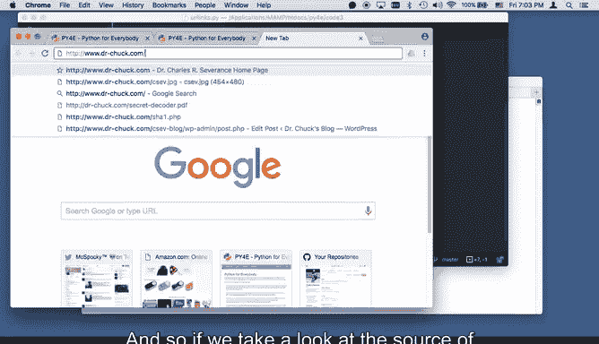
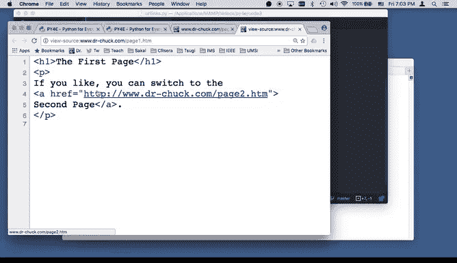
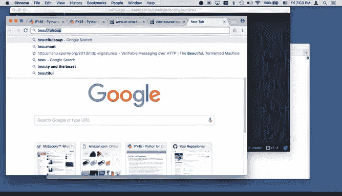
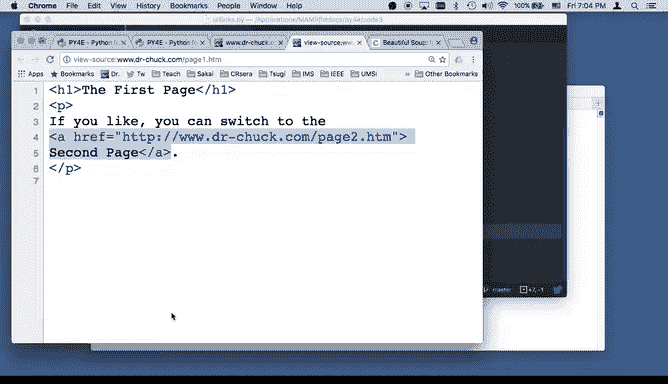
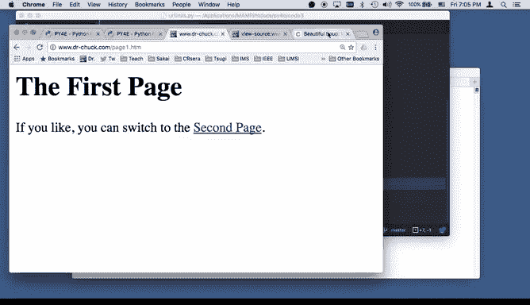
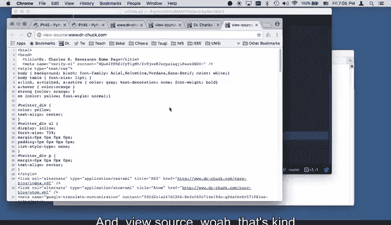
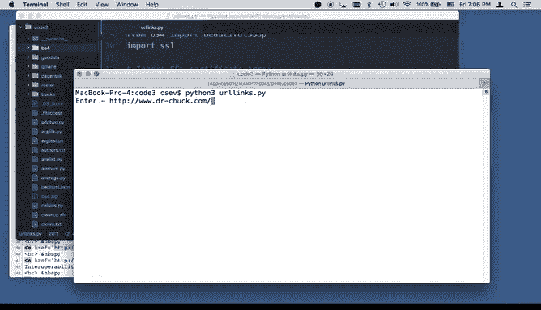
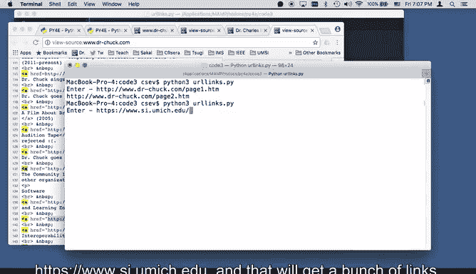

# 密歇根大学《给所有人的Python课》课程3：《使用Python访问Web数据》｜python-network-data｜ - P23：23_04_05_实战示例_BeautifulSoup.zh_en - GPT中英字幕课程资源 - BV1Hu4y1e7WS

Hello everybody， welcome to Python for everybody。 We're gonna to do a little bit of sample code If you're interested in getting the sample code。

 you can download this zip here at pythonforeverbody。com materialsials。

phP and you will download and you will get all the files and all the files that I'm looking at here and so the one I'm going to play with today is the file called URL links。

 py So the first thing you got to do before URL links。

 py works is you have got to install beautiful soup and I've got some simple instructions at the beginning of the file and so one way to do it is install it using Pythoninstall process to install this beautiful soup for all Python applications and if you are the owner of your computer and you're going to use beautiful soup a lot it's a fine idea to do that。

I want to show you a simpler way that if you don't own your own computer and you just want to make it so that beautiful soup works。

 you can download this file。This file right here。Beautiful soup。

4 dot zipip unzip it and put it in the same folder as here。 And so if you look in this folder。

 I have a subfolder called B S 4。 And that's the unzipped version of this。 And it has these things。

 I didn't write this code。 So I'm sorry if the name is bad。 but this is the code to B S4。

 And this is what's in B S 4 dot zip and it's in the same folder as。Ul links。

pyy and so what happens is when you do this from BS4 important beautiful soup that either can go to sort of this global magic place that Python install stuff and pulls in the beautiful soup object or it can go to the folder BS4 and pull it in okay and so that's how that works。

 so you have to do one of these two things， I prefer to keep it simple。

 download an unzipist file and put it in the same folder as as this code and away you go。

So from the previous example we're going to use ULlib of course。

 and then we're going to pull in the beautiful soup from the beautiful soup for our library。

 we're going to get the beautiful soup object now if you do this with SSL if these websites we're going to play with have SSL。

 you pretty much have to do this little hack and these three lines don't worry too much about it。

 the whole idea you can do Google on stack overflow and figure this out。

 but this is the way that you ignore errors when you have SSL certificate errors。

And so we have to add this parameter context equals CTX， which is this variable that we create。

 so this part and this part sort of just do them， if you don't， you can take them out actually。

 but otherwise you won't be able to do HTPS sites， so let's take a look at what we're doing other than height dealing with the HTTPS problem。

嗯。Going to ask the user for URL we are going to retrieve all the HTML we're going to do a URL open just like we did before now this would return us something we could loop through line by line with a for loop。

 but instead we're going to hey read the whole thing and that basically returns us the entire。

Document at that web page in a single big string with new lines at the end of each line。

 And this is not an Uniicode， but it's probably UTF 8 string。

 But it turns out beautifulut soup knows how to deal with UTF 8 and it also knows how to deal with Uniicode strings。

 So what we're saying is beautiful soup。 read through and deal with all the nasty bits， right。

 So H is like very， very flexible。 So。Drctor Chuck。t com slash page 1。

HtM。And so if we take a look at the source of this， view page source。Make this bigger， you know。

 you might be able to do regular expressions， but it does things like break stuff across lines。

 there could be a line break here， there could be all kinds of things right and so writing you know regular expressions or splits or whatever is really hard for HTML。

And so what we do is someone has written this， it's to called beautiful suit。

And it's basically。This is the code and it's based on a joke from a children's story。

It basically someone has just went through and figured all the bad things that could possibly happen when you're reading and parsing HTML。

 so either you use it or you will slowly but surely derive all the things that it doesn't work。

And so when we look at this line right here， this line at a high level as saying we are giving you ugly nasty Hm that could make no sense whatsoever。

 Please read it and have all the brains that you have。 and all the weird stuff。

 figure that out for us and give us back an object， I happen to call it soup。

 you don't have to call it soup。 an object， and that is a proxy for that Hm。

 but this soup object is clean。 And so what we can do is we can sort of retrieve all the anchor tags。

 So we can talk to this object and say， ask it， give me the anchor tags。 What's an anchor tag。 Well。

 if we take a look at this source。 The anchor tag is the a through the slash a， that is the tag。

 It is the tag。 It is attributes that are on the tag。 It is the text within the tag and everything。

 And so that's what we're going to get。 Now， I call it tags plural。

 not because plural matters at all。 But because we're going to get a list of tags。

 because even though this web page has lots and lots of tags。 if we look at， say Doctor。

。com。

And view source well， that's kind of small。You paid source。

Right。And we go look for eight anchor tags， we got 45 of them and they all kind of have weird stuff in them right so this line will give us back a list of tags it will give us all the tags in this document so it goes the tag goes from there to there。

And then what we're going to do is gonna write a loop to loop through all the tags。

 So that's basically hopping like it's hopping through the document， sort of like this。

 That's what it's doing。 hop， hop， hop， hop， hop， hop And it's pulling out the text of the Hre attribute。

 So it's going to talk pull out this bit right here。 whoops oh darn。

 that was so cool because that's a flaw。 Look at that。 This is my own page。

 There is no closing quote here。 But it's going work because HTML soup is like， oh。

 I know what to do about that。 I can deal with that。

 So let's check to see if that one works because that's like a mistake But that's one of the things we like about beautiful soup。

😊，So we're going to read through and then we're going to pull out all the Are。

This is probably thousands of lines of code that you really don't want to run， so Python 3 URLlinks。

pyy。And so let's start with a simple one， HttP con/lash/lash。WwwDchuck。com。

And it reads it， oh， that's the no， that's。That's actually the card one because we got a whole bunch of。

 let's see if see the Suge one worked， it found that one。It's right after Sakaiproject。org。

 where is that， is there another Suge？Oh no， I didn't find that when that's kind of funky look it found it wrong。

 but that's okay。 So you see， it found all these and did a lot of nice stuff for us if we do it。

Python 3。UR R length。Dot PY and do the easy one used to be con slash slash w w du。Do。 Daash。Chuck。

com page1。htm。We will only see one。And there we go now the the SSL is if you are looking at a page that has SSL Python。

UR links too， so I'll go to like HtTPS， colon。Dub， duub duub S I at you mish。E you。

And that will get a bunch of links， and so you'll see。If it wasn't for that。

 so all kinds of stuff coming back and if it wasn't for this bit right here and this bit right here。

 this HTPS wouldn't have worked and it's not that that website had a bad URL。

 it has a certificate that's not in Python's official list and so the URL is okay。

So that gives you a quick summary of using the beautiful soup library in Python along with the URL Lib。

