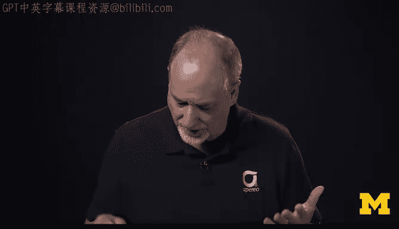
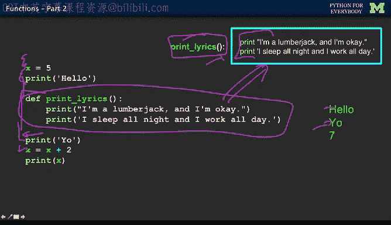
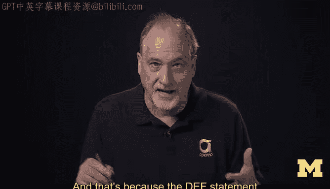
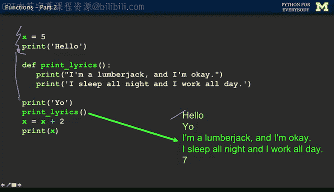
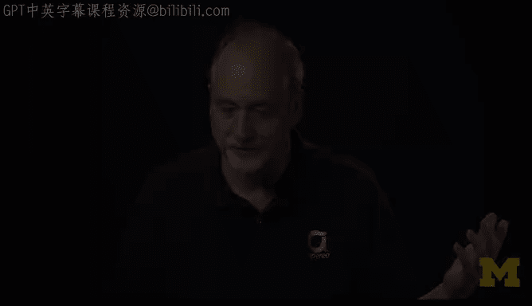

# 密歇根大学《给所有人的Python课》课程1：《编程入门指南（使用Python进行开发）》｜python｜ - P23：23_06_02_构建函数第一部分.zh_en - GPT中英字幕课程资源 - BV1214y117Mk

So now we're going to build some of our own functions。

 We sort of saw a little bit of that syntax at the very beginning。

 We're going to explore using the def keyword and some of the choices that we get to make。

 And so the essence of this。

I'll say this probably 20 times。The def statement only defines the function。

 There's a side effect to it， but it doesn't actually run the code。 It just remembers the code。

 And then later， we will call and invoke the function。

So here's an example of some dysfunctional code that's not going to work very well。

 And so we come in here we set x equals5 and you don't have to have the de at the beginning of the program。

 We do a print statement， So it comes hello， and then we do a def statement and that。

Cruises through here。 And the result is， as you have extended Python to have this thing called a print lyrics function and it's got 2 Bs of code in here。

 Now， this print does a d indent。 So that sort of blocks this off is that little bit inside the block is the function。

 That stuff's been copied up to there。 And now it continues on。 And it prints yo。

And it adds 2 to x and then prints x and out comes a 7， and now the program is done。

Where what happened to these lines of code， The answer is， they never executed。 They never executed。

 And that's because the def statement doesn't automatically run the code。 You must invoke。

We did not invoke the function。Not sure if that's a happy face or sad face。 It's a。It's a wrye face。

 it's a wondering what's going on face。So we didn't invoke it， right， We didn't invoke it。

 And so it did not work。 and we didn't we any output。 Now why we did this。

 I don't know why we did this。 question mark， question mark， Who knows why we did this， but。

What we really meant to do probably is something that more looks like the next bit。 You know。

 once you would define it， we got to call it。 And that's the reuse part。

 We had the store part working， but not the reuse part。 So here we go。

 This is a little more of of a functional bit of code。 said X to 5， print out hello。

Out that comes define it， this creates no output， but the D indent causes this block to be this to be part of that and that's sort of been stored store。

Now， we print out yo， and so out comes yo。 And then we call print lyrics。 And again。

 print is a function， has parentheses with parameters。 This has parentheses with no parameters。

 We didn't put any parameters in。 We'll get to that in a second。 Print lyrics。 now says， oh。

 run this code。 So out comes these two print statements。 Then we add two to X print it and outcome 7。

 So this is the store。 This is the reuse。This is the call。This is invoke。Okay。Okay。

So everything we've shown so far has no arguments， except this Max did have an argument that max is input。

 And then we will get something back。 The W。 and then the W gets stuck into big。

So arguments are input， so if we want to define arguments in our own functions that we're making。

We just put them in the parenthees。 Now， we， it's like a variable。 We're choosing a variable name。

 but this variable sort of doesn't exist。 This lang variable is best thought of as an alias。

It's a alias for whatever the first parameters is going to be when that particular function inification happens。

 Okay， so we're going to invoke this function three times。

 We're going to put in parentheses three different things。

 This is a way to have code that's almost the same。

 but a little bit different by pushing in different parameters than the code does something different。

And so this really is just a placeholder to say whatever the first parameter was。

 if that first parameter is E， then print this， if the first parameter is FR print that。

 otherwise print that。As our program runs， this accomplishes nothing， doesn't run any code。

 but it creates this thing called greet out there。 And we've indicated to Python。

 we expect a parameter。 We expect that when this is invoked or called， we want one parameter。

 So then called greet。And again， Python remembers to come back to here。

 and then it fires up to here and starts this line of code。 And E N Lng is an alias for E N。

So it's like Lang is not E， S。 Lng is not F R。 So this code runs out comes hello。

 and then we're done。 And it says， go back to where you remembered you were supposed to pick up next。

 which is here。Okay， so this says pick up next， then it goes on to the next statement。Here greet。

 so it's going to run this function again。Remember where to come back to， which is right here。

Jump up to here。And then make E， S this time be what Lng means。 And so now Lng is E， S。

 So this is true。 We run that code。 We come out and we're print it。 We print out Ola。

 and then we go back。To where we remembered before。Then we continue on， come to this code。Okay。

 so now we're in this code。 it's time to run greet again。 So we jump up to here。

 and then this time F R。Is。Laying。 And so it runs here。 That's false。 This is true。

 So it prints that out。 prints out boonsure。 Then it comes。 And it remembers， oh。

 forgot to remember where to come back to， continues on。Okay， so you see the whole pattern there。

 a lot of different pretty colors there。 But you get the idea that the it gets run a couple of times and Lng is the alias for whatever the first parameter happens to be。

 And that's the best way to think about it。 Whatever the first parameter is。

 I will use Lng within here。 I'll use Lng to refer to the first parameter。 You might name this thing。

Don't do this， but you could name it P1， P1， P1。So the parameter 1， No， Python wouldn't care。

 but it is really just the first parameter。 Lang itself is not really。

A variable in that there is no piece of memory that Lng belongs in。

 It really sort of is an alias of something else。

