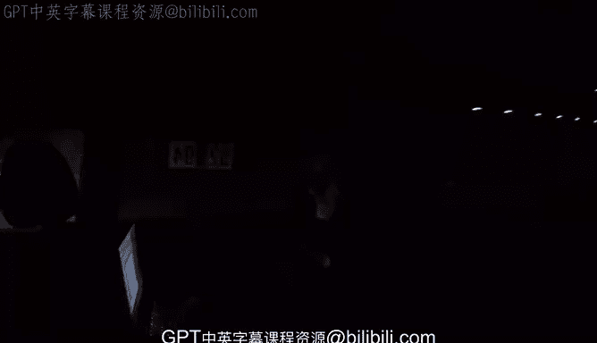

# 密歇根大学《给所有人的Python课》课程3：《使用Python访问Web数据》｜python-network-data｜ - P24：24_04_01_特别办公时间_蒙特利尔.zh_en - GPT中英字幕课程资源 - BV1Hu4y1e7WS

🎼，🎼Yeah。You can do a lot of things knowing programming with math and CS majors will tell you most of it is math and you have to take very hard math courses so to be a computer scientist you dont have to know math to be a technologist you don't but so you know in a lot of high school classes you could incorporate。

programming physics and I would agree with you， I don't really mean to say I have 1212 classes I'm going to require every single high school student to take just because they're in my field。

And so it's okay they might just take two or three。

And they still might have a chemistry class that's kind of took half the chemistry class away and added it gentle。

Let's do it。The big picture has to do with the fact that let's imagine what's it。Possible to teach a。

13 to 18 years，13 to 17 year student。teacheach them stuff they retain rather than filtering ones hi I'm Katya and yeah I took both classes they were great so thank you for teaching Hello my name is Car Hans。

 I'm a web architect and learning some more stuff cool。😊。

I am Seravvy and I'm doing PhD at Meel and I'm planning to go for the PC what natural sources a renewable sources。

 so that's why I'm likem prepared to learn because like I'll be using the softwares。

So I'll want random assessment tools， and I'll be using Python for that。Cool。

 I met one of the smartest people I ever met。Computer scientist from Mcguil， Ti。

 I'm Bni and I'm enjoying the python of course。Hei， I'm Jamatist。 I'm a visual effect artist。

 and thank you， Dr check for having me get a better artist in knowing Python。 Hi， I'm Mcwell。

 I have a recently incorporated tech company here in Montreal。 And Python。

 the lessons have been fantastic。 And I'll be taking it again in summer。 Thanks a bunch。😊，Yeah。

 I am an And。 I am very happy to learn Python from shock。 It's very interesting simple。 Thanks。 Hi。

 I'm Sergio。 I'm an aviation analyst at I care and I'm just wonder I'm I feel wonderful about Python。

 like it's completely open some some gates for me。 So thank you。😊，Hi。

 my name is Tim Mccherin and I am taking a Python for informformatics and thank you for check for this great experience。

Hi， my name is Olga， this is my first course with Cora and I really love。Happy， and I hope it。

Help me find a job Well congratulations you Hi I'm Steve。

 I'm taking both the history of internet and the Python course and I' am having a great time with both of them。

😊，Hi， I'm Nancy and thank you， Dr。 Chuck on behalf of the LA chapter of Women who Cove。

And I'm Flor I on tooar and I'm learning Python。The second， well。

 it's really the first language that I learn。Seriously and I'm really enjoying it and I'm really enjoying how you've set up the class it's really really helpful it's great to have you in the class thank you。

Hi， I'm Joanna and I'm taking the Pi of course， it's my first language and it's been great。Hi。

 I'm Ramona and I'm taking the Internet History course and I plan to take the Python course in summer。

😊，Hi， my name is Pierre， I've done the Python course and I want to proceed on with other cursor courses。

My name is Matt， I'm an an IT administrator， and I've been learning Python for a couple years now and it's really helped in everything I do so thanks Dr。

 Chuck， thank you。Hi， my name is Saib and I'm taking Python with Dr。Hi， I'm Dominda。

 I'm a student at my University， so I'm a beginner， so it was very interested in me today。

We had so many people at office hours that the management came and kicked us out of the lobby and forced us to have this room where we had to buy orurvs。

 so signing off from another successful office hours this time for Montreal， cheers。

