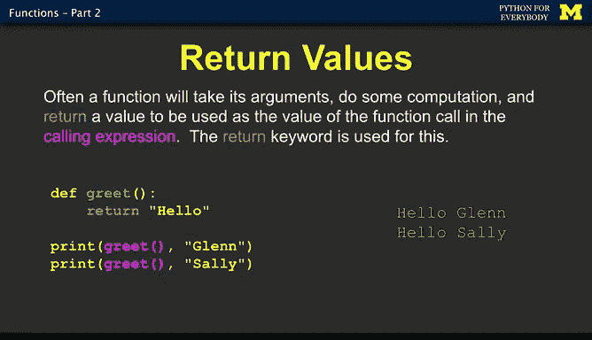
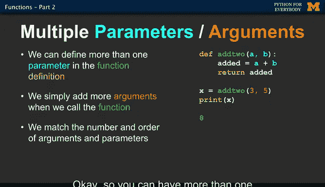

# 密歇根大学《给所有人的Python课》课程1：《编程入门指南（使用Python进行开发）》｜python｜ - P24：24_06_03_构建函数第二部分.zh_en - GPT中英字幕课程资源 - BV1214y117Mk

When we are looking at like the float statement or the input statement， we see things like。

You know， input。Prenhesesis， blah， blah， blah， Prehey equals x， right。

 And so we're going to assign something。 The question is。

 what is this residual value that comes back。And within the function， we。

 as the writer of the function， get to determine what that residual value is by the return statement。

So basically， even though this is really a trivial function。As no parameters。

 the return statement does two things， one， it stops the function。And it jumps to that next line。

 right， but two， it also determines the residual value。So by saying return。If we come in here。

And so we， we do this。 Then we're， we're in the middle of this print statement。

 So it sort of pauses here。 and then it runs this code。 And then the return says， oh。

 this little bit that was the function。 Send that back right there。

 So that means that this is really print Ho， Glen， which prints out Ho， Glen。

And then it goes on to the next line， it runs greed again。Runs greedy Gr， comes in here。

And so now hello becomes this residual value。 Now， it's not very clever， but you get the idea。

 this residual value， it like hello， Sally。 So it prints out hello， Sally。

So here's a little better example of this where we're using both arguments and a return value。

So again， this just remembers it， we're going to say greet and E。 So E is laying G is going to run。

And then runs this here now we've returned hello， so this hello。Becomes this。

 So hello is the residual value of the function evaluation， and so out comes hello Glen。

So now we do this greet E S。 So we're going to call this code and E S is going to come in as lang。

 And in this case， it's going to run this and return Ola。 So Ola is going to then。

Become this replaces and that says oa Sally。And so now we're going to do it again， G FR。

 Greek comes up here。Passing in FR is the language。Falls true， and then return。

 Re doesn't come out here。 Return is done。 That's it。 You're done at that point。

 And you also specified the residual value of this little bit。 And that's boju Michael。By the way。

 Glen， Sally and Michael are real people。 I always just use names of real people that are actual people I know。

Okay， so now we're going to do is going to take a look again at that max function。

 but we're going to understand how the return works。 This is really more about the return。

 So if we take a look at max。Right， this is so we're going evaluate the right hand side of this。

 So we have something to send into big。 So Max hello world says take this parameter and send it in to max。

 Here's the max function。 right， And so hello world comes into Max as some parameter。

 We don't know what it's named inside Max。 We really don't care。 But it's going to do something。

 You know， read some stuff。 check to see if it's a string or something。

 and then it's going to loop through a bunch of stuff and figure out what the largest thing is and figure this out and read through pick the W is the largest one。

 And then it's going to execute a return statement。 because it has to pass back。 the W to us， right。

 So to communicate out of the function back to the real world。 Here's our real world here。

 it says return W。 Now， it's probably a variable。 But But you get the idea It has to run a return statement。

 And that's the end of execution。 It doesn't continue。

 It doesn't even run a single statement after return。 But then it sends back to us。

To replace in this function， I mean， in this， in that original statement， the W then becomes。

The residual value。 And then the W is what goes into big。 Now， after a while， you won't need to。

 to look at all of this。Syntax， so in in such detail。

 I just want you to be able to know every single character in what they mean and slow this down into slow motion。

cause after a while， you'll just type this stuff and you won't to think about it。

 but you need to be able to slow it down to sort of slow motion if you need to。Okay。

 so you can have more than one parameter， as you might well expect。 You know。

 this says I want two parameters。 Again， the name of these things。 inside here hardly matters。

 Just that's the first parameter。 that's the second parameter。 in a call， we pass in 3 and 5。

 So that as easy。 The number and order of the parameters is the same in the function in invocation as it is in the function definition。

 And we just add these two numbers together， make it local variable and then return it。 So 8 becomes。

What comes back and gets stuck into X？So more than one parameter， more than one argument， no problem。

 the names of the parameters inside the functions。No big deal。So some functions do not return values。

 we call them nonfful functions， and if they return values， then we call them fruitful functions。

So in summary this was a pretty quick introduction to functions。

 like I said I don't really expect you to build a bunch of functions。

 but I want you to understand them and so when the time comes and you're thinking to yourself。

 oh wow， it's time to build a function， you'll know how to build them and you'll know how to use them。

