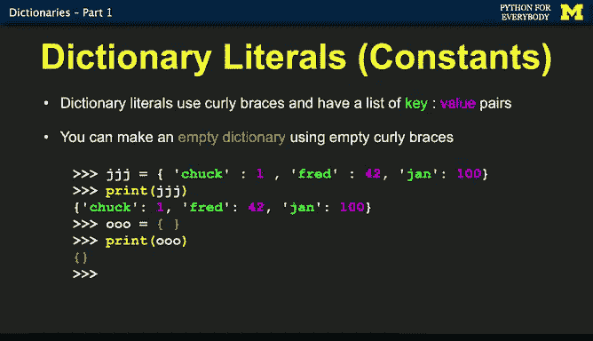

# 密歇根大学《给所有人的Python课》课程2：《Python数据结构课程（密歇根大学）》｜python-data｜ - P25：25_05_01_字典.zh_en - GPT中英字幕课程资源 - BV1yP411a7TZ

Welcome to Cha 9 Python dictionaries。 This is the payoff。 This is the payoff in data structures。

 So we have been doing various things we did lists。

 and this is kind of review what's a collection right。

 a collection is a variable that we can put more than one thing in。

 but then once we put more than one thing in a collection we have to wait to put it in and get it out。

 we have to have an index as it were like some kind of tag or marker that says what do we just put in there。

 we're putting five things in but how do I get number three back and in a list。

 you know they go in an order， It's pretty simple。And so again， to review what is not a collection。

 right， the variable X in this situation。 If you say x equals 2， it's going to have a two in it。

 And if you say x equals 4， it doesn't end up with both a two and a4 in it at the same time。

But in a collection， you could have the value2 and the value for， but you got to。

Put them somewhere inside the variable， and you have to have an indexing mechanism inside the variable。

So the sort of solid core collections of Python are a list which we've already talked about and a dictionary。

 so list is like a little card catalog that you could thumb through。

 there's the first one there's the second one and you know maybe there's 40 of them or whatever。

And we looked them up by position。Up to the length -1， because we start them at 0， as we。

 as we've talked about。So I think that is like an old library card catalog and maybe we've never seen a library。

 maybe never seen a card catalog， but it's just a bunch of cards that you flip through。

A dictionary allows more random access， not necessarily have to know where it's at or look for through all of them to find something。

 You can give it a tag。 You can say this is tagged with summer， and this is tagged with winner。

 Then you can go say， give me back the summer value in the winter。

 You could almost think of it as like the tags in a dictionary are like their own variable names。

 Their variable names within a variable name。And so this。

 we're going to talk about dictionaries in this chapter。

Dictionaries are Python's most powerful and probably most popular data collection。

 and people are drawn to languages like pearl or PhP。 I mean， I remember。Don't， don't learn Pearl。

 but I remember。Think looking at this language pearl， which I felt was a terrible。

 terrible programming language， but it had this thing called associative arrays in it。

 which were key value pairs， just like Python dictionaries。

 And people would tolerate what I thought was a terrible programming language because they could use this powerful data structure。

This key value data structure。And it's kind of like having a database。

For moderately sized data structures sitting there in Python right and like I said。

 it's Pearl and PhP have an associative array which are key value pairs。

 property bags or hash maps or maps in the Java programming language。

 property bag and C sharpharp and do net， and so this notion of a key value pair is really these days required in any reasonable programming language。

So dictionaries have changed over time in Python。 And actually。

 there's another course see programming for everybody where we look at this in much more detail。

 and what happened in Python over time was the internal structure of what dictionaries were and how the dictionary code is built inside Python。

 changed and evolved。 And so prior to Python 3。7， dictionaries did not keep entries in order of insertions。

 So you might see courses that talk a lot， including my version earlier versions of my course that said。

 oh， and dictionaries kind of randomize everything。

 And that's because they were called built with hash maps and hash maps as an underlying computer science data structure。

 don't worry about that。 But later in Python 37， which came out in 2018。

 the entries are in order of insertion。 But that doesn't mean they're sorted， right。

 just if you just put them in， if you put things in a list。They're an order that you put them in。

 if you put things in a dictionary， they're in the order you put them in。

 so you could almost think of a dictionary like a list with an extra quick look up by key。

 So you can think of it as like a list， but with random access。

 you don't have to go through all of them you if you know what the key is， you can look it up。

 And so you may see different things。 if you are seeing documentation or books from different versions of Python。

So Python。Lss， dictionaries and tuples just things that were designed with you in mind。

 they're designed to be easy to use。And if you really want to dig deeper， you can。

But how they were actually built is really。Beautifully intricate computer science learning that is a useful thing。

But for now， we're just going to use them and we're going to be thankful that Gino Van Rossam built them for us and you can insert a thing and you can take a thing out and you can throw it away and you don't have to worry about what's really going on。

But that itself is a really interesting study。That we cover in another course。

So let's take a look at lists。You create an empty list。You append a number to the list。

 You append another number to the list。And then you pin another numbered list， 12375。They go in。

 you got three of them。You can look them up by the number， card sub1 is three。

 which is the second one because they started zero， okay？

And you can replace it Car sub1 equals card sub1 plus 2。

 and that takes that value 3 and turns it to5。 So again， it's just there are three things in here。

 and we have to have an indexing mechanism。And that indexing mechanism is integer numbers that start from 0 to the length of the list minus-1。

So dictionaries doing the same basic kind of thing。

I think I'm kind of like a file cabinet as we create a dictionary。

But now instead of 012 and you literally could use 01 and  two is the keys， you could。

 they're not going to stay in order， though， I mean， there'll be order of insertion。

 but they're not you could go if you put 021， the order would be 021 because it's a key。

 not the position。If you want position use list cabinets。

 and so it's easier just to think of these as tags， which are strings in this case。

 cabinet subsummer equals 12， cabinet sub fall equals 3 and cabinet subspring equals 75。

So that says we put three values in。Using three keys， we， as the programmer。

 get to choose those keys。 They don't have to be strings。

 but strings is probably the easiest thing to think about。 So if we print it out。

 we don't just see the 12，3 and 75。 We see that 12 is stored under the key summer。

3 is stored on the key falls，75 is stored under the key string。

 and we can look them up by key cabinets of fall is 3。

We can put this on the left hand end and the right hand side of an assignment statement。

 cabinets of fall equals cabinets of fall plus 2。And now we change that value。 So， again。

 if you're using strings as keys， you can almost think of these as。Variables within a variable。

 So we have a collection， the dictionary， and in that collection。

 you have kind of a bunch of variables in it。You could kind of imagine that Python。

 when you start making variables， uses a similar kind of way to keep track of what's in each variable。

And it probably does。Okay， so again， comparing lists and dictionaries， they're very， very similar。

 The difference is， is that the indexing， how you look something up， like in the lists of 0。

 that's looking at the first element， and we can replace it。

 We can put them on the left hand side or the right hand side of an assignment statement。

 and the thing in the brackets is the only thing that changes。 lists put numbers in the brackets。

Dictionaries put anything but typical strings are very typical in the brackets。

 And so it's really how you store them and also the storing， right， because lists。

 you just like the list exist and you want to add one to the end。 The dictionary。

 you're kind of like。Just throwing them in， even though they do stay in order。

 the thing to think of them as key value pairs。And so if we look at this code。You know。

 we put two things in the list， append to 21 and append 183， and then we can replace it。

And then comparing that same line for line in the dictionary， we put in age of 21 and course of 182。

 print it， and you can see the key value pairs， and then you can replace one of the keys as 23 and print it out and it just changes。

 right， you've replaced it and it changes。In addition to constructing a dictionary and then adding things to it。

We can just have a constant。 We can have list content， the constants with square brackets。

 and we have。Curly braces to make dictionary constants in that constant。

 you just have key colon value， comma key colon value， comma key colon value。

 and you just fill it up。 you can make an empty dictionary by either calling the dictionary constructor。

 And like on the previous slide DicCT open pre and closed pre。

 or you can just make a constant curly brace。 Think of this as zero or 42 or quote Fred。

 that's a dictionary literal or a dictionary constant。

